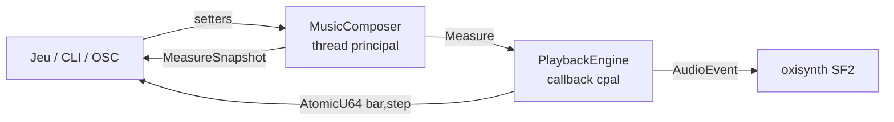

# Harmonium

Moteur Rust de musique procédurale tous styles — traditions, musiques de jeu,
genres fusionnés — piloté en temps réel par l'état d'un jeu. Premier client :
« 1837 » (roguelike Rust/Bevy) ; le beat est exposé au gameplay, quatre
émotions pilotent la musique.

Direction et principes : [`.specify/memory/constitution.md`](.specify/memory/constitution.md).
Phase en cours : [`specs/009-phase1-reel/plan.md`](specs/008-phase0-clock-playback/plan.md).

## Workspace

| Crate | Rôle |
|---|---|
| `harmonium_core` | Types purs et génération : grille de pas, `Measure`, `TimelineGenerator`, `Writehead`/`Playhead`, harmonie, `TuningParams`/`StyleProfile`, mapping émotion → paramètres. Aucune I/O. |
| `harmonium_audio` | Rendu SoundFont (oxisynth), enregistrement WAV / MIDI / MusicXML, garde d'allocation temps réel. |
| `harmonium_host` | `MusicComposer` (thread principal) + `PlaybackEngine` (callback cpal), transport lock-free, `NativeHandle`, `create_offline_engine`, binaire `harmonium` avec contrôle OSC. |
| `harmonium_cli` | REPL d'écoute et de test (`harmonium-cli`). |
| `harmonium_lab` | Ingestion de corpus MusicXML, métriques de distance, tuning assisté. |

## Démarrer

```bash
make soundfont           # télécharge la banque GM complète GeneralUser GS (~32 Mo)
make run                 # REPL, charge assets/GeneralUser-GS.sf2 par défaut (ou repli test.sf2)
make run ARGS="--soundfont path/to/bank.sf2"
make play ARGS="--osc"   # lecteur autonome, /harmonium/params (arousal valence density tension) sur UDP 8080
make test                # cargo test --workspace
make quality             # fmt + clippy + tests
```

## Architecture d'exécution



Le composer génère des mesures d'avance ; le callback audio les joue pas à
pas et publie la position sans verrou. Les paramètres structurels prennent
effet à la mesure suivante ; gains, mute, programmes GM et seek sont
immédiats.

## Intégration dans un jeu

`harmonium::audio::create_offline_engine(sf2, feet_sf2, sample_rate)` rend un
`MusicComposer` et un `PlaybackEngine` sans ouvrir de périphérique : le jeu
appelle `playback.process_buffer()` depuis son propre callback audio et
`composer.generate_ahead()` depuis sa boucle principale.

## Licence

Harmonium est distribué sous `MIT OR Apache-2.0`, au choix (`LICENSE-MIT`, `LICENSE-APACHE`).
L'option de compilation `odin` (synthé `odin2-core`, dérivé d'Odin 2) est sous GPLv3 : un binaire
compilé avec elle est GPL. Sans `odin`, le moteur rend en SoundFont et ne contient aucun code GPL.
