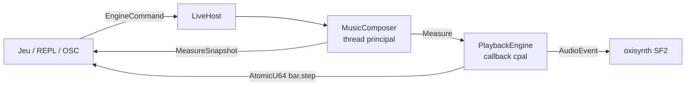

# Harmonium

Moteur Rust de musique procédurale tous styles — traditions, musiques de jeu,
genres fusionnés — piloté en temps réel par l'état d'un jeu. Premier client :
« 1837 » (roguelike Rust/Bevy) ; le beat est exposé au gameplay, quatre
émotions pilotent la musique.

Direction et principes : [`.specify/memory/constitution.md`](.specify/memory/constitution.md).
Phase en cours : [`specs/009-phase1-reel/plan.md`](specs/008-phase0-clock-playback/plan.md).

## Workspace

| Crate | Rôle |
|---|---|
| `harmonium_core` | Types purs et génération : grille de pas, `Measure`, `TimelineGenerator`, `Writehead`/`Playhead`, harmonie, `TuningParams`/`StyleProfile`, mapping émotion → paramètres. Aucune I/O. |
| `harmonium_audio` | Rendu SoundFont (oxisynth), enregistrement WAV / MIDI / MusicXML, garde d'allocation temps réel. |
| `harmonium_host` | `MusicComposer` (thread principal) + `PlaybackEngine` (callback cpal), transport lock-free, `LiveHost` (hôte vivant : exécuteur d'`EngineCommand`, `pump`), module OSC, `create_offline_engine`. |
| `harmonium_cli` | REPL d'écoute et de test (`harmonium-cli`), contrôle OSC par `--osc`. |
| `harmonium_studio` | Studio egui (natif et web) : jouer le moteur, le voir et le régler — émotions, piano-roll, mixeur, enregistrement. Toujours compilé avec `odin`, hors des membres par défaut. |
| `harmonium_lab` | Ingestion de corpus MusicXML, métriques de distance, tuning assisté. |
| `harmonium_determinism` | Harnais : les mêmes snapshots en natif et en `wasm32-unknown-unknown`, comparés octet par octet. |

## Démarrer

```bash
make soundfont           # télécharge la banque GM complète GeneralUser GS (~32 Mo)
make run                 # REPL, charge assets/GeneralUser-GS.sf2 par défaut (ou repli test.sf2)
make run ARGS="--soundfont path/to/bank.sf2"
make run ARGS="--osc"   # REPL + OSC : /harmonium/params (arousal valence density tension) sur UDP 127.0.0.1:8080
make test                # tests sans Odin (hors studio), puis le studio, puis le contrat Odin du host
make quality             # fmt + clippy + tests
make wasm/check          # le moteur compile pour wasm32-unknown-unknown, avec et sans Odin
make test/determinism    # snapshots natif = wasm (Node, CLI wasm-bindgen de la version de Cargo.lock)
```

## Studio : écouter et valider un son

Le studio est l'outil pour essayer le moteur à l'oreille et à l'œil : choisir un style, bouger les
émotions, voir les notes publiées et entendre le résultat à la mesure suivante.

```bash
make studio STUDIO_ODIN=assets/odin   # natif ; recompile, donc embarque les profils de profiles/ tels quels
make studio/web/serve STUDIO_ODIN=assets/odin   # web sur http://127.0.0.1:8787 (trunk requis)
```

- **Banques** : `assets/GeneralUser-GS.sf2` (`make soundfont`) et `assets/harmonium_trad.sf2` (pieds) ;
  `STUDIO_BANKS` change le dossier. **Presets Odin** : `STUDIO_ODIN` désigne un dossier de `*.odin` à plat
  (nom du preset = nom du fichier). Sans lui, les pistes Odin des profils (Isaac, `nt_desert`) jouent leur
  programme SoundFont, avec un avertissement au démarrage. `assets/odin/` est local et non versionné : des
  liens vers les presets d'usine d'Odin 2 (`Soundbanks/Factory Presets/`).
- **Écran Live** :
  - en haut : style, graine, lecture, enregistrement ;
  - à gauche : émotions (pavé valence × arousal, densité, tension), mode direct, pieds, tempo, swing,
    signature, « Reset engine » ;
  - au centre : forme, accords, piano-roll par piste ;
  - à droite : horloge, état (équivalent de `state` du REPL), mixeur (gain, mute, solo).
  - Un clic sur une mesure y saute ; glisser fait une boucle (16 mesures au plus).
  - Une piste écartée par la densité du profil (`density_tracks`) est grisée : « off: density < x ».
- **Valider un réglage de profil** : onglet **Workbench**, sans recompiler. « Fork » copie un profil distribué
  dans un brouillon ; chaque fichier TOML s'édite dans son onglet, une erreur s'affiche sur sa ligne ; « Apply »
  installe le profil, qui s'entend à la mesure suivante. Natif : « Profile folder » ouvre et enregistre un dossier
  (relu tel quel par `harmonium-cli --profile`). Web : téléverser un dossier ou un `.zip`, télécharger le dossier en
  `.zip` ; le brouillon reste dans le navigateur. Pour un profil distribué : modifier `profiles/<id>/`, relancer
  `make studio`. En natif, le repli « Engine » de l'écran Live charge aussi un dossier de profil hors du dépôt.
- **Garder une trace** : REC (WAV, MIDI, MusicXML) écrit dans `~/Music/Harmonium Studio/`, nommé par profil et
  graine ; la graine affichée rejoue la même musique.
- **Session d'agent** : le studio et le REPL sortent du son. Un agent ne les lance pas lui-même ; il donne la
  commande et ce qu'il faut écouter au propriétaire. Ses propres vérifications restent silencieuses : rendu hors
  ligne, par exemple
  `cargo run -p harmonium-cli --features odin -- --export --bars 8 --style isaac_basement -s assets/GeneralUser-GS.sf2 --odin-presets assets/odin --record-wav /tmp/essai.wav`,
  ou `LiveHost::detached` dans un test.

Détails (manifeste, cache web, parité avec le REPL) : [`harmonium_studio/README.md`](harmonium_studio/README.md).

## Architecture d'exécution



Le composer génère des mesures d'avance ; le callback audio les joue pas à
pas et publie la position sans verrou. Les paramètres structurels prennent
effet à la mesure suivante ; gains, mute, programmes GM et seek sont
immédiats.

## Intégration dans un jeu

`harmonium::audio::create_offline_engine(sf2, feet_sf2, sample_rate)` rend un
`MusicComposer` et un `PlaybackEngine` sans ouvrir de périphérique : le jeu
appelle `playback.process_buffer()` depuis son propre callback audio et
`composer.generate_ahead()` depuis sa boucle principale.

## Licence

Harmonium est distribué sous `MIT OR Apache-2.0`, au choix (`LICENSE-MIT`, `LICENSE-APACHE`).
L'option de compilation `odin` (synthé `odin2-core`, dérivé d'Odin 2) est sous GPLv3 : un binaire
compilé avec elle est GPL. Sans `odin`, le moteur rend en SoundFont et ne contient aucun code GPL.
