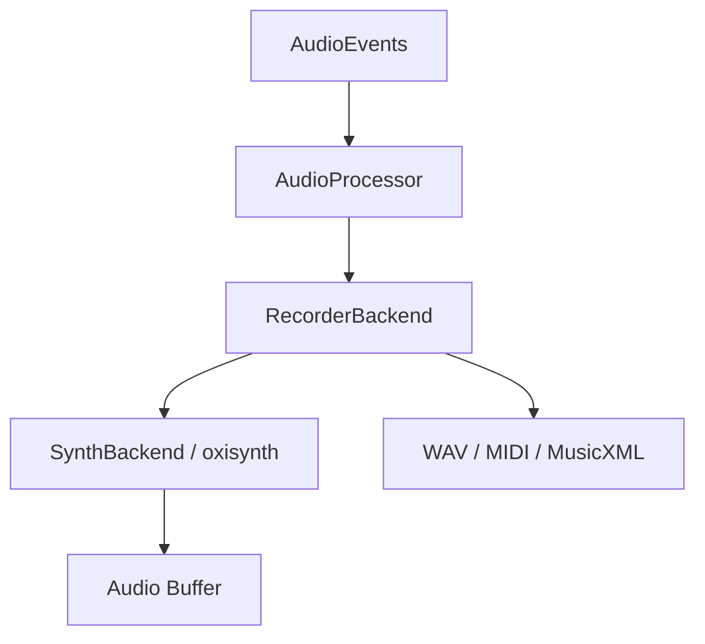

# Harmonium Audio

`harmonium_audio` renders the abstract `AudioEvent`s produced by `harmonium_core` into sound. Synthesis is SoundFont-only, through [oxisynth](https://crates.io/crates/oxisynth).

## Architecture

Everything implements the **`AudioRenderer`** trait (`handle_event` / `process_buffer`). **`AudioProcessor`** wraps a renderer and exposes event + buffer processing.



## Modules

### `backend`

* **`SynthBackend`** — the synthesizer. `SynthBackend::new(sample_rate, sf2_bytes, &initial_routing)`; `sf2_bytes = None` renders silence until a `LoadFont` event arrives. Handles `LoadFont`, `SetChannelRoute` (bank per logical channel), `ProgramChange`, `SetMixerGains` (CC 7), `AllNotesOff`, `ControlChange` (CC 1 drives filter/resonance/pitch-bend tension on channels 0–4).
* **`RecorderBackend`** — wraps a renderer and captures WAV, MIDI and MusicXML on `StartRecording` / `StopRecording`.
* **`MidiBackend`** / **`WavBackend`** — standalone file exporters.

### `voice_manager`

`VoiceManager` owns the `oxisynth::Synth`, the logical→MIDI channel map (GM drums on MIDI 9 when a GM-sized SoundFont is loaded) and the per-channel bank routing (`ChannelRoute`; a negative bank id means bank 0).

### `voicing`

Jazz voicing algorithms: `BlockChordVoicer` (locked-hands block chords), `ShellVoicer` (root/3rd/7th shells), drop-2 spreading, comping patterns.

### `realtime`

`RTCheckAllocator`: debug-build allocation tracker that panics on allocations inside the audio callback.

## Dependencies

* **`oxisynth`** — SoundFont 2/3 synthesizer.
* **`hound`** — WAV encoding.
* **`midly`** — MIDI encoding.
* **`rand`** — pitch-instability wobble.

## Usage

```rust
use harmonium_audio::{AudioProcessor, backend::synth_backend::SynthBackend};

let sf2 = std::fs::read("assets/test.sf2").ok();
let backend = Box::new(SynthBackend::new(44100.0, sf2.as_deref(), &[0, 0, 0, 0]));
let mut processor = AudioProcessor::new(backend);

// In the audio callback:
let output_buffer = &mut [0.0f32; 512]; // interleaved stereo
processor.process_events(&events);
processor.process_audio(output_buffer, 2);
```
