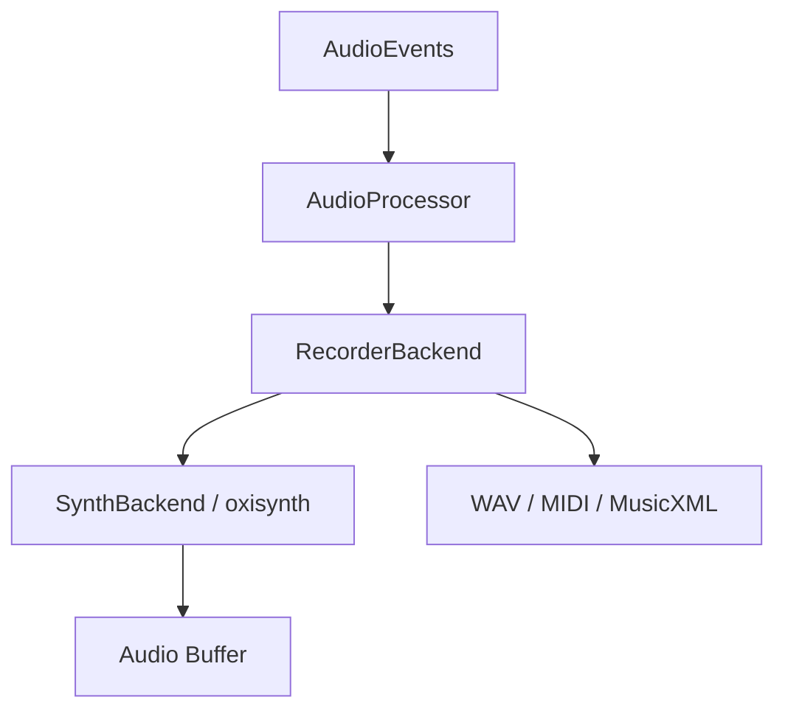

# Harmonium Audio

`harmonium_audio` renders the abstract `AudioEvent`s produced by `harmonium_core` into sound. Synthesis is SoundFont-only, through [oxisynth](https://crates.io/crates/oxisynth).

## Architecture

Les voies générées implémentent **`AudioRenderer`** (`handle_event` / `process_buffer`). **`AudioProcessor`** enveloppe un renderer ; la voie jouée indépendante utilise directement `PlayedNotes::handle_event` et `render_add`.



## Modules

### `backend`

* **`SynthBackend`** — `SynthBackend::new(sample_rate, sf2_bytes, feet_sf2_bytes, &initial_routing)` ; synthèse oxisynth puis deux biquads stéréo et gain de bus. `SetMix` installe la salle, les CC 7/10/91 et les coefficients préparés par le compositeur au taux de l'hôte. État et DSP à taille fixe : aucune allocation ni aucun verrou ajoutés au callback. `SetChannelRoute`, `ProgramChange`, `AllNotesOff` et les CC MIDI ordinaires restent pris en charge.
* **`RecorderBackend`** — capture WAV (après EQ et master) et MIDI, **sans allocation, verrou ni E/S dans le callback**. Le callback copie des blocs PCM préalloués (recyclés) et des événements MIDI `Copy` horodatés en frames dans une file SPSC `rtrb` bornée ; un travailleur d'enregistrement (`RecorderWorker`) encode WAV (`hound`) et MIDI (`midly`), gère la croissance mémoire et publie les fichiers dans `finished_recordings`. Natif, un thread le fait tourner, créé dans `RecorderBackend::new` ; sans thread (wasm, où `std::thread::spawn` n'existe pas), `RecorderBackend::pumped` rend le travailleur et l'hôte l'avance par `RecorderWorker::pump()` : même encodeur, mêmes octets. Le MIDI initialise CC 7/10/91 pour toutes les pistes logiques (`TrackId::ALL`) et les réémet à chaque `SetMix`. MusicXML est exporté par le compositeur depuis les mesures.
  * **Débordement explicite** : `OverflowPolicy::DropAndCount` (défaut, temps réel) refuse ce qui ne tient pas et le compte dans `RecorderBackend::stats()` (`dropped_pcm_samples`, `dropped_midi_events`, `lost_commands`) ; le WAV garde sa durée (silence à la place des blocs perdus), un `Stop` entre toujours. `OverflowPolicy::Block` (`RecorderBackend::with_policy`, rendu hors ligne) attend le thread : rien n'est perdu et la fin d'une prise rend la main une fois le fichier publié. `RecorderBackend::pumped` est toujours en `DropAndCount` : sans thread, rien ne pourrait attendre ; la perte, comptée, ne vient que d'un `pump` trop espacé (la réserve couvre ≈ 3 s de stéréo à 44,1 kHz).
  * **MIDI exact** : `PlaybackEngine` annonce la cadence audible (`AudioEvent::MidiClock`, ticks par frame) à chaque pulse ; le thread convertit les frames en ticks **cumulés** et n'arrondit que la position absolue (swing et rampes de tempo compris) : résidu ≤ 0,5 tick par rapport aux positions écrites, sans dérive.
  * `AudioEvent::UpdateMusicalParams` porte un `PlaybackParams` (`Copy`, préparé sur le thread principal), jamais un `Box<MusicalParams>`.

### `voice_manager`

`VoiceManager` owns the `oxisynth::Synth`, the logical→MIDI channel map (GM drums on MIDI 9 when a GM-sized SoundFont is loaded) and the per-channel bank routing (`ChannelRoute`; a negative bank id means bank 0).

Le compositeur prépare `ProfileMix::prepare(sample_rate)` hors callback ; le
`PlaybackEngine` conserve un seul `TrackState` par canal logique (CC, mute).
Les changements d'air restaurent les niveaux du profil ; les mutes restent
actifs, notamment pour `--solo-track`. `set gain` reçoit une amplitude linéaire
et la convertit selon l'atténuation SF2, sans modifier pan/envoi.
La synthèse sans section `[mix]` est sèche, centrée, CC 7 = 127, bus unité, EQ
neutre ; voir [le schéma et ses bornes](../profiles/README.md#mixage).

Avec la banque de pieds, Heel/Toe utilisent les canaux 3/4 indépendants.
En repli GM, les deux partagent le canal 9 : **les CC de Toe gagnent** (ordre
canonique `TrackId::ALL`), dans le synthé et le MIDI.
Les profils distribués ont les mêmes niveau/envoi aux deux pieds ; leur pan
distinct devient celui de Toe en GM. `mute` filtre les NoteOn logiques, sans
mettre CC 7 à zéro sur le canal partagé. Le MIDI reste GM (pieds sur 9), même
si le WAV emploie la banque dédiée : choisir la banque dans le lecteur externe.
Les CC transportent niveau relatif, placement et envoi ; la salle, l'EQ et le
gain de bus ne sont pas portables en MIDI standard et se règlent sur le lecteur.

L'export pur `timeline_to_midi(timeline, &profile)` / `write_midi` reçoit
le profil complet : mêmes CC et programmes avant les notes de chaque piste.
Il retourne les erreurs d'encodage à l'appelant.

### Isolation de la banque de pieds et du piano GM

`SynthBackend::new` prépare la banque de pieds **avant** le démarrage audio :
seuls les numéros de banques des en-têtes de presets SF2 (`pdta/phdr`) sont
translatés de `FEET_BANK_OFFSET`. Samples, programmes et routage restent
inchangés ; la banque préparée est chargée sans offset oxisynth. Les en-têtes
tronqués et le dépassement de banque sont rejetés, sans saturation.

Cause : oxisynth 0.1.0 soustrait ses offsets avec `saturating_sub` pendant la
recherche des presets. La banque de pieds chargée en dernier, native 0 /
programme 0 avec offset 1, répondait donc aussi à **banque 0 / programme 0** :
le piano GM devenait un preset de pieds, souvent silencieux hors de leur
tessiture. Des banques natives distinctes évitent ce masquage sans changer
le callback, les événements ou les routes Heel/Toe (banque 1, canaux 3/4).
Cette préparation concerne la banque dédiée du constructeur ; les banques ne
se chargent qu'à la construction (plus d'événement `LoadFont`).

La préparation inclut l'en-tête terminal : la banque fournie le laisse sans
nom `EOP`, et `soundfont` 0.1.0 l'importe aussi comme un preset vide. Le laisser
en banque native 0 recréerait donc un piano silencieux malgré la translation
du preset de pieds.

Le contrat `gm_piano_is_not_masked_by_the_feet_font` charge deux vraies SF2
de test, distingue leurs presets et vérifie que le PCM du programme 0 /
banque 0 est identique à celui de la banque GM seule, tandis que Heel/Toe
conservent le preset dédié en banque 1.

### `played_notes`

`PlayedNotes::new(sf2_bytes, sample_rate)` charge un synthé SoundFont distinct,
hors callback : les notes jouées ne partagent ni voix, ni programmes, ni
contrôleurs avec les pistes générées. Les seize canaux MIDI, **y compris 9**,
sont mélodiques ; le programme global démarre à 0 et `SetProgram` le change
pour les notes suivantes. La voie reste SoundFont même avec l'option `odin`.

`PlayedNoteEvent` est `Copy` : `NoteOn`, `NoteOff`, `AllNotesOff` et
`SetProgram`. Les données MIDI hors plage sont ignorées sans panique ;
`NoteOn` de vélocité 0 libère la note. `NoteOff` respecte le relâchement de la
banque. `AllNotesOff` coupe immédiatement les voix puis purge le bloc interne
précalculé de 64 frames ; seule l'horloge privée du synthé silencieux avance.
Réverbération et chorus sont désactivés pour éviter toute queue d'effet.

`render_add(output, channels)` ajoute le signal sans effacer la sortie, via un
scratch fixe de 64 frames stéréo, quelle que soit la taille du callback. En
mono, les côtés sont moyennés ; en multicanal, seuls les deux premiers canaux
reçoivent le signal. Une frame incomplète reste intacte. Sans banque valide,
la voie est silencieuse. Le rendu conserve la latence interne oxisynth d'au
plus 63 frames entre un événement et le prochain bloc synthétisé.

La polyphonie est bornée à 256 voix SoundFont (une note peut utiliser plusieurs
zones). Le stockage est réservé au constructeur ; à saturation, le vol de
voix existant d'oxisynth s'applique sans croissance mémoire.

### `realtime`

`RTCheckAllocator`: debug-build allocation tracker that panics on allocations and deallocations inside the audio callback. Contexts nest (`enter_audio_context` / `exit_audio_context` form a depth counter); `PlaybackEngine::process_buffer` holds one for the whole call.

La garde n'a aucune exemption d'allocation. La copie locale d'oxisynth remplace
le `Vec` temporaire de chaque `NoteOn` par `[None; 64]` et réserve le stockage
des voix avant le callback, y compris lors d'une augmentation explicite de la
limite de polyphonie hors callback. Le premier `NoteOn`, le rendu et le vol de
voix à saturation restent soumis au même allocateur que le reste du moteur.
Voir [la provenance, la licence LGPL-2.1 et le détail du patch](../vendor/oxisynth/README.md).

## Dependencies

* **`oxisynth`** — SoundFont 2/3 synthesizer.
* **`hound`** — WAV encoding (recorder worker only).
* **`midly`** — MIDI encoding (recorder worker only).
* **`rtrb`** — SPSC queues between the callback and the recorder thread.
* **`arrayvec`** — stack-allocated programme lists.

## Usage

```rust
use harmonium_audio::{AudioProcessor, backend::synth_backend::SynthBackend};

let sf2 = std::fs::read("assets/test.sf2").ok();
let backend = Box::new(SynthBackend::new(44100.0, sf2.as_deref(), None, &[0, 0, 0, 0]));
let mut processor = AudioProcessor::new(backend);

// In the audio callback:
let output_buffer = &mut [0.0f32; 512]; // interleaved stereo
processor.process_events(&events);
processor.process_audio(output_buffer, 2);
```
