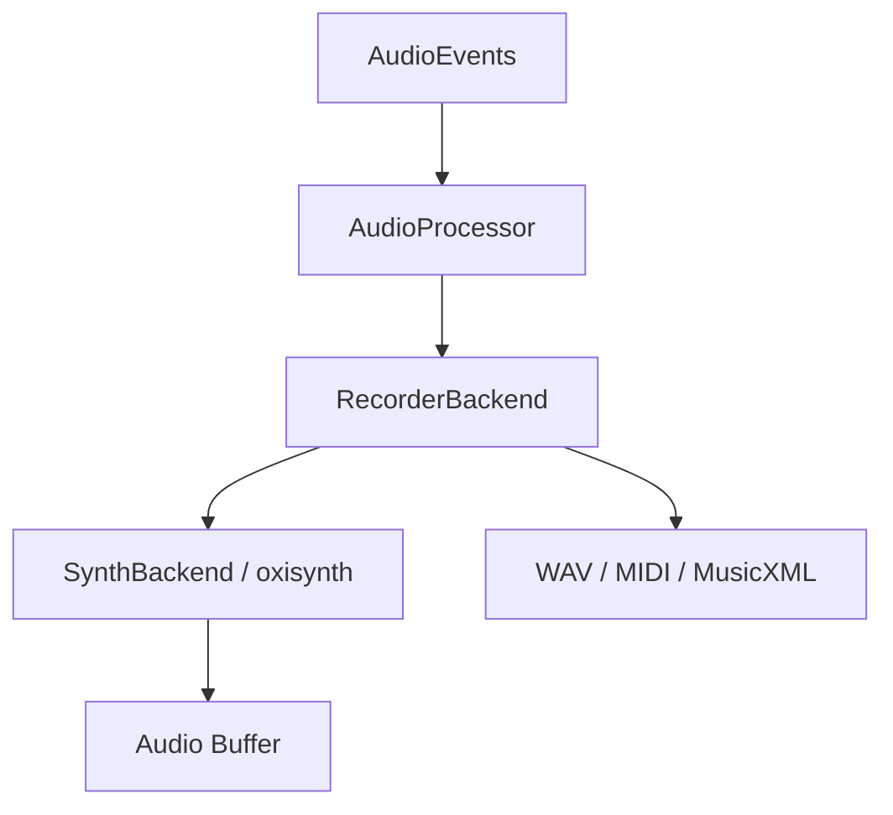

# Harmonium Audio

`harmonium_audio` renders the abstract `AudioEvent`s produced by `harmonium_core` into sound. Synthesis is SoundFont-only, through [oxisynth](https://crates.io/crates/oxisynth).

## Architecture

Everything implements the **`AudioRenderer`** trait (`handle_event` / `process_buffer`). **`AudioProcessor`** wraps a renderer and exposes event + buffer processing.



## Modules

### `backend`

* **`SynthBackend`** — `SynthBackend::new(sample_rate, sf2_bytes, feet_sf2_bytes, &initial_routing)` ; synthèse oxisynth puis deux biquads stéréo et gain de bus. `SetMix` installe la salle, les CC 7/10/91 et les coefficients préparés par le compositeur au taux de l'hôte. État et DSP à taille fixe : aucune allocation ni aucun verrou ajoutés au callback. `LoadFont`, `SetChannelRoute`, `ProgramChange`, `AllNotesOff` et les CC MIDI ordinaires restent pris en charge.
* **`RecorderBackend`** — capture WAV (après EQ et master) et MIDI. Le MIDI initialise CC 7/10/91 pour les cinq pistes logiques et les réémet à chaque `SetMix`, dont les changements de profil/air et `set gain`. MusicXML est exporté par le compositeur depuis les mesures.

### `voice_manager`

`VoiceManager` owns the `oxisynth::Synth`, the logical→MIDI channel map (GM drums on MIDI 9 when a GM-sized SoundFont is loaded) and the per-channel bank routing (`ChannelRoute`; a negative bank id means bank 0).

Le compositeur prépare `ProfileMix::prepare(sample_rate)` hors callback ; le
`PlaybackEngine` conserve un seul `TrackState` par canal logique (CC, mute).
Les changements d'air restaurent les niveaux du profil ; les mutes restent
actifs, notamment pour `--solo-track`. `set gain` reçoit une amplitude linéaire
et la convertit selon l'atténuation SF2, sans modifier pan/envoi.
La synthèse sans section `[mix]` est sèche, centrée, CC 7 = 127, bus unité, EQ
neutre ; voir [le schéma et ses bornes](../profiles/README.md#mixage).

Avec la banque de pieds, Heel/Toe utilisent les canaux 3/4 indépendants.
En repli GM, les deux partagent le canal 9 : **les CC de Toe gagnent** (ordre
canonique Melody, Chords, Bass, Heel, Toe), dans le synthé et le MIDI.
Les profils distribués ont les mêmes niveau/envoi aux deux pieds ; leur pan
distinct devient celui de Toe en GM. `mute` filtre les NoteOn logiques, sans
mettre CC 7 à zéro sur le canal partagé. Le MIDI reste GM (pieds sur 9), même
si le WAV emploie la banque dédiée : choisir la banque dans le lecteur externe.
Les CC transportent niveau relatif, placement et envoi ; la salle, l'EQ et le
gain de bus ne sont pas portables en MIDI standard et se règlent sur le lecteur.

L'export pur `timeline_to_midi(timeline, &profile.mix)` / `write_midi` reçoit
explicitement le même mix et écrit ces CC avant les notes de chaque piste.
Il retourne les erreurs d'encodage à l'appelant.

### `realtime`

`RTCheckAllocator`: debug-build allocation tracker that panics on allocations inside the audio callback.

## Dependencies

* **`oxisynth`** — SoundFont 2/3 synthesizer.
* **`hound`** — WAV encoding.
* **`midly`** — MIDI encoding.

## Usage

```rust
use harmonium_audio::{AudioProcessor, backend::synth_backend::SynthBackend};

let sf2 = std::fs::read("assets/test.sf2").ok();
let backend = Box::new(SynthBackend::new(44100.0, sf2.as_deref(), None, &[0, 0, 0, 0]));
let mut processor = AudioProcessor::new(backend);

// In the audio callback:
let output_buffer = &mut [0.0f32; 512]; // interleaved stereo
processor.process_events(&events);
processor.process_audio(output_buffer, 2);
```
