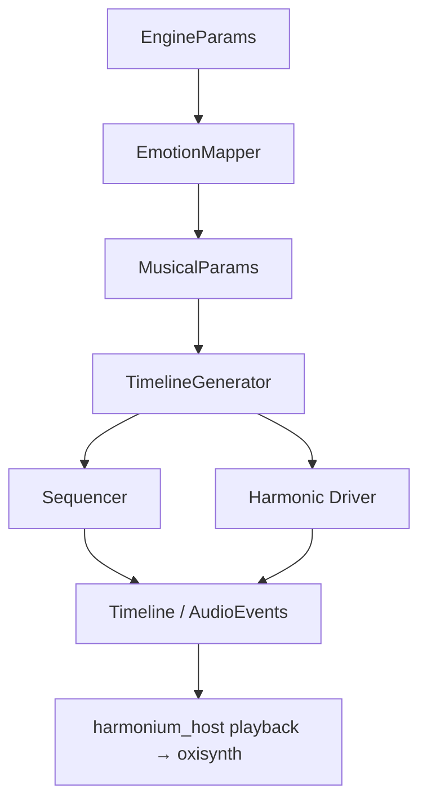

# Harmonium Core

`harmonium_core` is the brain of the Harmonium project. It contains the platform-agnostic logic for music generation, harmonic analysis, rhythmic sequencing, emotion→parameter mapping, and event scheduling. It has no audio dependencies; `harmonium_host` drives it and renders its events.

## Architecture

The core revolves around the **`TimelineGenerator`** (`src/timeline`), which composes bars ahead of time into a shared timeline. The **Sequencer** (Rhythm) and the **Harmonic Driver** (Pitch/Harmony) feed it, and the **`EmotionMapper`** (`src/mapper.rs`) translates `EngineParams` (arousal/valence/density/tension) into the technical `MusicalParams` it consumes.



## Key Modules

### 1. Harmony (`src/harmony`)
This is the most advanced module, implementing multiple sophisticated music theory concepts to generate meaningful chord progressions and melodies.

*   **Strategies**:
    *   **Basic**: Uses the Russell Circumplex model to map emotions (Valence/Arousal) to harmonic quadrants.
    *   **Neo-Riemannian**: Implements geometric chord transformations (Parallel, Leading-tone, Relative) for smooth, cinematic transitions.
    *   **Steedman Grammar**: A generative grammar approach to functional harmony (jazz/pop progressions).
    *   **Lydian Chromatic Concept**: Based on George Russell's theory, organizing tonal gravity levels.
    *   **Parsimonious Voice Leading**: Ensures smooth movement between chords by minimizing semitone distances.

*   **Context**: The `HarmonyContext` struct tracks the state:
    *   `current_chord`: The active chord.
    *   `tension` (0.0 - 1.0): Controls dissonance and complexity.
    *   `valence` (-1.0 - 1.0): Controls mood (Major/Minor bias).

### 2. Sequencer (`src/sequencer.rs`)
Handles the generation of rhythmic patterns using various algorithms.

*   **Rhythm Modes**:
    *   **Euclidean**: Uses Bjorklund's algorithm to distribute pulses evenly (classic "world music" rhythms).
    *   **Perfect Balance**: Inspired by XronoMorph, it superimposes regular polygons (Triangle, Square, etc.) to create "well-formed" rhythms.
    *   **Classic Groove**: Generates realistic drum patterns (Four-on-the-floor, Breakbeat) with ghost notes and syncopation based on tension.

*   **StepTrigger**: Each step generates a trigger containing boolean flags for instruments (`kick`, `snare`, `hat`, `bass`, `lead`) and velocity.

### 3. Fractal (`src/fractal.rs`)
Implements **Pink Noise (1/f noise)** using the Voss-McCartney algorithm.
*   Used to add "humanization" and natural variation to velocity, timing, and melodic contours, preventing the output from sounding too robotic.

### 4. Events (`src/events.rs`)
Defines the protocol for musical actions. The core outputs these events, which are then consumed by the audio backend (`harmonium_audio`).

*   `NoteOn` / `NoteOff`: Standard MIDI-like note events.
*   `ControlChange`: Parameter automation.
*   `SetChannelRoute`: Routes a logical channel to a SoundFont bank (`-1` = default bank 0).
*   `StartRecording` / `StopRecording`: Controls audio/MIDI export.

## Usage

The crate is normally driven through `harmonium_host` (`Composer` writes bars with a `Writehead`, `PlaybackEngine` reads them with a `Playhead`). Standalone, the mapper and generator can be used directly:

```rust
use harmonium_core::{EmotionMapper, EngineParams};

let mapper = EmotionMapper::default();
let emotions = EngineParams { arousal: 0.8, valence: 0.5, ..Default::default() };
let params = mapper.map(&emotions);
println!("BPM: {}", params.bpm);
```

See `harmonium_host/src/composer.rs` for the full generation loop.

## Dependencies

*   **`midly`**: For MIDI message handling.
*   **`rust-music-theory`**: Primitives for intervals, scales, and chords.
*   **`rand`**: For stochastic generation processes.
*   **`serde`**: For state serialization.
