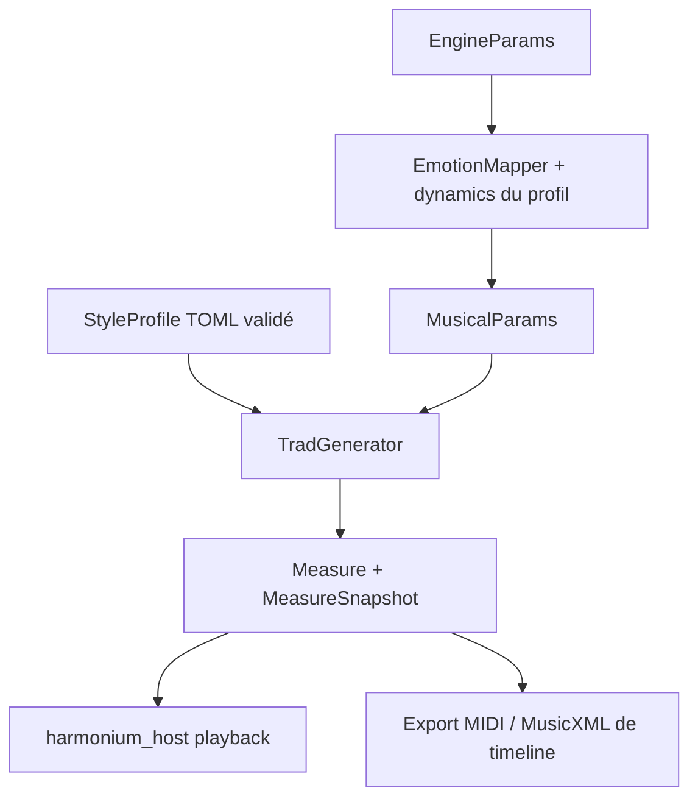

# Harmonium Core

`harmonium_core` contient la génération pure et déterministe, sans I/O audio.
Le moteur utilise exclusivement un `StyleProfile` validé ; le profil embarqué
par défaut est `reel_quebecois` (230 BPM à la noire, 2/2, pulse à la blanche).

## Architecture



Un profil définit la grille, la pulse, la forme, les cellules, l'harmonie,
l'accompagnement, la percussion, l'instrumentarium et les courbes émotionnelles.
`TuningParams` ne contient que ce profil ; ses anciens réglages autonomes et les
overlays ne font pas partie du schéma. `TUNING_VERSION = 12` ajoute les secondes
fins de reprise aux rôles de phrase et cadences probabilistes ; les goldens sont
régénérés. Les rôles fixes d'origine, sans `second_ending`, reproduisent le
contrat de notes antérieur sans second chemin, à la version courante des tirages.
`TUNING_VERSION = 19` ajoute les sets : un bloc de tirages (longueur du set, tonalité de chaque
air) pris avant l'air 1 de chaque set (`set.toml`, module `trad::set`).

## Modules

- `style_profile` : chargeur TOML validé ; un seul décodeur multi-fichiers pour les profils
  embarqués (fichiers d'origine inclus par `build.rs`), les dossiers (`load`) et la mémoire
  (`from_files`) ; erreurs situées par fichier et ligne.
- `trad` : réalisation des cellules et des reprises, harmonisation,
  accompagnement, percussions, arrangement, intros et dynamique.
- `models` : sélection du modèle harmonique depuis `[harmony]` ;
  `trad_functional` et `jazz_functional` (grammaire Steedman à état local).
- `theory` : accords, `PitchClass`, conduite des voix et Lydian Chromatic Concept.
- `algo` : Bjorklund euclidien et interface d'aléa injecté.
- `timeline` : mesures, notes et pistes `Melody`, `Chords`, `Bass`, `Heel`, `Toe`,
  writehead/playhead, exports MIDI et MusicXML depuis les mesures.
- `mapper` : applique les quatre émotions aux courbes `[dynamics]` du profil actif.
- `events`, `command`, `report`, `params` : contrats avec le host et le rendu.
  `AudioRecordFormat` ne contient que WAV/MIDI ; MusicXML est une partition de mesures.

## Utilisation

```rust
use harmonium_core::{EmotionMapper, EngineParams, MusicalParams, StyleProfile};

let profile = StyleProfile::builtin();
let mut params = MusicalParams::default();
let emotions = EngineParams { arousal: 0.8, valence: 0.5, ..Default::default() };
EmotionMapper::new().apply_dynamics(
    &emotions, &profile.dynamics, profile.meter.default_bpm, &mut params,
);
```

Le host instancie `TradGenerator` directement : aucun sélecteur de générateur.
Pour changer de style, installer un profil avec `MusicComposer::set_profile`
ou `set_profile_id`. Voir `profiles/README.md` pour le format des données.
La fixture `tests/fixtures/profiles/jazz_test` est synthétique, hors distribution,
et ne constitue pas un style jazz validé à l'écoute.
