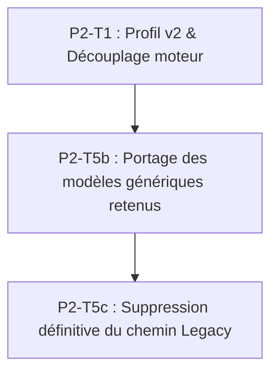

# Inventaire du générateur Legacy : porter ou supprimer

**Date** : 2026-10-22  
**Auteur** : Assistant d'ingénierie Harmonium (P2-T5a)  
**Contexte** : Décision D5 du plan Phase 2 (`specs/010-phase2-style-profiles/plan.md`) et Constitution v3 (`.specify/memory/constitution.md`, principes IV et V).  
**Objectif** : Trier l'ancien générateur procédural (`Style::Legacy`, à dominante jazz/groove) avant son élimination (P1-T6 redéfinie). Déterminer quels algorithmes abstraire en modèles génériques pilotés par les profils de données TOML, et supprimer sans compromis le code mort et les architectures rigides.

---

## 1. Tableau d'inventaire des modules et sous-systèmes Legacy

| Module / Fichier | Lignes | Rôle en une phrase | Ce que ça fait musicalement | Utile à quel profil futur | Dépendances | Qualité / Tests | Décision proposée | Coût portage & Adaptations |
|---|---|---|---|---|---|---|---|---|
| `harmony/steedman_grammar.rs` | 832 | Grammaire générative de progressions d'accords jazz/pop. | Enchaîne les accords selon des règles syntaxiques (V→ii-V, back-cycling, substitutions tritoniques). | **Jazz**, Pop/Classique fonctionnel | `chord.rs`, `LydianChromaticConcept`, `HarmonyContext`, RNG | Actif sous Legacy, 8 tests unitaires complets | **Porter** comme `harmony.model = "jazz_functional"` | **M** : extraire l'état mutable du `RwLock`, charger règles et poids depuis le profil TOML |
| `harmony/neo_riemannian.rs` | 419 | Moteur de transformations Tonnetz (P, L, R). | Transitions chromatiques non fonctionnelles conservant 2 notes communes entre triades. | **Cinématique / Film**, Jazz moderne | `chord.rs`, `NeoRiemannianParams`, LCC | Actif sous haute tension, 7 tests unitaires | **Supprimer** du chemin principal ; porter ultérieurement si profil cinématique | **S** : pur calcul mathématique, mais inutile pour Trad, Autochtone ou Jazz fonctionnel standard |
| `harmony/parsimonious.rs` | 602 | Conduite de voix parcimonieuse multi-accords (Tymoczko). | Recherche de voisins harmoniques à distance minimale (1-2 demi-tons), morphing triade/tétracorde, TRQ. | **Jazz** (comping modal), Cinématique | `chord.rs`, `VoiceLeadingParams`, LCC | Actif sous haute tension + tétracordes, 7 tests unitaires | **Porter** comme `harmony.model = "parsimonious"` ou brique de voicing | **M** : découpler de `HarmonicDriver`, exposer `MAX_SEMITONE_MOVEMENT` et TRQ via profil |
| `harmony/lydian_chromatic.rs` | 425 | Lydian Chromatic Concept de George Russell (12 niveaux). | Détermine la gamme mère Lydienne et le degré de gravité/tension (1..12), émet `ScaleGuidance`. | **Jazz** (modal, coach impro), Ambient | `chord.rs` (`Chord`, `PitchClass`) | Actif (nourrit `ScaleGuidance`), 8 tests unitaires | **Porter** comme bibliothèque théorique / improv guidance | **S** : module fonctionnel pur sans état ; exporter `ScaleGuidance` comme option de profil |
| `harmony/voice_leading.rs` | 197 | Algorithmes d'optimisation de conduite des voix. | Calcule la distance de voix, appariement glouton optimal, pénalités de triton, accords intermédiaires. | **Tous styles polyphoniques** (Jazz, Guitare Trad) | `chord.rs` (`Chord`, `PitchClass`) | Actif (utilisé par parsimonious), 4 tests unitaires | **Garder tel quel** (déplacer dans un module théorie neutre) | **S** : fonctions pures réutilisables par n'importe quel voicer d'accompagnement |
| `harmony/pivot.rs` | 284 | Système de transition par accords pivots ambigus. | Détecte dim7/aug/sus4 pour basculer entre Steedman et Neo-Riemannian avec hystérésis. | Aucun (spécifique à l'architecture monolithique Legacy) | `chord.rs`, `LydianChromaticConcept` | Actif sous Legacy, 4 tests unitaires | **Supprimer** | — (Artifice de transition interne au driver monolithique, remplacé par sélection nette par profil) |
| `harmony/melody.rs` | 715 | `HarmonyNavigator`, génération mélodique procédurale. | Mélodie note-à-note combinant chaînes de Markov, bruit fractal 1/f (Pink Noise) et contour Temperley. | Aucun (remplacé par les banques de cellules de profil, Constitution V) | `rust_music_theory`, `fractal.rs`, `basic::ChordQuality`, `MelodyParams` | Actif sous Legacy, 15 tests unitaires | **Supprimer** | — (La mélodie jazz future viendra d'un corpus / cellules jazz, non d'un bruit 1/f) |
| `harmony/chord.rs` | 890 | Modèle riche d'accords et d'intervalles. | Types d'accords (triades, 7es, 6es, sus, altérés), parsing de notation ("Dm7", "G7"), calcul de pitch classes. | **Tous styles avec accords** (Jazz, Trad, etc.) | Indépendant (stdlib uniquement) | Actif, largement testé (16 tests unitaires) | **Garder tel quel** (déplacer dans `harmonium_core::theory::chord`) | **S** : types musicaux universels déjà très propres et sans état |
| `harmony/driver.rs` | 1097 | `HarmonicDriver`, orchestrateur monolithique Legacy. | Arbitre entre Steedman, Neo-Riemannian et Parsimonious selon la tension et une taboo list. | Aucun (architecture monolithique fermée) | Tous les sous-modules `harmony/*`, `HarmonyDriverParams` | Actif sous Legacy, 17 tests unitaires | **Supprimer** | — (Remplacé par le trait/dispatch `HarmonyModel` sélectionné par le profil) |
| `harmony/basic.rs` | 151 | `BasicHarmony` (quadrants émotionnels de Russell). | Mappe valence/tension sur 6 progressions d'accords pop/folk figées (I-V-vi-IV, etc.). | Aucun | `EmotionalQuadrantParams` | Actif sous mode Basic, 4 tests unitaires | **Supprimer** | — (Table figée en code, contraire au principe V de la constitution) |
| `harmony/mod.rs` | 136 | Racine du module d'harmonie. | Déclare les sous-modules, re-exporte les types, définit `HarmonyContext`, `HarmonyStrategy`. | Infrastructure | Sous-modules `harmony` | N/A | **Refactorer** (conserver re-exports des briques portées, supprimer le reste) | **S** |
| `sequencer.rs` (Bjorklund) | l. 606–654 (49 l.) | Algorithme euclidien de Bjorklund. | Distribue régulièrement $k$ pulses sur $n$ pas temporels. | **Autochtone** (tambour), **Jazz**, **World** | Aucun | Actif, testé | **Porter** comme `rhythm.model = "euclidean"` ou `percussion.model = "euclidean"` | **S** : fonction pure `generate_euclidean_bools` à extraire dans un module algo dédié |
| `sequencer.rs` (Polygones / Perfect Balance) | l. 37–302, 700–1100 (~670 l.) | Rythmes polygonaux réguliers/irréguliers (style XronoMorph). | Génère des onsets par géométrie polygonale et interférences de phases. | Aucun profil identifié pour le jeu 1837 | `AccentPattern`, trigonométrie discrète | Actif sous Legacy, ~10 tests unitaires | **Supprimer** | — (Expérimentation polyrythmique mathématique sans ancrage dans les styles visés) |
| `sequencer.rs` (ClassicGroove) | l. 15–16, 1100–1250 (~150 l.) | Motifs de batterie prédéfinis (four-on-the-floor, breakbeat). | Joue des patterns de batterie figés avec ghost notes et anticipations. | Aucun (doit être en données TOML) | `ClassicGrooveParams` | Actif sous Legacy, testé | **Supprimer** | — (Les patterns rythmiques doivent être des grilles en TOML dans `[percussion]`, pas du code) |
| `sequencer.rs` (Séquenceur & Conductor) | l. 303–605 (~300 l.) | Séquenceur pas-à-pas et détection de passage de mesure. | Avance pas par pas avec double buffer et horloge échantillon. | Aucun (moteur basé sur `MeasureSnapshot`) | `TimeSignature`, `StepTrigger` | Actif sous Legacy, 12 tests unitaires | **Supprimer** | — (Harmonium génère désormais par mesure complète `generate_measure` via la grille du profil) |
| `timeline/generator.rs` | 2132 | `TimelineGenerator`, générateur procédural Legacy complet. | Assemble pas-à-pas lead, walking bass, snare et hi-hat selon Sequencer et HarmonicDriver. | Aucun | `Sequencer`, `HarmonyNavigator`, `HarmonicDriver`, `TuningParams` | Actif sous `Style::Legacy`, ~25 tests unitaires | **Supprimer** | — (Remplacé par le générateur de profil issu de P2-T1) |
| `timeline/export.rs` | 600 | Export MusicXML depuis `ScoreTimeline`. | Convertit les `Measure` en fichier MusicXML partitionné par instrument. | **Tous styles** | `ScoreTimeline`, `InstrumentConfig` | Actif, testé | **Garder tel quel** | Déjà découplé et générique |
| `timeline/midi_export.rs` | 623 | Export MIDI Standard (SMF) depuis `ScoreTimeline`. | Écrit les 5 pistes MIDI (Melody, Chords, Bass, Heel, Toe) avec tempo et signatures. | **Tous styles** | `midly`, `ScoreTimeline` | Actif, testé | **Garder tel quel** | Déjà découplé et générique |
| `export.rs` (racine core) | 1507 | Ancien exportateur MusicXML événementiel. | Tente de reconstituer des notes à partir de paires d'événements audio bruts `(f64, AudioEvent)`. | Aucun | `AudioEvent`, `MusicalParams` | Obsolète, supplanté par `timeline/export.rs` | **Supprimer** | — (Dette technique majeure et code dupliqué) |
| `mapper.rs` (`EmotionMapper.map`) | l. 1–192, 216–252 (~230 l.) | Traducteur émotions Russell → paramètres Legacy. | Mappe arousal/valence sur BPM 70–180, pulses euclidiens, octaves et stratégies. | Aucun | `EngineParams`, `MusicalParams`, `MapperConfig` | Actif sous Legacy, 10 tests | **Supprimer** | — (Remplacé par la section `[dynamics]` du profil qui définit les courbes de réaction) |
| `mapper.rs` (`UnifiedTensionSystem`) | l. 253–410 (~160 l.) | Matrice TRQ couplant tension harmonique et oddité rythmique. | Associe niveaux LCC et distance antipodale en 4 états émotionnels (Stability, etc.). | Aucun | `TensionState`, `EngineParams` | Actif sous Legacy, 4 tests | **Supprimer** | — (Trop couplé aux anciennes structures mathématiques) |
| `fractal.rs` | 42 | Bruit rose 1/f (algorithme Voss-McCartney). | Génère un bruit corrélé en 1/f pour contour mélodique continu. | Aucun | `RngCore` | Utilisé uniquement par `HarmonyNavigator` | **Supprimer** | — (Devient orphelin dès la suppression de `melody.rs`) |
| `style_profile.rs` (ancien) | 119 | Surcouche métadonnées sur `TuningOverlay`. | Enveloppe un nom, une description et un `TuningOverlay` JSON/TOML. | Aucun | `TuningOverlay`, `TuningParams` | Actif sous Legacy, 4 tests | **Supprimer** | — (Supplanté par le chargeur de profil v2 de P2-T1) |
| `tuning.rs` (sections Legacy) | ~1300 / 1848 l. | 9 structures de paramètres Legacy, overlays et validateurs. | Configure seuils de grammaire, P/L/R, seuils de groove, octaves de bruit rose, etc. | Aucun sous cette forme | `TuningParams`, `TuningOverlay` | Actif sous Legacy, nombreux tests de validation | **Supprimer** les 9 structures et leurs overlays | — (Paramètres des modèles retenus migrés dans le schéma de profil TOML) |
| `harmonium_audio/src/voicing/*` | 607 (5 fichiers) | Voicings jazz (`BlockChordVoicer`, `ShellVoicer`, `CompingPattern`). | Génère des voicings jazz à deux mains (Shearing) ou guide tones (tierce/septième) sous la mélodie. | **Jazz** (accompagnement piano/guitare) | `harmonium_core::harmony::chord::ChordType` | Débranché du moteur de rendu, 6 tests unitaires | **Porter** comme `accompaniment.model = "jazz_voicer"` ou conserver en réserve jazz | **M** : câbler les voicers au flux de mesures `Measure` (ils n'étaient jamais branchés) |

---

## 2. Tests et goldens impactés

### Tests et fichiers voués à disparaître avec Legacy

1. **Golden master Legacy** :
   - `harmonium_host/tests/golden_measures/snapshot_stream_seed42_8bars.json` (1725 lignes) : ce golden fige le flux de 8 mesures du moteur par défaut sous `Style::Legacy` (lead piano, basse walking, batterie).  
   - **Remplacement** : Le test de non-régression `snapshot_stream_unchanged` dans `harmonium_host/tests/snapshot_stream_tests.rs` doit être réancré sur le profil par défaut du moteur (`profiles/reel_quebecois/` avec un golden de référence reel validé). Le contrat du principe I de la constitution s'applique désormais sur le profil officiel.
2. **Suite d'intégration de génération musicale Legacy** :
   - `harmonium_core/tests/music_generation_tests.rs` (1106 lignes, 28 tests `#[ignore]`) : teste l'exportation MusicXML et labo de `Sequencer + HarmonicDriver` et `TimelineGenerator` (tests euclidiens, PerfectBalance, ClassicGroove, Steedman, Neo-Riemannian, transpositions sax ténor/alto).
   - **Remplacement** :
     - Pour les algorithmes portés : créer des tests unitaires ciblés (ex. `euclidean_rhythm_tests.rs`, `steedman_functional_tests.rs`).
     - Pour les scénarios de génération de styles : les tests d'acceptation de profils (`trad_reel_snapshot_tests.rs`, tests futurs pour gigue et valse) couvrent l'end-to-end de manière beaucoup plus stricte.
3. **Tests de sonde d'espace tonal** :
   - `harmonium_core/tests/key_space_probe.rs` (172 lignes) : teste l'accord absolu (issue #26) sur `TimelineGenerator` et `HarmonicDriver` en tonalité non-C.
   - **Remplacement** : Remplacé par un test contractuel vérifiant que le modèle d'harmonie porté et la génération de profil respectent l'ancrage absolu de la fondamentale.
4. **Tests de synchronisation de barline du séquenceur** :
   - `harmonium_host/tests/barline_integration_tests.rs` (202 lignes) : teste spécifiquement le switch de buffer à la barline de `Sequencer::new_with_mode(..., RhythmMode::ClassicGroove)`.
   - **Remplacement** : Supprimé avec `Sequencer` ; la gestion de barline et d'invalidation est déjà protégée par `handoff_tests.rs` et `deterministic_seek_tests.rs`.
5. **Tests de compatibilité de style CLI / Host** :
   - `harmonium_host/tests/trad_reel_snapshot_tests.rs` (lignes 262–267) : assert vérifiant `composer.set_style(Style::Legacy)`. Remplacé par la sélection de profil par identifiant (`composer.set_profile("reel_quebecois")`).

---

## 3. Usages de Legacy dans le host, la CLI, `harmonium_lab` et la documentation

### Host (`harmonium_host`)
- **`composer.rs`** :
  - `enum Generator` (l. 40–54) : contient la branche `Legacy(Box<TimelineGenerator>)`.
  - `MusicComposer::new_with_seed` (l. 265–306) : instancie par défaut `TimelineGenerator` avec `Sequencer`, `HarmonyNavigator` et `HarmonicDriver`.
  - `build_legacy_generator` (l. 637–670) : fabrique un `TimelineGenerator` à la demande.
  - `set_style(Style::Legacy)` (l. 774–792) et `set_key` (l. 905–917) : réinitialisent le navigateur harmonique legacy.
  - `generate_ahead` (l. 991–992) : branche `Generator::Legacy` appelant `emotion_mapper.map(&cached_emotions)`.
- **`native_handle.rs`** :
  - `set_style(Style)` (l. 426–440) : transmet le style legacy à `MusicComposer`.
- **Tests host (`deterministic_seek_tests.rs`, `handoff_tests.rs`, `beat_info_tests.rs`, `swing_tempo_tests.rs`)** :
  - Démarrent via `create_offline_engine(None, None, ...)` ou `MusicComposer::new_with_seed` sans spécifier de style, héritant donc de `Style::Legacy` par défaut. Dès la bascule sur profil par défaut, ces tests tourneront sur le profil sans modification structurelle.

### CLI (`harmonium_cli`)
- **`parser.rs`** :
  - Commande `style legacy` (l. 368, 582).
  - Commandes de réglages legacy : `set rhythm_mode`, `set rhythm_steps`, `set rhythm_pulses`, `set rhythm_density`, `set rhythm_tension`, `set harmony_mode`, `set harmony_strategy`, `set harmony_tension`, `set harmony_valence`, `set octave`, `set voicing_density`, `set voicing_tension`, `enable/disable <rhythm|harmony|melody|voicing>`.
- **`export.rs`** :
  - `println!("Legacy export: seed={}, ...")` (l. 148).
- **`help.rs` & `completer.rs`** :
  - Auto-complétion et textes d'aide documentant les commandes legacy susmentionnées.

### `harmonium_lab`
- **`render.rs`** (l. 81) :
  - `composer.set_rhythm_mode(harmonium_core::sequencer::RhythmMode::ClassicGroove);` lors du rendu de benchmark.
- **`agent/claude.rs`** (l. 963) :
  - `GrammarStyle::Jazz` dans l'agent d'optimisation de tuning.
- **`dna_types.rs`** (l. 543) :
  - Lit `params.rhythm_mode` pour l'empreinte rythmique.

### Documentation
- `harmonium_core/README.md` : schéma Mermaid montrant `Sequencer` et `HarmonicDriver` alimentant `TimelineGenerator`.
- `harmonium_cli/README.md` : documentation de `style legacy`, `enable voicing`, `set voicing_density`, etc.
- `harmonium_audio/README.md` : section documentant `BlockChordVoicer` et `ShellVoicer`.

---

## 4. Analyse des risques et types partagés (Trad vs Legacy)

| Élément partagé | Risque identifié | Niveau de risque | Stratégie d'atténuation |
|---|---|---|---|
| `TrackId` (`timeline/mod.rs`) | Les variantes `Heel` (canal 3) et `Toe` (canal 4) sont nommées d'après la podorythmie trad, mais servaient de `Snare` et `Hat` dans le générateur Legacy. | **Moyen** | Le modèle `TrackId` est déjà nettoyé en Phase 1 (D10). Conserver `Melody`, `Chords`, `Bass`, `Heel`, `Toe` comme pistes contractuelles universelles ; documenter dans le profil le mapping d'instruments SoundFont par piste (`[instruments]` et `[percussion]`). |
| `ChordQuality` | Deux enums distincts portent le même nom : `harmonium_core::harmony::basic::ChordQuality` (5 variantes) et `harmonium_core::trad::harmony::ChordQuality` (2 variantes : Major, Minor). | **Élevé** | Supprimer `basic.rs`. Conserver les types génériques de `chord.rs` (`ChordType` avec `is_major()`, `is_minor()`) ou unifier proprement dans un sous-module théorie commun. |
| `PitchClass` | Déclaré comme `pub type PitchClass = u8;` à deux endroits : `harmony/chord.rs:10` et `trad/mode.rs:8`. | **Faible** | Conserver un seul alias canonique dans `harmonium_core::theory::PitchClass` ou à la racine de `core`. |
| `TuningParams::default()` | Plus de 70 % des champs de `TuningParams` sont des paramètres Legacy (`harmony_driver`, `grammar`, `neo_riemannian`, etc.). Le code de production et les tests s'appuient sur `TuningParams::default()`. | **Élevé** | Ne pas supprimer brutalement `TuningParams` sans que P2-T1 ait livré le chargement complet des profils. La suppression de ces champs doit intervenir dans la tâche de nettoyage final, avec mise à jour conjointe de `MusicComposer`. |
| `MusicComposer::new_with_seed` | Le constructeur initialise `Generator::Legacy` par défaut. | **Élevé** | Lors de la bascule P2-T1 / P2-T5, faire pointer le moteur par défaut sur le profil actif (`profiles/reel_quebecois/`). |
| `harmonium_audio::voicing` | Jamais connecté au playback temps réel de l'ancien moteur, mais compile et possède des tests. | **Faible** | Isoler dans un module dédié ou conserver comme bibliothèque utilitaire pour le futur modèle d'accompagnement jazz. Aucun impact sur le flux temps réel. |

---

## 5. Ordre de travail recommandé (2 ou 3 tâches)

Pour respecter la constitution (pas de régression du reel, pas de chemin parallèle pérenne) et coordonner avec P2-T1 :

### Tâche 1 : P2-T5b — Portage des modèles génériques retenus (Jazz & Algorithmes)
*Objectif : Extraire en composants purs et modulaires ce qui servira un profil futur, sans dépendance à Legacy.*
1. **Algorithme euclidien** :
   - Extraire `generate_euclidean_bools` de `sequencer.rs` vers `harmonium_core::algo::euclidean` (ou sous-module rythme).
   - Protéger par des tests unitaires dédiés.
2. **Modèle harmonique fonctionnel (`harmony.model = "jazz_functional"`)** :
   - Nettoyer `steedman_grammar.rs` : supprimer le `RwLock` interne (état conservé dans la structure d'instance de stratégie passée au tour par tour), permettre le paramétrage des règles et poids depuis des structures désérialisables depuis TOML.
   - Conserver `chord.rs` et `voice_leading.rs` comme boîte à outils théorique (`harmonium_core::theory`).
   - Porter `parsimonious.rs` comme stratégie harmonique autonome ou module de conduite de voix.
   - Conserver `lydian_chromatic.rs` pour l'émission optionnelle de `ScaleGuidance`.

### Tâche 2 : P2-T5c — Suppression définitive du chemin Legacy (exécute P1-T6)
*Objectif : Nettoyage sans compromis du code mort et bascule du host sur les profils.*
1. **Suppression des sources Legacy** :
   - Supprimer `harmonium_core/src/timeline/generator.rs` (2132 lignes).
   - Supprimer `harmonium_core/src/harmony/driver.rs` (1097 lignes), `pivot.rs` (284 lignes), `basic.rs` (151 lignes), `melody.rs` (715 lignes), `neo_riemannian.rs` (419 lignes).
   - Supprimer `harmonium_core/src/sequencer.rs` (2067 lignes, hors fonction euclidienne extraite).
   - Supprimer `harmonium_core/src/fractal.rs` (42 lignes).
   - Supprimer `harmonium_core/src/export.rs` (1507 lignes, ancien exportateur MusicXML).
   - Supprimer l'ancien `harmonium_core/src/style_profile.rs` (119 lignes).
   - Nettoyer `harmonium_core/src/tuning.rs` : retirer les 9 structures legacy et leurs overlays (~1300 lignes).
   - Nettoyer `harmonium_core/src/params.rs` : retirer `Style::Legacy`, `RhythmMode`, `MelodyScaleType`, `TensionState`, `VarietyParams`, etc.
   - Nettoyer `harmonium_core/src/command.rs` : supprimer les commandes `EngineCommand` obsolètes.
   - Nettoyer `harmonium_core/src/mapper.rs` : retirer `map()`, `MapperConfig` et `UnifiedTensionSystem`.
2. **Nettoyage du Host, de la CLI et de l'Audio** :
   - Host : Dans `composer.rs`, supprimer `enum Generator::Legacy` et `build_legacy_generator`. Le moteur instancie uniquement le générateur piloté par profil.
   - Audio : Dans `voice_manager.rs`, supprimer la branche `Style::Legacy` et `GM_PROGRAM_PIANO`.
   - CLI : Supprimer la sous-commande `style legacy` et les options de réglage legacy dans `parser.rs`, `help.rs`, `completer.rs`.
3. **Nettoyage des tests et goldens** :
   - Supprimer `snapshot_stream_seed42_8bars.json`.
   - Mettre à jour `snapshot_stream_unchanged` pour tester le profil par défaut (`reel_quebecois`).
   - Supprimer `harmonium_core/tests/music_generation_tests.rs`, `key_space_probe.rs`, `barline_integration_tests.rs`.
4. **Mise à jour de la documentation** :
   - Nettoyer les README de `harmonium_core`, `harmonium_cli`, `harmonium_audio`.

## 6. Portages P2-T5b réalisés

- Théorie neutre : `harmony/chord.rs` → `theory/chord.rs` et
  `harmony/voice_leading.rs` → `theory/voice_leading.rs`.
  Alias canonique unique : `theory::PitchClass` ; tous les consommateurs
  (Legacy, profils, host, audio et labo) utilisent les nouveaux chemins.
  La conversion vers la qualité Legacy reste dans `harmony/basic.rs`,
  à supprimer avec ce module en P2-T5c.
