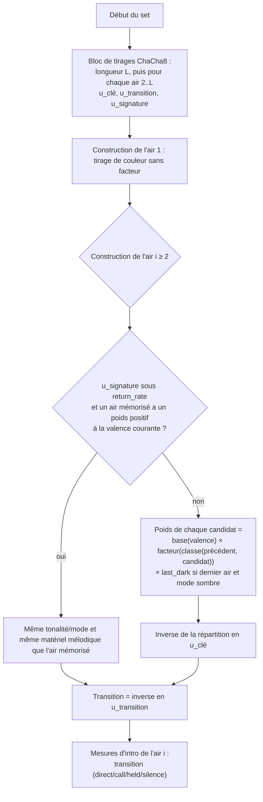

# V7a — Forme longue (sets) : étude et conception

Étude du point 7 du [plan de la phase 012](plan.md#7-forme-longue). **Aucun code moteur modifié.**
Mesures et scripts jetables : exécutés dans `/tmp/set_etude/`, archivés tels quels dans
[`etudes/forme-longue/`](etudes/forme-longue/) (chemins `/tmp` codés en dur) ; les rendus de
`harmonium_lab/target/set_etude/` ont été effacés depuis. Moteur lu à `main` `ad7ad58`.

## 0. Résumé et recommandation

1. **Le chaînage actuel n'est pas un chaînage.** Il ne s'applique qu'à une valence *exactement* égale
   à `neutral_valence` (0,3) ; dès que la valence du jeu s'en écarte (ce qui est le cas courant en jeu), la
   tonalité du prochain air est un tirage indépendant du précédent (§1). Même au point neutre, la « relative »
   sort de `melody.key_modes` à chaque transition qui la choisit (B éolien après D ionien ; 50 % des airs 2 à 5
   à la sonde) et n'est pas diatonique pour mixolydien et dorien. Aucune mesure ne compare ces enchaînements
   à un corpus.
2. **Ce que les sets réels apportent est modeste et mesurable** (§3) : sur 199 k transitions de 106 k sets
   (The Session), les tonalités voisines (armure à ±1 altération) font 90,6 % contre 85,7 % sous tirage
   indépendant ; « même tonalité » est 1,39× plus fréquent, « tonique −1 ton » 0,73× ; les sets font 2 ou
   3 airs dans 89,5 % des cas, 81 % sont d'un seul type. L'essentiel de la « logique de tonalités » est la
   concentration du répertoire (D, G, A, mi/la modaux), que les profils portent déjà.
3. **Conception retenue** (§4) : une section `[set]` par profil (fichier `set.toml`) : longueur du set,
   **facteurs multiplicatifs par classe de transition appliqués au poids de base du profil** (`key_modes`
   à valence neutre, `[[color]]` sinon : le jeu garde la main sur la couleur), tirages fixés au début du set
   et résolus tardivement, rampe de tempo/intensité **bornée, jamais négative, nulle aux extrêmes de l'intensité
   du jeu**, air « signature » qui revient (taux mesuré 17 %), transitions (`direct`, `call`, `held`,
   `silence`), fin de set. Position publiée : `set_index`, `tune_in_set` (1-based), `tunes_in_set`.
   `form.next_same_weight`/`next_relative_weight`, `intro_each_tune` et `intro.each_tune` disparaissent
   (coupure nette).
4. **Recommandation** : lancer V7b en sept tâches (§6), la première étant le schéma `[set]` et la
   migration des sept profils ; **ne pas** faire de sets multi-types (gigue → reel) dans V7b : le moteur ne
   porte qu'un profil à la fois (mètre, grille, forme globaux), et 81 % des sets réels sont mono-type.
   Le bloc de tirages du set est pris au début du set, avant l'air 1 : toute la session change pour une
   même graine ; bump `TUNING_VERSION` 13 → 14 et goldens régénérés, y compris `profile_d2_fixed.json`
   (décision à écrire au §6).
5. **Écoute** (§7) : un set de 3 reels hors moteur (sol → ré → la ionien, tempo 230 → 235,2 → 240) et la
   baseline du chaînage actuel sont rendus avec GeneralUser-GS. **Non écoutés par l'auteur de l'étude** ;
   seules les mesures des MIDI sont rapportées.

## 1. État du moteur (vérifié dans le code et par sonde)

| Constat | Preuve |
|---|---|
| Un air = `bars_per_tour × tours_per_tune` mesures, plus ses mesures d'intro ; `position_of` somme `intro_bars + cycle` air par air. Les tours sont constants. | `generator.rs:184-218` |
| Choix du plan du prochain air : si `harmony_valence == neutral_valence` (flottant, 0,3 par défaut) → `draw_next_tune_plan` (même tonalité/relative, poids `form.next_same_weight`/`next_relative_weight`, 1/1 par défaut) ; **sinon** `dynamics.draw_color(valence)` (poids de `[[color]]` évalués à la valence, **sans lire l'air précédent**). | `generator.rs:1107-1116`, `dynamics.rs:331`, `params.rs:449`, `mapper.rs:25` (la valence passe telle quelle) |
| `relative_key_mode` : ionien ↔ éolien à ±3, mais mixolydien → dorien à +9 et dorien → mixolydien à +3. Re ↔ mi mixolydien/dorien n'est pas une relative diatonique (D mixolydien → B dorien : armures écartées de 2 quintes ; la vraie relative est A dorien). Le candidat n'est jamais comparé à `melody.key_modes`. | `generator.rs:1379-1386` ; sonde ci-dessous |
| Les « premiers airs » sont identifiés par `tune_index == 0` à quatre endroits ; deux drapeaux redondants : `arrangement.intro_each_tune` (entrées de pistes) et `intro.each_tune` (mesures d'intro). | `arrangement.rs:270,618`, `generator.rs:1234` |
| `end_after_tour` : seul l'air 0 est généré, le reste est silencieux. | `generator.rs:306-309, 1074` |
| `TunePosition` publie déjà `tune_index` (0-based), `tour`, `tours`, `part`, `pass`, `key`, `mode`. | `arrangement.rs:71-94` |
| Tempo : `tempo_for(bpm, intensity)` = `bpm + tempo_offset(intensity)`, borné 40..300 ; `meter.min_bpm/max_bpm` sont **validés mais jamais imposés** (le reel atteint 245 > 240). L'intensité vient de `arousal_intensity(arousal) + tension_intensity(tension)`. | `dynamics.rs:293`, `mapper.rs:22`, `style_profile.rs:671-682` |
| Lecture de l'intensité dans le générateur : 5 sites (vélocités, durées, densité de pieds, chop, poids de rôles). | `generator.rs:126,286,918-924,1018,1119` |

**Sonde** (crate jetable `/tmp/set_etude/probe`, dépend de `harmonium_core` par chemin, 400 graines × 5 airs,
profil `reel_quebecois` embarqué, `TradGenerator::generate_measure` réel) :

| Valence | Transitions | Même tonalité d'un air au suivant | Remarque |
|---|---:|---:|---|
| 0,3 (neutre) | 1600 | 50,9 % | 804/1600 airs (50,3 %) **hors `key_modes`** : B, E et F♯ éolien, B et F♯ dorien |
| 0,6 | 1600 | 20,2 % | tirages indépendants (D↔G↔A ionien, mixolydien), aucune dépendance au précédent |
| −0,6 | 1600 | 13,9 % | idem, familles sombres (A éolien/dorien, D dorien, E éolien) |

Conséquence de conception : la logique de set doit **entrer dans le chemin `draw_color` aussi**, sinon elle
ne s'entend jamais en jeu.

CLI : `--export --bars N` sans automation ne se termine pas pour N ≥ 110 avec `--tours 1` (graine 2 ; tué à 25 s ;
N = 100 : 0,3 s) ni pour `--bars 160 --tours 3` ; corrigé depuis (BUG1, `plan.md` §7 : la génération dépassait
la capacité de 100 mesures de la timeline). Les exports de l'étude passent par `--automation` (pas d'outro).

## 2. Pratique réelle

### 2.1 Tableau de synthèse

| Tradition / contexte | Airs par set | Durée | Tonalités | Types | Tempo | Transitions | Sources |
|---|---|---|---|---|---|---|---|
| **Veillée québécoise, set carré** (xixᵉ–xxᵉ s.) | Pas de nombre d'airs documenté : le fiddler joue pour une *danse* ; le « corps » de chaque figure est répété 12 fois (4 couples × 3), le quadrille/cotillon 2 fois | Un quadrille de 5 parties tient en 14 min 27 (vidéo pédagogique, consignes comprises) | Non documentées par danse | Quadrille : suite de 5–6 figures, tunes **6/8 et 4/4** ; set carré : reels, gigues « six-huit » | Non documenté | Le câlleur guide ; aucune transition musicale décrite | [Ornstein 1982](https://cjtm.icaap.org/content/10/v10art2.html), [Chartrand 1996](https://www.danse.qc.ca/articles-parus.html), [RPCQ](https://www.patrimoine-culturel.gouv.qc.ca/rpcq/detail.do?id=118&methode=consulter&type=imma), [Gagné 2012](https://squaredancehistory.org/items/show/1567) |
| **Acadie (Î.-P.-É., Chéticamp)** | « Les Quatre », « Les Huit », *reel à huit* (pas dansés), quadrilles et sets introduits vers 1900 ; quadrille de West Prince en 2 parties à plusieurs formations | Mariages : danse « tout le jour » ; pas de durée par air | Non documentées | Reels, gigues ; harmonica ou turlutte en l'absence de violon | Non documenté | Non documentées | [Arsenault](http://danseacadienne.ca/acadian-dances/) |
| **Cap-Breton (voisin et influence acadienne, proxy)** | Concert : marche → strathspey(s) → reels (7 airs dans l'exemple de la fig. 7, 4 dans la fig. 8) ; danse : médleys de jigs *ou* de reels | Set carré de **15–20 min** ; bals de 22 h à 1 h ; médleys de concert 5–11 min | Changement de mode sur la même tonique (la majeur → la mineur) cité comme « jolt » d'énergie | Jigs ensemble ; ordre air lent → marche → strathspey → reel/hornpipe, jamais l'inverse | **Danse** : tempo constant, changement seulement strathspey → reel. **Concert** : accélération sur tout le médley (reels 100–120 à la blanche, moy. 108–112 ; marches 60–90 ; strathspeys 130–190) | Lisses (pas de pause, à la différence de l'Écosse) ; accelerando au passage strathspey → reel (ex. : 99 → 106 bpm en 9 s) | [Garner 2015](https://journals.lib.unb.ca/index.php/MC/article/download/24450/28305/37561) |
| **Bal colonial britannique** (Québec 1787, Newark) | Menuets (5) puis contredanses anglaises ; une contredanse = **1 heure** à 25 couples ; chez Jarvis : contredanses de l'ouverture jusqu'au souper (23 h), puis 2 danses | 1 h par danse | — | Contredanses (reels, gigues) | — | Rien sur les raccords | [McGee 1992](https://doczz.net/doc/182249/european-contacts-with-canada-les-contacts-entre-l-europe...) |
| **Régiment (marches, appels de tambour)** | Retraite : 15 min **au moins** (Bland 1727, Simes 1767) ; appels : « signal + trois roulements » au début, « trois roulements + un drag complet » à la fin | ≥ 15 min | — | Marches de fifre en 3/4, 6/8, 2/4, 3/8 | Pas de marche : 110 à la noire (pas redoublé, 2/4 ou 6/8), 90 à la blanche (4/4), 90 à la blanche pointée (retraite, 3/4) — **Scott 1835**, postérieur à l'époque | Roulements et drag cadentiels : transitions *appelées*, pas improvisées | [Historic Drumming — Retraite](https://www.historicdrumming.com/british-american-drumming/duty-call-the-retreat/), [— rythme de la marche](https://www.historicdrumming.com/british-american-drumming/duty-call-the-march/rhythm-english-march) |
| **Session irlandaise** (forum, anecdotique) | 2–3 airs | — | « Regarder la note finale d'un air et la première du suivant ; mieux encore avec un changement de tonalité » | — | — | — | [Chiff & Fipple](https://www.chiffandfipple.com/t/putting-together-sets/11486) |

Lecture :

- **Pas de pratique québécoise ni acadienne chiffrée en accès libre** pour l'enchaînement des tonalités ni la
  durée d'un set d'airs ; la littérature décrit la danse (figures, répétitions), pas le médley du fiddler.
  Le point de comparaison musical mesuré le plus proche est le Cap-Breton (Garner), géographiquement lié à
  l'Acadie (Chéticamp) mais écossais d'origine : à prendre comme **proxy**, pas comme règle acadienne.
- **Deux régimes de tempo coexistent** : danse (constant, on ne change qu'aux transitions de type) et
  concert/médley (accélération continue : marche 77 → 85, +10 % ; reels 110 → 115, +4,5 % ; en danse
  115 → 118, +2,6 %, soit +2,6 à +5,5 % pour des reels ; jusqu'à +17 bpm quand la transition de type est incluse).
- Une **transition lisse** est la norme dansée ; la pause nette est un trait écossais de concert.
- Les **appels** militaires (roulements, drag) justifient une transition `call` pour la marche.
- Le profil `marche_britannique_coloniale` a déjà un décompte de tambour avant chaque air
  (`intro_each_tune = true`, forme `percussion`) : c'est une transition `call` sans le nom.

### 2.2 Ce que 16 % des transitions réelles disent des types

Dans les sets de The Session, 80,9 % des sets ne contiennent qu'un type ; 16,5 % des transitions changent de
type (jig → reel 12,7 % d'entre elles, reel → jig 8,3 %, hornpipe → reel 5,0 %). Chez les artistes
acadiens enregistrés, strathspey → reel fait 16 % des transitions (influence cap-bretonnaise).

## 3. Mesures

### 3.1 Sources et méthode

- **Sets de membres** : `sets.json` de [TheSession-data](https://github.com/adactio/TheSession-data) (ODbL,
  Git LFS ; 329 282 lignes, 130 297 sets, 105 959 d'au moins 2 airs). Chaque ligne porte le type et le mode
  *du réglage joué* (`Gmajor`, `Edorian`…). Sets postés par des membres, **majorité irlandaise,
  contemporaine** : borne et ordre de grandeur, pas la pratique québécoise.
- **Pistes enregistrées** : `recordings.json` du labo, pistes à ≥ 2 airs des artistes de
  `quebec_artists.json` (41 enregistrements, 575 pistes) et `acadian_artists.json` (22, 304). La tonalité
  d'un `tune_id` est celle de son réglage le plus fréquent dans `tunes.json` ; les airs sans `tune_id`
  (61 % côté Québec, 37 % côté Acadie des airs de pistes multiples) sont écartés **et coupent le set**.
  Ce sont des albums de concert, pas des veillées.
- **Corpus du labo** (manifestes : 764 airs québécois, 270 acadiens, 1 025 britanniques) : distribution
  tonalité × mode par type ; pas de séquence.
- **Classe de transition** (priorité) : *même tonalité* ; *même tonique, autre mode* ; *relatif* (même
  collection diatonique, autre tonique) ; sinon l'intervalle de tonique : +5ᵗᵉ (dominante), +4ᵗᵉ
  (sous-dominante), +1 ton, −1 ton ; *autre*. **Voisine** : écart d'armure ≤ 1 quinte.
- **Rapport** = fréquence observée / fréquence attendue sous tirage indépendant dans les marginales du type
  (produit des distributions du 1ᵉʳ et du 2ᵉ air). Un rapport proche de 1 veut dire que la classe n'est
  que la conséquence de la concentration du répertoire.
- **Aucun set britannique n'existe en accès libre dans le corpus** (Nottingham, AmRev, Cahusac sont des
  airs isolés). Reste la borne des distributions par type (§3.4).

### 3.2 Sets de membres (The Session)

Longueur des sets (≥ 2 airs, n = 105 959) : 2 airs 45,2 % · 3 : 44,3 % · 4 : 6,8 % · 5 : 1,6 % · 6 et plus :
2,2 % ; moyenne 2,88. Les sets d'un seul air (24 338) sont à part.

Transitions de tonalité (n = 198 985) :

| Classe | Tous types | reel → reel (80 553) | jig → jig (51 672) |
|---|---:|---:|---:|
| même tonalité | 23,9 % | 20,9 % | 21,2 % |
| même tonique, autre mode | 7,8 % | 7,8 % | 8,0 % |
| relatif (même collection) | 20,7 % | 22,2 % | 23,2 % |
| tonique +5ᵗᵉ | 15,2 % | 15,5 % | 15,8 % |
| tonique +4ᵗᵉ | 16,2 % | 16,0 % | 17,0 % |
| tonique +1 ton | 5,5 % | 5,6 % | 4,6 % |
| tonique −1 ton | 4,3 % | 4,0 % | 4,0 % |
| autre | 6,6 % | 7,8 % | 6,2 % |
| voisines (armure ±1) | 90,6 % | 89,9 % | 91,4 % |

**Rapports observé / indépendance** (base des facteurs de §4) :

| Rapport | même | parallèle | relatif | +5ᵗᵉ | +4ᵗᵉ | +1 ton | −1 ton | autre |
|---|---:|---:|---:|---:|---:|---:|---:|---:|
| tous types | 1,39 | 1,01 | 0,94 | 0,94 | 1,00 | 0,86 | 0,73 | 0,76 |
| reel (80 553) | 1,28 | 1,00 | 1,02 | 0,97 | 1,01 | 0,91 | 0,73 | 0,75 |
| jig (51 672) | 1,21 | 0,90 | 0,98 | 0,97 | 1,06 | 0,79 | 0,74 | 0,95 |
| hornpipe (7 291) | 1,16 | 1,17 | 0,85 | 0,97 | 1,04 | 0,86 | 0,74 | 0,73 |
| valse (3 802) | 1,27 | 1,18 | 0,86 | 0,97 | 0,97 | 0,84 | 0,81 | 0,62 |
| polka (9 021) | 1,47 | 0,69 | 0,85 | 0,84 | 0,97 | 1,05 | 0,81 | 0,69 |
| slip jig (6 450) | 1,22 | 1,30 | 0,96 | 0,81 | 0,91 | 1,08 | 0,91 | 0,91 |


Lecture : les rapports sont presque tous entre 0,75 et 1,3. Seuls ressortent *même tonalité* (+20 à +40 %) et
*descente d'un ton* (−25 à −30 %). Mouvement de tonique hors « même » : monte 52 %, descend 48 % : pas de
direction. Le set de 3 airs : 1ᵉʳ → 3ᵉ identique à 25,5 %, autant qu'entre airs voisins (23,9 %) : une
tendance générale à rester dans la tonalité, **pas de structure de retour** à la tonalité d'origine.

**Effet de position** (sets de 3 reels, n = 19 771) : part de modes mineur/dorien 35,0 % au 1ᵉʳ air, 37,4 % au
2ᵉ, **28,9 % au dernier** : un set finit plus souvent en majeur (× 0,80). Peu d'effet de position sur les
tonalités majeures (ré 32/25/32 %, sol 22/26/23 % aux airs 1/2/3).

**Airs qui reviennent** : 8 266 membres ; **16,7 %** des airs posés l'avaient déjà été par le même membre
dans un set antérieur (1ᵉʳ air 15,2 %, milieu 16,8 %, dernier 18,0 %) ; 65,7 % des transitions *a → b* sont
des paires que ≥ 2 membres ont postées (enchaînements conventionnels) ; 100 airs couvrent 25,9 % des
occurrences (12 480 airs distincts).

### 3.3 Artistes québécois et acadiens enregistrés

| | Québec (41 enreg.) | Acadie (22 enreg.) |
|---|---:|---:|
| pistes | 575 | 304 |
| pistes à 1 air | 415 (72,2 %) | 124 (40,8 %) |
| 2 · 3 · 4 · 5+ airs | 129 · 23 · 8 · 0 | 57 · 58 · 38 · 27 |
| sets exploitables · transitions | 44 · **55** | 99 · **205** |
| même tonalité | 25,5 % (rapport 1,28) | **41,5 %** (3,45) |
| même tonique, autre mode | 9,1 % (1,77) | **24,9 %** (2,02) |
| relatif | 20,0 % (1,09) | 3,9 % (0,36) |
| +5ᵗᵉ · +4ᵗᵉ | 16,4 % · 7,3 % | 4,9 % · 5,9 % |
| +1 ton · −1 ton · autre | 12,7 · 3,6 · 5,5 % | 5,9 · 4,9 · 8,3 % |
| voisines (armure ±1) | 81,8 % | 76,6 % |
| type : reel → reel | 67,3 % | 38,5 % |
| autres types fréquents | jig → reel 5,5 % | strathspey → reel 16,1 %, jig → jig 14,6 % |
| airs présents dans ≥ 2 enregistrements du même artiste | 7,6 % (17/223) | 1,8 % (7/383) |

Lecture : **n = 55 côté Québec est trop petit pour fonder un réglage** (un écart d'une transition = 1,8
points). L'Acadie (n = 205) montre un profil très différent (même tonalité ×3,5, changement de mode sur la
même tonique ×2,0) mais l'échantillon est dominé par des fiddlers de Cap-Breton (Joe Cormier, Marc Boudreau)
et par des médleys A majeur → A mixolydien/dorien : cohérent avec Garner (« A majeur → A mineur », jolt
d'énergie). Les pistes à un seul air (72 % au Québec) disent que le *set* n'est pas l'unité d'un album de
violon québécois : le fiddler joue un reel, parfois deux.

### 3.4 Borne : distribution par type dans le corpus du labo

Probabilité que deux airs tirés indépendamment du même type (taille du corpus entre parenthèses) soient
dans des tonalités voisines :

| Tradition | reel | jig | hornpipe | valse | marche |
|---|---:|---:|---:|---:|---:|
| québécoise | 75,7 % (574) | 79,0 % (88) | — | 66,6 % (67) | 78,1 % (16) |
| acadienne | 57,6 % (169) | 66,9 % (55) | 52,9 % (29) | — | 75,2 % (11) |
| britannique coloniale | 74,1 % (493) | 67,0 % (365) | 80,8 % (78) | 73,2 % (60) | 71,5 % (25) |

Tonalités dominantes (part du type) : québécoise : reel ré 40 %, sol 21 %, la 15 % ; acadienne : reel ré 20 %,
la 20 %, sol 17 %, la dorien 8 % ; britannique : reel ré 39 %, sol 34 %, la 13 %, hornpipe sol 44 %, ré 36 % ;
marches : britannique sol 48 %, ré 24 % ; acadienne la mixolydien 27 %, la dorien 18 %.
**L'acadien est plus étalé** : un tirage indépendant y reste voisin 58 % du temps contre 75 % au Québec ;
c'est là qu'une règle de set serait le plus audible.

## 4. Conception : section `[set]`

### 4.1 Principes

- **En données, par profil** (principe V) : fichier `set.toml` référencé par `[files] set = "set.toml"`,
  comme `arrangement` et `dynamics` ; section absente = **un set sans fin** (`tunes_in_set = 0`), tous
  facteurs à 1, pas de rampe, pas de signature, transition `direct`, intro et entrées de pistes au seul premier
  air de la session : le comportement actuel, hors le chaînage même/relative. Aucun nom
  de style dans le code : les classes sont géométriques (`same`, `fifth_up`…), les transitions des mécanismes
  (`direct`, `call`…).
- **Le jeu garde la priorité.** La couleur (tonalité/mode) reste décidée par la valence ; le set ne fait que
  *pondérer* des candidats que le jeu autorise. Le tempo et l'intensité du set s'ajoutent sans jamais
  abaisser le résultat des émotions et s'effacent quand l'intensité du jeu est proche de ses extrêmes.
- **Mesuré d'abord** : toute valeur distribuée vient d'un tableau du §3 ; ce qui ne l'est pas est marqué
  « à l'oreille » et vaut 0 ou neutre tant qu'une écoute ne l'a pas fixé.
- **Une seule façon de faire** : le chaînage même/relative, `intro_each_tune` et `intro.each_tune`
  disparaissent ; `tune_index == 0` devient « premier air d'un set ».

### 4.2 Schéma proposé

```toml
# set.toml — un set est une suite d'airs d'un même profil (même mètre, même forme).

[set]
# Nombre d'airs : distribution pondérée, entiers 1..=16, somme des poids > 0, ≤ 64 entrées.
# `tunes = 1` partout : chaque air est son propre set (annonce complète à chaque air : marche).
length = [
  { tunes = 2, weight = 45 }, { tunes = 3, weight = 44 },
  { tunes = 4, weight = 7 },  { tunes = 5, weight = 4 },
]

# Facteurs multipliant le poids de base de chaque tonalité candidate. 0 interdit une classe, 1 la neutralise.
# Base = `melody.key_modes` à `neutral_valence`, `[[color]]` évalué à la valence sinon.
# Réels : rapports observé/indépendance de The Session, reel → reel (§3.2).
[set.key]
same      = 1.28   # même tonique, même mode
parallel  = 1.00   # même tonique, autre mode
relative  = 1.02   # même collection diatonique, autre tonique
fifth_up  = 0.97   # tonique +7 demi-tons
fourth_up = 1.01   # tonique +5
step_up   = 0.91   # tonique +2
step_down = 0.73   # tonique −2
other     = 0.75
# Dernier air du set : facteur sur les modes sombres (aeolian, dorian) ; 1.0 = neutre.
# Mesuré : 28,9 % contre 36,2 % de moyenne aux deux premiers airs de 19 771 sets de 3 reels.
last_dark = 0.80

# Rampe sur la progression du set p = (tune_in_set − 1) / (tunes_in_set − 1) ∈ [0,1], 0 si un seul air.
# Paliers par air (le tempo ne change pas pendant un air) ; courbes [[p, valeur]] comme [dynamics].
[set.ramp]
tempo_bpm      = [[0.0, 0.0], [1.0, 8.0]]   # bpm de la noire ajoutés
intensity_lift = [[0.0, 0.0], [1.0, 0.08]]  # ajouté à l'intensité du jeu (0..1)
# Portée du set selon l'intensité du jeu : 0 = le set s'efface, 1 = plein effet.
gate           = [[0.0, 0.0], [0.2, 1.0], [0.8, 1.0], [1.0, 0.0]]
# Plafond du tempo ajouté. Défaut : meter.max_bpm. Ne s'applique pas si le jeu dépasse déjà.
ceiling_bpm    = 240.0

# Air « signature » : un air d'un set antérieur de la session revient.
[set.signature]
return_rate = 0.17   # probabilité par air (mesuré : 16,7 %, §3.2) ; 0 = jamais
memory      = 3      # airs des sets précédents éligibles (les plus récents)

# Transition vers l'air suivant : poids, tirée par air (jamais pour le premier du set).
[[set.transitions]]
kind   = "direct"    # levée seule (`intro.pickup_eighths`), comportement actuel sans intro
weight = 70
[[set.transitions]]
kind   = "call"      # `bars` mesures de pieds seuls, puis levée (rôle d'intro `percussion`)
weight = 20
bars   = 1
[[set.transitions]]
kind   = "held"      # la tonique finale de l'air précédent est tenue (rendu d'outro), puis levée
weight = 10
[[set.transitions]]
kind   = "silence"   # `bars` mesures vides, puis levée
weight = 0
bars   = 1

# Fin de set (dernier air). Section absente : `outro = false`, `gap_bars = 0`. Sans objet pour un set sans fin.
[set.end]
outro    = true                                   # outro (cadence tonique) à la dernière mesure du dernier tour
gap_bars = [{ bars = 0, weight = 2 }, { bars = 1, weight = 2 }, { bars = 2, weight = 1 }]  # à l'oreille, non mesuré
```

Le premier air d'un set utilise `[intro]` (formes pondérées, levée) et `[arrangement.entries]` tels quels :
les pistes entrent progressivement à *chaque set*, pas seulement au premier de la session.
Les autres airs voient toutes les pistes dès A1, comme l'actuel `intro_each_tune = false`.

**Validation** (erreurs avec chemin du champ, comme `[mix]`) : classes inconnues ; facteurs finis ≥ 0 ; au
moins un candidat de poids total > 0 après facteurs ; longueurs 1..=16 ; courbes à abscisses strictement
croissantes dans `[0,1]` et valeurs finies ; `intensity_lift` dans `0..1` ;
`tempo_bpm ≥ 0` ; `ceiling_bpm` dans `meter.min_bpm..=300` ; `return_rate` dans `0..1` ; `memory` 0..16 ;
`transitions` : poids non négatifs à somme > 0, `bars` 1..=`MAX_INTRO_BARS` pour `call`/`silence`, aucun
`bars` pour `direct`/`held` ; `gap_bars` : poids de somme > 0, `bars` 0..=`MAX_INTRO_BARS`.

### 4.3 Résolution d'un air du set



Règles :

1. **Candidats** : `melody.key_modes` si `harmony_valence == neutral_valence` (même test qu'aujourd'hui,
   mais une seule fonction), sinon `[[color]]` à la valence. Ce choix **supprime la sortie hors liste** du
   §1 et rend la logique audible en jeu.
2. **Tirages fixés au début du set, résolus tardivement.** Le bloc `(L, u_clé₂…u_clé_L, u_transition₂…,
   u_signature₂…)` est tiré en une fois, avec `rng.next_range_usize(0..1_000_000)` (même précision que
   `draw_color`), **au début du set, avant la construction de l'air 1**. Les `u` sont ensuite convertis en
   tonalité avec les poids *au moment de la construction* de l'air : si le jeu change de valence entre deux
   airs, la tonalité suit la valence, la structure du set (longueur, transitions, retours) ne change pas, et
   `invalidate_future` reconstruit les airs futurs avec les mêmes `u`. Le nombre de tirages ne dépend que de
   `L`, pas des valeurs des données. Ce bloc décale le flux : **toute la session change** pour une même
   graine. Variante écartée : amorcer un second `ChaCha8Rng` depuis la graine de session laisserait l'air 1
   inchangé (donc `profile_d2_fixed.json`), mais le principe II parle du `ChaCha8Rng` *injecté* ; à trancher
   par le coordinateur si la stabilité des goldens prime.
3. **Premier air d'un set** : tiré comme aujourd'hui (`TunePlan::draw(None)` à valence neutre, `draw_color`
   sinon, sans facteur).
4. **Signature** : la mémoire garde, pour les `memory` derniers airs *des sets précédents*, le
   `TunePlan` (tonalité, mode) et la `FiddleLine` (matériel mélodique construit). Un air qui revient est
   rejoué avec ce matériel tel quel ; harmonie, intro et accompagnement sont recalculés avec l'état courant.
   On mémorise le **matériel**, pas une graine, parce que `build_tune` module la ligne par l'intensité et
   la valence : rejouer une graine ne redonnerait pas les mêmes notes si l'émotion a changé.
   Un air mémorisé n'est éligible que si sa tonalité/mode a un poids > 0 à la valence courante (le jeu
   gagne). Pas de retour dans le même set. L'index du retour vaut `⌊(u/return_rate)·n⌋`, sans tirage de plus.
   *Incipit seul* (garder 4 mesures et retirer la suite) : hors V7b (§6), il demande un rôle de copie
   inter-airs que `CopyOfPart` n'offre pas (copie intra-air).
5. **Rampe.** Une fonction pure, `effective_intensity(position, intensité du jeu)`, remplace les 5 lectures
   de l'intensité du générateur (§1), et le tempo devient :
   `tempo = tempo_for(bpm, i') + min(lift_tempo(p)·gate(i), max(0, ceiling − tempo_for(bpm, i')))`
   avec `i' = clamp(i + intensity_lift(p)·gate(i), 0, 1)`. Elle ne baisse jamais le tempo, ne dépasse
   jamais le plafond sauf si le jeu l'a déjà dépassé, **ne change rien à l'intensité 0 ou 1** (`gate` = 0)
   et n'utilise aucun tirage. Un `set_bpm` explicite du jeu désactive le lift de tempo (commande directe
   gagnante, comme l'automation du CLI ; nouveau champ `MusicalParams` posé par le compositeur).
6. **Transitions** : toute matière entre deux airs est **mesures d'intro de l'air suivant**
   (`Section::Intro`), donc `position_of` garde l'arithmétique `intro_bars + cycle`. `held` fait jouer la
   dernière mesure de l'air précédent avec le rendu d'outro existant (`fill_outro_measure`), sans arrêt.
   `call` réutilise le rôle d'intro `percussion` ; `silence` n'ajoute aucune note ; `direct` est la levée
   seule d'aujourd'hui.
7. **Fin de set** : `outro = true` applique le rendu d'outro à la dernière mesure du dernier tour du
   dernier air ; `gap_bars` s'ajoute aux mesures d'intro de l'air 1 du set suivant. `end_after_tour`
   (drapeau du jeu) garde son sens : arrêt après le dernier tour de l'air courant, hors logique de set.

### 4.4 Contrat snapshot

`TunePosition` (publié dans `MeasureSnapshot.position`) gagne, avec `#[serde(default)]` :

| Champ | Convention | Sens |
|---|---|---|
| `set_index: usize` | 0-based, comme `tune_index` | numéro du set dans la session |
| `tune_in_set: usize` | **1-based**, comme `tour` | « air n° k du set » (1 pour le premier air) |
| `tunes_in_set: usize` | constant dans le set | longueur du set tirée (≥ 1) ; **0** = set sans fin (section `[set]` absente) |

`tune_index` reste l'indice global ; `set_index` et `tune_in_set` s'en déduisent sans état caché. Les
mesures de transition portent `section = Intro` et le `tune_in_set` de l'air qui suit ; les mesures de
`held` portent encore celui de l'air qui finit (c'est sa dernière mesure). `BeatInfo` ne change pas : la
pulse reste continue d'un air à l'autre.

**Déterminisme** (principe II) : seul le `ChaCha8Rng` injecté ; aucun `HashMap` itéré dans la résolution
(tables en `Vec` ordonnés, mémoire de signature en `VecDeque`) ; la mémoire de signature se reconstruit par
rejeu depuis la mesure 1 (`silent_advance`) puisqu'elle ne dépend que du flux de tirages et des
`musical_params` rejoués ; les `u` sont des entiers `0..1_000_000` convertis une fois.

### 4.5 Valeurs par profil proposées pour V7b

| Profil | `length` | `[set.key]` | `ramp.tempo_bpm` (plafond) | `intensity_lift` | `transitions` | `signature` |
|---|---|---|---|---|---|---|
| reel_quebecois | 2·3·4·5 : 45·44·7·4 | rapports *reel* (§3.2) | +8 (240) | +0,08 | direct 70, call 20, held 10 *(à l'oreille)* | 0,17 / 3 |
| gigue_quebecoise | idem | rapports *jig* | +6 (185) | +0,08 | idem | 0,17 / 3 |
| reel_acadien | idem | **racine carrée** des rapports mesurés chez les artistes acadiens (même 1,86, parallèle 1,42, relatif 0,60, +5ᵗᵉ 0,58, +4ᵗᵉ 0,66, +1 ton 0,76, −1 ton 0,66, autre 0,74) | +8 (238) | +0,08 | idem | 0,17 / 3 |
| gigue_britannique_coloniale | idem | rapports *jig* | +5 (168) | +0,06 | direct 80, call 10, held 10 | 0,17 / 3 |
| hornpipe_britannique_coloniale | idem | rapports *hornpipe* | +3 (104) | +0,05 | idem | 0,17 / 3 |
| valse_quebecoise | idem | rapports *valse* | +2 (150) | +0,05 | direct 100 | 0,17 / 3 |
| marche_britannique_coloniale | `1` seule entrée | tous à 1 | 0 (pas de marche constant) | 0 | — | 0 |

Justifications : les reels et jigs prennent les rapports mesurés *sur leur type* ; la **racine carrée** pour
l'acadien rapproche de 1 des rapports mesurés sur 205 transitions dominées par le Cap-Breton (même 3,45
mesuré, 1,86 retenu) ; les rampes sont dans la fourchette mesurée de Garner (+2,6 à +5,5 % pour des reels) :
8 bpm = 3,5 % du reel (230), 6 bpm = 3,5 % de la gigue (172,5), 3 bpm = 3,3 % du hornpipe ;
la valse et le pas de marche restent presque ou tout à fait constants (danse en tempo constant, Garner ; pas
de marche, Scott) ; les valeurs de transition ne sont **pas mesurables** dans le corpus symbolique (*à
l'oreille*) mais suivent Garner (lisse en danse). Longueur 1 pour la marche = ce qu'elle fait aujourd'hui :
chaque air est annoncé par le décompte de tambour (`intro` `percussion`, 1 mesure).

À 230 bpm, un air de 3 tours dure 100 s (mesure 1,04 s, tour de 32 mesures 33,4 s) : un set de 3 airs ≈
5 min, de 5 airs ≈ 8,5 min. Garner donne ≈ 50–60 s par air en concert (1,5 tour) ; le jeu peut raccourcir
`tours_per_tune` sans toucher au set.

### 4.6 Exemples

**Reel québécois** (valeurs de la ligne ci-dessus) : voir §4.2.

**Marche** (un air = un set ; chaque air est annoncé par le décompte de tambour de `[intro]`, rôle
`percussion`, 1 mesure, sans levée) :

```toml
[set]
length = [{ tunes = 1, weight = 1 }]
```

Les `[[set.transitions]]` ne servent qu'à partir du 2ᵉ air d'un set : inutiles ici.

**Reel acadien** : `[set.key]` `same = 1.86`, `parallel = 1.42`, `relative = 0.60`, `fifth_up = 0.58`,
`fourth_up = 0.66`, `step_up = 0.76`, `step_down = 0.66`, `other = 0.74`, `last_dark = 0.80` (la dorien et
mi dorien sont candidats ; le dernier air reste majeur plus souvent).

**Sans `[set]`** : un set sans fin ; `tunes_in_set = 0`, `tune_in_set` compte les airs de la session,
aucun facteur ni rampe ni signature : les airs se tirent comme aujourd'hui à valence non neutre.

### 4.7 Ce que la conception ne fait pas

- **Pas de sets multi-types** (gigue → reel). `TradGenerator::position_of` utilise la forme et le mètre du
  profil global, le tempo de profil `default_bpm`, `PulseSpec` ; `TunePlan` porte bien un `Arc<StyleProfile>`
  par air, mais pas le mètre ni les mesures. Il faudrait un profil par air dans `position_of`, le snapshot
  (changement de signature rythmique), le tempo et le MIDI. Voir la tâche V7c (§6). Part concernée : ≈ 19 % des
  sets réels (16,5 % de transitions, §2.2).
- **Pas d'accélération continue** dans l'air (le tempo est un palier par air) : Garner décrit les deux
  (« escalier » fréquent) ; le palier garde le tempo constant sur tout l'air, ce que la danse demande.
- **Pas de départ/clôture figés par tonalité** : l'air de départ est tiré comme aujourd'hui ; seule la
  clôture est biaisée vers le majeur (`last_dark`), parce que c'est le seul effet de position mesuré.
- **Rien d'autochtone** : aucune donnée de set pour ces traditions ; conforme au principe VII.

## 5. Tests de contrat à écrire (flux de snapshots et `BeatInfo`)

Tous au niveau `MeasureSnapshot`/`TunePosition`/`BeatInfo` (principe VI), seeds fixes, profil de test
construit en données (pas de nom de style).

| # | Test | Assertion observable |
|---|---|---|
| 1 | Position de set | sur 400 mesures, `tune_in_set` va de 1 à `tunes_in_set` sans trou ni retour, puis `set_index` +1 et `tune_in_set` = 1 ; `tunes_in_set` constant dans un set ; `tune_index` continu |
| 2 | Longueur | sur 500 seeds, la fréquence de chaque `tunes_in_set` suit `set.length` (tolérance statistique documentée) ; `length = [{tunes=1}]` ⇒ `tunes_in_set == 1` partout |
| 3 | Déterminisme | même seed, mêmes données ⇒ suites identiques de `(set_index, tune_in_set, key, mode)` et de notes ; `silent_advance(n)` puis génération = génération continue |
| 4 | Plan stable sous émotion | changer `valence` entre deux airs, puis `invalidate_future` : longueur du set, `tune_in_set` et transitions inchangés ; les tonalités suivent la liste de candidats de la nouvelle valence |
| 5 | Candidats respectés | toute `(key, mode)` publiée ∈ `melody.key_modes` à valence neutre, ∈ `[[color]]` à poids > 0 sinon (régression du constat §1 : 50 % hors liste aujourd'hui) |
| 6 | Poids de classe | tous les facteurs à 0 sauf `fifth_up` ⇒ chaque transition est `fifth_up` quand un candidat existe ; tous à 1 ⇒ fréquences ≈ poids de base (loi des grands nombres, seeds fixes) |
| 7 | `last_dark` | `last_dark = 0` ⇒ le dernier air d'un set n'a jamais de mode sombre tant qu'un candidat clair existe |
| 8 | Rampe monotone | à intensité de jeu constante dans `[0,2 ; 0,8]`, le tempo publié ne baisse jamais d'un air à l'autre d'un même set ; il est constant à l'intérieur d'un air |
| 9 | Priorité du jeu | à intensité 0 et à intensité 1, tempo et vélocités = ceux d'un profil sans rampe ; avec `set_bpm` explicite, tempo = valeur explicite ; tempo ≤ `ceiling_bpm` sauf si les émotions seules le dépassent |
| 10 | Signature | `return_rate = 1` ⇒ à partir du 2ᵉ set, l'air 2 reprend les notes de mélodie d'un des `memory` airs précédents quand les émotions de construction sont identiques ; `return_rate = 0` ⇒ jamais ; l'air éligible exclu si son poids de couleur est 0 |
| 11 | Transitions | `direct` : première mesure de l'air = levée seule ; `call` : `bars` mesures sans mélodie ni accords ; `silence` : `bars` mesures sans note ; `held` : dernière mesure de l'air précédent = rendu d'outro, sans arrêt ; dans tous les cas la grille de mesures reste contiguë (aucune mesure manquante, `BeatInfo` sans trou) |
| 12 | Fin de set | `outro = true` ⇒ rendu d'outro seulement à la dernière mesure du dernier air ; `gap_bars` mesures vides ensuite, puis intro complète de l'air 1 du set suivant avec entrées de pistes progressives |
| 13 | Entrées | air 1 d'un set : pistes entrent selon `[arrangement.entries]` ; airs suivants : toutes les pistes dès A1 |
| 14 | Validation | un `[set]` invalide est refusé avec le chemin du champ (`set.key.same`, `set.length[2].weight`…) ; section absente ⇒ `tunes_in_set == 0`, aucun air n'a de transition ni de rampe, intro et entrées au seul air 1 |
| 15 | Sérialisation | un JSON de snapshot sans les trois nouveaux champs se relit (défauts) ; `TUNING_VERSION` = 14 |

Tests à **supprimer** : `trad_reel_tests.rs:173`, `trad_reel_snapshot_tests.rs:205` et
`phrase_parameter_tests.rs:176,245` (testent le chaînage même/relative et les poids supprimés) ;
`next_tune_is_same_or_relative_across_seeds` du générateur ; ne pas les remplacer par un test sur les
internes.

## 6. Plan de tâches V7b (et V7c)

| Tâche | Contenu | Fichiers | Dépend de | Acceptation |
|---|---|---|---|---|
| **T1** Schéma et migration | `ProfileSet`, `[files] set`, validation, erreurs ; retirer `form.next_same_weight/next_relative_weight` et les deux drapeaux `each_tune` ; `set.toml` pour les 7 profils (§4.5) ; README profils | `style_profile.rs`, `arrangement.rs`, `profiles/*/set.toml`, `profiles/README.md` | — | tests 14, profils chargés ; un profil externe sans `[set]` joue comme avant à valence non neutre |
| **T2** Plan de set et choix de tonalité | `SetPlan` (bloc de tirages au début du set, avant l'air 1), résolution unifiée (candidats `key_modes`/`[[color]]` × facteurs), suppression de `draw_next_tune_plan`, `relative_tune_plan`, `is_same_or_relative_plan` | `generator.rs`, `plan.rs`, `dynamics.rs`, `trad/mod.rs` | T1 | tests 2–7 |
| **T3** Position et snapshot | trois champs de `TunePosition`, `position_of` par set, serde par défaut | `arrangement.rs`, `generator.rs`, `report.rs` | T2 | tests 1, 3, 15 |
| **T4** Transitions et fin de set | formes `direct/call/held/silence`, `gap_bars`, outro de fin de set, entrées par set, remplacement de `tune_index == 0` | `generator.rs`, `arrangement.rs` | T2, T3 | tests 11–13 |
| **T5** Rampe | `effective_intensity`, lift de tempo plafonné, `gate`, indicateur « bpm explicite » | `generator.rs`, `dynamics.rs`, `params.rs`, `composer.rs` | T1 | tests 8–9 |
| **T6** Signature | mémoire de matériel, éligibilité par valence | `generator.rs`, `plan.rs` | T2 | test 10 |
| **T7** Mesure et clôture | `TUNING_VERSION` 13 → 14, goldens, métrique labo : classes de transition et longueurs des sets *générés* comparées à §3 (échantillon 500 seeds), mesure du tempo/énergie sur un set complet (plan §7 « Vérifier »), écoute du propriétaire, ADR dans le plan | `tuning.rs`, goldens, `harmonium_lab` | T2–T6 | rapport du labo ; ADR après écoute |

T1 puis T2 ; T3 et T5 en parallèle après T1/T2 ; T4 après T3 ; T6 après T2 ; T7 en dernier.
Les tâches touchent `generator.rs`, donc **un seul propriétaire d'intégration** (T2 → T3 → T4 → T6 en
série, T5 en parallèle seulement sur `dynamics.rs`/`params.rs`).

**Goldens.** Le bloc de tirages est pris avant l'air 1 : le flux de `rng` change pour toutes les graines,
donc tous les goldens de notes changent (airs 1 compris). `profile_d2_main.json` suit la procédure
habituelle. `profile_d2_fixed.json` (100 mesures par graine, source `main:64266ff…`) ne peut plus être
identique : **décision à écrire dans le plan avant T7** : (a) le régénérer une fois depuis le commit de T7
(`source` mis à jour), les notes de l'air 1 pouvant alors varier avec les seules graines ; (b) amorcer le
bloc de tirages sur un second `ChaCha8Rng` dérivé de la graine de session (air 1 et mesures 1–96 inchangés,
à condition de trancher la question du principe II, §4.3 règle 2) ; (c) retirer le test de la comparaison
« ancien main » devenue sans objet. Recommandation : (a), c'est le plus simple et le plus conforme au principe II.

**V7c (hors V7b)** : sets multi-types (profil par air dans `position_of`, mètre et tempo par air, signature
rythmique dans le snapshot, MIDI) ; incipit de signature ; accélération continue par mesure ; durée de tour
variable par position dans le set. À décider après l'écoute du premier set de V7b.

## 7. Vérification pratique (hors dépôt)

**Procédure** (`/tmp/set_etude/chain_set.py`, aucun fichier du dépôt modifié) :

1. Règle de §4 pour `reel_quebecois` : poids de base `key_modes` (ré/sol ionien 3, la ionien 2, la/ré
   mixolydien 1) × rapports *reel*. Matrice de transition résultante :

   | de \ vers | D ionien | G ionien | A ionien | A mixolydien | D mixolydien |
   |---|---:|---:|---:|---:|---:|
   | D ionien | 35 % | 28 % | 18 % | 9 % | 9 % |
   | G ionien | 28 % | 37 % | 17 % | 9 % | 10 % |
   | A ionien | 31 % | 22 % | 26 % | 10 % | 10 % |
   | A mixolydien | 32 % | 23 % | 21 % | 13 % | 11 % |
   | D mixolydien | 29 % | 30 % | 19 % | 9 % | 12 % |

   (tirage indépendant : ré 30 %, sol 30 %, la 20 %, la mixo 10 %, ré mixo 10 %.)
2. Set de 3 airs, tirage hors moteur (`random.Random(7)`, 3 `u` fixés au début, résolus avec les poids) :
   **sol ionien → ré ionien → la ionien** (+5ᵗᵉ, +5ᵗᵉ). Graine de set choisie parmi 1–8 pour avoir trois
   tonalités distinctes ; la règle ne l'impose pas.
3. Pour chaque tonalité, une graine CLI dont l'air 1 est dans cette tonalité (3, 6, 7 ; `--style reel_quebecois`).
4. Jeu simulé à arousal 0,5 constant ; la rampe de §4.3 donne arousal effectif 0,50 / 0,54 / 0,58 et
   tempo 230 / 235,2 / 240 (plafond 240 atteint au dernier air) ; passée au CLI par `--automation`
   (`arousal` et `bpm` nominal) puisque le CLI n'a pas d'option de set.
5. Assemblage (mido) : air 1 = intro + tours 1–2 ; airs 2 et 3 = levée mélodique (2 derniers temps de la
   mesure d'intro) + tours 2–3 (toutes les pistes dès A1, comme `intro_each_tune = false`) ; tempo écrit à
   chaque air.
6. Rendu `fluidsynth -ni -g 0.8 -r 44100` avec `GeneralUser-GS.sf2`.

**Fichiers** (`harmonium_lab/target/set_etude/`) : `set_regle_proposee.wav` (201,7 s, moyenne −22,4 dB,
crête −6,3 dB), `baseline_chainage_actuel.wav` (207,3 s, mêmes graine 6 et arousal 0,5 : chaînage actuel
ré ionien → **si éolien** → si éolien, 3 airs de 2 tours), et leurs `.mid`.

**Mesures du MIDI du set** :

| Air | Tonalité | Mesures | Tempo (bpm) | Vél. moy. mélodie | Vél. moy. guitare | Vél. moy. pieds | Coups de pieds / mesure |
|---|---|---:|---:|---:|---:|---:|---:|
| 1 | sol ionien | 66 | 230,0 | 93,4 | 72,0 | 44,6 | 3,89 (entrée au tour 2) |
| 2 | ré ionien | 64,5 | 235,2 | 95,9 | 71,0 | 47,6 | 7,92 |
| 3 | la ionien | 64,5 | 240,0 | 98,4 | 70,0 | 49,8 | 7,92 |

Tempo +4,3 % sur le set (fourchette de Garner pour des reels : +2,6 à +5,5 %), vélocité de la mélodie
+5 %, pieds +12 % ; la guitare baisse de 2 points (courbe `guitar_velocity` du profil : le jeu garde son
mixage). Baseline : tempo, vélocités et densité constants (230 bpm, mélodie 93 ± 0,5).

**Limites** : trois exports indépendants ne reproduisent ni le raccord (seule la levée mélodique est
conservée, un contrôle propre demande T4), ni la mémoire de signature, ni la continuité de la lecture ;
les airs 2 et 3 viennent de sessions séparées (mêmes profils, graines CLI différentes) ; le tempo est celui
du moteur sous `bpm` explicite, pas un lift ajouté après `tempo_for` ; **non écouté**.

## 8. Limites et risques

- **Les mesures ne portent pas sur la pratique québécoise** : l'échantillon réel des sets est irlandais, et
  les artistes québécois enregistrés donnent 55 transitions. Les facteurs distribués sont donc des *rapports
  de répertoire*, presque neutres ; le réglage audible viendra de l'écoute. Un corpus de sets québécois
  (Voyer & Tremblay 2001, *La danse traditionnelle québécoise et sa musique d'accompagnement*, non lu :
  livre papier) est la prochaine source à examiner.
- Les tonalités des enregistrements viennent du réglage majoritaire de The Session, pas de l'enregistrement.
- Tempo : aucune mesure québécoise ni acadienne de l'accélération ; la rampe reprend le Cap-Breton et la
  borne reste *à l'oreille*.
- Les sets introduisent des pauses audibles (intro de set, entrées progressives de pistes) toutes les 3–8
  min ; si le jeu veut une musique continue, `length = [{ tunes = 16, weight = 1 }]` et `gap_bars = 0`
  l'obtiennent sans code.
- Le snapshot change (champs de position, tonalités des airs 2+) : version et goldens à bumper (§6).
- `set_bpm` explicite désactive le lift de tempo : à documenter dans l'API du jeu.

## 9. Sources

- Ornstein, L. (1982), « [Instrumental Folk Music of Quebec: An Introduction](https://cjtm.icaap.org/content/10/v10art2.html) », *Canadian Journal for Traditional Music* 10.
- Chartrand, P. (1996), « Origine du set carré », extrait de Legault & Chartrand, *La danse traditionnelle dans le Bas-Saint-François*, Mnémo — [texte](https://www.danse.qc.ca/articles-parus.html).
- Arsenault, G., « [Traditional Acadian Dances on Prince Edward Island](http://danseacadienne.ca/acadian-dances/) ».
- Répertoire du patrimoine culturel du Québec, « [Câll de danses traditionnelles](https://www.patrimoine-culturel.gouv.qc.ca/rpcq/detail.do?id=118&methode=consulter&type=imma) ».
- Gagné, Y. (2012), « [Danse québécoise : Quadrille en 5 parties](https://squaredancehistory.org/items/show/1567) », vidéo, 14 min 27.
- Garner, D. K. (2015), « [That Driving Sound: Use of Tempo in Traditional Cape Breton Fiddle Performance](https://journals.lib.unb.ca/index.php/MC/article/download/24450/28305/37561) », *MUSICultures* 42(2) : 55-78.
- McGee, T. J. (1992), « An Elegant Band of Music: Music in Canada in the 18th Century », *International Journal of Canadian Studies* 5 : 25-38 — [texte](https://doczz.net/doc/182249/european-contacts-with-canada-les-contacts-entre-l-europe...) (bal de 1787 à Québec, bals de Hannah Jarvis).
- Historic Drumming, « [The Major Duty Calls: The Retreat](https://www.historicdrumming.com/british-american-drumming/duty-call-the-retreat/) » (Bland 1727, Simes 1767, Potter 1817) et « [Rhythm of the English March](https://www.historicdrumming.com/british-american-drumming/duty-call-the-march/rhythm-english-march) » (Scott 1835).
- Voyer, S. & Tremblay, G. (2001), [*La danse traditionnelle québécoise et sa musique d'accompagnement*](https://www.pulaval.com/livres/la-danse-traditionnelle-quebecoise-et-sa-musique-d-accompagnement), Presses de l'Université Laval — référencé, **non consulté**.
- Chiff & Fipple, « [Putting together sets](https://www.chiffandfipple.com/t/putting-together-sets/11486) » (anecdotique).
- [TheSession-data](https://github.com/adactio/TheSession-data) : `sets.json` (Git LFS, ODbL), `recordings.json`, `tunes.json` ; copies du labo dans `harmonium_lab/corpus/trad/raw/thesession/`. Seuls des agrégats figurent ici (principe VII et décision D1 du labo).
- Manifestes du labo : `corpus/{trad,acadienne,britannique_coloniale}/manifest.jsonl` et `corpus/sources.md`.
- Code : `generator.rs`, `dynamics.rs`, `arrangement.rs`, `mapper.rs`, `style_profile.rs` à `main` `ad7ad58`.
