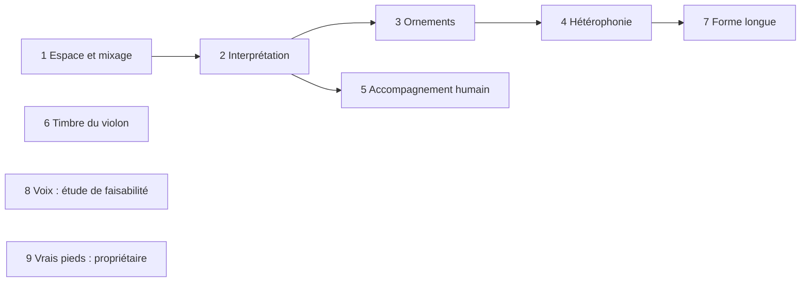

# Phase 012 — Vie et réalisme

## Problème

Les sept profils jouent des airs dont la structure se rapproche du corpus
(phase 3), mais le rendu sonne « machine » : tout est sec, centré, au même
volume de canal ; chaque note a la même articulation ; pas d'ornements ; un
seul instrument mélodique ; accompagnement mécanique ; attaques de violon
lentes. Cette phase ajoute la vie du jeu, **en données dans les profils**
(principe V), un point à la fois, chacun mesuré puis écouté (dans cet ordre).

## Règles communes à toutes les tâches

- Chaque nouveau réglage vit dans le profil TOML (section dédiée), validé au
  chargement avec une erreur lisible ; aucun nom de style dans le code.
- Déterminisme : tout tirage passe par le `ChaCha8Rng` du générateur. Aucun
  aléa dans le thread audio.
- Callback audio : pas d'allocation, pas de verrou ; les réglages arrivent
  par les événements existants, préparés sur le thread principal.
- Une seule façon de faire : un réglage remplace l'ancien chemin, il ne
  s'y ajoute pas ; le code mort découvert dans la zone est supprimé.
- Snapshot modifié ⇒ bump `TUNING_VERSION` et goldens régénérés dans le même
  commit ; `profile_d2_fixed.json` reste identique sauf décision écrite ici.
- Avant toute écoute du propriétaire : mesure par le coordinateur (niveaux,
  variété, fins de phrase, absence d'indice trivial dans les kits à l'aveugle).
- Les décisions de style se figent en ADR dans ce plan **après** validation à
  l'oreille et au labo.

## Ordre et parallélisme



1 et 6 touchent le rendu ; 2 à 5 touchent le générateur. 6 (labo, banques)
et 8 (étude) peuvent tourner en parallèle des autres quand leurs fichiers ne
se recouvrent pas. 9 dépend seulement des enregistrements du propriétaire.

## 1. Espace et mixage — `[mix]` par profil

### Constat (main `9323ef1`, vérifié dans le code)

- Aucun CC de panoramique (10), de réverbération (91) ni de chorus (93)
  n'est envoyé. oxisynth remet CC 91 à 0 et CC 10 à 64 : tout est **sec et
  centré** (sauf envois codés dans la SoundFont elle-même).
- `PlaybackEngine` garde des gains `lead/chords/bass/snare/hat`
  (1,0 / 0,6 / 0,6 / 0,5 / 0,4, noms hérités de l'ancien moteur), mais ne les
  envoie que sur `PlaybackCommand::SetChannelGain` (commande `set gain` du
  REPL). `PlaybackCommand::MixerGains` n'est jamais émis ; les champs
  `MusicalParams::gain_*` ne sont lus nulle part. En pratique **tous les
  canaux restent à CC 7 = 100** : l'équilibre ne dépend que des vélocités.
- `VoiceManager::process_event` traite un `AudioEvent::ControlChange` CC 1
  (filtre, résonance, « pitch instability » par `rand::thread_rng()` dans le
  thread audio) qu'aucun code n'émet : code mort et non déterministe.
- La réverbération intégrée d'oxisynth (`set_reverb_params` : taille, amorti,
  largeur, niveau) est active mais ne reçoit aucun envoi.
- oxisynth ne publie que le mélange stéréo (`write`, `read_next`) : pas de
  sortie par canal, donc pas d'égalisation par piste sans changer de
  synthèse.
- Niveau global très bas : rendus WAV `726f218` (banque GM, seed 3,
  34 mesures, deux tours, sept profils) entre **−37,1 et −33,6 dBFS RMS**,
  crête **−22,1 à −21,1 dBFS** ; le labo normalise ses kits à la crête
  pour compenser.

### Décisions

- Section `[mix]` du profil : salle (`room` : taille, amorti, largeur, niveau)
  et, par piste (`Melody`, `Chords`, `Bass`, `Heel`, `Toe`) : niveau en dB,
  panoramique `-1..1`, envoi de réverbération `0..1`. Égalisation simple sur
  le bus stéréo (coupe-bas et une bande de présence ou plateau aigu, biquads
  sans allocation) ; l'égalisation par piste est hors de portée tant
  qu'oxisynth ne sort pas les canaux séparément. Gain de bus `master_db`
  par profil pour placer le mélange près de la pleine échelle sans
  saturer.
- Un seul état de mixage par piste, initialisé par le profil à chaque
  chargement ou changement d'air ; `set gain`/`mute` du REPL agissent sur ce
  même état. Les gains hérités (`SetMixerGains`, `MixerGains`,
  `MusicalParams::gain_*`) et le traitement CC 1 mort sont supprimés.
- L'export MIDI porte les mêmes CC (7, 10, 91) en tête de piste, pour qu'un
  rendu externe (fluidsynth du labo) entende le même mélange.
- Les notes ne changent pas : le flux de snapshots reste identique,
  `TUNING_VERSION` inchangé sauf si un golden sérialise le profil.
- Valeurs de départ par profil justifiées dans le README du profil (type de
  salle : cuisine, salle paroissiale, plein air pour la marche) puis ajustées
  à l'oreille.

### Fichiers touchés (prévision)

`harmonium_core/src/style_profile.rs` (schéma, validation),
`harmonium_core/src/events.rs`, `harmonium_audio/src/voice_manager.rs`,
`harmonium_audio/src/backend/*`, `harmonium_host/src/playback.rs`,
export MIDI, `harmonium_cli` (REPL `gain`), `profiles/*/profile.toml`,
`profiles/README.md`, `harmonium_audio/README.md`.

### Acceptation observable

- Rendu WAV de chaque profil avec la banque GM : niveau RMS/crête **par
  piste** (rendu piste seule, même seed) et mélange complet. Violon devant :
  au moins 4 dB au-dessus de chaque piste d'accompagnement, pieds ≤ violon
  − 8 dB (mesure de référence du labo), mélange entre −6 et −1 dBFS de
  crête sur les sept profils (aujourd'hui vers −22), sans saturation.
- Image stéréo mesurée (corrélation ou différence G/D par piste) conforme au
  panoramique du profil ; rapport réverbéré/sec non nul quand l'envoi > 0.
- Tests de contrat : profil `[mix]` hors bornes rejeté avec message ;
  export MIDI contient les CC attendus ; même seed ⇒ même WAV octet pour
  octet ; snapshots inchangés.
- Aucune allocation dans le callback (`RTCheckAllocator` en debug).
- Puis écoute du propriétaire : kit avant/après sur 3 profils.

### Mesures V1

Mesuré le 2026-10-23, branche `wquintal/vie-v1-mix`, depuis main `d2137f9`.
Référence : binaire main avec
**seul ajout de `--solo-track`**, copié dans `/tmp/harmonium-mix-before` avant
le changement du mix. Aucune note, banque de cellules ni entrée d'arrangement
retouchée. Les deux variantes utilisent seed **3**, **34 mesures**, **2 tours**,
44 100 Hz, WAV stéréo float32, mêmes banques externes :

- `/Users/william.quintal/Project/bascanada/harmonium/assets/GeneralUser-GS.sf2`
- `/Users/william.quintal/Project/bascanada/harmonium/assets/harmonium_trad.sf2`

Script durable : `specs/012-vie-realisme/measure_mix.py`, numpy + stdlib :

```sh
cargo build -p harmonium-cli --release
/Users/william.quintal/Project/bascanada/harmonium_lab/.venv/bin/python \
  specs/012-vie-realisme/measure_mix.py --binary /tmp/harmonium-mix-before --stage before
/Users/william.quintal/Project/bascanada/harmonium_lab/.venv/bin/python \
  specs/012-vie-realisme/measure_mix.py --binary target/release/harmonium-cli \
  --stage after --check-acceptance
```

Pour reconstruire le binaire de référence, compiler main avec le seul ajout
CLI `--solo-track` (filtre des NoteOn par mute, pas de changement de génération).
Le script retire uniquement les tables `[mix*]` dans une copie temporaire
des profils pour cet ancien binaire. `--profiles-root` accepte aussi un
checkout main séparé ; `--reuse` réanalyse les fichiers sans les écraser.

RMS calculé sur **tous les échantillons**, silences d'entrée compris, et les
deux canaux ; crête absolue, aucune normalisation ni limiteur. La contribution
réverbérée est mesurée par un second rendu strictement identique, sauf
`mix.room.level = 0`, puis `20 log10(RMS(WAV − WAV_sec) / RMS(WAV_sec))`.
C'est une comparaison énergétique du retour, pas une estimation du temps
de décroissance. La corrélation G/D est également donnée par piste.

#### Mélanges complets

| Profil | RMS avant → après (dBFS) | Crête avant → après (dBFS) | Réverb./sec après (dB) |
|---|---:|---:|---:|
| `gigue_britannique_coloniale` | −36.2 → −16.6 | −22.0 → −3.7 | −18.5 |
| `gigue_quebecoise` | −36.1 → −17.7 | −21.9 → −3.3 | −21.7 |
| `hornpipe_britannique_coloniale` | −35.9 → −15.1 | −21.7 → −3.0 | −21.1 |
| `marche_britannique_coloniale` | −33.6 → −11.7 | −22.1 → −3.4 | −36.6 |
| `reel_acadien` | −37.1 → −18.4 | −21.8 → −3.1 | −19.5 |
| `reel_quebecois` | −37.1 → −18.7 | −22.1 → −3.1 | −22.3 |
| `valse_quebecoise` | −35.6 → −17.8 | −21.1 → −3.2 | −15.7 |

#### Pistes seules, mêmes notes

Unités : dBFS (RMS/crête), dB (écarts, balance G−D et réverb./sec).
Abréviations : GB/GQ = gigues britannique/québécoise ; HB = hornpipe ;
MB = marche ; RA/RQ = reels acadien/québécois ; VQ = valse.
`n.s.` : RMS < −90 dBFS, placement/corrélation non significatifs ; les
valeurs RMS/crête brutes restent affichées, sans faire passer le bruit
numérique de la réverbération pour une piste musicale.

| Profil/piste | RMS av. → ap. | Crête av. → ap. | Mélodie − piste av. → ap. | G−D av. → ap. | Corr. G/D av. → ap. | Réverb./sec ap. |
|---|---:|---:|---:|---:|---:|---:|
| GB/Melody | −38.6 → −17.2 | −25.7 → −4.4 | — | −0.0 → 0.3 | 0.993 → 0.990 | −18.1 |
| GB/Chords | −43.9 → −27.7 | −27.5 → −9.3 | 5.3 → 10.5 | −0.1 → −5.1 | 0.999 → 0.992 | −19.9 |
| GB/Bass | −42.1 → −29.1 | −29.6 → −16.4 | 3.5 → 11.9 | −0.1 → −0.0 | 0.999 → 0.999 | −28.8 |
| GB/Heel | −153.7 → −155.5 | −123.5 → −117.6 | 115.1 → 138.4 | n.s. | n.s. | — |
| GB/Toe | −153.7 → −155.5 | −123.5 → −117.6 | 115.1 → 138.4 | n.s. | n.s. | — |
| GQ/Melody | −39.7 → −18.7 | −25.3 → −4.0 | — | −0.0 → −0.7 | 0.993 → 0.996 | −21.2 |
| GQ/Chords | −43.3 → −27.7 | −24.8 → −7.2 | 3.6 → 9.0 | −0.1 → 4.8 | 0.999 → 0.996 | −22.3 |
| GQ/Bass | −40.3 → −27.7 | −28.2 → −15.4 | 0.6 → 9.0 | −0.0 → −0.0 | 0.999 → 0.999 | −32.0 |
| GQ/Heel | −114.8 → −101.0 | −68.3 → −53.0 | 75.0 → 82.4 | n.s. | n.s. | — |
| GQ/Toe | −153.4 → −156.3 | −123.5 → −118.9 | 113.7 → 137.6 | n.s. | n.s. | — |
| HB/Melody | −36.9 → −15.4 | −25.3 → −3.4 | — | −0.1 → 0.3 | 0.993 → 0.994 | −20.9 |
| HB/Chords | −46.5 → −30.2 | −27.5 → −9.3 | 9.6 → 14.9 | −0.1 → −5.1 | 0.999 → 0.996 | −22.3 |
| HB/Bass | −45.4 → −32.5 | −29.6 → −16.2 | 8.6 → 17.1 | −0.1 → −0.0 | 0.999 → 0.999 | −30.9 |
| HB/Heel | −155.3 → −159.7 | −123.5 → −118.4 | 118.4 → 144.4 | n.s. | n.s. | — |
| HB/Toe | −155.3 → −159.7 | −123.5 → −118.4 | 118.4 → 144.4 | n.s. | n.s. | — |
| MB/Melody | −33.7 → −11.7 | −25.9 → −4.3 | — | 0.1 → 0.1 | 0.992 → 1.000 | −36.6 |
| MB/Chords | −155.0 → −169.3 | −123.5 → −128.1 | 121.3 → 157.6 | n.s. | n.s. | — |
| MB/Bass | −155.0 → −169.3 | −123.5 → −128.1 | 121.3 → 157.6 | n.s. | n.s. | — |
| MB/Heel | −49.4 → −34.1 | −26.0 → −10.3 | 15.7 → 22.5 | −0.1 → 0.5 | 1.000 → 1.000 | −62.2 |
| MB/Toe | −155.0 → −169.3 | −123.5 → −128.1 | 121.3 → 157.6 | n.s. | n.s. | — |
| RA/Melody | −40.2 → −19.2 | −25.1 → −4.4 | — | −0.1 → 0.6 | 0.991 → 0.991 | −19.0 |
| RA/Chords | −45.4 → −29.8 | −24.8 → −7.2 | 5.2 → 10.6 | −0.1 → −5.0 | 0.998 → 0.992 | −19.9 |
| RA/Bass | −41.7 → −29.1 | −28.1 → −15.2 | 1.5 → 9.9 | −0.1 → −0.1 | 0.999 → 0.999 | −29.4 |
| RA/Heel | −54.5 → −39.9 | −33.9 → −19.0 | 14.3 → 20.7 | −0.1 → 0.8 | 1.000 → 1.000 | −37.5 |
| RA/Toe | −57.1 → −42.5 | −35.8 → −20.7 | 16.9 → 23.2 | −0.1 → −1.0 | 1.000 → 1.000 | −37.5 |
| RQ/Melody | −39.9 → −19.4 | −25.0 → −4.4 | — | −0.0 → −0.7 | 0.994 → 0.996 | −22.1 |
| RQ/Chords | −45.4 → −30.2 | −24.8 → −7.7 | 5.5 → 10.8 | −0.1 → 4.8 | 0.999 → 0.996 | −22.4 |
| RQ/Bass | −42.2 → −30.1 | −28.5 → −16.0 | 2.3 → 10.7 | −0.0 → −0.0 | 0.999 → 0.999 | −32.0 |
| RQ/Heel | −111.3 → −98.1 | −64.9 → −50.0 | 71.4 → 78.7 | n.s. | n.s. | — |
| RQ/Toe | −153.4 → −156.8 | −123.5 → −119.3 | 113.5 → 137.4 | n.s. | n.s. | — |
| VQ/Melody | −37.2 → −18.2 | −25.0 → −5.5 | — | −0.0 → −0.4 | 0.991 → 0.977 | −15.6 |
| VQ/Chords | −43.4 → −29.7 | −24.8 → −9.0 | 6.2 → 11.5 | −0.1 → 5.6 | 0.999 → 0.979 | −16.5 |
| VQ/Bass | −44.5 → −33.9 | −28.5 → −17.7 | 7.3 → 15.6 | −0.0 → −0.0 | 1.000 → 0.997 | −26.4 |
| VQ/Heel | −61.2 → −48.6 | −33.6 → −20.7 | 24.0 → 30.3 | −0.1 → 0.8 | 1.000 → 1.000 | −32.7 |
| VQ/Toe | −61.9 → −49.2 | −36.1 → −23.0 | 24.7 → 31.0 | −0.1 → −1.0 | 1.000 → 1.000 | −32.7 |

#### Décisions et limites de mesure

- Gain de bus calibré par profil pour une crête proche de −3 dBFS, pas
  de normalisation automatique (valeurs initiales, corrigées par la revue
  ci-dessous pour la marge aux émotions maximales) : +16 dB reel québécois,
  +16,5 gigue québécoise/reel acadien, +17 gigue/hornpipe britanniques,
  +17,5 marche, +14,5 valse. Accompagnement : guitare −5 dB, basse −8 dB, pieds −6 dB
  par rapport à CC 7 maximal. Les écarts RMS réels ne sont pas les
  différences des paramètres : banques, notes, vélocités et arrangement comptent.
- Sur les 34 mesures, écart mélodie − accompagnement tonal actif minimal :
  **8,99 dB** (critère ≥4). Pieds actifs ≥20,66 dB sous la mélodie
  (critère ≥8). **Aucun échantillon ≥1** sur tous les WAV mesurés.
  Les panoramiques ont le bon signe ; basses centrées à moins de 0,1 dB.
- Seed 3 choisit une intro de deux mesures pour reel/gigue québécois ;
  les pieds entrent au tour 2, **après les 34 mesures demandées**. On ne
  modifie ni seed ni arrangement pour fabriquer une preuve favorable.
  Complément à **66 mesures**, `--bars 66 --output /tmp/harmonium-mix-66` :
  pieds réellement actifs ≥20,62 dB sous la mélodie ; G−D Heel ≈+0,75 dB,
  Toe ≈−0,97 dB. Les sept mélanges restent entre **−3,41 et −1,35 dBFS**.
  Les pistes non arrangées (pieds britanniques, Chords/Bass/Toe de la
  marche) ne prouvent pas leur placement ; l'outro peut jouer un accent Heel.
- Réverbération mesurée non nulle sur chaque piste active avec envoi :
  beaucoup moins en marche (retour global −36,6 dB/sec) qu'en valse
  (−15,7 dB/sec). Les SF2 ont leurs propres paramètres ; aucun envoi ne
  garantit à lui seul un temps de salle identique avec une autre banque.
- Deux rendus complets de chaque profil, même seed : **WAV identiques
  octet pour octet**, aussi bien à 34 qu'à 66 mesures. Le script conserve
  le doublon `*-Mix-repeat.wav` et les SHA-256 dans les JSON.
- Chemin unique : `TrackState` pilote niveau/pan/envoi et mute ; `SetMix`
  transporte uniquement des valeurs Copy précalculées. Suppressions :
  `AudioEvent::SetMixerGains`, `PlaybackCommand::MixerGains`, les cinq
  `MusicalParams::gain_*`, les cinq gains en dur de `PlaybackEngine`,
  les méthodes `set_gains`, le traitement CC 1 filtre/résonance/aléa
  et la dépendance `rand` du crate audio.
- En GM partagé, **Toe gagne** les CC du canal 9 ; ordre identique dans le
  synthé et le MIDI. Avec la banque pieds, les canaux 3/4 sont séparés.
  Le MIDI porte les CC 7/10/91, pas les paramètres non portables de salle,
  d'EQ et de gain master ; ceux-ci se règlent dans le lecteur externe.
- La présence est un biquad en cloche RBJ, coupe-bas Butterworth à Q fixe ;
  calcul des coefficients hors callback, deux états par bande/canal,
  après `synth.write`. Aucun limiteur ni RNG dans le nouveau DSP.
- Recherche de références via `xd://lsp` tentée, puis rechargement : le
  serveur rust-analyzer quitte avec code 0 avant initialisation. Repli
  explicite : recherche exhaustive des symboles et compilation des consommateurs.
  Ne pas présenter cette recherche texte comme une preuve LSP.
- Vérification finale : **`cargo test --workspace` : 405 réussis,
  2 ignorés (42 suites)** ; `cargo fmt --all` puis `cargo fmt --all -- --check`
  réussis. `cargo clippy --workspace --lib --bins --message-format=json` :
  **163 avertissements préexistants, contre 165 sur main, aucun nouveau**,
  comparaison par fichier/code/message avec un checkout main archivé.
  Les deux `expect` de l'export MIDI ont été retirés. `-D warnings` ne
  peut pas passer sur main (126 erreurs dès le crate core), donc le
  critère vérifié est bien « aucun nouvel avertissement hors tests ».
- Contrats dédiés : chargement rejeté par champ borné (y compris NaN/inf),
  niveaux négatifs finis sans plancher artificiel, CC MIDI avant notes,
  réapplication sur profil et nouvel air, préservation du mute, gain de bus
  linéaire. Le test audio avec la vraie `assets/test.sf2` applique `SetMix`
  et rend les biquads **sous `RTCheckAllocator` en debug** : aucune
  allocation/désallocation dans ce nouveau chemin après préparation des voix.
  Cette preuve ne prétend pas instrumenter les allocations/verrous préexistants
  de l'enregistreur WAV/MIDI, qui reste hors garde dans l'architecture actuelle.
- Tous les goldens de snapshots passent sans régénération, dont
  `profile_d2_fixed.json` et `profile_d2_main.json` : **`TUNING_VERSION = 13`
  inchangé**, aucun golden ne sérialise le nouveau mix. Les 42 WAV de
  référence ont aussi été reproduits octet pour octet avec les seules
  tables `[mix*]` retirées des profils courants ; les corrections clippy
  finales ne changent aucun des 42 WAV après.

Écoute (hors dépôt) : `/tmp/harmonium-mix/{before,after}/<profil>-Mix.wav`,
et `-Melody.wav`, `-Chords.wav`, `-Bass.wav`, `-Heel.wav`, `-Toe.wav`.
Contre-épreuves sèches : suffixe `-dry.wav`. Résultats complets :
`/tmp/harmonium-mix/{before,after}/measurements.json` et
`/tmp/harmonium-mix-66/after/measurements.json`.
Écoute et validation historique par le propriétaire encore nécessaires ;
ces valeurs sont des propositions de rendu mesurées, pas un ADR d'écoute.

#### Revue coordinateur : marge aux émotions maximales

Le calage à −3 dBFS de crête était fait en émotions neutres. Rendu de
contrôle, 5 seeds × 7 profils, 66 mesures, 2 tours, automation constante
`intensity = arousal = density = tension = feet = 1`, valence 0, banques GM
+ pieds : le hornpipe **saturait** (crête jusqu'à **+1,62 dBFS**, 16
échantillons ≥ 1 sur le seed 7) et quatre profils montaient au-dessus de
−1 dBFS. Règle retenue : crête ≤ −1,5 dBFS au pire de ces rendus. Gains de
bus corrigés : reel québécois 16 → 15,5 ; gigue québécoise 16,5 → 15,5 ;
reel acadien 16,5 → 15,5 ; marche 17,5 → 16,5 ; gigue britannique
17 → 16 ; hornpipe 17 → 13,5 ; valse 14,5 inchangé. Après correction
(mêmes rendus, plus les mêmes seeds en neutre) :

| Profil | Crête neutre, 5 seeds (dBFS) | RMS neutre moyen (dBFS) | Crête max-émotions, pire (dBFS) | Échantillons ≥ 1 |
|---|---:|---:|---:|---:|
| `gigue_britannique_coloniale` | −4,14 … −2,35 | −18,0 | −1,85 | 0 |
| `gigue_quebecoise` | −3,14 … −2,22 | −18,0 | −1,77 | 0 |
| `hornpipe_britannique_coloniale` | −6,54 … −4,11 | −18,0 | −1,88 | 0 |
| `marche_britannique_coloniale` | −4,77 … −3,61 | −12,3 | −1,85 | 0 |
| `reel_acadien` | −4,43 … −3,76 | −18,7 | −1,82 | 0 |
| `reel_quebecois` | −4,35 … −3,05 | −19,0 | −1,68 | 0 |
| `valse_quebecoise` | −3,96 … −2,99 | −17,4 | −1,98 | 0 |

Le hornpipe neutre descend à −6,5 dBFS de crête (critère initial −6..−1) :
la marge en jeu prime. La marche reste ~6 dB plus forte en RMS que les
autres (fifre continu) : à juger à l'oreille lors d'un changement de style.
Les pieds sont à ≥ 20 dB RMS sous la mélodie (≈ 14–16 dB avant V1) : risque
de pieds trop discrets, à écouter avant de figer.

### Dette temps réel préexistante (hors V1) — soldée par RT1

V1 prouvait `SetMix` et le DSP du mixage sous l'allocateur de contrôle ; le
callback complet restait hors garde (`RecorderBackend`, `UpdateMusicalParams`,
rapport périodique, `process_commands`). RT1 solde ce tableau : **tout
`PlaybackEngine::process_buffer` s'exécute désormais sous `RTCheckAllocator`**
(garde imbriquable, `RtGuard` en tête de fonction), commandes, profil,
rapports et début/fin d'enregistrement compris.

| Chemin préexistant | Problème | État (RT1) |
|---|---|---|
| `recorder.rs` début WAV (`Vec` 1 MiB, `Arc`, `WavWriter`) | Ressources créées depuis la commande audio. | **Fait.** Le thread d'enregistrement (créé dans `RecorderBackend::new`, hors callback) crée l'écrivain ; le callback envoie `WavStart`. |
| `recorder.rs` écriture WAV (`SharedWriter` + `Mutex`, `Cursor<Vec>`) | Verrou et réallocation à chaque échantillon. | **Fait.** Le callback copie dans des blocs PCM préalloués (8192 échantillons × 48, recyclés par un second anneau SPSC) ; le thread encode avec `hound`, sans verrou partagé (`Rc<RefCell>` local au thread). |
| `recorder.rs` fin WAV / fin MIDI (`finished_recordings.lock()`, `push`, SMF) | Verrou, `Vec`, sérialisation dans le callback. | **Fait.** Le callback envoie `WavStop` / `MidiStop` ; le thread sérialise et publie dans `finished_recordings`. |
| `recorder.rs` début/pendant MIDI (`vec!`, `push`, `midi_active`) | Croissance de collections dans le callback. | **Fait.** Événements `Copy` horodatés en **frames** dans une file SPSC de 4096 messages ; piste, notes actives et delta-times vivent côté thread. |
| `playback.rs` `UpdateMusicalParams` (`Box<MusicalParams>`, `clone`) et `recorder.rs` (`params.clone()`, liste de programmes) | Clone de `Vec`/`Box`, destruction de l'ancien snapshot dans le callback. | **Fait.** `PlaybackParams` (`Copy`, `MusicalParams::playback_params()`, préparé sur le thread principal comme `PreparedMix`) traverse commande, événement et rapport. Aucune charge propriétaire ne transite : l'anneau de recyclage envisagé n'est pas nécessaire. `gm_programs_for_profile` rend un `ArrayVec`. |
| `playback.rs` rapport périodique (`musical_params.clone()`, `Vec::with_capacity(16)`) | Clone de `MusicalParams`, allocation du tampon de notes. | **Fait.** `EngineReport::realtime(PlaybackParams)` : champs de taille fixe, `Vec` vides (capacité 0). `EngineReport.musical_params` devient `PlaybackParams`. |
| `playback.rs` `process_commands` hors garde | Aucune garde ; `log::info(&format!(…))` (alloc + verrou + E/S) sur `Seek`, `SeekPlayhead`, `SetLoop`, `ClearLoop` ; `SetMutedChannels(Vec<bool>)` libéré dans le callback. | **Fait.** Garde globale ; journaux retirés du callback ; `SetMutedChannels([bool; 16])`. |

**Débordement (explicite et testé).** `OverflowPolicy::DropAndCount` (temps
réel, défaut de `RecorderBackend::new`) refuse ce qui ne tient pas et le
compte dans `RecorderStats` (`dropped_pcm_samples`, `dropped_midi_events`,
`lost_commands`, lisibles via `RecorderBackend::stats()`) ; le WAV remplace
les blocs perdus par du silence (durée exacte) et le thread journalise un
avertissement. Les données ne prennent jamais les 8 dernières places de la
file : un `Stop` entre toujours. `OverflowPolicy::Block` (rendu hors ligne,
`create_offline_engine`) attend le thread : rien n'est perdu, et la fin d'une
prise rend la main une fois le fichier publié (les exports CLI/labo lisent
`finished_recordings` juste après le dernier `process_buffer`). Tests :
`wav_overflow_is_counted_and_padded_with_silence` et
`midi_overflow_is_counted_and_stop_still_delivered` (sans thread, pool épuisé
puis file saturée), `wav_is_byte_identical_to_direct_encoding`.

**Preuve.** `harmonium_host/tests/realtime_callback_tests.rs` : moteur réel,
synthé `test.sf2`, deux prises WAV + MIDI avec SetMix, rampe de tempo, mute,
boucle, seek, rapports ; `harmonium_audio/tests/recorder_realtime_tests.rs` :
l'enregistreur seul, SetMix et changement de tempo en cours de prise. Toute
allocation ou libération du callback fait paniquer ces tests (vérifié en
injectant un `vec!` dans `RecorderBackend::process_buffer`). L'absence de
verrou tient à la construction (files `rtrb`, atomiques) : l'allocateur ne
peut pas la détecter. Les `AudioRenderer` de test (`handoff_tests`,
`swing_tempo_tests`) ont des journaux préalloués et prennent leur verrou une
première fois hors garde (sur macOS cette prise alloue).

**Reste (documenté, en dehors du régime permanent).**

- `LoadFont` : analyser et insérer une SoundFont alloue (oxisynth) et journalise
  (verrou + E/S). Exemption `allow_allocation()` dans `SynthBackend`, sur cette
  commande seulement. Piste : analyse sur le thread principal, et insertion sans
  allocation côté oxisynth (hors dépôt).
- `oxisynth::core::midi::inner_noteon` alloue puis libère un `Vec` de 64
  pointeurs à chaque NoteOn (bibliothèque tierce). Exemption ciblée
  `allow_allocation()` autour de ce seul `send_event(NoteOn)` dans
  `VoiceManager::process_event` ; rendu (`write`), NoteOff, CC, programmes et le
  code du dépôt restent gardés. Constaté avec `assets/test.sf2` ; une banque
  SF3 ou des zones plus riches n'ont pas été mesurées.
- Politique `DropAndCount` : la marge est de ≈ 4,5 s de stéréo à 44,1 kHz
  (48 blocs) devant le thread d'enregistrement ; un thread bloqué plus
  longtemps perd du PCM (compté, silence dans le WAV).
- Un hôte qui lit `finished_recordings` en temps réel voit désormais un fichier
  quelques millisecondes après la commande d'arrêt, plus au retour du callback.

## 2. Interprétation — `[performance]` par profil

- **Constat** : toutes les notes sont `Articulation::Normal` ; pas de
  micro-décalage autre que le swing ; pas de courbe de dynamique de phrase ni
  de respiration en fin de phrase.
- **À faire** : micro-décalages déterministes par position (avance/retard),
  articulations détaché/lié/accent, courbe de dynamique par phrase,
  respirations aux fins de phrase ; branché aux 4 émotions (tension = plus en
  avant, plus détaché).
- **Vérifier** : au labo ce qui est mesurable (écart d'attaque par position,
  durée relative, vélocité par position de phrase) ; snapshots déterministes ;
  bump `TUNING_VERSION`.

### Décisions V2

- `performance.tracks.<piste>` : décalages par pas, dispersion symétrique,
  menu pondéré d'articulations filtré par position/durée/intervalle précédent,
  courbe de phrase, bornes MIDI et respiration. Algorithmes génériques dans
  `harmonium_core/src/performance.rs`, aucune sélection par nom de style.
  Paramètres, mécanique/neutre et unités dans `profiles/README.md`.
- **Fraction de pas**, plutôt que millisecondes : le geste suit le tempo,
  le swing et les rampes. Le snapshot publie des millièmes de pas signés pour
  l'attaque, un gate en millièmes de durée et la respiration en millièmes de
  pas ; résolution de décision 0,001 pas, rendu arrondi à l'échantillon.
  `start_step` ne bouge pas ; aucune position émotionnelle n'est réinjectée
  dans `BeatInfo` ni le transport. Premier instant d'une lecture/seek :
  attaque négative bornée à la frame 0 disponible, pas de pré-roll inventé.
- Les événements note-on/note-off sont précalculés et triés sur le principal
  à `MusicComposer::stage_bar`, après toute modification des notes. Le lecteur
  emprunte les événements négatifs de la mesure suivante depuis sa fenêtre
  préchargée : l'attaque du pas 0 peut réellement tomber dans le dernier pas
  précédent. Gate/respiration peuvent finir entre deux pas, traverser une
  barre, et suivent la durée gelée de chaque pas. Les buffers sont découpés
  à chaque événement, pas seulement aux cases de grille.
- Le nouveau chemin audio n'a ni RNG, ni allocation, ni verrou. Buffers
  bornés préalloués à la construction ; tri non allouant des événements du
  pas, anciennes mesures renvoyées au principal. Chaque insertion passe par
  `push_capped` : au-delà de la capacité l'événement est abandonné (assertion
  en debug), jamais de croissance ni de panique dans le callback. Le test debug
  `performance_playback_tests` utilise `RTCheckAllocator` et une capture
  atomique sans verrou ; il vérifie les frames 0, 900, 2125, 3625, 3750,
  4750, 15800, 17400 et un retrigger traversant la barre. La dette RT
  préexistante du point 1 et l'enregistreur ne sont pas modifiés.
- `Normal`, `Detached`, `Linked`, `Accent` sont des **intentions déjà
  réalisées** : aucun gate ni bonus de vélocité caché dans le renderer.
  L'ancien variant `Staccato`, sans consommateur de production, est retiré.
  `Trigger` reste une intention de sample, durée MIDI de référence un pas.
  Le MIDI statique tient compte de l'attaque et de la fin réalisée
  (quantification 480 PPQ) ; le MIDI enregistré suit les événements audio.
  La vérité CLI contient désormais les snapshots complets également sans
  fichier d'automation, avec `bar_start_frames` et les anciens reports.
  `MusicalParams::arousal` brut remplace aussi le `state_snapshot.arousal`
  autrefois dérivé du tempo : le snapshot publie l'axe réellement appliqué.
- La phrase vient des `form.parts.phrase_ends` (frontières 1-based), ou des
  rôles cadentiels si elles sont omises ; aucune hypothèse 4+4 dans le code.
  La phase est évaluée à l'attaque, y compris à l'intérieur de la mesure.
  Respiration sur toutes les notes de la dernière attaque, pas sur les
  intros ; une intro conserve ses notes/levées d'arrangement.
- Les quatre axes sont des coefficients de données. Tension : avance et
  raccourcissement ; arousal brut : bonus des seuls accents (nouveau champ
  `MusicalParams::arousal`, distinct de l'intensité issue arousal+tension).
  Valence/densité : coefficients disponibles mais neutres faute de mesure
  spécifique ; aucune corrélation ABC/émotion revendiquée.
- **Chemin unique et frontières conservées** : les durées basse/guitare du
  profil sont des durées **écrites** du motif, pas un staccato caché. Les
  courbes P2 `fiddle_duration`, `tension_duration` et
  `tension_chord_duration` restent des transformations de durée écrite,
  publiées dans `duration_steps` (elles interviennent aussi avant la scission
  d'une tenue par densité). Les remplacer par un gate changerait la partition
  et casserait la neutralité demandée ; le gate V2 est une interprétation
  fractionnaire de cette durée publiée. L'humanisation de vélocité des pieds,
  tirée **une fois par air puis relue aux reprises**, reste une donnée du
  motif de podorythmie ; V2 n'ajoute aucun second jitter de vélocité et aucun
  réglage de performance aux pieds distribués. Le jitter V2 porte uniquement
  sur le temps des attaques. Ces distinctions conservent D2/P2 sans deux
  implémentations d'un même gate ou tirage.
- **RNG par mesure** : le seek déterministe ne rejoue pas les mesures déjà en
  mémoire (la timeline est conservée) ; un tirage d'interprétation pris sur le
  flux courant dépendrait donc du nombre de mesures déjà générées (le test
  `reel_determinism_set_seed_and_deterministic_seek` l'a montré). Une graine
  `performance_seed` est tirée **une fois par air** à `build_tune`, comme
  `feet_humanize`, sur le ChaCha8 du générateur, et seulement si
  l'interprétation n'est pas neutre ; chaque mesure en dérive un `ChaCha8Rng`
  (`seed_from_u64` + `set_stream(mesure)`). Les reprises et les tours ne
  rejouent donc pas le même geste (un violoneux ne se répète pas), mais la
  mesure `n` est identique quel que soit l'historique de génération.
- Neutralité : toutes les pistes à zéro (`Performance::is_neutral`) ⇒ aucune
  graine tirée, aucune étape d'interprétation : flux identique, y compris
  l'air suivant. Une règle sans effet sur le gate ni la vélocité compte pour
  zéro (son étiquette n'est pas publiée seule). Contrat de 100 mesures : profil
  absent et champs explicitement nuls produisent le même flux complet. Le cas
  `profile_d2_fixed.json` désactive explicitement la performance comme les
  autres couches postérieures à sa référence historique, et reste identique
  octet pour octet (non régénéré) ; seul `profile_d2_main.json` est régénéré.
- `TUNING_VERSION = 14` : modification du contrat explicite, pas une variante
  de transport. Les références courantes sont régénérées avec cette version ;
  les références historiques restent celles du cas performance neutre.

### Mesures V2

Commande reproductible (Python du labo, `mido` ; binaire `--release`) :

```sh
for s in before after; do
  harmonium_lab/.venv/bin/python specs/012-vie-realisme/measure_performance.py \
    --binary target/release/harmonium-cli --stage $s
done
harmonium_lab/.venv/bin/python specs/012-vie-realisme/measure_performance.py --corpus-only
```

7 profils × 20 seeds × 5 scénarios d'automation constante (neutre : arousal
0,5 / tension 0,4 ; tension 0 et 1 ; arousal 0 et 1), 34 mesures, 2 tours,
MIDI + vérité JSON pour chacun des 700 exports par étape. **Avant** = le même
binaire sur une copie des profils dont les sections `[performance]` sont
retirées ; **après** = profils distribués. Mélodie seulement, mesures de tour
seulement (les intros gardent leurs notes d'arrangement). Sorties hors dépôt :
`/tmp/harmonium-perf/{before,after}/` (`measurements.json` : distributions par
position, articulation, mesure de phrase) et `corpus-performance.json`.

**Identité du neutre.** Binaire de `main` (`ad7ad58`) contre ce binaire, profils
sans `[performance]`, seed 3, 34 mesures, banques GeneralUser GS + `harmonium_trad` :
les WAV des **sept profils** ont le même SHA-256 (par ex. reel québécois
`6afe4a58930a…`, gigue québécoise `56ecbc7910c2…`, valse `9b3fc461d160…`). Un tri
des événements simultanés par hauteur (au lieu de l'ordre de création) avait
changé les derniers bits du reel : l'ordre de création est donc la clé de tri.
Même seed, mêmes profils ⇒ deux rendus aux octets identiques (reel, gigue et
valse québécois, après ; le script compare les SHA-256 et échoue sinon).

Neutre (tension 0,4, arousal 0,5), moyennes sur les notes de mélodie :

| Profil | Notes | Écart d'attaque après, pas [p10 ; p90] | min ; max | Gate avant → après | Vélocité avant → après | Respirations |
|---|---:|---|---|---|---|---|
| reel_quebecois | 4409 | −0,015 [−0,041 ; +0,008] | −0,056 ; +0,014 | 1,000 → 0,960 | 95,4 → 95,4 | 160 × 19 ms |
| gigue_quebecoise | 3307 | −0,017 [−0,038 ; +0,002] | −0,046 ; +0,006 | 1,000 → 0,960 | 95,4 → 95,3 | 160 × 22 ms |
| valse_quebecoise | 2574 | −0,023 [−0,042 ; −0,002] | −0,046 ; +0,006 | 1,000 → 0,959 | 100,3 → 100,8 | 160 × 41 ms |
| reel_acadien | 4458 | −0,014 [−0,049 ; +0,014] | −0,066 ; +0,021 | 1,000 → 0,960 | 95,4 → 95,4 | 160 × 21 ms |
| marche_britannique_coloniale | 2658 | −0,018 [−0,032 ; −0,005] | −0,036 ; −0,001 | 1,000 → 0,960 | 100,1 → 100,2 | 160 × 81 ms |
| gigue_britannique_coloniale | 3255 | −0,017 [−0,038 ; +0,001] | −0,046 ; +0,006 | 1,000 → 0,960 | 93,3 → 93,3 | 160 × 26 ms |
| hornpipe_britannique_coloniale | 4079 | −0,022 [−0,041 ; −0,001] | −0,046 ; +0,006 | 1,000 → 0,960 | 97,7 → 97,8 | 160 × 52 ms |

Avant : tous les écarts valent 0 et tous les gates 1. Le gate 0,960 est la part
de `tension_detach` à tension 0,4 (0,10 × 0,4) ; les respirations sont les
160 fins de phrase de 20 seeds (8 par seed), durée nominale hors swing. Les
écarts sont petits par construction (≈ 1–3 ms) : ni la grille ni le groove
existant ne changent.

Écart d'attaque moyen par pas, reel québécois (après) : −0,035 aux deux
pulses (pas 0 et 8), −0,005 à −0,007 aux autres pas pairs. Fraction de pas ;
aux 230 BPM nominaux, −0,035 ≈ −2,3 ms.

Tension 0 → 1 et arousal 0 → 1 (constants ; **avant** = même automation, sans
`[performance]`) :

| Profil | Attaque moyenne, tension 0 → 1 | Gate moyen, tension 0 → 1 | Vélocité moyenne, arousal 0 → 1, avant | après | Notes `Accent` à arousal 1 |
|---|---|---|---|---|---:|
| reel_quebecois | +0,001 → −0,039 | 1,000 → 0,900 | 68,1 → 122,7 | 68,1 → 122,3 | 50 |
| gigue_quebecoise | −0,001 → −0,041 | 1,000 → 0,900 | 68,1 → 121,1 | 68,0 → 120,8 | 55 |
| valse_quebecoise | −0,007 → −0,047 | 0,999 → 0,899 | 69,9 → 123,5 | 70,4 → 123,4 | 26 |
| reel_acadien | +0,002 → −0,038 | 1,000 → 0,900 | 68,2 → 122,7 | 68,1 → 122,4 | 44 |
| marche_britannique_coloniale | −0,002 → −0,042 | 1,000 → 0,900 | 74,1 → 124,3 | 74,1 → 124,0 | 42 |
| gigue_britannique_coloniale | −0,001 → −0,041 | 1,000 → 0,900 | 69,2 → 115,0 | 69,1 → 114,7 | 41 |
| hornpipe_britannique_coloniale | −0,006 → −0,046 | 1,000 → 0,900 | 71,8 → 119,2 | 71,8 → 118,8 | 97 |

Le gros écart de vélocité entre arousal 0 et 1 **existe déjà avant** : c'est
la courbe d'intensité (`dynamics.arousal_intensity`), pas V2. Le bonus d'accent
(base 2, plus jusqu'à 4 à arousal 1 selon le profil) ne touche que 1–2 % des notes ; il se lit
dans les maxima de phrase, pas dans la moyenne.

Vélocité moyenne par mesure de phrase (neutre, avant → après ; courbe de
phrase propre à chaque profil, interpolée sur quatre mesures) :

| Profil | m.1 | m.2 | m.3 | m.4 |
|---|---|---|---|---|
| reel_quebecois | 95,1 → 94,2 | 95,3 → 96,4 | 95,2 → 96,1 | 96,3 → 95,0 |
| gigue_quebecoise | 95,3 → 94,3 | 94,7 → 95,6 | 95,2 → 96,2 | 96,7 → 95,4 |
| valse_quebecoise | 100,3 → 99,4 | 99,7 → 101,4 | 100,1 → 102,2 | 101,1 → 100,2 |
| reel_acadien | 95,5 → 94,6 | 95,1 → 96,2 | 95,2 → 96,1 | 96,0 → 94,6 |
| marche_britannique_coloniale | 100,7 → 99,7 | 99,7 → 100,8 | 99,6 → 100,7 | 100,7 → 99,5 |
| gigue_britannique_coloniale | 93,0 → 91,9 | 92,8 → 93,7 | 92,9 → 93,9 | 94,9 → 93,6 |
| hornpipe_britannique_coloniale | 97,5 → 96,7 | 97,3 → 98,5 | 97,1 → 98,0 | 99,3 → 98,1 |

Répartition des articulations publiées (neutre, après ; le gate d'un `Detached`
vaut 1 − (0,20 + 0,04) = 0,76, les autres 0,96) :

| Profil | Répartition |
|---|---|
| reel_quebecois | Normal 98,1 % ; Accent 1,1 % ; Linked 0,6 % ; Detached 0,1 % |
| gigue_quebecoise | Normal 98,2 % ; Accent 1,5 % ; Linked 0,3 % |
| valse_quebecoise | Normal 96,9 % ; Linked 1,7 % ; Accent 0,7 % ; Detached 0,6 % |
| reel_acadien | Normal 98,4 % ; Accent 1,0 % ; Linked 0,6 % ; Detached < 0,1 % |
| marche_britannique_coloniale | Normal 95,9 % ; Linked 2,4 % ; Accent 1,7 % |
| gigue_britannique_coloniale | Normal 98,4 % ; Accent 1,1 % ; Linked 0,5 % |
| hornpipe_britannique_coloniale | Normal 97,7 % ; Accent 2,3 % |

Ces fréquences reprennent celles des marques écrites du corpus (liaisons,
ties, points) : ce sont des planchers, car l'ABC n'écrit pas tous les coups
d'archet. Le hornpipe britannique n'a **aucune** articulation écrite
(`references/ornaments/britannique_coloniale-hornpipe.json`) : il n'a que des
accents métriques proposés, à valider à l'oreille.

**Limite mesurée : dérive du MIDI enregistré (corrigée par RT1, voir plus bas).** Le MIDI statique
(`timeline_to_midi`, test `performance_midi_tests`) place chaque attaque et
chaque fin à 1/480 de noire. Le MIDI du **RecorderBackend** (celui de
`--record-midi`) arrondit le delta de chaque événement en ticks
(`push_midi_event` → `steps_to_ticks`, `recorder.rs`) et jette le reste : sur
des événements sur la grille le reste est nul, sur des attaques décalées il
s'accumule comme une marche aléatoire. Résidu MIDI − vérité (ms, médiane
[p10 ; p90], neutre) :

| Profil | Avant | Après |
|---|---|---|
| reel_quebecois | −0,1 [−18,6 ; +0,5] | −0,3 [−8,4 ; +5,2] |
| gigue_quebecoise | +1,3 [+0,3 ; +2,3] | −9,9 [−19,8 ; −1,4] |
| valse_quebecoise | +2,9 [+0,8 ; +5,1] | −7,3 [−18,9 ; −1,1] |
| reel_acadien | +0,0 [−16,3 ; +1,5] | +0,7 [−2,9 ; +7,1] |
| marche_britannique_coloniale | −0,0 [−0,1 ; −0,0] | −5,4 [−14,9 ; +0,7] |
| gigue_britannique_coloniale | +3,1 [+0,9 ; +5,3] | −10,6 [−20,3 ; −1,3] |
| hornpipe_britannique_coloniale | −0,7 [−1,2 ; −0,2] | +3,8 [−1,9 ; +15,4] |

Sur une seed, le résidu part de 0 puis dérive jusqu'à −20 ms à la mesure 31
(gigue québécoise) : le fichier reste lisible, mais ses attaques ne sont plus
exactes. Le **rendu audio n'est pas touché** (les événements sont à la frame
exacte) ; seule la trace MIDI enregistrée l'est. `recorder.rs` étant hors
périmètre de V2, la correction (reporter le reste fractionnaire de ticks, ou
mieux horodater les événements en frames depuis la file SPSC prévue dans la
dette temps réel du point 1) est à faire avec cette tâche. Les queues
« avant » du reel (p10 ≈ −18 ms) existent déjà sans `[performance]` : modèle
de grille du script ou approximation du recorder, non investigué, hors V2.

Rendus pour l'écoute, hors dépôt : `/tmp/harmonium-perf/before/` et
`/tmp/harmonium-perf/after/`, `reel_quebecois-neutral-03.wav`,
`gigue_quebecoise-neutral-03.wav`, `valse_quebecoise-neutral-03.wav`
(banque GM + pieds `harmonium_trad`, seed 3, 34 mesures ; le fichier
`-repeat.wav` prouve l'identité octet pour octet). Écoute attendue : attaques
un peu plus souples aux temps forts, souffle bref en fin de phrase, légère
enflure au milieu de la phrase — rien de spectaculaire : **à valider à l'oreille**
avant toute augmentation des valeurs.

#### Revue coordinateur V2

- Repris sur Sonnet après la limite Codex (même worktree, travail conservé).
- Contrôle : `cargo test --workspace` 405 réussis / 2 ignorés (45 suites ; 9 tests
  unitaires internes du playhead remplacés par des contrats de flux couvrant
  barre, durée écrite, relance de même hauteur et allocation), fmt OK, clippy
  hors tests 163 → 162 sans nouvel avertissement. WAV identiques à seed égal
  (7 profils, deux rendus).
- Marge aux émotions maximales (5 seeds × 7 profils, 66 mesures, automation
  constante à 1) : les accents poussaient la gigue québécoise à −0,00 dBFS et
  la marche à −0,12 dBFS. Gains de bus abaissés : gigue québécoise 15,5 → 13,5,
  marche 16,5 → 15 ; pire crête ensuite −2,0 et −1,6 dBFS (neutre −5,4…−4,5 et
  −6,5…−6,0). Les cinq autres profils restent sous −1,5 dBFS.
- Les effets sont volontairement petits (attaques ±1–3 ms, gate 0,96, 96–98 %
  de notes `Normal`) : l'écoute dira s'il faut les augmenter.
- La dérive du MIDI enregistré (jusqu'à −20 ms) fausse les mesures du labo
  qui lisent `--record-midi` : corrigée par RT1 (enregistreur), voir ci-dessous.

#### Correction RT1 : MIDI enregistré exact

Cause : `push_midi_event` arrondissait chaque delta en ticks et jetait le reste.
Correction : l'horodatage est en **frames** ; `PlaybackEngine` annonce à chaque
pulse la cadence audible (`AudioEvent::MidiClock { ticks_per_frame }` : un pas
droit tronqué = 120 ticks, un quart arrondi de swing ou de rampe =
`120 × pas_par_quart` ticks, donc le swing audible reste dans le fichier et la
grille n'accumule aucun reste) ; le thread d'enregistrement convertit chaque
événement en ticks **cumulés** (ancre fractionnaire à chaque changement de
cadence) et n'arrondit que la position absolue. Le tempo variable (rampes
D4) ne change que la cadence, jamais les positions.

Mesure : `harmonium_host/tests/recorded_midi_exact_tests.rs` rend 30 mesures
(20 graines × reel/gigue/valse québécois × tensions 0,4 et 1, `--record-midi` du
moteur hors ligne, comme l'export CLI), apparie chaque attaque Melody/Chords/Bass
à sa position écrite (pas + décalage V2 en millièmes de pas, grille de swing
audible) et exprime le résidu en ticks (480 par noire ; 1 tick ≈ 1 ms à
120 BPM). Résidu enregistré − vérité, médiane [p10 ; p90], max |r| :

| Profil, tension | Avant | Après |
|---|---|---|
| reel_quebecois 0,4 | −0,2 [−13,8 ; +8,9], 20,8 | +0,0 [−0,4 ; +0,4], 0,5 |
| reel_quebecois 1 | −3,7 [−13,4 ; +1,5], 39,5 | +0,0 [−0,3 ; +0,4], 0,5 |
| gigue_quebecoise 0,4 | −14,2 [−28,0 ; −1,9], 40,0 | +0,0 [−0,4 ; +0,4], 0,5 |
| gigue_quebecoise 1 | −0,5 [−4,4 ; +2,2], 12,0 | +0,0 [−0,4 ; +0,4], 0,5 |
| valse_quebecoise 0,4 | −10,7 [−24,4 ; −1,3], 40,6 | +0,0 [−0,4 ; +0,4], 0,5 |
| valse_quebecoise 1 | +0,7 [−1,0 ; +4,9], 10,5 | +0,0 [−0,4 ; +0,4], 0,5 |

Le reste (≤ 0,5 tick) est l'arrondi à l'entier de la position absolue. Le
même test avec swing 0,62 et une rampe de tempo (`SetTempo` 150 BPM sur 8
pulses) donnait 11,3 ticks avant, ≤ 1 après. Les mêmes seeds exportées avant
et après (reel, gigue, valse québécois, marche britannique ; seeds 1 et 7 ;
12 mesures ; `assets/test.sf2`) : **WAV identiques octet pour octet**,
MIDI avec les mêmes événements dans le même ordre et des ticks décalés de 1 à
14 au plus (la dérive corrigée). `TUNING_VERSION` et les goldens de snapshots
sont inchangés.

## 3. Ornements idiomatiques

- **Constat** : aucun ornement généré.
- **À faire** : mesurer dans l'ABC du corpus les agréments `{g}`, triolets de
  notes répétées `(3eee`, rouleaux `~`, doubles cordes, par style et par
  position ; les doser par profil et par arousal.
- **Vérifier** : fréquences par position dans ±10 points du corpus ; pas
  d'ornement sur une note trop courte ; tessiture respectée.
- **Mesure faite (V3a, labo DS-T10, `harmonium_lab` `93d5048`)** :
  `references/ornaments/<tradition>-<type>.json` et section DS-T10 de
  `harmonium_lab/specs/001-trad-dataset/plan.md` : taux /100 notes par type
  et par mesure, durée porteuse minimale observée, schéma `[ornaments]`
  proposé (`engine_proposal`). Taux écrits = plancher (transcriptions
  sous-notées) ; arousal non mesurable dans l'ABC (multiplicateurs neutres).
  V3b (moteur) : fait, voir ci-dessous.

### Décisions V3b

Schéma et unités : [`profiles/README.md`](../../profiles/README.md#ornements) ; code :
`harmonium_core/src/ornaments/` (`mod.rs` schéma et validation, `realize.rs` réalisation),
branché dans `TradGenerator::generate_measure` après l'interprétation V2.

- **Une seule façon : la note de passage devient un type.** `[ornaments.types.passing]`
  (courbe de densité + durée porteuse minimale) remplace `dynamics.density_passing` et
  `form.ornament_min_steps`, supprimés ; `parts.ornament_protected_bars` reste, et protège
  désormais **tous** les types (cadence : aucun ornement dans la mesure, même additif, pour que
  la dernière note de la phrase reste celle de l'air). Une seule passe décide par note, donc
  jamais deux ornements sur la même note : la note de passage (sans tirage) passe avant les
  types tirés, un tirage unique `u` choisit au plus un type par porteuse (intervalles cumulés
  des probabilités). **Conséquence écrite** : section `[ornaments]` absente ⇒ plus de note de
  passage (elle vivait dans `dynamics.toml`) ; les sept profils la déclarent (sauf la marche,
  dont la courbe était nulle). Le passage est réalisé **après** l'interprétation (il ne reçoit
  donc plus de gate/décalage tirés, et la respiration de la porteuse est replafonnée sur sa nouvelle durée) ;
  à temps égal la note écrite précède la note ajoutée.
- **Appogiatures : sur la note précédente, pas sur la porteuse.** La porteuse reste sur la
  grille (le geste de danse, `BeatInfo` et le transport ne bougent pas) ; l'appogiature la
  précède de `span` pas (≤ 0,49, la borne d'attaque de V2, donc le chemin existant du lecteur :
  attaque négative empruntée à la mesure préchargée) et sa fin tombe **exactement** sur
  l'attaque de la porteuse. La note précédente de la mesure est écourtée de la même durée par
  `breath` (additif, composable avec la respiration de fin de phrase) ; si elle n'a pas
  ≥ 0,25 pas à rendre, l'ornement n'est pas posé. La première note d'une mesure n'a pas de
  précédente accessible (mesure déjà publiée) : son appogiature recouvre la queue de la note
  précédente dans la limite de la release de la banque, aucune note publiée n'est modifiée.
- **Sous-pas par décalage/gate.** Chaque note ajoutée garde `start_step` sur la grille la plus
  proche et un décalage |offset| ≤ 0,5 pas ; sa durée = `durée_en_pas × gate` (un pas
  entier de durée écrite, gate en millièmes). Les figures partagent la **durée jouée** de la
  porteuse (gate et respiration V2 compris) : rouleau 36/16/16/16/16 %, turn 14/18/14/54 %
  (voisine haute, porteuse, voisine basse, porteuse), trille ≈ 0,2 pas par note en nombre
  impair, triolet 3 × 1/3 avec 10 % de silence. Les voisines sont diatoniques dans le **mode
  actif** (mode parallèle compris) et la tessiture du profil ; sinon la porteuse reste seule.
- **Double corde / accord** : cordes à vide du profil (`strings`, donnée) : note simultanée sur
  la corde voisine de celle de la porteuse (dans le mode, l'intervalle et la tessiture
  demandés), plus tierce diatonique au doigt sous la porteuse pour la double corde ; même
  durée, même timing, même piste. Fifre (marche) : type désactivé, donnée.
- **Probabilité** : l'espérance du type dans une mesure vaut `taux × rate_scale × multiplicateur
  d'arousal / 100 × notes de la mesure`, répartie sur les porteuses permises (durée **écrite**,
  contextes), plafonnée à 1. Le taux reste donc « pour 100 notes de la mélodie » comme dans le
  corpus, même quand la durée minimale exclut la plupart des notes (les rouleaux du corpus sont
  sur 475 noires ou noires pointées sur 501 : répartir sur toutes les croches les aurait
  déplacés). Arousal : multiplicateurs `low` / `high` par type, interpolation linéaire sur
  l'arousal **brut** (comme V2), bornés 0..4, **neutres** dans les sept profils.
- **Déterminisme sans tirage.** Aucune lecture du `ChaCha8Rng` du générateur : la graine de
  l'air est un hachage (SplitMix64) de son matériel écrit (hauteur, position, durée de chaque
  mesure distincte, indice de l'air), calculée seulement si un type tire ; chaque porteuse tire
  dans un `ChaCha8Rng` propre `(graine, contenu de la mesure, pas)`. Raisons : un tirage sur le
  flux de l'air déplacerait l'intro et les airs suivants (avant/après impossible à comparer,
  contrat `intro_and_tour_same_melody` cassé) ; tout désactivé ⇒ **aucun tirage, flux
  identique** (vérifié sur le flux complet, identifiants de notes compris). La mesure `n` est la
  même après un seek.
- **Copies, reprises, variation.** Les tirages d'une porteuse ne dépendent que de la mesure
  **écrite** (hauteurs et positions) et du taux de la mesure-source (`CopyOf`/`CopyOfPart`
  suivis récursivement) : une copie exacte, une reprise ou un second tour portent les mêmes
  ornements ; une variation de P3-T3 (`varied_end`, `octave`…) change la mesure écrite, donc
  ses ornements. `ornaments.repeat_variation` (0 distribué) libère en plus les passes et tours
  2+ avec cette probabilité. Limite : les émotions changent la **durée jouée** (`fiddle_duration`,
  tension) ; la décision (éligibilité) suit la durée écrite, mais la figure s'étire avec la durée
  jouée, donc deux passes à émotions différentes n'ont pas les mêmes positions de notes (le
  contrat d'identité exacte des reprises sous automation se vérifie sans ornements tirés).
- **Valeurs des sept profils.** Taux écrits et par mesure du labo (DS-T10), `rate_scale = 4`
  identique partout (les taux sont des planchers ; avec 1 le reel québécois n'a qu'un ornement
  toutes les ~10 mesures, à peine audible), à valider à l'oreille. Écarts motivés avec
  `engine_proposal` : (a) taux par mesure seulement pour les types à ≥ 30 occurrences dans des
  parties de huit mesures reconnues, forme du corpus positionné, niveau du taux global (la valse
  a 105 doubles cordes dont **une** positionnée : sa table par mesure la mettait toute en m.8,
  protégée) ; (b) durée porteuse minimale = minimum observé si l'effectif < 30, sinon plus petite
  durée dont le taux par note atteint 10 % du meilleur (classes d'au moins 5 occurrences) :
  rouleaux et doubles cordes du reel québécois et rouleaux acadiens passent de 1/2, 1 et 1/3 à
  2 croches ; (c) le minimum du triolet est le total remplacé (3 × la première note du labo) ;
  (d) double corde et accord désactivés pour la marche (fifre monophonique) ; (e) types sans
  occurrence désactivés. Provenance et tableaux : README de chaque profil.
- **Limites assumées.** La mesure protégée (dernière de chaque partie) n'a aucun ornement : le
  taux réalisé vaut 7/8 du taux configuré et la m.8 du corpus (double corde en cadence) n'est pas
  reproduite. Les contextes (`intervals`, `beats`, `phrase_end`) sont implémentés et testés mais
  **ouverts** dans les profils : le labo ne mesure pas de taux par contexte pour ces types.
  L'export MusicXML écrit les notes en séquence (comme pour les accords de guitare) : les notes
  simultanées ou sous-pas de la mélodie y sont inexactes ; non traité ici. Le MIDI statique et
  enregistré les porte (MIDI enregistré : dérive de ticks de V2, `recorder.rs` hors périmètre).
- `TUNING_VERSION = 16`. Régénérés : `profile_d2_main.json`,
  `snapshot_stream_reel_seed42_8bars.json`. **`profile_d2_fixed.json` n'est pas modifié** : le
  test retient seulement `passing` (équivalent de l'ancien comportement : ni `[performance]`,
  ni ornements tirés). Goldens sans ornement tiré : WAV de `main` (`725067b`) et du binaire
  courant avec `[ornaments]` retiré des profils, 7 profils × graines 1, 3, 5, banques GM + pieds :
  **21 / 21 identiques octet pour octet**.

### Mesures V3b

Mesuré le 2026-10-23, branche `wquintal/vie-v3b-ornaments`. Script durable
`specs/012-vie-realisme/measure_ornaments.py` (venv et code du labo, binaire `--release`,
banques GM + `harmonium_trad`) :

```sh
export PYTHONPATH=/Users/william.quintal/Project/bascanada/harmonium_lab/src
PY=/Users/william.quintal/Project/bascanada/harmonium_lab/.venv/bin/python
cargo build --release -p harmonium-cli
$PY specs/012-vie-realisme/measure_ornaments.py corpus                              # taux des profils = recalcul du labo
$PY specs/012-vie-realisme/measure_ornaments.py --binary target/release/harmonium-cli rates
$PY specs/012-vie-realisme/measure_ornaments.py --binary target/release/harmonium-cli --seeds 100 \
    --output /tmp/harmonium-ornaments-100 rates                                     # effectif plus grand
$PY specs/012-vie-realisme/measure_ornaments.py --binary target/release/harmonium-cli {peaks,midi,wav}
```

- `corpus` : recalcule DS-T10 avec `harmonium_lab.trad.ornaments.run_ornaments` (code du labo) :
  **taux globaux et par mesure des sept profils = recalcul**, références versionnées = recalcul.
- `rates` : 7 profils × 20 graines × arousal 0 / 0,5 / 1 (valence 0,3, densité 0,2, tension 0,4),
  34 mesures, 2 tours ; un export de référence **sans `[ornaments]`** et un par type activé
  (seul dans la section) : comme l'air ne dépend pas des ornements, la différence des deux
  vérités isole le type (notes ajoutées / porteuses réécrites ; 2 540 exports à 20 graines,
  12 700 à 100). Comptage
  sur les **mesures distinctes** (une copie exacte porte les mêmes ornements : compter deux fois
  doublerait la variance) hors mesure protégée ; attendu = Σ mesures de
  `min(taux de la mesure × échelle × multiplicateur / 100 × notes, porteuses éligibles)` avec les
  durées écrites d'un export à intensité 0,5 / tension 0. Verdict : `ok` = rapport dans 0,9–1,1 ;
  `†` effectif faible = attendu dans l'intervalle de Poisson exact à 95 % de l'observé ; `‡` = hors
  cible. **Aucune occurrence dans une mesure protégée** (compteur à 0 dans les 99 cellules).

**Résultat à 20 graines** (spec) : sur 99 cellules (type × profil × arousal), 15 `ok`, 82 `†`,
2 `‡`. À 100 graines : 31 `ok`, 62 `†`, 6 `‡` (5 % attendus par construction d'un intervalle à
95 %, avec des types qui partagent leur tirage `u` : leurs écarts sont corrélés). **Agrégé sur les
99 cellules à 100 graines : 3 579 observées pour 3 621 attendues, rapport 0,988** (arousal 0 :
0,948 ; 0,5 : 0,988 ; 1 : 1,031 ; types additifs 0,999, types réécrits 0,978). Les types à gros
effectif sont dans ±10 points relatifs ; les autres tiennent dans l'intervalle des occurrences
(effectifs de 0 à 30 occurrences, comme le corpus). 100 graines, compte observé / attendu
(rapport) ; `†` effectif faible, `‡` hors cible :

| Profil | Type | Corpus /100 | Configuré /100 | Min (croches) | arousal 0 | arousal 0,5 | arousal 1 | /100 notes (a 0,5, mesures ouvertes) |
|---|---|---:|---:|---:|---|---|---|---:|
| `reel_quebecois` | grace_single | 0.185 | 0.738 | 0.5 | 41/45.6 (0.90)† | 38/45.4 (0.84)† | 37/44.5 (0.83)† | 0.550 |
| `reel_quebecois` | grace_multiple | 0.047 | 0.187 | 1 | 9/13.0 (0.69)† | 14/12.9 (1.08) | 10/12.7 (0.79)† | 0.203 |
| `reel_quebecois` | double_stop | 0.344 | 1.377 | 2 | 47/43.4 (1.08) | 44/41.4 (1.06) | 41/43.4 (0.94) | 0.637 |
| `reel_quebecois` | roll | 0.690 | 2.759 | 2 | 103/110.6 (0.93) | 110/102.9 (1.07) | 121/108.5 (1.11)† | 1.593 |
| `reel_quebecois` | turn | 0.004 | 0.017 | 1 | 2/1.1 (1.74)† | 0/1.1 (0.00)† | 1/1.1 (0.89)† | 0.000 |
| `reel_quebecois` | triplet_repeated | 0.182 | 0.727 | 1 | 46/49.4 (0.93) | 45/49.1 (0.92) | 36/47.9 (0.75)† | 0.652 |
| `reel_quebecois` | trill | 0.010 | 0.039 | 1 | 4/2.7 (1.49)† | 3/2.7 (1.13)† | 3/2.6 (1.15)† | 0.043 |
| `gigue_quebecoise` | grace_single | 0.207 | 0.827 | 1 | 39/43.1 (0.90) | 32/43.0 (0.74)† | 51/41.6 (1.23)† | 0.616 |
| `gigue_quebecoise` | grace_multiple | 0.033 | 0.131 | 1 | 2/6.8 (0.29)† | 5/6.8 (0.74)† | 6/6.6 (0.91) | 0.096 |
| `gigue_quebecoise` | double_stop | 0.076 | 0.305 | 1 | 9/15.9 (0.57)† | 13/15.8 (0.82)† | 15/15.3 (0.98) | 0.250 |
| `gigue_quebecoise` | roll | 0.207 | 0.827 | 3 | 10/8.0 (1.24)† | 8/6.3 (1.26)† | 4/7.7 (0.52)† | 0.154 |
| `valse_quebecoise` | grace_single | 0.073 | 0.293 | 1 | 12/14.6 (0.82)† | 12/13.4 (0.89)† | 9/12.7 (0.71)† | 0.262 |
| `valse_quebecoise` | grace_multiple | 0.012 | 0.049 | 1 | 0/2.4 (0.00)† | 2/2.2 (0.89)† | 3/2.1 (1.41)† | 0.044 |
| `valse_quebecoise` | double_stop | 1.283 | 5.133 | 1 | 242/255.6 (0.95) | 244/235.0 (1.04) | 224/222.7 (1.01) | 5.329 |
| `valse_quebecoise` | chord | 0.086 | 0.342 | 2 | 7/12.3 (0.57)† | 8/9.8 (0.82)† | 4/10.7 (0.37)‡ | 0.175 |
| `valse_quebecoise` | roll | 0.061 | 0.244 | 3 | 0/3.8 (0.00)‡ | 2/2.4 (0.82)† | 1/3.4 (0.29)† | 0.044 |
| `valse_quebecoise` | triplet_repeated | 0.061 | 0.244 | 2 | 4/8.8 (0.46)† | 4/7.0 (0.57)† | 5/7.6 (0.66)† | 0.087 |
| `reel_acadien` | grace_single | 0.273 | 1.091 | 1 | 62/64.4 (0.96) | 72/64.1 (1.12)† | 82/63.3 (1.30)‡ | 1.027 |
| `reel_acadien` | grace_multiple | 0.102 | 0.407 | 1 | 28/28.8 (0.97) | 41/28.5 (1.44)‡ | 38/28.2 (1.35)† | 0.585 |
| `reel_acadien` | double_stop | 0.125 | 0.499 | 1 | 36/35.4 (1.02) | 48/35.0 (1.37)‡ | 45/34.6 (1.30)† | 0.685 |
| `reel_acadien` | roll | 0.878 | 3.512 | 2 | 147/154.8 (0.95) | 132/146.5 (0.90) | 153/153.0 (1.00) | 1.882 |
| `reel_acadien` | triplet_repeated | 0.573 | 2.292 | 1 | 192/183.0 (1.05) | 183/181.4 (1.01) | 190/179.6 (1.06) | 2.610 |
| `reel_acadien` | trill | 0.028 | 0.111 | 2 | 5/4.8 (1.05) | 7/4.5 (1.54)† | 9/4.7 (1.91)† | 0.100 |
| `marche_britannique_coloniale` | roll | 0.247 | 0.987 | 2 | 45/44.8 (1.00) | 39/44.7 (0.87)† | 48/44.5 (1.08) | 0.817 |
| `gigue_britannique_coloniale` | grace_single | 0.049 | 0.194 | 1 | 16/10.4 (1.53)† | 8/10.4 (0.77)† | 11/10.4 (1.06) | 0.150 |
| `gigue_britannique_coloniale` | grace_multiple | 0.011 | 0.043 | 2 | 1/1.1 (0.94) | 1/1.0 (1.05) | 3/1.0 (2.89)† | 0.019 |
| `gigue_britannique_coloniale` | double_stop | 0.059 | 0.238 | 1 | 17/12.8 (1.33)† | 9/12.7 (0.71)† | 13/12.7 (1.03) | 0.168 |
| `gigue_britannique_coloniale` | chord | 0.062 | 0.248 | 1 | 16/13.3 (1.20)† | 9/13.3 (0.68)† | 8/13.3 (0.60)† | 0.168 |
| `gigue_britannique_coloniale` | roll | 0.019 | 0.076 | 3 | 0/0.4 (0.00)† | 0/0.3 (0.00)† | 1/0.4 (2.50)† | 0.000 |
| `gigue_britannique_coloniale` | triplet_repeated | 0.003 | 0.011 | 1 | 0/0.6 (0.00)† | 0/0.6 (0.00)† | 1/0.6 (1.74)† | 0.000 |
| `gigue_britannique_coloniale` | trill | 0.005 | 0.022 | 2 | 1/0.5 (1.88)† | 1/0.5 (2.09)† | 3/0.5 (5.78)‡ | 0.019 |
| `hornpipe_britannique_coloniale` | double_stop | 0.022 | 0.087 | 2 | 2/3.5 (0.58)† | 4/3.2 (1.27)† | 4/3.4 (1.19)† | 0.058 |
| `hornpipe_britannique_coloniale` | triplet_repeated | 0.327 | 1.310 | 2 | 36/49.8 (0.72)† | 34/42.9 (0.79)† | 46/47.3 (0.97) | 0.491 |

**Arousal** : les multiplicateurs distribués sont neutres, donc le taux réalisé ne suit pas
l'arousal (colonnes ci-dessus égales à l'effectif près) ; la pente est une donnée à régler à
l'oreille. Elle est prouvée par contrat : multiplicateurs 0,2 → 3,0, taux réalisés dans le
rapport 15 ± 4 entre arousal 0 et 1, flux identique entre arousals si neutres.

**Par mesure de la partie** (100 graines, trois arousals poolés, mesures distinctes ; les
copies `CopyOf` des m.5–7 sont absorbées par leur source) : observé / attendu, m.1 à m.7 (m.8
protégée : 0 par construction).

| Profil / type | m.1 | m.2 | m.3 | m.4 | m.5 | m.6 | m.7 |
|---|---|---|---|---|---|---|---|
| reel québécois / rouleau | 102/92.2 | 29/39.9 | 75/65.5 | 63/55.8 | 19/18.6 | 16/20.7 | 30/29.3 |
| reel québécois / triolet | 32/37.1 | 22/26.3 | 35/32.2 | 7/8.8 | 13/15.1 | 5/10.8 | 13/16.3 |
| reel québécois / double corde | 45/39.7 | 4/13.4 | 15/13.0 | 55/47.4 | 6/6.2 | 1/4.0 | 6/4.6 |
| reel québécois / appogiature | 22/22.7 | 25/31.0 | 5/3.9 | 36/35.4 | 6/7.6 | 7/12.9 | 15/21.9 |
| reel acadien / rouleau | 103/105.5 | 77/76.8 | 68/71.0 | 92/104.7 | 26/21.4 | 36/37.2 | 30/37.7 |
| reel acadien / triolet | 118/137.2 | 86/85.9 | 178/160.6 | 43/38.5 | 43/34.6 | 36/31.3 | 61/55.8 |
| hornpipe britannique / triolet | 46/54.7 | 23/28.3 | 17/22.1 | 0/0.0 | 13/15.8 | 17/19.1 | 0/0.0 |

Seul écart net : la double corde du reel québécois en m.2 (4 pour 13,4 attendues, ≈ 0,3 % sous
l'hypothèse nulle) alors que m.4 est au-dessus : probablement des porteuses de m.2 sans corde à vide
jouable dans le mode (la réalisation s'abstient) ; non investigué.

**Vérifications du flux et du lecteur** (7 profils, banques GM + pieds) :

| Contrôle | Résultat |
|---|---|
| MIDI enregistré = vérité (5 graines, 34 mesures, notes de mélodie par (hauteur, vélocité)) | **0 note manquante** sur 6 270 notes |
| WAV deux fois, même graine (reel, gigue, valse québécois, avant et après) | SHA-256 identiques deux à deux |
| Crête, 5 graines × 7 profils, 66 mesures, automation constante intensité = arousal = densité = tension = pieds = 1 | **−2,55 … −1,62 dBFS** (reel québécois −1,80 ; gigue québécoise −2,00 ; valse −2,24 ; reel acadien −2,55 ; marche −1,62 ; gigue britannique −2,30 ; hornpipe −1,88), 0 échantillon ≥ 1, **aucun ajustement de gain nécessaire** (critère −1,5) |
| Crête neutre, mêmes graines | −5,97 … −2,67 dBFS |

Écoute (hors dépôt) : `/tmp/harmonium-ornaments/{before,after}/<profil>-neutral-03.wav`
(`reel_quebecois`, `gigue_quebecoise`, `valse_quebecoise` ; seed 3, 34 mesures, deux tours,
arousal 0,5 ; *avant* = profil sans `[ornaments]`, qui est le flux d'avant V3b). Notes de mélodie
avant → après : reel 225 → 247 (14 mesures sur 34 ornées, copies comprises), gigue 178 → 182
(4 mesures), valse 141 → 145 (4 mesures) : les gigues et la valse sont très peu ornées
(planchers × 4), le reel l'est nettement. Écoute attendue : petites coupures avant la note
(appogiatures), rouleaux sur les noires, doubles cordes à vide ; **à valider à l'oreille**
avant de relever `rate_scale`. Les SoundFonts libres ont des attaques de violon de 250–360 ms
(point 6) : des notes de 15–40 ms s'y entendent surtout comme un grain ou un accent, pas comme
des hauteurs.

Contrats de flux (`harmonium_core/tests/ornaments_contract_tests.rs`, 14 tests, sur 200 airs
pour les fréquences) : sections inertes ⇒ flux complet identique (identifiants de notes compris,
sept profils × 2 graines × 100 mesures) ; fréquence réalisée de chaque type dans 90–110 % du
taux configuré (chord : ≥ 70 %, triple corde parfois injouable) ; `rate_scale` ; taux par
mesure ; aucune note ajoutée hors d'une porteuse de durée écrite ≥ minimum (huit types) et
tessiture respectée ; décalage ≥ −0,49 pas et notes sur la grille ; appogiature finissant sur la
porteuse sans chevauchement de la note précédente ; double corde même timing, corde à vide ou
tierce, 3–12 demi-tons ; arousal 0,2 → 3,0 ⇒ rapport 15 ± 4 et flux égal si neutre ;
déterminisme ; copies (`CopyOf`) et reprises identiques, libérées par `repeat_variation` ;
mesures protégées intactes, filtres `intervals` / `phrase_end` ; ligne écrite conservée (hauteur et
position de chaque note) pour tous les types sauf le turn ; 15 valeurs ou combinaisons hors bornes
rejetées avec le nom du champ, plus un champ inconnu.

`cargo test --workspace --no-fail-fast` : **421 réussis, 0 échec, 2 ignorés (47 suites)** ;
`cargo fmt --all -- --check` réussi ; `cargo clippy --workspace --lib --bins` : **162
avertissements, comme `main` (162), aucun nouveau** ; aucun `unwrap`/`expect` ni code dans le
callback audio (la réalisation est sur le thread principal, dans `generate_measure`).
Tests adaptés, pas affaiblis : les fixtures de neuf fichiers qui lisent la mélodie **écrite**
(cadences, rythme, copies, entropie, intro, MIDI droit, grille du handoff, jazz) neutralisent
`[ornaments]` comme elles neutralisent déjà `[performance]` ; trois fichiers de densité/mode
gardent seulement `passing` (le comportement qu'ils testent) ; le test d'automation du CLI
vérifie le déterminisme avec les ornements et l'identité exacte des reprises sans eux (voir
« Copies, reprises, variation »). Le test des copies de l'hôte (`m.5 == m.1`) a prouvé le besoin
du taux de la mesure-source : sans lui, un taux par mesure différent rendait les copies
différentes.

## 4. Hétérophonie

- **À faire** : deuxième instrument mélodique (accordéon, 2ᵉ violon, harmonie
  à la tierce) qui joue la même ligne avec ses propres variations, décrit en
  données (instrument, entrée dans l'arrangement, taux de variation).
- **Vérifier** : la 2ᵉ voix suit la ligne (même contour, mêmes cadences),
  diffère sur une part mesurée des notes ; niveau sous le violon (point 1).

## 5. Accompagnement humain

- **À faire** : accords grattés (décalage des cordes), basse avec notes de
  passage, styles piano main gauche et accordéon basse-accord, en données.
- **Vérifier** : écart entre cordes d'un même accord, part de notes de
  passage, aucune fausse note contre la mélodie aux temps forts.

### Décisions V5b-0 — composition et déterminisme

Lecture du code fusionné sur `main` `649c684` (V2, V3b et RT1) :

- `Performance::apply` affecte `NotePerformance.offset` et tire encore par note.
  Le grattage passe **après V2**, additionne ses décalages en millièmes de pas et
  conserve la borne ±490 et le lecteur d'événements préparés existant. Aucun
  calcul, tirage ni allocation ajouté au callback, intégralement gardé depuis RT1.
- Les accords sont interprétés **par attaque** (`Chords`, `start_step`) : contexte
  de l'attaque précédente, un jitter et une articulation pour toutes ses cordes ;
  gate et respiration communs. La vélocité de chaque corde reste individuelle.
  Ce changement entre avec le grattage, pas avec la migration neutre du schéma.
- La graine d'air est déjà dérivée sans tirage du matériel mélodique par
  `ornaments::tune_seed` (SplitMix64). L'accompagnement réutilise cette graine et
  ce mélangeur, avec des domaines voix/mesure/attaque distincts dans ChaCha8Rng :
  **pas de deuxième mécanisme ni de tirage sur le RNG séquentiel**. La graine
  est calculée si les ornements ou l'accompagnement en ont besoin. Ainsi les
  décisions de mélodie, intro, pieds et airs suivants restent inchangées.
- V5b-1 remplace les champs plats et `dynamics.chop_patterns`, sans activer de
  passage ni de grattage : version 16 et goldens inchangés. V5b-2 puis V5b-3
  versionnent explicitement leurs changements de flux ; la référence historique
  `profile_d2_fixed.json` conserve un accompagnement mécanique explicite.
- Les valeurs musicales restent des hypothèses de départ de l'étude V5a, pas un
  ADR d'écoute. V5b-5 (labo) et V5b-6 (écoute propriétaire) ne sont pas réalisés.

Navigation LSP tentée puis serveur rechargé : rust-analyzer quitte avec code 0
avant initialisation. Repli : inventaire exhaustif des consommateurs et
compilation des crates ; aucune preuve LSP revendiquée.

### Mesures V5b

**V5b-1 — migration neutre.** Schéma séparé en `trad/accomp_profile.rs`,
réalisation existante adaptée, sept profils et fixture jazz migrés ; anciens
champs et motifs de dynamique supprimés. Binaire `--release` de main conservé
dans `/tmp/harmonium-accomp/baseline/`, profils inclus. Exports réels GM + pieds,
seed 3, 100 mesures par profil : **700 snapshots complets identiques**, avant
contre schéma migré (y compris mélodie, pieds, identifiants et performance).
Trois WAV de référence (reel, gigue, valse québécois, seed 3, 34 mesures, deux
tours) préparés dans `/tmp/harmonium-accomp/before/`. `TUNING_VERSION = 16`
inchangé ; SHA-256 de `profile_d2_fixed.json` :
`2960f927a50d0f0108c89de8f82993e531cebd9d7f02276fa37a9eca6437fec2`.

**V5b-2 — passages.** `trad/bass_passing.rs` : règles pondérées, approches
diatoniques/chromatiques, fenêtre élargie, phase de phrase et densité/arousal
en données. Aucune approche sur les coups ou temps forts ; durée du coup
précédent raccourcie si nécessaire. Veto sur la mélodie à l'attaque, puis
revérification du flux après les ornements ; notes ordinaires interprétées
par V2. Graine de matériel unique et sous-domaines par voix/mesure/attaque.
`TUNING_VERSION = 17` ; références courantes régénérées, référence D2 fixe
inchangée (accompagnement de passage explicitement absent dans cette fixture).

Script durable `measure_accomp.py` : 20 seeds × 7 profils × arousal 0 / 0,5 / 1,
34 mesures, deux tours, densité constante 0,5 ; compare les vérités de main
avec les mêmes automations. Première mesure : frontières avec passage à arousal
0,5 = reel québécois 37,0 %, reel acadien 33,1 %, gigue québécoise 33,8 %,
gigue britannique 28,2 %, hornpipe 18,6 %, valse 1,2 % (cadence seule), marche 0.
Reel québécois : poids d'abstention augmenté de 4 à 5 pour viser 25–35 %
après veto, plutôt que de prétendre que les poids donnent une fréquence garantie.
Après recalage : **30,6 %** des frontières du reel québécois à arousal 0,5
(15,9 % à 0 ; 35,5 % à 1), mesures dans
`/tmp/harmonium-accomp/passing-final/rates/measurements.json`.
**Aucun conflit de passage** ; taux de conflit aux temps forts exactement celui
de main pour les 21 cellules profil/arousal (0–3,0 %). Mélodie, Heel et Toe
comparés note pour note : identiques, sur les 420 paires d'exports.

Sept contrats dédiés passent : bornes/erreurs de chargement ; tables inertes,
flux complet et aucun tirage (100 mesures) ; pistes voisines et basse forte
inchangées ; trois mouvements, tessiture, approche sans répétition et veto
(20 graines × 64 mesures) ; déterminisme et invalidation ; densité et arousal.
La migration précédente passait également `cargo test --workspace` :
430 réussis, deux ignorés, 50 suites. Référence clippy hors tests de main
archivé (`649c684`) : 162 avertissements, enregistrés pour comparaison finale.

**V5b-3 — grattage.** `trad/strum.rs`, schéma de cordes et coups dans
`trad/accomp_profile.rs`, triades doublées par octaves et coups montants dans
`trad/accomp.rs`. Le rejeu de conduite de voix n'alloue plus de notes jetables.
Les tirages de présence, vélocité et écart ont des domaines séparés de la même
graine de matériel ; aucun tirage séquentiel ajouté. V2 interprète maintenant
chaque attaque en bloc (jitter, articulation, gate et respiration), puis V5
ajoute le geste dans ±490. Un geste trop large est réduit **en entier** :
pas de saturation indépendante qui inverserait ou superposerait des cordes.
Le jitter V2 par attaque remplace la validation croisée jitter/écart proposée
quand V2 était encore par note. `TUNING_VERSION = 18`, deux goldens courants
régénérés dans cette étape ; D2 fixe reste mécanique et inchangé.

Mêmes 420 paires d'exports, après grattage :

| Profil | Écart de cordes à arousal 0,5 (ms), min–max | Étalement moyen (ms) | Erreurs d'ordre |
|---|---:|---:|---:|
| reel québécois | 4,17–7,81 | 18,04 | 0 |
| reel acadien | 4,20–7,81 | 18,10 | 0 |
| gigue québécoise | 4,86–9,11 | 20,95 | 0 |
| gigue britannique | 5,57–10,46 | 23,86 | 0 |
| valse québécoise | 6,29–11,76 | 27,01 | 0 |
| hornpipe britannique | 6,99–13,01 | 30,18 | 0 |
| marche britannique | — | — | 0 |

Résultats : `/tmp/harmonium-accomp/strum/rates/measurements.json` (intervalles
des passages inclus). Les voisins Melody/Heel/Toe restent identiques à main ;
conflits de passage et erreurs d'ordre nuls, conflits forts inchangés.

**Contrats V5a §5.8.** Treize tests de `accompaniment_contract_tests` couvrent
chargement, neutralité/rejeu, passages, voisins, cordes descendantes/montantes
sur 200 mesures et trois tempos, ms/arrondi, ancre, plafonds, atomicité V2
(jitter 0,1 pas, supérieur à l'ancien seuil), présence pondérée et MIDI statique.
Pour l'ancre, la formule de moyenne est vérifiée avec jitter nul : avec un
tirage indépendant **par écart**, la moyenne arithmétique des cordes n'est pas
nécessairement le milieu des deux extrêmes ; les ancres 0/1 fixent bien la
première/dernière corde, 0,5 le milieu de l'étalement. Cette distinction corrige
le test 5 de l'étude sans changer le geste proposé.
Le test 8 est vérifié relativement à main, plus strict que le plafond corpus+3.
Les tests historiques de structure/répétition neutralisent explicitement les
nouveaux gestes ; les assertions incidentes d'ancien nombre de notes sont
retirées, pas réécrites pour épingler quatre cordes.

`cargo test -p harmonium_core --no-fail-fast` : 314 réussis, un ignoré,
23 suites. MIDI enregistré réel : `cargo test --release -p harmonium
--test recorded_midi_exact_tests` (20 seeds × trois profils × deux tensions,
plus swing/rampe) : deux tests réussis. Lecteur RT :
`performance_playback_tests`, trois réussis ; nouveau scénario de cordes
positives à la fin de mesure, négatives au début suivant et basse traversant
la barre/retrigger : attaques aux frames 15000, 15100, 15150, 15200, 15850,
15900, 15950, 17000 et fins de basse 17000/21000 (jamais l'ancienne fin 19000).
Tout passe par les événements préparés et la garde globale RT1, aucun code
de callback modifié.

**V5b-4 — recettes et mix.** Recettes TOML complètes dans `profiles/README.md`
(piano main gauche programme 0 ; accordéon basse-accord programme 21), sans
identifiant de recette dans le moteur. `doubling = ["octave"]` / `["tenth"]`,
conduite de voix ou `fixed_triad` : seuls les champs changent. Les passages
prennent la voix grave de chaque attaque comme source/cible et écourtent
toutes ses doublures ensemble ; V2 leur donne le même gate et jitter.
L'invariant fondamentale/quinte porte sur cette voix grave, pas sur la tierce
d'une dixième ajoutée. Trois tests chargent les snippets exacts du README :
octaves/dixièmes et marches entre cibles graves, boutons fixes et absence de
marche/grattage, erreurs de tessiture/doublure/voicing. Exports réels GM + pieds
des deux recettes : WAV/MIDI/vérité dans `/tmp/harmonium-accomp/recipes/`.
Aucun instrument distribué changé ; les données ne justifient pas ce choix
sans écoute. Valeurs omises neutres : goldens V18 passent sans régénération.

`measure_mix.py` relancé sur le binaire final à 34 puis 66 mesures, seed 3,
deux tours, banques GM + pieds. Pistes seules, mélanges, contre-épreuves sèches
et doublons déterministes dans `/tmp/harmonium-accomp/mix{,-66}/after/`.
À 34 mesures, les pieds de plusieurs profils ne sont pas encore entrés ;
66 mesures les exercent au second tour. Les Heel britanniques ne sont que
l'accent final, et leurs Toe sont absents, pas une podorythmie mesurée.
Le rapport 34 signale seulement l'ancien plancher de crête −6 dBFS du
hornpipe (−6,21, sans saturation), déjà subordonné par la revue V1 à la marge
en jeu ; le rapport 66 n'a **aucun échec d'acceptation**.

| Profil | Mélodie − accords, 66 m. (dB) | Mélodie − basse (dB) | Mélodie − pied actif, min. (dB) | Pire crête max-émotions (dBFS) |
|---|---:|---:|---:|---:|
| reel québécois | 7,88 | 8,86 | 23,78 | −1,53 |
| reel acadien | 8,05 | 8,33 | 20,23 | −3,04 |
| gigue québécoise | 7,67 | 8,46 | 27,14 | −2,00 |
| gigue britannique | 8,36 | 10,68 | 36,68 | −2,11 |
| valse québécoise | 8,90 | 14,80 | 32,47 | −1,63 |
| hornpipe britannique | 12,70 | 16,10 | 41,92 | −1,88 |
| marche britannique | — | — | 22,46 | −1,62 |

Crêtes : cinq seeds **1 à 5** × sept profils, 66 mesures, deux tours, automation
constante **intensity = arousal = density = tension = feet = 1**, valence 0.
**Zéro échantillon ≥1**, toutes les crêtes ≤−1,5 dBFS ; les gains de bus et de
pistes restent donc inchangés. Marge la plus courte : 0,03 dB sur ce relevé,
pas une garantie pour toutes les banques/graines. Les écarts de pistes sont
tous >4 dB (pieds actifs également >8), malgré l'énergie des quatrièmes cordes.
Les sept mélanges 34/66 sont chacun identiques à leur second rendu.

Rendus d'écoute demandés, sans normalisation : `/tmp/harmonium-accomp/before/`
et `/tmp/harmonium-accomp/after/`, `reel_quebecois.wav`,
`gigue_quebecoise.wav`, `valse_quebecoise.wav` ; seed 3, 34 mesures, deux tours,
GeneralUser-GS + harmonium_trad, arousal 0,5, **densité 0,5**, valence 0,3,
tension 0,4 identiques avant/après (la densité 0,2 masquerait les accords par
le seuil d'entrée existant). Les intros/entrées restent celles du seed ;
ces fichiers ne prétendent pas faire entendre des pieds encore non arrangés.
**Aucune écoute ni ADR musical effectué** ; V5b-5 et V5b-6 restent hors tâche.

**Défaut de banque corrigé (préexistant).** oxisynth 0.1.0 cherche un préset avec
`banknum.saturating_sub(offset)` : avec la banque de pieds chargée à l'offset 1,
une demande banque 0 / programme 0 (piano GM) tombait sur le préset 0 des pieds
(accords muets, basse jouée avec les samples de pieds). Les sept profils
distribués n'utilisent pas le programme 0 et n'étaient pas touchés. Correction
à l'initialisation seulement (`SynthBackend::new`, hors callback) : les numéros de
banque des en-têtes `phdr` de la banque de pieds sont translatés de
`FEET_BANK_OFFSET` et la banque est chargée sans offset oxisynth ; samples,
programmes et routage inchangés. Tests : piano GM non masqué avec pieds chargés,
banques mal formées rejetées. Interrompu par la limite Codex juste avant son
commit, terminé et vérifié par le coordinateur (449 tests, fmt).

Reproduction (Python du labo avec numpy ; `before` requiert le binaire et
les profils de main `649c684`, voir options du script) :

```sh
cargo build --release -p harmonium-cli
PY=/Users/william.quintal/Project/bascanada/harmonium_lab/.venv/bin/python
$PY specs/012-vie-realisme/measure_accomp.py --binary target/release/harmonium-cli rates
$PY specs/012-vie-realisme/measure_accomp.py --binary target/release/harmonium-cli peaks
$PY specs/012-vie-realisme/measure_accomp.py --binary target/release/harmonium-cli --stage after wav
$PY specs/012-vie-realisme/measure_mix.py --binary target/release/harmonium-cli \
  --stage after --bars 66 --output /tmp/harmonium-accomp/mix-66
```

Rapport final : `/tmp/harmonium-accomp/rates/measurements.json` (20 seeds par
profil et arousal 0/0,5/1, intervalles de cibles, ligne de basse, approches,
ordres/montées/descentes/écarts et bornes), `peaks/peaks.json`,
`mix-66/after/measurements.json`, `after/wav.json`. Clippy hors tests :
**162 avertissements sur main, 162 après, aucun nouveau** (comparaison par
fichier/code/message, journaux `clippy-{before,after}.jsonl` hors dépôt).
`cargo fmt --all -- --check` réussi. SHA-256 D2 fixe toujours identique à
celui consigné en V5b-1 ; aucune nouvelle instruction audio ni aucun
`unwrap`/`expect` dans les nouveaux chemins de production.


## 6. Timbre du violon

- **Constat** : attaques de 250–360 ms dans les 4 SF2 libres comparées,
  pour des croches d'environ 130 ms.
- **À faire** : chercher des échantillons à attaque courte ou à couches de
  vélocité, ou un modèle physique ; comparaison à l'oreille comme SK3.
- **Vérifier** : temps d'attaque mesuré < durée d'une croche au tempo du
  reel ; licence compatible notée dans `assets/README.md`.
- **Candidats trouvés (V6/SK4, `harmonium_lab` `3c27b45`)** : VSCO 2 CE
  (CC0) arco raccourci 9/9 ms, hybride spiccato/arco 22/49 ms, FluidR3
  raccourci 127/217 ms (attaque 90 %, G3/A4). Kit à l'aveugle
  `harmonium_lab/target/fiddle_compare_sk4/` (7 violons × 3 reels).
  Attend l'écoute du propriétaire avant intégration (banque violon par
  profil, licence dans `assets/README.md`). Couches VSCO p/f à vélocité 80 :
  écart de 25–30 dB à vérifier avec les vélocités du moteur.

## 7. Forme longue

- **À faire** : sets enchaînés (choix des tonalités entre airs,
  accélération, arc d'énergie), airs « signature » récurrents.
- **Vérifier** : enchaînements de tonalités comparés au corpus quand il les
  documente ; tempo et énergie mesurés sur un set complet.

Étude et conception : [`forme-longue-etude.md`](forme-longue-etude.md) (V7a). Réglages et effet à
l'oreille : [`profiles/README.md`](../../profiles/README.md#forme-longue-set). **V7b T1 à T3
faits** (schéma, plan de set, position publiée) ; T4 (transitions, fin de set), T5 (rampe), T6
(signature) et T7 (clôture, écoute, ADR) restent à faire.

### Décisions V7b (T1 à T3)

- **Portée du schéma.** `set.toml` ne porte que ce que le moteur lit : `length` et `[key]`
  (`same`, `parallel`, `relative`, `fifth_up`, `fourth_up`, `step_up`, `step_down`, `other`,
  `last_dark`). `[ramp]`, `[signature]`, `[[transitions]]` et `[end]` arrivent avec le code de T4 à
  T6 (champ inconnu refusé d'ici là) : pas de réglage sans effet. Les clés sont à la racine du fichier
  (comme `arrangement.toml`), donc `set.key.same` côté profil et `[key] same` côté fichier.
- **Une seule façon de faire.** `form.next_same_weight`/`next_relative_weight`,
  `arrangement.intro_each_tune` et `intro.each_tune` sont supprimés et **refusés** au chargement
  (`deny_unknown_fields` sur `[arrangement]` et `[intro]`, dont le premier laissait passer une faute
  de frappe en silence). « Premier air d'un set » (`tune_in_set == 1`) remplace `tune_index == 0` pour
  l'intro complète, la forme d'intro tirée et les entrées de pistes ; la marche, un air par set
  (`length = [{ tunes = 1, weight = 1 }]`), garde son décompte à chaque air. Supprimés :
  `draw_next_tune_plan`, `relative_tune_plan`, `relative_key_mode`, `is_same_or_relative_plan`,
  `StyleDynamics::draw_color`, `TunePlan::draw` (les tests tirent via `set::candidates` et
  `ProfileSet::choose`).
- **Candidats uniques** (`trad::set::candidates`) : `melody.key_modes` si
  `harmony_valence == neutral_valence` (même test qu'avant), `[[color]]` évalué à la valence sinon ;
  premier air d'un set et airs suivants passent par le même tirage `0..1 000 000`. Plus aucune
  tonalité hors candidats ; le chaînage est actif à toute valence.
- **Classes** (`KeyClass::of`) : même tonalité, même tonique autre mode, relatif (même collection
  diatonique : le relatif de ré mixolydien est la dorien, pas si dorien), puis intervalle de tonique
  (+7, +5, +2, −2), sinon autre. Le mode du précédent est celui **entendu à sa dernière mesure
  générée** (`plan.mode` après un éventuel changement de mode parallèle).
- **Repli sans tonalité.** Poids = base × facteur de classe × `last_dark` (dernier air d'un set fini,
  modes mineurs seulement ; jamais sur le premier air, même d'un set d'un air). Si la somme est
  nulle : facteurs de classe retirés, puis `last_dark`, puis poids de base. Cela remplace
  l'exigence « au moins un candidat de poids positif après facteurs » de l'étude §4.2 : une règle
  statique ne pourrait pas couvrir `[[color]]` qui varie avec la valence ; la validation demande
  seulement un facteur de classe positif.
- **Bloc de tirages.** `SetPlan::draw` au début de chaque set, avant la construction de l'air 1 :
  longueur `L` (`next_range_usize(0..Σpoids)`), puis `L − 1` tirages `0..1 000 000` (un par air 2 à
  L), convertis à la construction de l'air avec la valence d'alors. Un set sans fin (`length`
  absent) ne tire rien d'avance : chaque air tire son entier à sa construction. `invalidate_future`
  garde les `SetPlan` dont le premier air est au plus l'air courant : un air futur est reconstruit
  avec le même tirage, un set futur est retiré avec ses airs. Les tirages de transition (T4) et de
  signature (T6) s'ajouteront au bloc avec leur code.
- **`TunePosition`** : `set_index`, `tune_in_set` (1-based), `tunes_in_set` (0 : sans fin), tous
  `#[serde(default)]`. Un air pas encore construit reçoit un set provisoire (`set_index =` nombre de
  sets connus, rang 1, longueur 0) : seuls des appels spéculatifs l'atteignent. L'export CLI à durée
  fixe ne génère que l'air 1 (`end_after_tour`, comportement inchangé) et n'en liste donc qu'un, avec
  son set et son rang ; l'ancien en-tête supposait des airs de longueur uniforme sans intro.
- **Version et goldens.** `TUNING_VERSION` 18 → **19** (T2 et T3 ensemble : le flux de notes change
  à T2, la position publiée à T3). Régénérés : `profile_d2_main.json`,
  `snapshot_stream_reel_seed42_8bars.json`, et **`profile_d2_fixed.json`** (SHA-256
  `9117e34c…96a`, avant `2960f927…ec2`) ainsi que `main_golden_gigue_quebecoise.json` /
  `main_golden_valse_quebecoise.json` (test renommé `fixed_roles_gigue_valse_notes_match_the_reference`).
  **Pourquoi la référence fixe ne peut pas rester identique** : aucune variante raisonnable ne conserve
  les notes. (a) Un second `ChaCha8Rng` amorcé par la graine de session : le générateur ne reçoit qu'un
  `&mut dyn RngCore` injecté, il ne connaît pas la graine ; en dériver une amorce consomme un tirage de
  l'injecté (décalage identique) et ajoute de l'aléa hors du flux injecté (principe II). (b) Tirer le
  bloc *après* la construction de l'air 1 laisserait l'air 1 intact à valence constante, mais la
  fixture couvre 100 mesures dont les mesures 99-100 sont le début de l'air 2 (tonalité désormais tirée
  par la règle de set), et ses sessions automatisées peuvent tirer le mode parallèle pendant l'air 1,
  donc le bloc décalerait ces tirages. La référence fixe devient une référence de non-régression à la version
  courante : `source` = `TUNING_VERSION:19:fixed_roles`. Elle ne prouve plus l'identité avec l'ancien
  main ; cette preuve (V1 à V5b : SHA-256 identique à chaque étape) s'arrête ici. Régénération :
  `HARMONIUM_UPDATE_GOLDENS=1 cargo test -p harmonium-cli profile_d2_main_note_reference`,
  `-p harmonium_core --test style_profile_tests fixed_roles`, `-p harmonium --test snapshot_stream_tests`.
- **Test statistique adapté** : `arousal_scales_the_rate_between_the_configured_multipliers`
  (`ornaments_contract_tests.rs`) échantillonnait 60 graines : le décalage du flux donnait un rapport
  10,6 (bornes 11 à 19, attendu 15) sur de petits effectifs ; 200 graines, mêmes bornes, sans toucher
  au code des ornements.
- **Tests de contrat** (`harmonium_core/tests/set_contract_tests.rs`) : étude §5 n° 1 (position), 2
  (longueur, 500 graines, trois écarts-types binomiaux), 3 (déterminisme et seek par `silent_advance`),
  4 (plan stable sous émotion, `invalidate_future`), 5 (candidats, valences 0,3 / 0,6 / −0,6), 6
  (facteurs de classe), 7 (`last_dark`), 14 (validation avec chemin du champ ; section absente =
  set sans fin, intro et entrées au seul air 1), 15 (ancien JSON relu, `TUNING_VERSION`). Les n° 8 à 13
  suivent T4 à T6. Supprimés : `next_tune_is_same_or_relative_across_seeds`, les contrôles
  même/relatif de `trad_reel_tests.rs`, `trad_reel_snapshot_tests.rs` et
  `tune_transition_weights_control_published_color`.

### Mesures V7b

Script durable [`measure_sets.py`](measure_sets.py) (calculs en Python indépendant du moteur : candidats,
classification, chaîne de Markov exacte de la règle y compris `last_dark`, loi à tirages indépendants) sur
l'exemple `harmonium_core/examples/set_metrics.rs` : **500 graines × 7 profils × 3 valences (neutre, 0,6,
−0,6), 16 airs d'un tour**, soit 168 000 airs ; longueurs et transitions sur les **trois premiers sets** de
chaque session (longueurs i.i.d., sans biais de troncature), 1 500 sets et environ 2 500 transitions par
profil. Tonalité lue à la première mesure de l'air (l'intro : aucun changement de mode n'y a lieu). Le script
sort en erreur si une tonalité sort des candidats, si une fréquence s'écarte de la loi de la règle de plus de
quatre écarts-types, ou si une longueur s'écarte de la distribution configurée. Résultat :
**0 tonalité hors candidats sur 168 000 airs, aucun écart**.

**Tonalités hors candidats.** Sonde de l'étude (`main` `ad7ad58`, reel québécois, 1 600 transitions par
valence) : 50,3 % hors `key_modes` à la valence neutre ; 0 % maintenant à 0,3, 0,6 et −0,6 pour les sept
profils (8 000 airs par profil et valence).

**Même tonalité d'un air au suivant, dans un set** (généré %, règle attendue entre parenthèses, tirages
indépendants en dernière colonne ; ± 1,7 à 1,9 points à 95 %). Étude §1 (reel québécois, avant) : 50,9 %
(neutre), 20,2 % (0,6), 13,9 % (−0,6), sans lien avec l'air précédent hors du point neutre.

| Profil | 0,3 | 0,6 | −0,6 | indépendance 0,3 / 0,6 / −0,6 |
|---|---:|---:|---:|---|
| reel_quebecois | 29,6 (29,5) | 26,8 (26,9) | 19,8 (18,9) | 24,0 / 21,8 / 15,5 |
| gigue_quebecoise | 28,5 (28,8) | 25,2 (26,4) | 18,8 (18,9) | 24,0 / 21,8 / 15,5 |
| reel_acadien | 38,3 (39,5) | 46,6 (45,5) | 26,0 (25,7) | 20,9 / 25,1 / 13,4 |
| gigue_britannique_coloniale | 30,6 (29,4) | 40,2 (40,4) | 23,8 (24,0) | 24,5 / 34,7 / 19,5 |
| hornpipe_britannique_coloniale | 35,4 (35,2) | 40,4 (40,4) | 26,3 (26,2) | 31,0 / 35,7 / 22,1 |
| valse_quebecoise | 29,7 (29,7) | 27,7 (27,1) | 20,6 (19,3) | 24,0 / 21,8 / 15,5 |
| marche_britannique_coloniale | — (un air par set) | — | — | — |

Le chaînage agit maintenant à toute valence : la part de « même tonalité » dépasse la loi à tirages
indépendants dans les trois colonnes. Elle reste inférieure à celle du corpus réel (20,9 % reel → reel)
parce que le répertoire des profils est plus concentré (3 à 5 candidats) : seuls les **rapports**
sont comparables au corpus (colonne « Généré / indép. » du script).

**Classes de transition, reel québécois, valence neutre** (n = 2 561 transitions ; réel = reel → reel
de The Session, §3.2) :

| Classe | Réel % | Indépendance % | Règle attendue % | Généré % (IC 95 %) | Généré / indép. | Facteur |
|---|---:|---:|---:|---:|---:|---:|
| même tonalité | 20,9 | 24,0 | 29,5 | 29,6 ± 1,8 | 1,23 | 1,28 |
| même tonique, autre mode | 7,8 | 10,0 | 9,9 | 9,1 ± 1,2 | 0,91 | 1,00 |
| relatif | 22,2 | 12,0 | 11,9 | 11,6 ± 1,3 | 0,97 | 1,02 |
| tonique +5ᵗᵉ | 15,5 | 18,0 | 16,5 | 16,7 ± 1,4 | 0,93 | 0,97 |
| tonique +4ᵗᵉ | 16,0 | 18,0 | 17,8 | 18,7 ± 1,5 | 1,04 | 1,01 |
| tonique +1 ton | 5,6 | 9,0 | 7,7 | 8,0 ± 1,0 | 0,89 | 0,91 |
| tonique −1 ton | 4,0 | 9,0 | 6,7 | 6,3 ± 1,0 | 0,70 | 0,73 |
| autre | 7,8 | 0,0 | 0,0 | 0,0 ± 0,0 | — | 0,75 |

Le rapport « généré / indépendance » reproduit les facteurs (même tonalité ×1,23 pour 1,28 ; −1 ton
×0,70 pour 0,73) à la normalisation près ; « autre » vaut 0 parce que les candidats d'un reel (ré, sol,
la ionien ; la, ré mixolydien) n'en contiennent pas : le répertoire borne ce que la règle peut produire.
Reel acadien (n = 2 496) : même tonalité 38,3 % (réel acadien enregistré 41,5 %, indépendance 20,9 %),
même tonique autre mode 15,1 % (24,9 % ; 12,4 %), relatif 9,1 % (3,9 % ; 13,3 %) : la racine carrée des
rapports rapproche sans atteindre le corpus, comme l'étude le prévoyait. Les tableaux complets des sept
profils sortent de `python3 specs/012-vie-realisme/measure_sets.py`.

**Longueur des sets** (1 500 sets par profil, reel québécois) : 2 airs 44,7 % (configuré 45,0 ; The
Session 45,2), 3 : 43,9 % (44,0 ; 44,3), 4 : 7,4 % (7,0 ; 6,8), 5 : 4,0 % (4,0 ; 3,8). Les six autres
profils à longueurs configurées restent à 2,5 points au plus ; la marche donne 1 air partout.

**Autres contrôles.** `harmonium_cli/tests/export_terminates.rs` : les sept profils exportent 200
mesures, sans puis avec automation, en temps borné (33 s au total en debug). Crête à émotions maximales
(`measure_ornaments.py peaks`, automation constante `intensity = arousal = density = tension = feet = 1`,
5 graines × 7 profils, 66 mesures, 2 tours, GeneralUser-GS et `harmonium_trad.sf2`) : pire crête
**−1,74 dBFS** (valse québécoise ; reel québécois −1,78, gigue britannique −1,97, hornpipe −2,75, reel
acadien −2,81, gigue québécoise −3,07), aucun échantillon à 0 dBFS : la forme longue ne touche pas au
mixage. `cargo test --workspace --no-fail-fast` : aucun échec ; `cargo fmt` propre ; `cargo clippy
--workspace` : mêmes décomptes qu'avant (126 avertissements du crate `harmonium_core`, aucun nouveau).
Rien de nouveau dans le callback audio : le plan de set se tire sur le thread principal avec le reste
de l'air.

### BUG1 — export sans automation qui ne se termine pas (≥ 101 mesures)

- **Symptôme** : `harmonium-cli --export --bars N` sans `--automation` ne se termine pas pour N ≥ 101
  environ (`--bars 100` : 0,8 s ; `--bars 104`, `110`, `200` : bloqué), pour les sept profils, avec ou sans
  banque SoundFont. Avec `--automation` : aucun blocage.
- **Ce n'est pas** le deuxième air, la fenêtre d'anticipation de l'air suivant ni la fin d'export : la
  coïncidence avec la mesure 97 était fortuite. L'étude V7a (`--tours 1`, graine 2, N ≥ 110) est le même cas.
- **Cause** : sans automation, l'export prégénère `max(N, 32)` mesures puis fixe l'anticipation à `N + 16`
  (`export.rs`). La timeline retient au plus 100 mesures (`ScoreTimeline::with_default_capacity`), l'anneau
  vers le moteur de lecture 16 (`MEASURE_RING_CAP`) : les mesures 17+ sont générées mais pas encore envoyées,
  `republish_missing` les enverra plus tard. Dès que la génération dépasse 100 mesures devant la tête de
  lecture, `push_measure` évince les plus anciennes, dont des mesures **jamais jouées ni envoyées** (mesure 17
  avec N = 104). La tête de lecture attend alors la mesure 17 indéfiniment : sonde `playhead_bar()` figée à 17
  pendant que le rendu tourne (580 millions d'échantillons en 20 s, aucune mesure de plus).
- **Correction** : `Writehead::needs_generation` borne la fenêtre à `min(lookahead, capacité de la timeline)`
  (`ScoreTimeline::capacity`). Aucune mesure non jouée n'est plus évincée, quel que soit l'appelant ; la
  génération reprend à mesure que la tête avance. La sortie ne change pas (même ordre de tirages sur le même
  `ChaCha8Rng`) : `--bars 100` donne un MIDI identique octet pour octet. L'export n'énumère plus que les airs
  déjà générés dans son en-tête (sinon la mesure 193 aurait affiché l'air 1).
- **Test de contrat** : `harmonium_cli/tests/export_terminates.rs` exporte 200 mesures (graine 3) pour les
  sept profils distribués, sans automation puis avec une automation constante, en parallèle, délai maximal de
  120 s. Avant correction : les sept profils sans automation dépassent le délai ; après : 33 s au total en debug.

### Valeurs britanniques DS-T9b

Les extraits de `harmonium_lab/specs/001-trad-dataset/ds-t9b-profils-proposes.md` (références régénérées
après correction du parseur ABC) sont appliqués tels quels aux `roles`, `second_ending` et `rhythm` des
parties A et B de `gigue_britannique_coloniale` et `hornpipe_britannique_coloniale` ; la marche ne change pas
(références et secondes fins identiques). Les banques `cells.toml` ne sont pas régénérées. Le flux de
snapshots change pour ces deux profils à graine égale (MIDI différent aux graines 3 et 5, marche identique) :
`TUNING_VERSION` passe à 15 et `profile_d2_main.json` est régénéré (seule la ligne `source` change) ;
`profile_d2_fixed.json` reste identique. Provenance dans le README de chaque profil.

## 8. Voix

- **À faire d'abord** : étude de faisabilité (turlutte, chansons à répondre,
  chansons de canot) : synthèse possible, corpus et droits. Rien d'autochtone
  sans consultation (principe VII).
- **Fait** : [étude de faisabilité](voix-faisabilite.md). Premier pas retenu : turlutte en SoundFont de
  syllabes doublant la mélodie du reel (sans amendement) ; chanson à répondre et chanson de canot ensuite,
  en vocables ; aucune voix avec paroles dans le moteur.

## 9. Vrais pieds

- Côté propriétaire : déposer les enregistrements dans
  `harmonium_lab/samples/feet/own/{heel,toe}/`, puis `make trad-sf2`
  (pipeline prêt). Mesure des niveaux pieds/violon (point 1) après.
