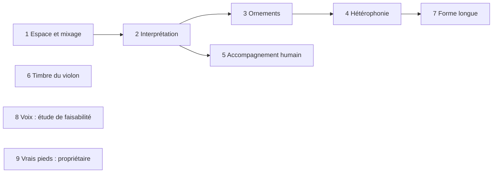

# Phase 012 — Vie et réalisme

## Problème

Les sept profils jouent des airs dont la structure se rapproche du corpus
(phase 3), mais le rendu sonne « machine » : tout est sec, centré, au même
volume de canal ; chaque note a la même articulation ; pas d'ornements ; un
seul instrument mélodique ; accompagnement mécanique ; attaques de violon
lentes. Cette phase ajoute la vie du jeu, **en données dans les profils**
(principe V), un point à la fois, chacun mesuré puis écouté (dans cet ordre).

## Règles communes à toutes les tâches

- Chaque nouveau réglage vit dans le profil TOML (section dédiée), validé au
  chargement avec une erreur lisible ; aucun nom de style dans le code.
- Déterminisme : tout tirage passe par le `ChaCha8Rng` du générateur. Aucun
  aléa dans le thread audio.
- Callback audio : pas d'allocation, pas de verrou ; les réglages arrivent
  par les événements existants, préparés sur le thread principal.
- Une seule façon de faire : un réglage remplace l'ancien chemin, il ne
  s'y ajoute pas ; le code mort découvert dans la zone est supprimé.
- Snapshot modifié ⇒ bump `TUNING_VERSION` et goldens régénérés dans le même
  commit ; `profile_d2_fixed.json` reste identique sauf décision écrite ici.
- Avant toute écoute du propriétaire : mesure par le coordinateur (niveaux,
  variété, fins de phrase, absence d'indice trivial dans les kits à l'aveugle).
- Les décisions de style se figent en ADR dans ce plan **après** validation à
  l'oreille et au labo.

## Ordre et parallélisme



1 et 6 touchent le rendu ; 2 à 5 touchent le générateur. 6 (labo, banques)
et 8 (étude) peuvent tourner en parallèle des autres quand leurs fichiers ne
se recouvrent pas. 9 dépend seulement des enregistrements du propriétaire.

## 1. Espace et mixage — `[mix]` par profil

### Constat (main `9323ef1`, vérifié dans le code)

- Aucun CC de panoramique (10), de réverbération (91) ni de chorus (93)
  n'est envoyé. oxisynth remet CC 91 à 0 et CC 10 à 64 : tout est **sec et
  centré** (sauf envois codés dans la SoundFont elle-même).
- `PlaybackEngine` garde des gains `lead/chords/bass/snare/hat`
  (1,0 / 0,6 / 0,6 / 0,5 / 0,4, noms hérités de l'ancien moteur), mais ne les
  envoie que sur `PlaybackCommand::SetChannelGain` (commande `set gain` du
  REPL). `PlaybackCommand::MixerGains` n'est jamais émis ; les champs
  `MusicalParams::gain_*` ne sont lus nulle part. En pratique **tous les
  canaux restent à CC 7 = 100** : l'équilibre ne dépend que des vélocités.
- `VoiceManager::process_event` traite un `AudioEvent::ControlChange` CC 1
  (filtre, résonance, « pitch instability » par `rand::thread_rng()` dans le
  thread audio) qu'aucun code n'émet : code mort et non déterministe.
- La réverbération intégrée d'oxisynth (`set_reverb_params` : taille, amorti,
  largeur, niveau) est active mais ne reçoit aucun envoi.
- oxisynth ne publie que le mélange stéréo (`write`, `read_next`) : pas de
  sortie par canal, donc pas d'égalisation par piste sans changer de
  synthèse.
- Niveau global très bas : rendus WAV `726f218` (banque GM, seed 3,
  34 mesures, deux tours, sept profils) entre **−37,1 et −33,6 dBFS RMS**,
  crête **−22,1 à −21,1 dBFS** ; le labo normalise ses kits à la crête
  pour compenser.

### Décisions

- Section `[mix]` du profil : salle (`room` : taille, amorti, largeur, niveau)
  et, par piste (`Melody`, `Chords`, `Bass`, `Heel`, `Toe`) : niveau en dB,
  panoramique `-1..1`, envoi de réverbération `0..1`. Égalisation simple sur
  le bus stéréo (coupe-bas et une bande de présence ou plateau aigu, biquads
  sans allocation) ; l'égalisation par piste est hors de portée tant
  qu'oxisynth ne sort pas les canaux séparément. Gain de bus `master_db`
  par profil pour placer le mélange près de la pleine échelle sans
  saturer.
- Un seul état de mixage par piste, initialisé par le profil à chaque
  chargement ou changement d'air ; `set gain`/`mute` du REPL agissent sur ce
  même état. Les gains hérités (`SetMixerGains`, `MixerGains`,
  `MusicalParams::gain_*`) et le traitement CC 1 mort sont supprimés.
- L'export MIDI porte les mêmes CC (7, 10, 91) en tête de piste, pour qu'un
  rendu externe (fluidsynth du labo) entende le même mélange.
- Les notes ne changent pas : le flux de snapshots reste identique,
  `TUNING_VERSION` inchangé sauf si un golden sérialise le profil.
- Valeurs de départ par profil justifiées dans le README du profil (type de
  salle : cuisine, salle paroissiale, plein air pour la marche) puis ajustées
  à l'oreille.

### Fichiers touchés (prévision)

`harmonium_core/src/style_profile.rs` (schéma, validation),
`harmonium_core/src/events.rs`, `harmonium_audio/src/voice_manager.rs`,
`harmonium_audio/src/backend/*`, `harmonium_host/src/playback.rs`,
export MIDI, `harmonium_cli` (REPL `gain`), `profiles/*/profile.toml`,
`profiles/README.md`, `harmonium_audio/README.md`.

### Acceptation observable

- Rendu WAV de chaque profil avec la banque GM : niveau RMS/crête **par
  piste** (rendu piste seule, même seed) et mélange complet. Violon devant :
  au moins 4 dB au-dessus de chaque piste d'accompagnement, pieds ≤ violon
  − 8 dB (mesure de référence du labo), mélange entre −6 et −1 dBFS de
  crête sur les sept profils (aujourd'hui vers −22), sans saturation.
- Image stéréo mesurée (corrélation ou différence G/D par piste) conforme au
  panoramique du profil ; rapport réverbéré/sec non nul quand l'envoi > 0.
- Tests de contrat : profil `[mix]` hors bornes rejeté avec message ;
  export MIDI contient les CC attendus ; même seed ⇒ même WAV octet pour
  octet ; snapshots inchangés.
- Aucune allocation dans le callback (`RTCheckAllocator` en debug).
- Puis écoute du propriétaire : kit avant/après sur 3 profils.

### Mesures V1

Mesuré le 2026-10-23, branche `wquintal/vie-v1-mix`, depuis main `d2137f9`.
Référence : binaire main avec
**seul ajout de `--solo-track`**, copié dans `/tmp/harmonium-mix-before` avant
le changement du mix. Aucune note, banque de cellules ni entrée d'arrangement
retouchée. Les deux variantes utilisent seed **3**, **34 mesures**, **2 tours**,
44 100 Hz, WAV stéréo float32, mêmes banques externes :

- `/Users/william.quintal/Project/bascanada/harmonium/assets/GeneralUser-GS.sf2`
- `/Users/william.quintal/Project/bascanada/harmonium/assets/harmonium_trad.sf2`

Script durable : `specs/012-vie-realisme/measure_mix.py`, numpy + stdlib :

```sh
cargo build -p harmonium-cli --release
/Users/william.quintal/Project/bascanada/harmonium_lab/.venv/bin/python \
  specs/012-vie-realisme/measure_mix.py --binary /tmp/harmonium-mix-before --stage before
/Users/william.quintal/Project/bascanada/harmonium_lab/.venv/bin/python \
  specs/012-vie-realisme/measure_mix.py --binary target/release/harmonium-cli \
  --stage after --check-acceptance
```

Pour reconstruire le binaire de référence, compiler main avec le seul ajout
CLI `--solo-track` (filtre des NoteOn par mute, pas de changement de génération).
Le script retire uniquement les tables `[mix*]` dans une copie temporaire
des profils pour cet ancien binaire. `--profiles-root` accepte aussi un
checkout main séparé ; `--reuse` réanalyse les fichiers sans les écraser.

RMS calculé sur **tous les échantillons**, silences d'entrée compris, et les
deux canaux ; crête absolue, aucune normalisation ni limiteur. La contribution
réverbérée est mesurée par un second rendu strictement identique, sauf
`mix.room.level = 0`, puis `20 log10(RMS(WAV − WAV_sec) / RMS(WAV_sec))`.
C'est une comparaison énergétique du retour, pas une estimation du temps
de décroissance. La corrélation G/D est également donnée par piste.

#### Mélanges complets

| Profil | RMS avant → après (dBFS) | Crête avant → après (dBFS) | Réverb./sec après (dB) |
|---|---:|---:|---:|
| `gigue_britannique_coloniale` | −36.2 → −16.6 | −22.0 → −3.7 | −18.5 |
| `gigue_quebecoise` | −36.1 → −17.7 | −21.9 → −3.3 | −21.7 |
| `hornpipe_britannique_coloniale` | −35.9 → −15.1 | −21.7 → −3.0 | −21.1 |
| `marche_britannique_coloniale` | −33.6 → −11.7 | −22.1 → −3.4 | −36.6 |
| `reel_acadien` | −37.1 → −18.4 | −21.8 → −3.1 | −19.5 |
| `reel_quebecois` | −37.1 → −18.7 | −22.1 → −3.1 | −22.3 |
| `valse_quebecoise` | −35.6 → −17.8 | −21.1 → −3.2 | −15.7 |

#### Pistes seules, mêmes notes

Unités : dBFS (RMS/crête), dB (écarts, balance G−D et réverb./sec).
Abréviations : GB/GQ = gigues britannique/québécoise ; HB = hornpipe ;
MB = marche ; RA/RQ = reels acadien/québécois ; VQ = valse.
`n.s.` : RMS < −90 dBFS, placement/corrélation non significatifs ; les
valeurs RMS/crête brutes restent affichées, sans faire passer le bruit
numérique de la réverbération pour une piste musicale.

| Profil/piste | RMS av. → ap. | Crête av. → ap. | Mélodie − piste av. → ap. | G−D av. → ap. | Corr. G/D av. → ap. | Réverb./sec ap. |
|---|---:|---:|---:|---:|---:|---:|
| GB/Melody | −38.6 → −17.2 | −25.7 → −4.4 | — | −0.0 → 0.3 | 0.993 → 0.990 | −18.1 |
| GB/Chords | −43.9 → −27.7 | −27.5 → −9.3 | 5.3 → 10.5 | −0.1 → −5.1 | 0.999 → 0.992 | −19.9 |
| GB/Bass | −42.1 → −29.1 | −29.6 → −16.4 | 3.5 → 11.9 | −0.1 → −0.0 | 0.999 → 0.999 | −28.8 |
| GB/Heel | −153.7 → −155.5 | −123.5 → −117.6 | 115.1 → 138.4 | n.s. | n.s. | — |
| GB/Toe | −153.7 → −155.5 | −123.5 → −117.6 | 115.1 → 138.4 | n.s. | n.s. | — |
| GQ/Melody | −39.7 → −18.7 | −25.3 → −4.0 | — | −0.0 → −0.7 | 0.993 → 0.996 | −21.2 |
| GQ/Chords | −43.3 → −27.7 | −24.8 → −7.2 | 3.6 → 9.0 | −0.1 → 4.8 | 0.999 → 0.996 | −22.3 |
| GQ/Bass | −40.3 → −27.7 | −28.2 → −15.4 | 0.6 → 9.0 | −0.0 → −0.0 | 0.999 → 0.999 | −32.0 |
| GQ/Heel | −114.8 → −101.0 | −68.3 → −53.0 | 75.0 → 82.4 | n.s. | n.s. | — |
| GQ/Toe | −153.4 → −156.3 | −123.5 → −118.9 | 113.7 → 137.6 | n.s. | n.s. | — |
| HB/Melody | −36.9 → −15.4 | −25.3 → −3.4 | — | −0.1 → 0.3 | 0.993 → 0.994 | −20.9 |
| HB/Chords | −46.5 → −30.2 | −27.5 → −9.3 | 9.6 → 14.9 | −0.1 → −5.1 | 0.999 → 0.996 | −22.3 |
| HB/Bass | −45.4 → −32.5 | −29.6 → −16.2 | 8.6 → 17.1 | −0.1 → −0.0 | 0.999 → 0.999 | −30.9 |
| HB/Heel | −155.3 → −159.7 | −123.5 → −118.4 | 118.4 → 144.4 | n.s. | n.s. | — |
| HB/Toe | −155.3 → −159.7 | −123.5 → −118.4 | 118.4 → 144.4 | n.s. | n.s. | — |
| MB/Melody | −33.7 → −11.7 | −25.9 → −4.3 | — | 0.1 → 0.1 | 0.992 → 1.000 | −36.6 |
| MB/Chords | −155.0 → −169.3 | −123.5 → −128.1 | 121.3 → 157.6 | n.s. | n.s. | — |
| MB/Bass | −155.0 → −169.3 | −123.5 → −128.1 | 121.3 → 157.6 | n.s. | n.s. | — |
| MB/Heel | −49.4 → −34.1 | −26.0 → −10.3 | 15.7 → 22.5 | −0.1 → 0.5 | 1.000 → 1.000 | −62.2 |
| MB/Toe | −155.0 → −169.3 | −123.5 → −128.1 | 121.3 → 157.6 | n.s. | n.s. | — |
| RA/Melody | −40.2 → −19.2 | −25.1 → −4.4 | — | −0.1 → 0.6 | 0.991 → 0.991 | −19.0 |
| RA/Chords | −45.4 → −29.8 | −24.8 → −7.2 | 5.2 → 10.6 | −0.1 → −5.0 | 0.998 → 0.992 | −19.9 |
| RA/Bass | −41.7 → −29.1 | −28.1 → −15.2 | 1.5 → 9.9 | −0.1 → −0.1 | 0.999 → 0.999 | −29.4 |
| RA/Heel | −54.5 → −39.9 | −33.9 → −19.0 | 14.3 → 20.7 | −0.1 → 0.8 | 1.000 → 1.000 | −37.5 |
| RA/Toe | −57.1 → −42.5 | −35.8 → −20.7 | 16.9 → 23.2 | −0.1 → −1.0 | 1.000 → 1.000 | −37.5 |
| RQ/Melody | −39.9 → −19.4 | −25.0 → −4.4 | — | −0.0 → −0.7 | 0.994 → 0.996 | −22.1 |
| RQ/Chords | −45.4 → −30.2 | −24.8 → −7.7 | 5.5 → 10.8 | −0.1 → 4.8 | 0.999 → 0.996 | −22.4 |
| RQ/Bass | −42.2 → −30.1 | −28.5 → −16.0 | 2.3 → 10.7 | −0.0 → −0.0 | 0.999 → 0.999 | −32.0 |
| RQ/Heel | −111.3 → −98.1 | −64.9 → −50.0 | 71.4 → 78.7 | n.s. | n.s. | — |
| RQ/Toe | −153.4 → −156.8 | −123.5 → −119.3 | 113.5 → 137.4 | n.s. | n.s. | — |
| VQ/Melody | −37.2 → −18.2 | −25.0 → −5.5 | — | −0.0 → −0.4 | 0.991 → 0.977 | −15.6 |
| VQ/Chords | −43.4 → −29.7 | −24.8 → −9.0 | 6.2 → 11.5 | −0.1 → 5.6 | 0.999 → 0.979 | −16.5 |
| VQ/Bass | −44.5 → −33.9 | −28.5 → −17.7 | 7.3 → 15.6 | −0.0 → −0.0 | 1.000 → 0.997 | −26.4 |
| VQ/Heel | −61.2 → −48.6 | −33.6 → −20.7 | 24.0 → 30.3 | −0.1 → 0.8 | 1.000 → 1.000 | −32.7 |
| VQ/Toe | −61.9 → −49.2 | −36.1 → −23.0 | 24.7 → 31.0 | −0.1 → −1.0 | 1.000 → 1.000 | −32.7 |

#### Décisions et limites de mesure

- Gain de bus calibré par profil pour une crête proche de −3 dBFS, pas
  de normalisation automatique : +16 dB reel québécois, +16,5 gigue
  québécoise/reel acadien, +17 gigue/hornpipe britanniques, +17,5 marche,
  +14,5 valse. Accompagnement : guitare −5 dB, basse −8 dB, pieds −6 dB
  par rapport à CC 7 maximal. Les écarts RMS réels ne sont pas les
  différences des paramètres : banques, notes, vélocités et arrangement comptent.
- Sur les 34 mesures, écart mélodie − accompagnement tonal actif minimal :
  **8,99 dB** (critère ≥4). Pieds actifs ≥20,66 dB sous la mélodie
  (critère ≥8). **Aucun échantillon ≥1** sur tous les WAV mesurés.
  Les panoramiques ont le bon signe ; basses centrées à moins de 0,1 dB.
- Seed 3 choisit une intro de deux mesures pour reel/gigue québécois ;
  les pieds entrent au tour 2, **après les 34 mesures demandées**. On ne
  modifie ni seed ni arrangement pour fabriquer une preuve favorable.
  Complément à **66 mesures**, `--bars 66 --output /tmp/harmonium-mix-66` :
  pieds réellement actifs ≥20,62 dB sous la mélodie ; G−D Heel ≈+0,75 dB,
  Toe ≈−0,97 dB. Les sept mélanges restent entre **−3,41 et −1,35 dBFS**.
  Les pistes non arrangées (pieds britanniques, Chords/Bass/Toe de la
  marche) ne prouvent pas leur placement ; l'outro peut jouer un accent Heel.
- Réverbération mesurée non nulle sur chaque piste active avec envoi :
  beaucoup moins en marche (retour global −36,6 dB/sec) qu'en valse
  (−15,7 dB/sec). Les SF2 ont leurs propres paramètres ; aucun envoi ne
  garantit à lui seul un temps de salle identique avec une autre banque.
- Deux rendus complets de chaque profil, même seed : **WAV identiques
  octet pour octet**, aussi bien à 34 qu'à 66 mesures. Le script conserve
  le doublon `*-Mix-repeat.wav` et les SHA-256 dans les JSON.
- Chemin unique : `TrackState` pilote niveau/pan/envoi et mute ; `SetMix`
  transporte uniquement des valeurs Copy précalculées. Suppressions :
  `AudioEvent::SetMixerGains`, `PlaybackCommand::MixerGains`, les cinq
  `MusicalParams::gain_*`, les cinq gains en dur de `PlaybackEngine`,
  les méthodes `set_gains`, le traitement CC 1 filtre/résonance/aléa
  et la dépendance `rand` du crate audio.
- En GM partagé, **Toe gagne** les CC du canal 9 ; ordre identique dans le
  synthé et le MIDI. Avec la banque pieds, les canaux 3/4 sont séparés.
  Le MIDI porte les CC 7/10/91, pas les paramètres non portables de salle,
  d'EQ et de gain master ; ceux-ci se règlent dans le lecteur externe.
- La présence est un biquad en cloche RBJ, coupe-bas Butterworth à Q fixe ;
  calcul des coefficients hors callback, deux états par bande/canal,
  après `synth.write`. Aucun limiteur ni RNG dans le nouveau DSP.
- Recherche de références via `xd://lsp` tentée, puis rechargement : le
  serveur rust-analyzer quitte avec code 0 avant initialisation. Repli
  explicite : recherche exhaustive des symboles et compilation des consommateurs.
  Ne pas présenter cette recherche texte comme une preuve LSP.
- Vérification finale : **`cargo test --workspace` : 405 réussis,
  2 ignorés (42 suites)** ; `cargo fmt --all` puis `cargo fmt --all -- --check`
  réussis. `cargo clippy --workspace --lib --bins --message-format=json` :
  **163 avertissements préexistants, contre 165 sur main, aucun nouveau**,
  comparaison par fichier/code/message avec un checkout main archivé.
  Les deux `expect` de l'export MIDI ont été retirés. `-D warnings` ne
  peut pas passer sur main (126 erreurs dès le crate core), donc le
  critère vérifié est bien « aucun nouvel avertissement hors tests ».
- Contrats dédiés : chargement rejeté par champ borné (y compris NaN/inf),
  niveaux négatifs finis sans plancher artificiel, CC MIDI avant notes,
  réapplication sur profil et nouvel air, préservation du mute, gain de bus
  linéaire. Le test audio avec la vraie `assets/test.sf2` applique `SetMix`
  et rend les biquads **sous `RTCheckAllocator` en debug** : aucune
  allocation/désallocation dans ce nouveau chemin après préparation des voix.
  Cette preuve ne prétend pas instrumenter les allocations/verrous préexistants
  de l'enregistreur WAV/MIDI, qui reste hors garde dans l'architecture actuelle.
- Tous les goldens de snapshots passent sans régénération, dont
  `profile_d2_fixed.json` et `profile_d2_main.json` : **`TUNING_VERSION = 13`
  inchangé**, aucun golden ne sérialise le nouveau mix. Les 42 WAV de
  référence ont aussi été reproduits octet pour octet avec les seules
  tables `[mix*]` retirées des profils courants ; les corrections clippy
  finales ne changent aucun des 42 WAV après.

Écoute (hors dépôt) : `/tmp/harmonium-mix/{before,after}/<profil>-Mix.wav`,
et `-Melody.wav`, `-Chords.wav`, `-Bass.wav`, `-Heel.wav`, `-Toe.wav`.
Contre-épreuves sèches : suffixe `-dry.wav`. Résultats complets :
`/tmp/harmonium-mix/{before,after}/measurements.json` et
`/tmp/harmonium-mix-66/after/measurements.json`.
Écoute et validation historique par le propriétaire encore nécessaires ;
ces valeurs sont des propositions de rendu mesurées, pas un ADR d'écoute.

### Dette temps réel préexistante (hors V1)

Périmètre confirmé par le coordinateur : le critère RT de V1 porte sur
**l'application `SetMix` et le DSP du mixage**, prouvés sous l'allocateur de
contrôle ; ne pas refondre `RecorderBackend` ni `UpdateMusicalParams` dans V1.
Le callback complet n'est donc **pas** déclaré sans allocation/verrou.
`harmonium_host/src/playback.rs:452` appelle `process_commands` hors garde ;
le rendu/enregistrement passe également hors de la garde du handoff.

Emplacements dans le code livré (numéros après `cargo fmt`) :

| Chemin préexistant dans le callback | Allocation/verrou identifié | Correction nécessaire hors V1 |
|---|---|---|
| `harmonium_audio/src/backend/recorder.rs:43`, `:140-142` | Début WAV : `Vec::with_capacity(1 MiB)`, `Arc` et `WavWriter` construits depuis la commande audio. | Créer writer, buffers et ressources sur un thread d'enregistrement ; ne transférer que des identifiants/commandes Copy. |
| `harmonium_audio/src/backend/recorder.rs:384` → `:49`, `:53` ; `:56`, `:66` | Chaque écriture WAV passe par `SharedWriter` et son `Mutex` ; `Cursor<Vec<u8>>::write` peut réallouer au-delà de 1 MiB. `flush` et `seek` verrouillent aussi, notamment à la finalisation `:149`. | Callback → blocs PCM préalloués via SPSC ; encodage/écriture/finalisation et croissance de stockage entièrement hors callback. Recycler les blocs, définir explicitement l'overrun. |
| `harmonium_audio/src/backend/recorder.rs:156-157` | Fin WAV : verrou de `finished_recordings`, `Vec::push` potentiellement réallouant et libération des ressources writer/Arc. | Publier le résultat depuis le thread d'enregistrement ; le callback ne détient ni ne détruit ces ressources. |
| `harmonium_audio/src/backend/recorder.rs:167`, `:171`, `:175`, `:177` | Début MIDI : `vec!`, croissance du track, liste temporaire de `gm_programs_for_profile`. | Préparer les métadonnées hors callback ; transporter les événements MIDI horodatés à taille fixe vers le thread d'enregistrement. |
| `harmonium_audio/src/backend/recorder.rs:242`, `:274`, `:286`, `:355` | Pendant MIDI : `Vec::push` des événements/metas et des notes actives peut réallouer ; `SetMix` enregistré emprunte ce même append préexistant. | Capture MIDI via SPSC bornée ; construire le track et tenir les notes actives côté enregistreur, sans collection extensible dans le callback. |
| `harmonium_audio/src/backend/recorder.rs:197-219` | Fin MIDI : destruction du Vec de notes actives, append EndOfTrack, Vec des pistes SMF, croissance du buffer d'encodage, `finished_recordings.lock()` puis `push`. | Fermer les notes, sérialiser et publier le fichier côté enregistreur ; transmettre uniquement une borne temporelle de fin depuis l'audio. |
| `harmonium_host/src/playback.rs:1173`, `:1176` ; `harmonium_audio/src/backend/recorder.rs:325`, `:329` | `params.clone()` clone le `Box` et les Vec de `MusicalParams` ; le recorder répète ce clone et alloue la liste de programmes. Remplacer les anciens paramètres/détruire les payloads libère aussi de la mémoire sur ce thread. | Métadonnées audio/recorder/report Copy préparées sur le thread principal, comme `PreparedMix` ; retourner les éventuels payloads propriétaires par anneau de recyclage au thread principal plutôt que les cloner/détruire dans le callback. |
| `harmonium_host/src/playback.rs:1211` | Publication périodique du rapport : clone de `MusicalParams` et donc de ses Vec, même sans enregistrement. | Snapshot de rapport de taille fixe (tableaux/identifiants), ou slots préalloués rendus au producteur ; pas de clone de Vec sur le thread audio. |

Une correction globale devra ensuite garder **tout** `process_buffer` sous
`RTCheckAllocator` en debug, y compris commandes de profil, rapports et
début/fin d'enregistrement ; vérifier continuité PCM, horodatage MIDI et
déterminisme avec la file bornée, sans contourner la garde pour les exports.

## 2. Interprétation — `[performance]` par profil

- **Constat** : toutes les notes sont `Articulation::Normal` ; pas de
  micro-décalage autre que le swing ; pas de courbe de dynamique de phrase ni
  de respiration en fin de phrase.
- **À faire** : micro-décalages déterministes par position (avance/retard),
  articulations détaché/lié/accent, courbe de dynamique par phrase,
  respirations aux fins de phrase ; branché aux 4 émotions (tension = plus en
  avant, plus détaché).
- **Vérifier** : au labo ce qui est mesurable (écart d'attaque par position,
  durée relative, vélocité par position de phrase) ; snapshots déterministes ;
  bump `TUNING_VERSION`.

## 3. Ornements idiomatiques

- **Constat** : aucun ornement généré.
- **À faire** : mesurer dans l'ABC du corpus les agréments `{g}`, triolets de
  notes répétées `(3eee`, rouleaux `~`, doubles cordes, par style et par
  position ; les doser par profil et par arousal.
- **Vérifier** : fréquences par position dans ±10 points du corpus ; pas
  d'ornement sur une note trop courte ; tessiture respectée.

## 4. Hétérophonie

- **À faire** : deuxième instrument mélodique (accordéon, 2ᵉ violon, harmonie
  à la tierce) qui joue la même ligne avec ses propres variations, décrit en
  données (instrument, entrée dans l'arrangement, taux de variation).
- **Vérifier** : la 2ᵉ voix suit la ligne (même contour, mêmes cadences),
  diffère sur une part mesurée des notes ; niveau sous le violon (point 1).

## 5. Accompagnement humain

- **À faire** : accords grattés (décalage des cordes), basse avec notes de
  passage, styles piano main gauche et accordéon basse-accord, en données.
- **Vérifier** : écart entre cordes d'un même accord, part de notes de
  passage, aucune fausse note contre la mélodie aux temps forts.

## 6. Timbre du violon

- **Constat** : attaques de 250–360 ms dans les 4 SF2 libres comparées,
  pour des croches d'environ 130 ms.
- **À faire** : chercher des échantillons à attaque courte ou à couches de
  vélocité, ou un modèle physique ; comparaison à l'oreille comme SK3.
- **Vérifier** : temps d'attaque mesuré < durée d'une croche au tempo du
  reel ; licence compatible notée dans `assets/README.md`.

## 7. Forme longue

- **À faire** : sets enchaînés (choix des tonalités entre airs,
  accélération, arc d'énergie), airs « signature » récurrents.
- **Vérifier** : enchaînements de tonalités comparés au corpus quand il les
  documente ; tempo et énergie mesurés sur un set complet.

## 8. Voix

- **À faire d'abord** : étude de faisabilité (turlutte, chansons à répondre,
  chansons de canot) : synthèse possible, corpus et droits. Rien d'autochtone
  sans consultation (principe VII).

## 9. Vrais pieds

- Côté propriétaire : déposer les enregistrements dans
  `harmonium_lab/samples/feet/own/{heel,toe}/`, puis `make trad-sf2`
  (pipeline prêt). Mesure des niveaux pieds/violon (point 1) après.
