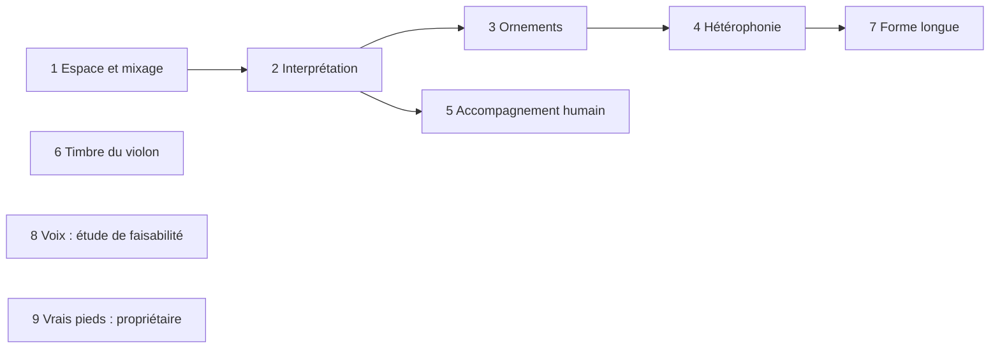

# Phase 012 — Vie et réalisme

## Problème

Les sept profils jouent des airs dont la structure se rapproche du corpus
(phase 3), mais le rendu sonne « machine » : tout est sec, centré, au même
volume de canal ; chaque note a la même articulation ; pas d'ornements ; un
seul instrument mélodique ; accompagnement mécanique ; attaques de violon
lentes. Cette phase ajoute la vie du jeu, **en données dans les profils**
(principe V), un point à la fois, chacun mesuré puis écouté (dans cet ordre).

## Règles communes à toutes les tâches

- Chaque nouveau réglage vit dans le profil TOML (section dédiée), validé au
  chargement avec une erreur lisible ; aucun nom de style dans le code.
- Déterminisme : tout tirage passe par le `ChaCha8Rng` du générateur. Aucun
  aléa dans le thread audio.
- Callback audio : pas d'allocation, pas de verrou ; les réglages arrivent
  par les événements existants, préparés sur le thread principal.
- Une seule façon de faire : un réglage remplace l'ancien chemin, il ne
  s'y ajoute pas ; le code mort découvert dans la zone est supprimé.
- Snapshot modifié ⇒ bump `TUNING_VERSION` et goldens régénérés dans le même
  commit ; `profile_d2_fixed.json` reste identique sauf décision écrite ici.
- Avant toute écoute du propriétaire : mesure par le coordinateur (niveaux,
  variété, fins de phrase, absence d'indice trivial dans les kits à l'aveugle).
- Les décisions de style se figent en ADR dans ce plan **après** validation à
  l'oreille et au labo.

## Ordre et parallélisme

1 et 6 touchent le rendu ; 2 à 5 touchent le générateur. 6 (labo, banques)
et 8 (étude) peuvent tourner en parallèle des autres quand leurs fichiers ne
se recouvrent pas. 9 dépend seulement des enregistrements du propriétaire.

## 1. Espace et mixage — `[mix]` par profil

### Constat (main `9323ef1`, vérifié dans le code)

- Aucun CC de panoramique (10), de réverbération (91) ni de chorus (93)
  n'est envoyé. oxisynth remet CC 91 à 0 et CC 10 à 64 : tout est **sec et
  centré** (sauf envois codés dans la SoundFont elle-même).
- `PlaybackEngine` garde des gains `lead/chords/bass/snare/hat`
  (1,0 / 0,6 / 0,6 / 0,5 / 0,4, noms hérités de l'ancien moteur), mais ne les
  envoie que sur `PlaybackCommand::SetChannelGain` (commande `set gain` du
  REPL). `PlaybackCommand::MixerGains` n'est jamais émis ; les champs
  `MusicalParams::gain_*` ne sont lus nulle part. En pratique **tous les
  canaux restent à CC 7 = 100** : l'équilibre ne dépend que des vélocités.
- `VoiceManager::process_event` traite un `AudioEvent::ControlChange` CC 1
  (filtre, résonance, « pitch instability » par `rand::thread_rng()` dans le
  thread audio) qu'aucun code n'émet : code mort et non déterministe.
- La réverbération intégrée d'oxisynth (`set_reverb_params` : taille, amorti,
  largeur, niveau) est active mais ne reçoit aucun envoi.
- oxisynth ne publie que le mélange stéréo (`write`, `read_next`) : pas de
  sortie par canal, donc pas d'égalisation par piste sans changer de
  synthèse.
- Niveau global très bas : rendus WAV `726f218` (banque GM, seed 3,
  34 mesures, deux tours, sept profils) entre **−37,1 et −33,6 dBFS RMS**,
  crête **−22,1 à −21,1 dBFS** ; le labo normalise ses kits à la crête
  pour compenser.

### Décisions

- Section `[mix]` du profil : salle (`room` : taille, amorti, largeur, niveau)
  et, par piste (`Melody`, `Chords`, `Bass`, `Heel`, `Toe`) : niveau en dB,
  panoramique `-1..1`, envoi de réverbération `0..1`. Égalisation simple sur
  le bus stéréo (coupe-bas et une bande de présence ou plateau aigu, biquads
  sans allocation) ; l'égalisation par piste est hors de portée tant
  qu'oxisynth ne sort pas les canaux séparément. Gain de bus `master_db`
  par profil pour placer le mélange près de la pleine échelle sans
  saturer.
- Un seul état de mixage par piste, initialisé par le profil à chaque
  chargement ou changement d'air ; `set gain`/`mute` du REPL agissent sur ce
  même état. Les gains hérités (`SetMixerGains`, `MixerGains`,
  `MusicalParams::gain_*`) et le traitement CC 1 mort sont supprimés.
- L'export MIDI porte les mêmes CC (7, 10, 91) en tête de piste, pour qu'un
  rendu externe (fluidsynth du labo) entende le même mélange.
- Les notes ne changent pas : le flux de snapshots reste identique,
  `TUNING_VERSION` inchangé sauf si un golden sérialise le profil.
- Valeurs de départ par profil justifiées dans le README du profil (type de
  salle : cuisine, salle paroissiale, plein air pour la marche) puis ajustées
  à l'oreille.

### Fichiers touchés (prévision)

`harmonium_core/src/style_profile.rs` (schéma, validation),
`harmonium_core/src/events.rs`, `harmonium_audio/src/voice_manager.rs`,
`harmonium_audio/src/backend/*`, `harmonium_host/src/playback.rs`,
export MIDI, `harmonium_cli` (REPL `gain`), `profiles/*/profile.toml`,
`profiles/README.md`, `harmonium_audio/README.md`.

### Acceptation observable

- Rendu WAV de chaque profil avec la banque GM : niveau RMS/crête **par
  piste** (rendu piste seule, même seed) et mélange complet. Violon devant :
  au moins 4 dB au-dessus de chaque piste d'accompagnement, pieds ≤ violon
  − 8 dB (mesure de référence du labo), mélange entre −6 et −1 dBFS de
  crête sur les sept profils (aujourd'hui vers −22), sans saturation.
- Image stéréo mesurée (corrélation ou différence G/D par piste) conforme au
  panoramique du profil ; rapport réverbéré/sec non nul quand l'envoi > 0.
- Tests de contrat : profil `[mix]` hors bornes rejeté avec message ;
  export MIDI contient les CC attendus ; même seed ⇒ même WAV octet pour
  octet ; snapshots inchangés.
- Aucune allocation dans le callback (`RTCheckAllocator` en debug).
- Puis écoute du propriétaire : kit avant/après sur 3 profils.

## 2. Interprétation — `[performance]` par profil

- **Constat** : toutes les notes sont `Articulation::Normal` ; pas de
  micro-décalage autre que le swing ; pas de courbe de dynamique de phrase ni
  de respiration en fin de phrase.
- **À faire** : micro-décalages déterministes par position (avance/retard),
  articulations détaché/lié/accent, courbe de dynamique par phrase,
  respirations aux fins de phrase ; branché aux 4 émotions (tension = plus en
  avant, plus détaché).
- **Vérifier** : au labo ce qui est mesurable (écart d'attaque par position,
  durée relative, vélocité par position de phrase) ; snapshots déterministes ;
  bump `TUNING_VERSION`.

## 3. Ornements idiomatiques

- **Constat** : aucun ornement généré.
- **À faire** : mesurer dans l'ABC du corpus les agréments `{g}`, triolets de
  notes répétées `(3eee`, rouleaux `~`, doubles cordes, par style et par
  position ; les doser par profil et par arousal.
- **Vérifier** : fréquences par position dans ±10 points du corpus ; pas
  d'ornement sur une note trop courte ; tessiture respectée.

## 4. Hétérophonie

- **À faire** : deuxième instrument mélodique (accordéon, 2ᵉ violon, harmonie
  à la tierce) qui joue la même ligne avec ses propres variations, décrit en
  données (instrument, entrée dans l'arrangement, taux de variation).
- **Vérifier** : la 2ᵉ voix suit la ligne (même contour, mêmes cadences),
  diffère sur une part mesurée des notes ; niveau sous le violon (point 1).

## 5. Accompagnement humain

- **À faire** : accords grattés (décalage des cordes), basse avec notes de
  passage, styles piano main gauche et accordéon basse-accord, en données.
- **Vérifier** : écart entre cordes d'un même accord, part de notes de
  passage, aucune fausse note contre la mélodie aux temps forts.

## 6. Timbre du violon

- **Constat** : attaques de 250–360 ms dans les 4 SF2 libres comparées,
  pour des croches d'environ 130 ms.
- **À faire** : chercher des échantillons à attaque courte ou à couches de
  vélocité, ou un modèle physique ; comparaison à l'oreille comme SK3.
- **Vérifier** : temps d'attaque mesuré < durée d'une croche au tempo du
  reel ; licence compatible notée dans `assets/README.md`.

## 7. Forme longue

- **À faire** : sets enchaînés (choix des tonalités entre airs,
  accélération, arc d'énergie), airs « signature » récurrents.
- **Vérifier** : enchaînements de tonalités comparés au corpus quand il les
  documente ; tempo et énergie mesurés sur un set complet.

## 8. Voix

- **À faire d'abord** : étude de faisabilité (turlutte, chansons à répondre,
  chansons de canot) : synthèse possible, corpus et droits. Rien d'autochtone
  sans consultation (principe VII).

## 9. Vrais pieds

- Côté propriétaire : déposer les enregistrements dans
  `harmonium_lab/samples/feet/own/{heel,toe}/`, puis `make trad-sf2`
  (pipeline prêt). Mesure des niveaux pieds/violon (point 1) après.
