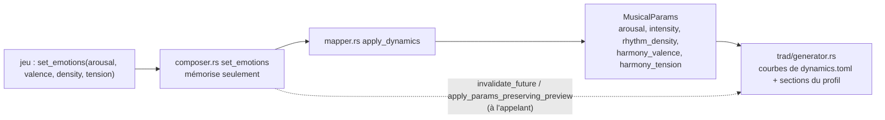

# J4 — Inventaire des émotions dans le code, recouvrements, constats

Moteur `main` (`957920f` + cette branche). Lecture du code, puis mesures
(`measure_emotions.py` → `emotions-mesures.md`). Le guide du concepteur de jeu est
[`emotions.md`](emotions.md) ; ce document est la référence technique.

## Chaîne d'application

- `harmonium_host/src/composer.rs:672` `set_emotions` : ignoré hors mode émotion
  (`use_emotion_mode`) ; mémorise, ne régénère pas. Le bpm explicite (`set_bpm`) l'emporte sur le
  tempo émotionnel (`bpm_override`).
- `harmonium_core/src/mapper.rs:14-29` `apply_dynamics` : seule fonction qui traduit les 4 axes.

  | Axe API | Champ de `MusicalParams` | Lu par |
  |---|---|---|
  | `arousal` 0..1 | `arousal` ; et `intensity` (voir ci-dessous) | courbes d'intensité, interprétation, passage de basse, 2ᵉ voix, ornements |
  | `valence` −1..1 | `harmony_valence` | couleur (tonalité, mode, registre), accent de brillance |
  | `density` 0..1 | `rhythm_density` | seuils de pistes, pieds, grattage, passage, ornement `passing`, 2ᵉ voix |
  | `tension` 0..1 | `harmony_tension` ; `rhythm_tension` ; part de `intensity` | contretemps, durées, dominantes, interprétation |

- **Intensité combinée** : `StyleDynamics::intensity_from_emotions`
  (`trad/dynamics.rs:277`) = `clamp(arousal_intensity(arousal) + tension_intensity(tension), 0, 1)`.
  `arousal_intensity` vaut l'identité dans les 7 profils ; `tension_intensity` ajoute −0,03 à +0,10
  (marche : 0 à +0,15). **La tension est donc aussi un peu d'arousal** pour toutes les grandeurs
  pilotées par l'intensité (ci-dessous).
- Hors des 4 émotions : `EngineParams.smoothness` (0,7 fixe, `melody_smoothness`) n'est pas
  pilotable par `set_emotions` et n'est lu par aucune génération (seulement copié dans le
  `StateSnapshot`). `rhythm_tension` est écrit par le mapper mais **jamais lu**. Le jeu ne peut pas
  s'appuyer sur ces deux champs.
- Les commandes directes `set_intensity`, `set_rhythm_density`, `set_feet_density`, `set_bpm`
  court-circuitent les émotions ; `apply_dynamics` réécrit `intensity` et `rhythm_density` au
  prochain `set_emotions` (les décisions de mode direct sont hors du périmètre de J4).

## Quand un changement s'entend

| Délai | Quoi | Où |
|---|---|---|
| mesure suivante (après `invalidate_future`) | tempo, vélocités, durées, accents, pieds, grattage, interprétation, notes de passage, ornements, 2ᵉ voix, pistes présentes | `generate_measure`, `apply_dynamics` (`generator.rs:1217`) |
| frontière de phrase (de partie pour la marche) | mode clair / sombre | `update_parallel_mode` (`generator.rs:614`), `mode_shift_boundary` |
| **air suivant** | tonalité (palette de couleur), registre, poids course / arpège / tournant de la mélodie, retour de la signature du set | `generator.rs:1461-1492`, `set.rs:424` |

L'air en cours garde son matériel mélodique (plan phase 013) : une émotion changée en cours d'air
module donc l'interprétation, jamais les notes écrites (sauf mode et notes de passage / ornements).

## Inventaire par émotion

Courbes lues dans `profiles/<style>/dynamics.toml` (`Curve::eval`, interpolation linéaire, valeur
constante hors bornes). « Valeurs » = bas / neutre / haut du profil `reel_quebecois` ; les autres
profils changent les amplitudes (tableau de fin de section).

### arousal (0..1, neutre 0,5)

Par l'**intensité** combinée `I` (donc aussi par la tension) :

| Grandeur | Fichier:ligne | Courbe / paramètre (reel) | Valeurs (I = 0 / 0,5 / 1) |
|---|---|---|---|
| Tempo | `dynamics.rs:283`, `generator.rs:310` | `tempo_offset` + `meter.default_bpm` | −10 / 0 / +15 BPM |
| Vélocité mélodie | `generator.rs:1229` (`apply_dynamics`) | `melody_velocity` | ×0,72 / 1 / 1,35 |
| Vélocité accords | idem | `guitar_velocity` | ×0,65 / 1 / 0,80 |
| Vélocité basse | idem | `bass_velocity` | ×0,80 / 1 / 1 |
| Vélocité pieds | idem | `feet_velocity` | ×0,60 / 1 / 1,65 |
| Accent des temps forts (mélodie) | `generator.rs:1224` | `strong_accent` | −4 / 0 / +8 |
| Durée des notes de mélodie | `generator.rs:1222` | `fiddle_duration` | ×1,15 / 1 / 0,85 |
| Densité de pieds (marche 0..2) | `generator.rs:151` | `feet_intensity` (+ `feet_density` du profil) | −1 / 0 / +1 |
| Motif de grattage (accords) | `generator.rs:1346`, `accomp_profile.rs:127` | `chop_intensity` | −1 / 0 / +0,5 |
| Poids course / arpège / tournant | `generator.rs:1476-1487` (air suivant) | `run_weight`, `arp_weight`, `turn_weight` | 0,5·0,5·2 / 1 / 2,5·2·0,4 |
| Rampe de set | `set.rs:243`, `generator.rs:304` | `set.ramp.intensity_lift` × `gate` | (hors J4) |

Par l'**arousal brut** :

| Grandeur | Fichier:ligne | Paramètre | Valeurs |
|---|---|---|---|
| Accent de vélocité des notes `Accent` | `performance.rs:268` | `[performance.tracks.Melody.emotions] arousal_accent` | +4 × arousal |
| Notes de passage de la basse | `bass_passing.rs:122-125`, `accomp_profile.rs:211` | `[accompaniment.bass.passing] arousal_low_multiplier`, `arousal_high_multiplier` | ×0,5 → ×1,5 (sur la courbe de densité) |
| Variations de la 2ᵉ voix | `heterophony.rs:157` | `[heterophony] arousal_low`, `arousal_high` | ×0,5 → ×1,5 sur les poids des opérations autres que l'unisson |
| Taux d'ornements | `ornaments/mod.rs:169`, `realize.rs:131` | `arousal_low_multiplier`, `arousal_high_multiplier` par type | **1 → 1 dans les 7 profils : sans effet** |

### valence (−1..1, neutre = `neutral_valence`, 0,3 ; 0,5 pour la marche)

| Grandeur | Fichier:ligne | Courbe / paramètre | Valeurs (reel) | Délai |
|---|---|---|---|---|
| Mode sombre / clair | `generator.rs:614-682` | `dark_below` = −0,3, `bright_above` = 0,1, `parallel_modes` (aeolien 3, dorien 1…) | < −0,3 : sombre ; > 0,1 : clair ; entre : garde le mode courant | frontière de phrase |
| Tonalité et mode de l'air | `set.rs:424` `candidates` | `valence == neutral_valence` : `melody.key_modes` ; sinon palette `[[color]]` pondérée par `valence_input(valence)` | 9 couleurs, poids de 0,1 à 6 | air suivant |
| Registre de la mélodie | `generator.rs:1488` | `color_register` (sur `valence_input`) | −5 / 0 / +5 demi-tons (neutre à 0,65) | air suivant |
| Accent de brillance | `generator.rs:1225` | `brightness_accent` | −8 / 0 / +10 de vélocité sur les temps forts | mesure suivante |
| Vélocité par valence | `performance.rs:272` | `emotions.valence_velocity` | 0 dans les 7 profils : sans effet | — |
| Retour de la signature | `generator.rs:1419` | filtre les candidats par valence | (hors J4) | air suivant |

`dynamics.valence_input` ramène −1..1 à 0..1 (`valence_range`). Le moteur jazz (hors profils
traditionnels) lit aussi la valence (`models/jazz.rs`) ; aucun profil distribué ne l'utilise.

### density (0..1, neutre 0,5)

| Grandeur | Fichier:ligne | Courbe / paramètre | Valeurs (reel) |
|---|---|---|---|
| Pistes présentes | `dynamics.rs:288`, `generator.rs:265`, `:349` | `density_tracks` : seuils | Heel ≥ 0,10 · Bass ≥ 0,15 · Chords ≥ 0,25 · Toe ≥ 0,35 · Melody toujours |
| Densité de pieds | `generator.rs:151` | `density_feet` (somme avec `feet_intensity`) | −1 / 0 / +1 |
| Motif de grattage | `generator.rs:1346` | `density_chop` (somme avec `chop_intensity`) | −1 / 0 / +0,5 |
| Notes de passage de la basse | `bass_passing.rs:125` | `[accompaniment.bass.passing] density` (×arousal) | 0 / 0,6 / 1 |
| Ornement mélodique `passing` | `ornaments/realize.rs:170` | `[ornaments.types.passing] density_curve` (× multiplicateur d'arousal = 1) | 0 jusqu'à 0,5, puis jusqu'à 1 |
| Variations de la 2ᵉ voix | `heterophony.rs:158` | `density_low`, `density_high` | ×0,7 → ×1,3 |
| Détaché par densité | `performance.rs:253` | `emotions.density_detach` | 0 dans les 7 profils : sans effet |

### tension (0..1, neutre = genou des courbes : 0,3 ; 0,5 pour la marche)

Par l'**intensité** (`tension_intensity` : −0,03 / 0 / +0,10) : tempo, vélocités, durées de mélodie,
accent, pieds, grattage, poids de mélodie (voir arousal). Par la **tension brute** :

| Grandeur | Fichier:ligne | Courbe / paramètre | Valeurs (reel, tension 0 / 0,3 / 1) |
|---|---|---|---|
| Accent des contretemps (mélodie) et coup de caisse 40 (pieds) | `generator.rs:1226,1245` | `tension_offbeat` | −3 / 0 / +24 de vélocité |
| Durée des notes de mélodie | `generator.rs:1222` | `tension_duration` | ×1,1 / 1 / 0,7 |
| Durée des accords | `generator.rs:1227` | `tension_chord_duration` | ×1 / 1 / 1,5 |
| Dominante à la place du dernier accord (hors cadences) | `generator.rs:1197` `chords_for_bar` | `tension_dominant` : part de la partie concernée | 0 / 0 / 0,75 |
| Attaque en avance | `performance.rs:249` | `emotions.tension_advance` | 0,04 pas × tension |
| Notes plus sèches | `performance.rs:252` | `emotions.tension_detach` | gate −10 % × tension |
| Guidage d'échelle (moteur jazz) | `generator.rs:935` | `harmony_tension` | hors profils traditionnels |

### Amplitudes par style (extrémités des courbes)

| Style | tempo (bas / haut) | mélodie ×(bas / haut) | contretemps tension haut | `tension_intensity` haut | seuils de pistes |
|---|---|---|---|---|---|
| reel québécois, reel acadien, gigue québécoise, valse québécoise | −10 / +15 | 0,72 / 1,35 | +24 | +0,10 | Heel .10, Bass .15, Chords .25, Toe .35 |
| gigue britannique coloniale | −8 / +10 | 0,75 / 1,25 | +16 | +0,10 | Bass .15, Chords .25 (pas de pieds) |
| hornpipe britannique coloniale | −6 / +8 | 0,75 / 1,25 | +16 | +0,10 | Bass .15, Chords .25 (pas de pieds) |
| marche britannique coloniale | −12 / +15 | 0,75 / 1,30 | +16 (4 au neutre) | +0,15 (seuil 0,5) | aucun (tout joue) |

`neutral_valence` : 0,3 partout sauf la marche (0,5, `dark_below` 0, `bright_above` 0,2, mode
changé à la **partie**). La marche n'a ni guitare ni basse ; les gigue et hornpipe britanniques n'ont
pas de pieds, ni de 2ᵉ voix.

## Recouvrements (deux émotions qui poussent la même chose)

| Grandeur | arousal | valence | density | tension | Lecture |
|---|:-:|:-:|:-:|:-:|---|
| Tempo | ✔ (I) | | | ✔ petit (I, +3 BPM) | tension = ~1/7 de l'effet d'arousal |
| Vélocité mélodie | ✔ (I, +51) | ✔ (+7) | | ✔ (I + contretemps, +18) | **trois axes sur la force** ; la tension fait le tiers de l'arousal |
| Accent des temps forts | ✔ (I) | ✔ (`brightness_accent`) | | | s'additionnent (`strong`, `generator.rs:1224`) |
| Densité de pieds | ✔ (I) | | ✔ | ✔ très petit | **les deux axes écrivent la même somme** (`feet_intensity + density_feet`) |
| Grattage (accords) | ✔ (I) | | ✔ | ✔ très petit | idem (`chop_intensity + density_chop`) |
| Notes de passage de la basse | ✔ (×0,5..1,5) | | ✔ (courbe) | | produit : arousal × densité |
| 2ᵉ voix variée | ✔ | | ✔ | | produit : facteur d'arousal × facteur de densité |
| Durée des notes | ✔ (I, ×0,85) | | | ✔ (×0,7) | deux axes sur la même multiplication (`fiddle_duration × tension_duration`) |
| Mode sombre / registre / tonalité | | ✔ | | | **exclusif à la valence** |
| Pistes présentes (seuils) | | | ✔ | | **exclusif à la densité** |
| Ornements `passing` (mélodie) | (×1) | | ✔ | | exclusif à la densité, au-dessus de 0,5 |
| Dominantes tenues, accords longs | | | | ✔ | **exclusif à la tension** |

Mesuré (`emotions-mesures.md`, « Qui fait bouger quoi », moyenne 0 → 1 sur 7 profils) :

| Mesure | arousal | valence | density | tension |
|---|---:|---:|---:|---:|
| Tempo (BPM) | +22,7 | 0 | 0 | +3,3 |
| Vélocité mélodie | +50,9 | +7,2 | +1,2 | +18,0 |
| Notes d'accords par mesure | +9,4 | 0 | +14,0 | 0 |
| Notes de pieds par mesure (talon + orteil) | +4,9 | 0 | +6,6 | 0 |
| Notes de passage de basse par mesure | +0,32 | 0 | +0,63 | +0,06 |
| Ornements ajoutés par mesure | +0,06 | −0,01 | +1,17 | +0,01 |
| Durée moyenne d'une note de mélodie (pas) | −0,26 | 0 | −0,25 | −0,80 |
| Hauteur moyenne de la mélodie (MIDI) | 0 | +7,5 | +0,2 | +0,1 |
| Part de mesures en mode sombre | 0 | −100 | 0 | 0 |

## Constats

1. **Arousal et densité se confondent en haut de l'échelle.** À 1, chacun double le grattage
   (7,97 → 15,9 notes par mesure en reel) et ajoute 4 pas de pied (reel : 7,97 → 11,95), et
   les deux accélèrent la basse qui marche. Ce qui les sépare : le tempo et la force (arousal seul) ;
   les pistes qui entrent et sortent aux seuils, et les ornements `passing` (densité seule).
   En bas de l'échelle ils se distinguent bien : arousal 0 garde un accompagnement allégé
   (grattage divisé par 2, pieds 2 par mesure), densité 0 **ne laisse que le violon**.
2. **La tension se mêle à l'arousal sur la force.** À 1, elle ajoute +18 de vélocité mélodie (arousal 0 → 1 :
   +51), par deux voies : un accent de contretemps jusqu'à +24 et +0,10 d'intensité (donc du tempo, +3 BPM).
   Son signe propre est la **durée** : en reel, notes de 2 pas → 1 pas à partir de tension ≈ 0,85, et le gate
   plus sec. Elle est reconnaissable à ça, pas à la force.
3. **La valence ne se confond avec rien** (mode, registre, tonalité) ; sa seule intersection avec les autres
   axes est +7 de vélocité (`brightness_accent`). Elle est lente : mode à la phrase, tonalité et registre
   à l'air suivant.
4. **Paliers plutôt que rampes pour les textures.** Mesures fines (pas de 0,05, 3 graines, reel) :
   le grattage est divisé par 2 pour arousal ≤ 0,20 et doublé seulement à arousal = 1 ; les pieds passent de
   2 à 8 par mesure à arousal 0,25, de 8 à 12 à 0,75 ; les pistes entrent à 0,10 (talons), 0,15 (basse), 0,25 (guitare),
   0,35 (orteils). Entre ces seuils, **rien d'audible ne change** à part le tempo et la force pour l'arousal,
   et presque rien pour la densité. L'arrondi (`round()` : les moitiés vont vers le haut, sur `base + décalage`) rend
   les paliers asymétriques : un décalage de −0,5 (arousal 0,25) ne change rien, +0,5 (arousal 0,75) change.
5. **Tension : effet faible sous son genou** (0,3 ; marche 0,5) : à 0, notes ×1,1 plus longues, contretemps −3, −0,6 BPM ;
   dominantes et accords longs : aucun effet. La plage utile commence au genou.
6. **Écrêtage à arousal élevé.** Le rendu complet (WAV flottant, 20 graines) dépasse 0 dBFS : gigue
   britannique à arousal 1 (+0,87 dBFS, 35 échantillons ≥ 1), reel acadien à arousal 0,75 (+0,11 dBFS, 2), valse
   québécoise à arousal 1 (+0,02 dBFS, 1). Tous les autres réglages d'un seul axe restent sous 0 dBFS
   (maximum −0,05 dBFS reel à arousal 0,75). `master_db` ne s'adapte pas à l'intensité (README, § Mixage : « sans
   limiteur »). Le jeu qui monte l'arousal à 1 avec ces styles écrête.
7. **La caisse claire de la marche est muette dans `harmonium_trad.sf2`** (solo de la piste Toe :
   −130 dBFS ; avec GeneralUser GS : −12 dBFS). Densité et arousal ajoutent des roulements dans le flux et
   le MIDI de la marche mais **le rendu WAV est identique bit à bit** avec cette banque : l'effet
   de la densité sur la marche est inaudible. Le kit d'écoute de la marche utilise donc la banque GM pour les
   pieds (comme `percussion_bank = 128` du profil l'attend). Décision de banque à confirmer pour le jeu.
8. **Champs écrits ou prévus mais sans effet** : `rhythm_tension`, `smoothness`, `valence_velocity`,
   `density_detach` (0 partout), `arousal_*_multiplier` des ornements (1 partout). Aucune émotion ne
   règle le taux d'ornements des types écrits (roulements, appoggiatures…), seulement le type `passing`
   (densité).
9. **Falaise de la valence au neutre.** `candidates` compare `valence == neutral_valence` à l'égalité exacte
   (`set.rs:426`) : 0,3 utilise `melody.key_modes` (distribution du corpus), 0,31 la palette `[[color]]` (poids
   différents). Sans conséquence si le jeu envoie des valeurs arrondies, mais à connaître.

## Propositions de données (non appliquées ; J2 les applique)

Aucun code. Tout est dans `dynamics.toml` et `[mix]`, et `proposition_emotions.py` produit une copie
patchée des profils (`--output`) pour mesurer ou écouter sans toucher au dépôt.

| # | Constat | Changement | Effet attendu |
|---|---|---|---|
| P1 | 1 | `density_feet` et `density_chop` à zéro (7 profils) : les pieds et le grattage suivent l'arousal seul. La densité garde seuils de pistes, passage de basse, ornement `passing`, 2ᵉ voix ; la marche reçoit des seuils de pistes (Heel ≥ 0,10, Toe ≥ 0,35) pour que la densité y fasse encore quelque chose | arousal = « comment ça joue » (tempo, force, pieds, grattage) ; densité = « combien de notes et de voix » |
| P2 | 2 | `tension_offbeat` × 0,6 (reel : 24 → 14,4) et `tension_intensity` × 0,5 (+0,10 → +0,05) | la tension perd environ la moitié de sa force et de son tempo ; reste : notes courtes, contretemps, dominantes |
| P3 | 6 | `master_db` : gigue britannique 16 → 14, valse 12 → 11, reel acadien 15,5 → 14,5 | plus aucun écrêtage (marge de 0,9 à 1,1 dBFS à la pire crête) ; le neutre de ces trois styles devient 1 à 2 dB plus bas : à écouter |
| P4 | 7 | Soit des notes 38/40 dans `harmonium_trad.sf2`, soit une banque de pieds propre à la marche | l'effet de la densité sur la marche devient audible |

La mesure de P1–P3 est dans `emotions.md` (§ Proposition) ; elle ne dit pas si c'est *mieux* à l'oreille :
c'est l'écoute du comparateur (`emotions/comparateur.html`) qui tranche, J2 appliquant
ce que le propriétaire valide.
