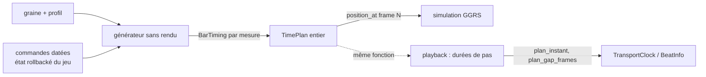

# J1 — Horloge musicale partagée : étude

**Statut** : étude + prototype (2026-10-26) | **Moteur** : branche `wquintal/j1-horloge` depuis `957920f`
| **Jeu** : `alacod` lu, non modifié

## En bref

Aujourd'hui, « où en est la musique » se lit sur la carte son : le playhead avance au rythme des
échantillons audio, et le jeu interroge cette position (`BeatInfo`). Chaque machine a sa carte son,
sa fréquence d'échantillonnage, ses petits retards : deux joueurs en réseau n'ont donc jamais
exactement la même position musicale. Pour un jeu à rollback, où chaque client doit recalculer la
même partie à la frame près, c'est inutilisable.

La décision du propriétaire inverse le sens : **la simulation du jeu décide du temps musical**. On
lui donne une partition des temps — un **plan** — qui dit, pour chaque mesure et chaque pas, à quel
instant il tombe. Ce plan se calcule avec des nombres entiers, à partir de la graine, du style et
d'une liste de commandes datées (« à la mesure 12, tempo 197,5 », « à la mesure 30, calme »).
Deux machines qui ont la même liste calculent le même plan, au flick près, sans écouter l'audio.

La musique, elle, continue d'être générée et jouée par chaque machine. Le playback suit le plan :
ses durées de pas sont maintenant tirées du plan lui-même. Il publie son **écart** avec le plan
(zéro quand tout va bien, positif après un trou de génération). Corriger cet écart en douceur
(accélérer l'audio de quelques pour mille) ou par un saut à la mesure suivante est préparé mais
pas branché : c'est une décision à prendre à l'oreille.

Le prototype est dans `harmonium_core::time_plan`. Les tests montrent que quatre clients qui
reçoivent les mêmes commandes dans des ordres différents, avec des rollbacks, obtiennent des
positions identiques à chaque frame de simulation, et que sur les 7 profils, avec et sans
automation, chaque pas rendu par le moteur tombe à ± 1 frame audio du plan.

Recommandation (§ 8) : garder ce plan entier comme seule source du temps musical, sortir la
structure des airs (longueur des sets, intros, raccords) du flux aléatoire des notes pour que la
simulation n'ait plus à faire tourner le générateur (avant J5), appliquer les commandes du jeu à
la mesure datée et non « maintenant » (J2), puis brancher la correction de dérive. Texte
d'amendement du principe II en § 10.

## 1. Ce qui place une mesure dans le temps aujourd'hui

Une mesure générée porte son tempo nominal, son swing, sa signature et sa pulse
(`Measure`, `harmonium_core/src/timeline/mod.rs:197`). Le playback gèle la durée de chaque pas au
début de chaque pulse (invariant D1 de la phase 0). La position d'une mesure dans le temps est la
somme des durées gelées de toutes les pulses précédentes. Ce qui fixe ces durées :

| Élément | Où | Calcul | Entrées |
|---|---|---|---|
| Tempo nominal du profil | `meter.default_bpm` | constante du profil | profil |
| Tempo d'émotion | `TradGenerator::tempo_for` (`trad/generator.rs:310`), `StyleDynamics::tempo_for` | `bpm + tempo_offset(intensité)` borné 40–300 ; intensité = `arousal_intensity(arousal) + tension_intensity(tension)` | émotions, courbes `f32` |
| Rampe de set | même fonction, `SetRamp` (`trad/set.rs:202`) | `+ tempo_bpm(progression) × gate(intensité)`, plafonné à `ceiling_bpm` ; progression = rang de l'air dans le set | rang de l'air → frontières d'air → tirages RNG |
| Tempo direct du jeu | `set_bpm` | remplace émotion et rampe de set | commande |
| Rampe de mesure | `PlaybackEngine::try_load` (`playback.rs`) | un changement de tempo entre deux mesures d'air rampe linéairement sur les pulses de la nouvelle mesure | tempo de la mesure précédente |
| `SetTempo` / `ClearTempo` | REPL (`PlaybackCommand`) | rampe sur N pulses, reçue « maintenant » | horloge du thread audio |
| Swing | `Measure.swing_ratio`, `meter.default_swing_ratio` | paire de croches de chaque noire : `ratio × noire` puis le reste ; ignoré en mesure composée | profil, `set_swing_ratio` |
| Signature, grille, pulse | `meter` | pas par noire = `steps × dénominateur / (numérateur × 4)` ; pulse = `steps_per_pulse` pas | profil |
| Intros, appels, silences, pauses de set | `TradGenerator::draw_intro` (`generator.rs:1641`) | mesures ajoutées avant l'air ; elles décalent tout ce qui suit et le rang des airs | tirages RNG partagés avec les notes |
| Sous-débit, seek, boucle | `PlaybackEngine::enter_step` | silence libre / saut | horloge audio, REPL |
| Latence de sortie | `audio.rs` (timestamps cpal) | `buffer_start_instant` | périphérique |

### Constats

1. **Durées en flottant, tronquées, dépendantes de la fréquence d'échantillonnage.** Avant J1, un
   pas droit valait `⌊sr × 60 / bpm / pas_par_noire⌋` frames (troncature gardée « pour ne pas
   changer le flux ») et une rampe ajoutait un pas `f32` à chaque pulse. Exemple : gigue québécoise
   à 172,5 BPM, 44,1 kHz, 3 834 frames au lieu de 3 834,78 — 9 frames de retard par seconde,
   0,7 s par heure ; à 48 kHz la troncature diffère (4 173 au lieu de 4 173,9). Deux clients à 44,1
   et 48 kHz n'avaient donc pas le même temps musical, même avec le même flux de mesures.
2. **Les commandes s'appliquent « maintenant ».** `set_emotions` + `invalidate_future` régénère à
   partir de `playhead + 1`, lu dans le transport audio (`composer.rs:398`). La mesure où le
   changement entre dépend de la position audio de chaque machine.
3. **La structure partage le flux aléatoire des notes.** Longueur de set, forme d'intro, raccords et
   pauses sont tirés dans le même `ChaCha8Rng` que la mélodie (`SetPlan::draw`, `draw_intro`).
   `invalidate_future` jette les airs futurs et les reconstruit avec un RNG déjà avancé : la
   frontière de l'air suivant — donc le tempo de la rampe de set — dépend du moment où les
   invalidations ont eu lieu. Le flux n'est reproductible que si chaque commande s'applique avant
   la génération de sa mesure, sans mesure jetée.
4. **Tirages non portables entre 32 et 64 bits.** `RngCore::next_range_usize` appelle
   `gen_range::<usize>` ; `rand` 0.8 tire alors un `usize` (`uniform_int_impl! { usize, usize,
   usize }`, `rand-0.8.5/src/distributions/uniform.rs:569`) : 32 bits en wasm32, 64 bits en natif.
   Un client wasm et un client natif divergent dès le premier tirage. Le jeu vise aussi le wasm
   (`alacod/docs/plan-engine.md` § 4.6).
5. **Flottants du générateur.** Le tempo d'émotion et la rampe de set passent par des courbes `f32`
   (`Curve::eval` utilise `mul_add`). Les opérations de base IEEE (et `mul_add`, fusionnée et
   correctement arrondie) donnent le même résultat sur x86_64, aarch64 et wasm32 ; aucune fonction
   transcendante n'entre dans le tempo. Le risque reste réel pour la structure : un `powf` (strum,
   mix) ne change que des offsets de notes, mais toute comparaison flottante qui ferait consommer
   le RNG différemment déplacerait les frontières d'air.
6. **`SetTempo` n'est pas datée** : commande de mise au point, reçue par le thread audio.

## 2. Ce que la simulation doit calculer seule

À une frame N de simulation (60 Hz dans `alacod`, `SIM_FPS`), sans audio et en entiers :

- mesure, pas, pulse dansée (1-based) et nombre de pulses de la mesure ;
- début et fin de la pulse et de la mesure courantes, donc la phase en fractions entières ;
- instant de la prochaine pulse et de la prochaine mesure (fenêtres « sur le temps » pour tirer,
  frapper, esquiver ; `alacod` H2 parle de « frames par temps ») ;
- le tempo gelé de la pulse.

C'est `PlanPosition` (`time_plan/mod.rs`), rendue par `TimePlan::position_at`,
`next_pulse_after`, `next_bar_after`, `step_instant`, `bar_start`. Une fenêtre « sur le temps » de
± 40 ms s'écrit `|t − pulse_start| ≤ 28 224 000` flicks (40 ms), sans flottant.

## 3. Représentation entière du temps

| Option | Exactitude | Défaut |
|---|---|---|
| Frames de simulation (60 Hz) | exacte pour la simulation | 16,7 ms de pas : un pas de reel à 240 BPM dure 3,75 frames ; il faut un reste fractionnaire partout |
| Microsecondes entières | proche | une frame à 60 Hz = 16 666,67 µs, une frame à 44,1 kHz = 22,68 µs : arrondis cumulés à gérer des deux côtés |
| Ticks par noire (PPQ MIDI) + carte de tempo | temps musical exact | il faut quand même une unité de temps pour convertir ticks → frames |
| **Flicks** (1/705 600 000 s) | exacte pour 24–240 Hz et 8–192 kHz | aucun pour nos besoins ; `u64` couvre 830 ans |

**Choix** : instants en flicks (`Flicks(u64)`), tempo en millièmes de BPM à la noire (`Tempo(u32)`,
40 000–300 000), swing en dix-millièmes (`Swing(u16)`, 5 000–7 500). Une frame à 60 Hz vaut
exactement 11 760 000 flicks, une frame audio 16 000 (44,1 kHz) ou 14 700 (48 kHz).

Politique d'arrondi, unique (`BarTiming`) :

- longueur d'une pulse : un seul arrondi, `60 × 705 600 000 × 1000 × pas_par_pulse × num × 4 /
  (tempo_milli × pas × dénom)` ;
- début du pas k dans la pulse : `k × pulse / pas` arrondi (droit) ; avec swing, chaque noire de la
  pulse est partagée (`swing × noire` pour la première croche), la noire et la pulse restent
  exactes ;
- rampe : tempo de la pulse k sur n = `from + (to − from) × k / n`, entier, `to` exact à la n-ième ;
- conversion en frames audio : arrondi de l'**instant cumulé**, jamais d'une durée isolée. Le
  playback n'accumule donc aucune erreur : 10 000 mesures à 233,37 BPM tombent sur le flick prévu
  (`integer_plan_has_no_drift_over_ten_thousand_bars`).

Les seules conversions depuis un flottant sont `Tempo::from_bpm` et `Swing::from_ratio` (une
multiplication IEEE arrondie, à la frontière avec le générateur) et le passage inverse
`Tempo::bpm` vers les paramètres `f32` du générateur. Le module est sous
`#![deny(clippy::float_arithmetic)]` : toute autre opération flottante y est refusée à la
compilation (clippy).

## 4. Construire le plan

- `BarTiming` : l'en-tête temporel d'une mesure (tempo, swing, signature, pas, pulse, `ramp_in`).
  Il se lit sur une `Measure` ou sur un `MeasureSnapshot` : le contrat de snapshot suffit.
- `TimePlan` : la suite des mesures ; la mesure 1 commence à 0 ; une mesure d'air dont le tempo
  diffère du tempo de fin de la précédente rampe sur ses pulses (même règle que le playback).
- `SharedTimePlan` (`time_plan/score.rs`) : graine + `TuningParams` + `DatedCommand`. Il fait
  tourner le générateur sans rendu, applique les commandes de chaque mesure juste avant de la
  générer, et pousse son `BarTiming`. Le tempo d'émotion, la rampe de set (frontières d'air
  comprises, intros, appels et silences) et le swing sont ceux que le moteur joue, puisque c'est
  le même code.

Commandes (`ScoreCommand`) : `Emotions` (quatre axes en millièmes), `Intensity`, `Tempo`
(milli-BPM), `ReleaseTempo`. Leur sémantique est celle du composer, désormais partagée :
`GameControls` (`mapper.rs`) porte émotions, mode émotion, tempo direct et tempo issu des émotions,
utilisé par `MusicComposer` et par le plan. `MusicComposer::apply_score_command` applique une
commande du plan avec exactement ce code.

### Pourquoi le générateur tourne dans le plan

Le tempo d'une mesure dépend du rang de son air dans le set (rampe de set), donc des frontières
d'air, donc des intros, raccords et pauses — tirés dans le flux aléatoire des notes (constat 3).
Sans générer les notes, on ne sait pas où commence l'air suivant. Trois voies :

| Voie | Pour | Contre |
|---|---|---|
| A. Générateur sans rendu dans le plan (prototype) | exact, aucun changement de flux, couvre tout | coût d'une génération par mesure (pas de rendu) ; flottants et RNG `usize` du générateur dans le chemin de la simulation |
| B. Squelette de forme séparé : longueur de set, forme d'intro, raccord, pause tirés dans un flux dédié, dérivé de la graine et du rang de l'air | la simulation ne calcule que des entiers bon marché ; une invalidation ne déplace plus les frontières ; corrige le constat 3 | change tous les tirages : bump `TUNING_VERSION`, goldens et empreinte V20 régénérés ; décision du propriétaire |
| C. Le jeu fixe tout le tempo | trivial | perd le tempo d'émotion et l'arc de set, ou les recopie côté jeu |

## 5. Commandes datées, retard et rollback

- Une commande est datée à une mesure (`CommandDate::Bar`) ou à un instant
  (`CommandDate::At(Flicks)`) : elle s'applique alors à la première mesure qui commence à cet
  instant ou après. La simulation date naturellement à un instant (« frame d'émission + délai ») ;
  la résolution en mesure ne dépend que du passé du plan, donc elle est causale et identique partout.
- Ordre total : `DatedCommand` est trié par `(order, command, date)`. `order` est fixé par le jeu
  (frame d'émission, puis joueur) : deux commandes de la même mesure s'appliquent dans le même
  ordre quel que soit leur ordre d'arrivée.
- Liste rollbackée : la liste de commandes est l'état GGRS (petite, `Clone + Hash`). Le plan est un
  cache dérivé, non rollbacké : `SharedTimePlan::sync(&commands)` à chaque frame ne recalcule que
  depuis la première mesure touchée par la différence.
- Commande en retard : si elle touche une mesure déjà planifiée, le plan repart du point de reprise
  (tous les `CHECKPOINT_BARS` = 8 mesures) qui la précède et regénère. Le passé du plan ne bouge
  jamais avant la mesure datée. Une commande annulée par le rollback (entrée mal prédite) se retire
  de la même façon (`remove`).
- Horizon : l'audio génère 4 mesures d'avance (`Writehead::lookahead`). Une commande datée en deçà
  de cet horizon arrive après la génération de sa mesure côté audio. Règle proposée pour J2 : le jeu
  date au plus tôt à « mesure courante + 1 » ; le composer applique les commandes à la génération de
  leur mesure, et pour une commande en retard régénère depuis cette mesure en reprenant l'état RNG
  qu'il avait avant elle (points de reprise, comme le plan). Tant que ce n'est pas fait, l'audio
  peut diverger du plan après une commande en retard — et l'écart le montre.

## 6. Comment l'audio suit le plan

**Fait (prototype)** : le playback ne calcule plus ses durées lui-même. À chaque pulse il prend le
tempo de la rampe (`ramp_tempo`), lit les débuts de pas dans `BarTiming::step_offset`, et convertit
les instants cumulés du plan en frames (`Flicks::to_frames`). Chaque pas commence donc à la frame
la plus proche de son instant de plan. Le `TransportClock` publie en plus :

- `step_start_frame` : frame de début du pas de `position` ;
- `plan_instant` : instant du plan de ce pas, le long des mesures jouées — ce que la simulation
  calcule pour le même pas ;
- `plan_gap_frames` : `step_start_frame` moins la frame du plan pour cet instant (ancrée au premier
  pas joué). Zéro en régime normal ; un sous-débit l'augmente, il est publié et jamais corrigé en
  silence. `BeatInfo` le recopie.

**Ancrage horloge audio ↔ horloge du jeu.** Le jeu démarre la musique à la frame de simulation F0
(instant de plan 0). Sur chaque client, la sortie audio de l'instant de plan p est audible à
`buffer_start_instant + (frame − buffer_start_frame) / sr` ; la simulation place la frame N à
l'instant mur de son ordonnanceur. L'écart total vaut, au même instant mur W :

`écart(W) = plan_audio(W) − plan_simulation(W)` (en flicks ; positif : l'audio est en avance)

Il additionne quatre causes, à séparer dans les mesures :

| Cause | Ordre de grandeur | Traitement |
|---|---|---|
| Latence de sortie | 5–40 ms, Bluetooth 150–250 ms [INFERENCE] | constante : déjà dans `buffer_start_instant` (timestamps cpal) ; Bluetooth non signalé → calibrage manuel |
| Dérive carte son / horloge système | 10–100 ppm [INFERENCE, tolérance usuelle des quartz] : 0,6 à 6 ms par minute | correction douce |
| Divergence de contenu (commande en retard, invalidation) | une mesure ou plus | régénération (J2) ; sinon saut |
| Sous-débit, pause, focus perdu | quelconque | saut à la mesure |

**Correction (prototype isolé, non branché)** : `time_plan::correction::CorrectionPolicy::decide`.
Zone morte de 10 ms ; au-delà, micro-ajustement du tempo audio de ± 1 à 5 ‰ pendant 8 pulses
(5 ‰ à 230 BPM = 1,15 BPM, sous le seuil d'un changement de tempo perçu [INFERENCE]) ; au-delà de
ce que 5 ‰ rattrapent, saut à la mesure suivante. Branchement proposé : une
`PlaybackCommand::Nudge { per_mille, pulses }` qui ne touche pas au plan mais à la conversion
instants → frames (`sr × (1 + ‰)` pendant N pulses) ; les instants de plan, eux, ne changent pas.
Le rééchantillonnage de la sortie (changer la vitesse de la carte) est rejeté : il déplace la
hauteur et demande un étage de plus dans le callback. Ajuster la simulation sur l'audio est exclu
(décision A).

## 7. `BeatInfo` et le contrat audio

- **Simulation** : la vérité de gameplay devient `PlanPosition`, calculée par la simulation depuis
  `SharedTimePlan` (entiers, rollbackable). Les fenêtres « sur le temps » se jugent là, jamais sur
  l'audio.
- **Présentation** : `BeatInfo` reste la vue de ce que le joueur **entend** (phase `f32`,
  `Instant`), utile au rendu (métronome, animations calées sur le son). Elle gagne
  `plan_gap_frames` ; à J5, elle prendra aussi l'écart en temps mur une fois l'ancrage branché.
- **Flux de snapshots** : inchangé (même seed, mêmes entrées ⇒ mêmes `MeasureSnapshot`) ; pas de
  bump de `TUNING_VERSION`. Le snapshot porte déjà tout ce que `BarTiming` lit.
- **Timing audio** : changé volontairement. Les pas droits ne sont plus tronqués et les rampes sont
  entières : à 120 BPM / 44,1 kHz une noire droite dure 22 050 frames et non plus 22 048. Les tests
  qui figeaient la troncature (`swing_tempo_tests`, `style_profile_tests`, `transport_position_tests`,
  `handoff_tests`) ont été ajustés au temps exact.

## 8. Options comparées et recommandation

| | Temps de référence | Calcul | Multijoueur | Coût |
|---|---|---|---|---|
| 0. Statu quo | playhead audio | flottant, par machine | non | — |
| 1. Plan entier, générateur sans rendu dans la simulation (**prototype J1**) | plan | entier ; tempo issu du générateur | oui entre plateformes de même largeur ; risque wasm32 (constat 4) | génération sans rendu |
| 2. Plan entier + squelette de forme séparé | plan | entier de bout en bout dans la simulation | oui, toutes plateformes | bump `TUNING_VERSION`, goldens |
| 3. Tempo fixé par le jeu seul | plan | entier | oui | perte du tempo d'émotion et de l'arc de set |

**Recommandation** :

1. Adopter le plan entier (flicks, milli-BPM, dix-millièmes) comme **seule** source du temps
   musical : c'est fait dans le prototype, le playback le suit déjà par construction.
2. Avant J5, passer à l'option 2 : un flux de structure dédié, dérivé de la graine et du rang de
   l'air, et une fonction pure `squelette(graine, profil, commandes) → frontières d'air` ; le
   générateur la consomme au lieu de tirer lui-même. Remplacer au passage `next_range_usize` par un
   tirage sur `u64` (constat 4) — ce qui change aussi le flux et va dans le même bump.
3. J2 : le composer applique les commandes datées à la génération de leur mesure, avec points de
   reprise pour les commandes en retard (§ 5), au lieu de `invalidate_future` à `playhead + 1`.
4. J5 : brancher l'ancrage audio ↔ simulation et la correction (§ 6) après écoute des seuils.

## 9. Ce qui reste hors plan

- `SetTempo` / `ClearTempo` (REPL) : live, non datés ; le playback les applique, le plan les ignore.
- Seek, boucles, `deterministic_seek` : outils de mise au point ; l'instant de plan publié continue
  le long des pas joués.
- Changement de profil (`set_profile`) et toute transition de style : J3.
- Commandes non encore datables : `end_after_tour`, densité des pieds, activations de pistes,
  swing en cours de session. Ajouter une variante à `ScoreCommand` suffit, le mécanisme est le même.
- Composer live : il applique encore les commandes immédiatement (constat 2) ; seul le harnais de
  test les applique à la mesure datée. L'écart publié est la mesure de cette divergence.
- Portabilité 32/64 bits du RNG (constat 4) et flottants du générateur (constat 5) : le plan est
  entier, ses entrées issues du générateur ne le sont pas encore (option 2).

## 10. Proposition d'amendement du principe II

Texte actuel :

> ### II. Déterminisme
>
> Même seed, mêmes paramètres, même musique. Pas d'aléa hors du `ChaCha8Rng` injecté ; aucune
> lecture d'horloge murale dans la génération. La position lue par le jeu vient du playhead, jamais
> interpolée depuis une horloge externe côté moteur.

Texte proposé :

> ### II. Déterminisme
>
> Même seed, mêmes paramètres, même musique. Pas d'aléa hors du `ChaCha8Rng` injecté ; aucune
> lecture d'horloge murale dans la génération.
>
> Le temps musical de référence est un **plan de temps** déterministe : la carte mesures/pas ↔
> instants, calculée en entiers (flicks, tempo en millièmes de BPM) depuis la seed, le profil et
> des commandes datées, sans lire l'audio. Deux machines qui ont les mêmes entrées calculent le
> même plan à l'unité près ; c'est lui que la simulation du jeu lit. Le playback suit ce plan et
> publie son écart avec lui ; il ne le corrige que par un mécanisme explicite et mesuré, jamais en
> silence. La position audible (`BeatInfo`) reste celle du playhead, jamais interpolée depuis une
> horloge externe côté moteur.

Conséquence pour le principe I (à noter dans la même révision, sans changer son texte) : le plan
de temps se déduit du flux de `MeasureSnapshot` (tempo, swing, signature, pulse, position) ; il
n'ajoute pas de troisième flux de contrat.

## 11. Preuves

| Test | Ce qu'il montre |
|---|---|
| `harmonium_core/tests/time_plan_contract_tests.rs` `two_clients_compute_the_same_time_whatever_the_arrival_order_and_rollbacks` | reel, gigue, valse : quatre clients (tout d'avance ; commandes à rebours arrivées après que le plan a déjà couvert 30 puis 60 mesures, plus une commande mal prédite puis retirée ; listes synchronisées par morceaux dans un autre ordre ; commandes en retard dans l'ordre, chaque rollback repartant d'un point de reprise plus tardif) → plans égaux sur 72 mesures et positions identiques à chaque frame à 60 Hz (plus de 3 600 frames) |
| idem `a_frame_dated_command_applies_at_the_first_bar_starting_at_or_after_it` | résolution d'une date en instant, passé du plan inchangé |
| idem `integer_plan_has_no_drift_over_ten_thousand_bars` | 10 000 mesures à 233,37 BPM swinguées : aucune dérive |
| `harmonium_host/tests/time_plan_playback_tests.rs` `rendered_steps_land_on_the_shared_plan_for_every_profile` | 7 profils × avec/sans automation, 48 mesures : chaque pas rendu par le moteur offline à ± 1 frame (44,1 kHz) du plan calculé seul, instant de plan publié identique au flick, écart publié nul ; 2 airs traversés partout, rampe de set dans 6 profils sans automation, 5 à 6 tempos et des rampes de mesure avec automation |
| idem `an_underflow_is_published_as_a_plan_gap_not_hidden` | un trou de génération de ~6 s apparaît dans `plan_gap_frames` |
| `time_plan::correction` (test unitaire) | politique zone morte / micro-ajustement / saut |
