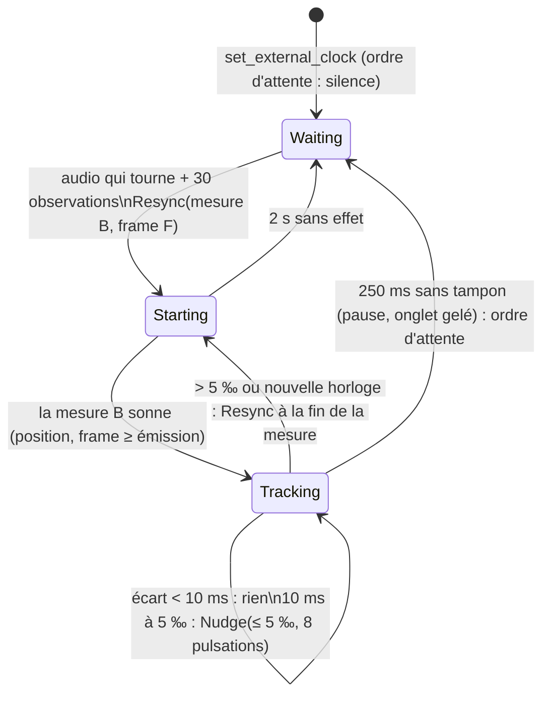

# J6 — harmonium suit l'horloge du jeu

**Statut** : livré, non fusionné (2026-11-07) | **Branche** : `wquintal/j6-horloge-externe` (depuis `main` `8826d64`)
| **Décision** : William, 2026-11-06, option a (`pret-pour-1837.md` § 6) | **Aucune écoute** : preuves hors ligne, sans son, sans studio

## En bref

La simulation du jeu (GGRS, 60 Hz) est la source du temps musical ; harmonium la **suit**. Le jeu donne une
horloge `{ sim_hz, anchor_frame, pulse_frames: num/den }` puis, à chaque frame de présentation, la frame de
simulation courante ; le moteur règle la **vitesse** et la **phase** de son playback dessus, sans jamais
interpoler la position qu'il publie (principe II respecté tel quel, aucun amendement).

| Besoin | Ce qui le fait |
|---|---|
| La pulsation dansée du profil dure la période (`3600/230` permis) | `ExternalClock::tempo_for` convertit la période en tempo à la noire selon le mètre ; `LiveHost` l'installe comme `SetBpm` (même priorité : émotion, rampe de set, variante de session ne s'appliquent plus) |
| Pas de départ « mesure 1 au clic » | `PlaybackCommand::Resync` : seek déterministe à la première mesure dont l'instant audible est à venir, silence jusqu'à cet instant (frame de moteur) |
| Écart filtré, décision par `CorrectionPolicy` | `ExternalFollower` (machine à états pure, `harmonium_host::external`) |
| Micro-ajustement sur la conversion instants → frames | `PlaybackCommand::Nudge { ppm, pulses }` : l'échelle porte sur l'instant du plan à la conversion en frames, jamais sur le plan |
| Callback sans allocation ni verrou | les ordres passent par la file de commandes existante ; tous les calculs de décision sont sur le fil principal |
| Plugin | `GameClock` (ressource) ; le plugin joint `Time<Real>::last_update()` (`Instant::now()` au début de la frame) |
| Retrait du plan partagé | `SharedTimePlan`, `DatedCommand`, `ScoreCommand`, `CommandDate`, `apply_score_command` et leurs tests supprimés |

## API

### `harmonium_core::time_plan::external` (entiers, sous `deny(clippy::float_arithmetic)`)

```rust
let clock = ExternalClock::new(60, anchor_frame, 3600, 230)?; // sim_hz, ancrage, période num/den en frames
clock.pulse_period();            // Flicks, arrondi au flick
clock.pulse_start(n);            // début de la pulsation n (0 : pulsation 1 de la mesure 1), flicks depuis l'ancrage, un seul arrondi
clock.frame_time(frame, milli);  // instant d'une frame de simulation, flicks signés depuis l'ancrage
clock.tempo_for(&bar_timing);    // Option<Tempo> : tempo à la noire dont la pulsation du mètre dure la période (40–300 BPM)
clock.rounding_error_ppm(&bar_timing, tempo); // erreur de la pulsation rendue, en ppm de la période exacte
```

### `harmonium_host::LiveHost`

```rust
host.set_external_clock(clock)?;                       // pose ou remplace ; installe le tempo, met le playback en attente
host.observe_external(SimObservation { sim_frame, frame_fraction, at: Instant::now() }, &published_clock)?; // à chaque frame
host.external_status();                                // Option<ExternalStatus> : phase, écart filtré (flicks), dernière correction, comptes
host.set_follow_config(FollowConfig { .. });           // zone morte, 5 ‰, 8 pulsations, garde de démarrage, latence supplémentaire…
host.clear_external_clock()?;                          // rend le tempo aux émotions, lève l'attente
```

`published_clock` est le dernier `TransportClock` lu (`ClockReader::read`) : le plugin Bevy garde le lecteur (il l'a pris à
l'hôte), c'est pourquoi l'observation le reçoit en paramètre. `resume()` et `pause()` passent en `&mut self` (ils envoient
l'ordre d'attente) ; l'appelant du studio et du plugin sont adaptés.

Nouveaux champs de `TransportClock` : `nudge_ppm` (micro-ajustement en vigueur) et `holding` (le callback attend un
instant de l'horloge ; la position publiée n'est alors pas celle d'une mesure jouée).

### `harmonium_bevy`

```rust
// À l'entrée dans la salle, et quand la salle ou son tempo change :
game_clock.clock = Some(ExternalClock::new(60, room.start_frame, 3600, 230)?);
// À chaque frame de présentation, avant HarmoniumSet :
game_clock.sim_frame = sim.frame;
game_clock.frame_fraction = sim.overstep_fraction(); // optionnel
// Diagnostic :
if let Some(follow) = music_clock.follow { follow.phase; follow.gap_ms(); follow.last_correction; }
```

README de `harmonium_bevy` : section « Suivre l'horloge du jeu » (unités, exemple, ce que le jeu doit fournir, limites).

## Fonctionnement



- **Mesure de l'écart.** La pulsation `n` (= `(mesure − 1) × pulsations_par_mesure + pulsation`) est entendue à
  l'`Instant` audible du tampon qui rend son premier échantillon (`pulse_start_frame` placée sur
  `buffer_start_instant`, la latence de sortie comprise). L'horloge la place à `ancrage + n × période`,
  convertie en `Instant` par un décalage simulation → mur moyenné sur les 60 dernières observations (la frame
  de simulation tremble d'une frame, 16,7 ms ; la moyenne ramène l'erreur à ≈ 2 ms). L'écart est la différence,
  positif quand l'audio est en avance ; une pulsation donne un échantillon, la décision utilise la moyenne des
  trois derniers (au moins deux) et ignore les pulsations qui suivent une décision.
- **Un décalage simulation → mur brusque** (plus de 100 ms, trois observations de suite) vide le filtre : on ne
  corrige pas un décalage à moitié filtré.
- **Démarrage.** L'instant visé est le début de la première mesure de l'horloge après « maintenant audible + 150 ms »
  (la garde couvre un tampon et la file de commandes). `F = frame du tampon + (instant visé − instant audible du tampon) × fs` :
  le playback, qui ne lit jamais d'`Instant` (principe II), reçoit une frame de moteur et attend en silence qu'elle arrive.
- **Saut.** La mesure en cours finit ; à son entrée suivante, le playback saute à la première mesure de l'horloge qui
  commence (à la zone morte près) après cette fin, et attend son instant en silence : au plus une mesure. Si la mesure
  visée est dans la fenêtre déjà composée (jusqu'à 4 mesures en avant), seul le playback bouge ; sinon (en arrière,
  plus loin) le composeur rejoue (`seek_recompose` : les mesures composées depuis la cible sont jetées, pour que le tempo
  de l'horloge sonne, au lieu d'être rejouées telles quelles). Le tempo de l'horloge est exact dès la première pulsation
  de la mesure sautée : pas de rampe depuis le tempo d'avant le saut.
- **Micro-ajustement.** À chaque ouverture de pulsation, le playback convertit les instants du plan en frames avec
  l'échelle `1 − ppm/10⁶` sur l'instant absolu : deux pulsations sous le même ajustement se raccordent sans arrondi
  cumulé, aucune durée n'est arrondie isolément. Les instants du plan, les notes, le MIDI exporté ne changent pas.
- **Commandes qui réinitialisent le tempo** (`SetStyleProfile`, `Reset`, `ResetBpm`, `SetBpm`, `SetTimeSignature`) :
  l'hôte réinstalle le tempo de l'horloge ensuite. `SetSeed`, `Reset`, nouvelle pièce : le playback attend de nouveau son instant.

## Preuves (hors ligne, sans son)

Tests : `harmonium_host/tests/external_clock_tests.rs` (clients simulés : hôte détaché, playback piloté tampon par
tampon par un modèle de périphérique, `Instant` fabriqués), `harmonium_core::time_plan::external` (unitaires),
`harmonium_bevy/tests/plugin.rs` (plugin à 60 Hz sur `Time<Real>` avancé à la main). La vérité de terrain est le modèle
du périphérique du test (la frame `f` est audible à `geste + latence + f / (fs (1 + dérive))`), jamais l'état interne du suivi.

### 1. Deux clients, 11 minutes simulées

Même graine et profil (`reel_quebecois`), horloge `3600/57` frames à 60 Hz (blanche de 1,053 s, 114 BPM à la noire),
ancrage à 2 s. A : 44,1 kHz, +80 ppm, geste à 0,3 s. B : 48 kHz, −80 ppm, geste à 2,1 s, `Instant` local décalé de
5 000 s. Frame de simulation observée à ± 1 frame (tirage pseudo-aléatoire). Écart `horloge − audio` de chaque pulsation
entendue après les 60 premières secondes :

| Client | Pulsations | Écart max | Écart moyen | Corrections |
|---|---|---|---|---|
| A 44,1 kHz +80 ppm | 570 | 9,29 ms | 4,27 ms | 1 démarrage, 3 micro-ajustements (le dernier : −2 ‰) |
| B 48 kHz −80 ppm | 570 | 9,27 ms | 4,21 ms | 1 démarrage, 3 micro-ajustements (le dernier : +2 ‰) |

Les deux restent sous la zone morte (10 ms). Une dérive de 80 ppm use la zone morte en ≈ 2 min : un micro-ajustement de
2 ‰ sur 8 pulsations la rattrape. À chaque seconde de 120 s à 650 s (hors 25 ms autour d'un début de mesure), la mesure
qui sonne chez A est celle qui sonne chez B (plus de 450 comparaisons, aucune différence).

### 2. Démarrage

La première pulsation audible est un début de mesure de l'horloge (`index` pair en 2/2). Elle tombe à ± 1 frame audio de la
frame que l'hôte avait décidée (`Applied::Start { frame }`) ; l'écart à l'instant de simulation (jitter ± 1 frame filtré) :
`−0,57 ms` (44,1 kHz, geste 0,3 s), `0,00 ms` (48 kHz, geste 2,1 s), `+1,39 ms` (96 kHz, geste 7,77 s, mesure 3). Aucune
pulsation avant le geste ni avant le début de la mesure de l'horloge.

### 3. Période fractionnaire et mètres

Tempo de 230 BPM à la noire, exprimé en pulsation du mètre ; pulsation moyenne sur 64 pulsations à 48 kHz, sans dérive
ni gigue, aucun micro-ajustement :

| Profil | Mètre | Période (frames à 60 Hz) | Écart de la pulsation moyenne |
|---|---|---|---|
| `reel_quebecois` | 2/2, blanche | `7200/230` | +0,24 ppm |
| `gigue_quebecoise` | 6/8, noire pointée | `5400/230` | +0,04 ppm |
| `gmd_pop` | 4/4, noire | `3600/230` | −0,38 ppm |
| `valse_quebecoise` | 3/4 | `3600/230` | +0,87 ppm |
| `nt_desert` | 12/8 (4 pulsations) | `5400/230` | +0,04 ppm |
| `gmd_blues_shuffle` | 4/4 en 12 pas | `3600/230` | −0,38 ppm |

Borne analytique de l'erreur : `Tempo` arrondit au milli-BPM, soit **± 0,5 / milli-BPM × 10⁶ ppm** (12,5 ppm à 40 BPM,
8,3 à 60, 4,2 à 120, 2,2 à 230, 1,7 à 300), plus une frame audio répartie sur 64 pulsations (≈ 1 ppm). Le test vérifie la borne
sur un balayage de 630 périodes et sur le rendu ; l'erreur s'accumule en dérive de 4 µs par seconde à 120 BPM, que le suivi
rattrape (la zone morte est usée en 40 min).

### 4. Écart forcé

Le périphérique audio se bloque : tout ce qui n'est pas rendu sonne plus tard (blanche de 0,667 s, 40 frames).

- **25 ms** : une décision, `Nudge { 4 ‰, 8 pulsations }` (≤ 5 ‰) ; huit pulsations plus tard, écart max **3,67 ms** (< 10 ms), aucun saut.
- **300 ms** : aucun micro-ajustement, `Jump` à la fin de la mesure en cours (mesure 24) ; silence ≤ une mesure (1,33 s) ; écart max
  après le saut **0,00 ms** (sans dérive ni gigue).

### 5. Changement d'horloge

Autre salle commencée 10 s plus tôt, autre tempo (50 frames, 144 BPM au lieu de 40 frames, 180 BPM), à 20 ppm de dérive et ± 1 frame de gigue :
l'audio finit sa mesure 22 (ancien tempo), saute à la mesure 8 de la nouvelle horloge (retour en arrière : `seek_recompose`), silence
de **0,33 s** (au plus une mesure : 1,67 s), la pulsation rendue dure alors 40 000 frames à 48 kHz (0,8333 s) dès la
première pulsation, écart max ensuite **3,02 ms**.

### 6. Sans horloge externe

- Le test « chaque pas rendu tombe sur le plan » garde toute sa force : le plan attendu vient des snapshots
  (`BarTiming::of_snapshot`) au lieu de `SharedTimePlan`, pour chaque profil distribué, avec et sans automation
  (émotions, tempo direct, retour aux émotions, énergie appliqués par les setters du composer à la mesure datée).
- `cargo test --workspace -q --no-fail-fast` : tout vert sauf `seek_to_bar_64_under_50ms` (voir ci-dessous) ; golden measures
  inchangées ; les 195 dumps de `determinism_dump` sont **identiques octet pour octet** à ceux de `8826d64` (comparés à une
  extraction de `git archive`) ; `TUNING_VERSION` non touché ; aucun snapshot n'a changé.
- `session_start` / `session_rng` / `SESSION_KEYS` / `SESSION_SCALES` ont déménagé dans `harmonium_core::session` (flux
  identique) : le composer et `harmonium_determinism` s'en servent.

### Mesures de l'acceptation

| Vérification | Résultat |
|---|---|
| `cargo test --workspace -q --no-fail-fast` | vert, sauf `seek_to_bar_64_under_50ms` |
| `cargo test -p harmonium --features odin` | vert, sauf `seek_to_bar_64_under_50ms` |
| `cargo +stable test -p harmonium_bevy --no-default-features` | 13 tests verts (dont 2 nouveaux) |
| `make bevy/check` (clippy `-D warnings`, wasm32, avec et sans `odin`) | propre |
| `cargo check -p harmonium_studio` | propre |
| `harmonium_determinism/scripts/run.sh` | natif = wasm : 195 / 195 fichiers identiques |
| `cargo +nightly fmt --all --check` | propre |
| `seek_to_bar_64_under_50ms` | machine partagée (charge 11 à 14) : 52, 53, 61, 63, 66 et 202 ms en six lancements, **passe une fois sur six (< 50 ms)** ; `deterministic_seek` n'a pas été modifié |

Le test `seek_to_bar_64_under_50ms` mesure un `deterministic_seek` en profil debug, sans rapport avec J6 (seul `composer.rs`
gagne `seek_recompose` et perd `apply_score_command`) ; il dépend de la charge de la machine.

## Ce que cpal donne comme latence

- **Natif** (cpal 0.15.3) : `info.timestamp().playback − callback` est l'instant où le tampon est audible selon le pilote.
  ALSA : le délai `snd_pcm_delay` du tampon ; CoreAudio : latence rapportée par le pilote ; WASAPI : estimation que
  cpal annote lui-même comme ignorant « une petite latence » (`wasapi/stream.rs`, `TODO`). C'est ce que
  `create_timeline_stream` met dans `buffer_start_instant`, donc ce que le suivi tient pour « audible ».
- **wasm32 (`webaudio`)** : `callback` = `AudioContext.currentTime` au moment où le tampon est préparé, `playback` =
  le `when` passé à `AudioBufferSourceNode.start` (curseur de programmation : `currentTime + 25 ms` au premier tampon, puis
  + la durée d'un tampon à chaque suivant). `playback − callback` est donc un **délai de programmation**
  (≈ 25 ms + tampons d'avance), **pas** la latence de sortie. cpal 0.15 ne lit ni `AudioContext.outputLatency` ni
  `baseLatency` : l'instant « audible » publié est l'instant où le tampon est **programmé**, avant la sortie matérielle
  (valeurs non mesurées ici). Rien n'est inventé : le suivi aligne ce que
  cpal donne, et un décalage connu se retranche avec `FollowConfig::extra_output_latency`
  (`HarmoniumConfig::follow` côté plugin). Lire `outputLatency` demande d'atteindre l'`AudioContext` de cpal, qui n'est pas
  exposé par `cpal::Stream` dans la version utilisée ; non fait.

## Limites

- **Latence de sortie web et Bluetooth** : voir ci-dessus. Les deux clients (Chrome) ont chacun leur latence matérielle,
  invisible pour le suivi : elle reste, entière, dans l'écart d'écoute entre les deux joueurs (typiquement quelques ms à
  quelques dizaines de ms). `extra_output_latency` est un réglage unique par client.
- **Onglet gelé** : plus de callback ni de frame de présentation. Au retour, l'audio est vu à l'arrêt (250 ms sans
  tampon), mis en attente, puis saute à la mesure courante (jusqu'à 1 s d'observations pour le filtre).
- **Gigue de GGRS entre pairs** : l'horloge est celle de la simulation **locale**. Une simulation qui rattrape ou ralentit
  (rollback, `WaitRecommendation`) décale la musique à la même vitesse ; au-delà de 100 ms de décalage brusque, le filtre
  repart et la musique saute à la mesure suivante. Le suivi ne regarde jamais le pair : « même mesure au même instant de
  simulation » vaut à la précision de la simulation locale de chaque client.
- **Filtre simulation → mur** : moyenne sur 1 s ; erreur ≈ 2 ms avec une gigue de ± 1 frame ; un jeu qui fournit
  `frame_fraction` et sa frame en début de frame de présentation fait mieux.
- **Mètre** : les pulsations par mesure sont celles du profil actif ; `SetTimeSignature` en cours de route, un profil qui
  change de mètre dans un air, et une dernière pulsation incomplète ne sont pas suivis.
- **Saut en avant dans la fenêtre** (≤ 4 mesures déjà composées) : le composeur ne rejoue pas. Un saut plus loin ou en arrière le
  rejoue (`seek_to_bar_64` : 50 à 200 ms en debug sous charge), pendant le silence prévu.
- **Silence au démarrage** : entre la pose de l'horloge et la première mesure, le playback est muet (≥ 0,5 s d'observations,
  la garde de 150 ms, puis jusqu'à une mesure). Une salle dont l'ancrage est dans le futur reste muette jusqu'à lui.
- Les corrections sont à la pulsation : un écart qui apparaît entre deux pulsations est vu à la suivante.

## À régler à l'oreille (William)

Tous dans `FollowConfig` (`HarmoniumConfig::follow` côté plugin), valeurs d'origine entre parenthèses :

1. `policy.dead_zone` (10 ms) : au-delà de quelle erreur on corrige. Trop petite : micro-ajustements permanents, audibles
   comme un flottement ; trop grande : les deux joueurs se désaccordent d'autant.
2. `policy.max_nudge_per_mille` (5 ‰) et `policy.window_pulses` (8) : 5 ‰ de vitesse sur 8 pulsations ; à écouter
   sur les pulsations longues (blanche du reel) et sur la gigue (noire pointée). Seul le tempo change, aucun rééchantillonnage.
3. `start_guard` (150 ms) : marge de démarrage ; plus grande, plus de silence avant le départ.
4. `extra_output_latency` (0) : à renseigner par client web, après mesure (aucun chiffre n'a été mesuré ici ; pas d'écoute).
5. `step_threshold` (100 ms) et `filter_observations` (60) : réactivité aux sauts de la simulation et lissage de la gigue.
6. `soft_jump_bars` (4) : jusqu'où un saut reste sans rejouer le composeur.

## Fichiers

- **Nouveaux** : `harmonium_core/src/time_plan/external.rs`, `harmonium_core/src/session.rs`, `harmonium_host/src/external.rs`,
  `harmonium_host/tests/external_clock_tests.rs`, ce compte rendu.
- **Modifiés** : `playback.rs` (`Nudge`, `Resync`, attente en silence, rampe de tempo supprimée après un saut), `clock.rs`
  (`nudge_ppm`, `holding`), `live_host.rs` (API d'horloge externe, `pause`/`resume` en `&mut self`), `composer.rs`
  (`seek_recompose`), `harmonium_bevy` (`GameClock`, `MusicClock::follow`, README, tests).
- **Supprimés** : `harmonium_core/src/time_plan/score.rs` et ses tests (`SharedTimePlan` & co), `MusicComposer::apply_score_command`.
- Notes historiques ajoutées à `horloge-etude.md` ; ligne J6 du tableau d'état de `plan.md` mise à jour.
