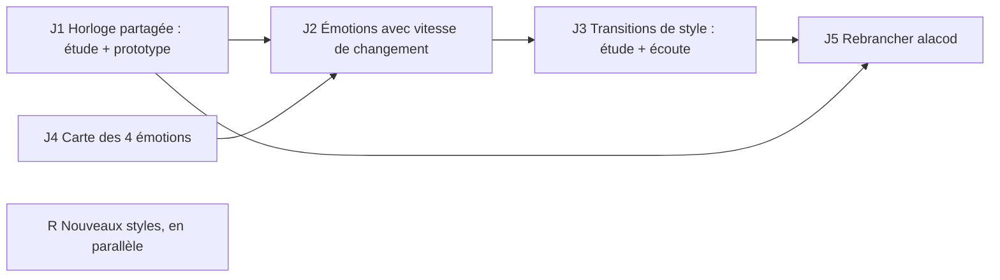

# Phase 013 — Le moteur dans le jeu

## Problème

La musique sonne bien en sets (phase 012), mais le moteur existe pour le jeu « 1837 »
(`~/Project/bascanada/alacod`, Bevy 0.19, simulation déterministe à rollback GGRS, fixed-point).
Constats vérifiés au départ de la phase (moteur `a354125`, jeu `5bdb201a`) :

- **L'intégration est morte.** `alacod/crates/game/src/audio/{mod,adaptive}.rs` dépend de
  `harmonium_bevy` (ancienne API : `RhythmMode::Euclidean`, `sequencer`, synthé Odin, supprimés du
  moteur) ; la feature `harmonium` est désactivée. Elle mappait ennemis / vague / vie vers tempo,
  densité, tension — pas les 4 émotions actuelles.
- **Le jeu veut un temps musical dans la simulation** (`alacod/docs/plan-engine.md`, H2 « Tempo » :
  frames par temps, fenêtres « sur le temps » pour tirer, frapper, esquiver ; musique en présentation).
  Aujourd'hui le temps vient du playhead audio (`ClockReader`/`BeatInfo`), propre à chaque machine :
  inutilisable tel quel par une simulation à rollback.
- **Réactivité** : `set_emotions` mémorise seulement ; l'appelant choisit `invalidate_and_regenerate`
  (changement dès la mesure suivante) ou `apply_params_preserving_preview(n)`. Anticipation de 4
  mesures. Dynamique, tempo et densité changent à la mesure suivante, le mode à la frontière de
  phrase ; le matériel de l'air est gardé. Aucune notion de vitesse de transition.
- **Changement de style** : `set_profile` coupe à la mesure suivante, sans transition.

## Décisions du propriétaire (2026-10-26)

- **A. La simulation est maîtresse du temps.** Le jeu fixe le tempo et ses changements à des
  instants connus à l'avance ; chaque client calcule le même temps musical. **La musique elle-même
  n'est pas rollbackée** : seuls quelques éléments partagés par le rollback (graine, plan de tempo,
  émotions, changements de style) servent à la générer sur chaque client, quitte à de légères
  différences audibles d'un client à l'autre.
- **B. Vitesse de changement configurable par le jeu.** Le jeu contrôle les émotions **et** le rythme
  auquel elles s'appliquent ; il peut forcer un changement drastique et immédiat ou une évolution
  progressive selon le niveau et la scène. Le lien entre « vitesse » et couches musicales est à étudier.
- **C. Transitions de style : à étudier** (le propriétaire est incertain ; écoute comparée ensuite).
- **D. Les 4 émotions doivent être clairement identifiables** à l'oreille et documentées ; leur
  branchement sur les signaux du jeu (ennemis, vie, jauges, zone) appartient au jeu, pas au moteur.

Conséquence constitutionnelle : le principe II (« la position lue par le jeu vient du playhead ») doit
être amendé pour le multijoueur : la position de **référence** devient un plan de temps déterministe
partagé ; le playhead le suit et publie son écart. L'amendement sera rédigé après l'étude J1.

## Tâches

- **J1 — Horloge musicale partagée** (étude puis prototype) : plan de tempo déterministe (« carte
  mesures ↔ instants » calculable en pur Rust sans audio, depuis la graine et les commandes de tempo
  datées), fonction pure « temps musical à la frame N » utilisable par la simulation, suivi par le
  playhead avec mesure et correction de l'écart (dérive horloge audio / horloge du jeu), latence
  audio. Contrat de snapshot et de `BeatInfo` adaptés ; proposition d'amendement du principe II.
- **J4 — Carte des 4 émotions** : ce que chacune fait par profil (tempo, dynamique, mode, densité,
  articulation…), plages utiles, recouvrements ; documentation pour le jeu et comparateur d'écoute
  (même boucle, une émotion à la fois). Corriger si deux émotions se confondent à l'oreille.
  *Livré (branche `j4-emotions-carte`)* : inventaire et constats `emotions-inventaire.md`, mesures
  `measure_emotions.py` → `emotions-mesures.{md,json}`, guide du concepteur `emotions.md`, comparateur
  d'écoute (kit `emotions` de `specs/012-vie-realisme/kits_ecoute.py`), propositions de données
  `proposition_emotions.py` (P1–P3, non appliquées : J2).
- **J2 — Émotions avec vitesse de changement** : API `cible + vitesse` (immédiat, rampe sur N
  mesures, à la prochaine phrase…), déterministe, décidée par le jeu ; quelles couches suivent à quelle
  vitesse (accent immédiat, dynamique, densité, mode, air) ; contrat de flux.
- **J3 — Transitions de style** : étude des options (finir la phrase ou l'air, pont cadentiel,
  modulation, entrée de la nouvelle percussion, fondu…), prototypes, comparateur d'écoute ; décision
  du propriétaire, puis implémentation générique (aucun nom de style dans le code).
- **J5 — Rebrancher le jeu** (dépôt `alacod`, avec son accord et selon ses règles) : nouvelle
  intégration Bevy 0.19 mince sur `create_offline_engine`, remplacement de `harmonium_bevy`, horloge J1
  dans la simulation, signaux → émotions côté jeu.
- **R — Nouveaux styles (en parallèle)** : profils en données depuis le corpus (types présents :
  quadrille et cotillon québécois, gigue/valse/marche acadiennes, reel/valse britanniques…), mesurés
  au labo, écoutés au comparateur. Puis phase 014 : test à l'aveugle équitable réel/généré (BT2).

## Acceptation de la phase

- Deux clients (même graine, mêmes commandes) calculent le même temps musical à la frame près, sans
  lire l'audio ; l'audio suit ce temps avec un écart mesuré et borné.
- Le jeu peut demander un changement d'émotion immédiat ou progressif, mesuré dans le flux.
- Les 4 émotions sont distinguées à l'oreille par le propriétaire (comparateur).
- Une transition de style choisie à l'oreille, implémentée en données.
- Le jeu joue la musique du moteur actuel.
