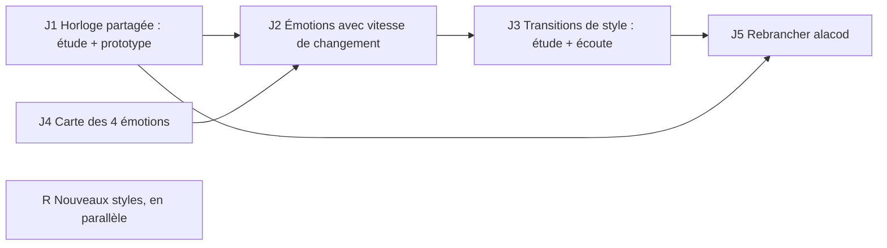

# Phase 013 — Le moteur dans le jeu

## Problème

La musique sonne bien en sets (phase 012), mais le moteur existe pour le jeu « 1837 »
(`~/Project/bascanada/alacod`, Bevy 0.19, simulation déterministe à rollback GGRS, fixed-point).
Constats vérifiés au départ de la phase (moteur `a354125`, jeu `5bdb201a`) :

- **L'intégration est morte.** `alacod/crates/game/src/audio/{mod,adaptive}.rs` dépend de
  `harmonium_bevy` (ancienne API : `RhythmMode::Euclidean`, `sequencer`, synthé Odin, supprimés du
  moteur) ; la feature `harmonium` est désactivée. Elle mappait ennemis / vague / vie vers tempo,
  densité, tension — pas les 4 émotions actuelles.
- **Le jeu veut un temps musical dans la simulation** (`alacod/docs/plan-engine.md`, H2 « Tempo » :
  frames par temps, fenêtres « sur le temps » pour tirer, frapper, esquiver ; musique en présentation).
  Aujourd'hui le temps vient du playhead audio (`ClockReader`/`BeatInfo`), propre à chaque machine :
  inutilisable tel quel par une simulation à rollback.
- **Réactivité** : `set_emotions` mémorise seulement ; l'appelant choisit `invalidate_and_regenerate`
  (changement dès la mesure suivante) ou `apply_params_preserving_preview(n)`. Anticipation de 4
  mesures. Dynamique, tempo et densité changent à la mesure suivante, le mode à la frontière de
  phrase ; le matériel de l'air est gardé. Aucune notion de vitesse de transition.
- **Changement de style** : `set_profile` coupe à la mesure suivante, sans transition.

## Décisions du propriétaire (2026-10-26)

- **A. La simulation est maîtresse du temps.** Le jeu fixe le tempo et ses changements à des
  instants connus à l'avance ; chaque client calcule le même temps musical. **La musique elle-même
  n'est pas rollbackée** : seuls quelques éléments partagés par le rollback (graine, plan de tempo,
  émotions, changements de style) servent à la générer sur chaque client, quitte à de légères
  différences audibles d'un client à l'autre.
- **B. Vitesse de changement configurable par le jeu.** Le jeu contrôle les émotions **et** le rythme
  auquel elles s'appliquent ; il peut forcer un changement drastique et immédiat ou une évolution
  progressive selon le niveau et la scène. Le lien entre « vitesse » et couches musicales est à étudier.
- **C. Transitions de style : à étudier** (le propriétaire est incertain ; écoute comparée ensuite).
- **D. Les 4 émotions doivent être clairement identifiables** à l'oreille et documentées ; leur
  branchement sur les signaux du jeu (ennemis, vie, jauges, zone) appartient au jeu, pas au moteur.

Conséquence constitutionnelle : le principe II (« la position lue par le jeu vient du playhead ») doit
être amendé pour le multijoueur : la position de **référence** devient un plan de temps déterministe
partagé ; le playhead le suit et publie son écart. L'amendement sera rédigé après l'étude J1.

## Tâches



- **J1 — Horloge musicale partagée** (étude puis prototype) : plan de tempo déterministe (« carte
  mesures ↔ instants » calculable en pur Rust sans audio, depuis la graine et les commandes de tempo
  datées), fonction pure « temps musical à la frame N » utilisable par la simulation, suivi par le
  playhead avec mesure et correction de l'écart (dérive horloge audio / horloge du jeu), latence
  audio. Contrat de snapshot et de `BeatInfo` adaptés ; proposition d'amendement du principe II.
  Étude, recommandation et texte d'amendement : `horloge-etude.md` ; prototype
  `harmonium_core::time_plan` (plan entier suivi par le playback, écart publié, correction isolée).
- **J4 — Carte des 4 émotions** : ce que chacune fait par profil (tempo, dynamique, mode, densité,
  articulation…), plages utiles, recouvrements ; documentation pour le jeu et comparateur d'écoute
  (même boucle, une émotion à la fois). Corriger si deux émotions se confondent à l'oreille.
  *Livré (branche `j4-emotions-carte`)* : inventaire et constats `emotions-inventaire.md`, mesures
  `measure_emotions.py` → `emotions-mesures.{md,json}`, guide du concepteur `emotions.md`, comparateur
  d'écoute (kit `emotions` de `specs/012-vie-realisme/kits_ecoute.py`), propositions de données
  `proposition_emotions.py` (P1–P3, non appliquées : J2).
- **J2 — Émotions avec vitesse de changement** : API `cible + vitesse` (immédiat, rampe sur N
  mesures, à la prochaine phrase…), déterministe, décidée par le jeu ; quelles couches suivent à quelle
  vitesse (accent immédiat, dynamique, densité, mode, air) ; contrat de flux.
- **J3 — Transitions de style** : étude des options (finir la phrase ou l'air, pont cadentiel,
  modulation, entrée de la nouvelle percussion, fondu…), prototypes, comparateur d'écoute ; décision
  du propriétaire, puis implémentation générique (aucun nom de style dans le code).
- **J5 — Rebrancher le jeu** (dépôt `alacod`, avec son accord et selon ses règles) : nouvelle
  intégration Bevy 0.19 mince sur `create_offline_engine`, remplacement de `harmonium_bevy`, horloge J1
  dans la simulation, signaux → émotions côté jeu.
- **R — Nouveaux styles (en parallèle)** : profils en données depuis le corpus (types présents :
  quadrille et cotillon québécois, gigue/valse/marche acadiennes, reel/valse britanniques…), mesurés
  au labo, écoutés au comparateur. Puis phase 014 : test à l'aveugle équitable réel/généré (BT2).

## Acceptation de la phase

- Deux clients (même graine, mêmes commandes) calculent le même temps musical à la frame près, sans
  lire l'audio ; l'audio suit ce temps avec un écart mesuré et borné.
- Le jeu peut demander un changement d'émotion immédiat ou progressif, mesuré dans le flux.
- Les 4 émotions sont distinguées à l'oreille par le propriétaire (comparateur).
- Une transition de style choisie à l'oreille, implémentée en données.
- Le jeu joue la musique du moteur actuel.

## R1 — Nouveaux styles en données (2026-10-26)

Branche `wquintal/r1-styles` du moteur (depuis `957920f`), branche `wquintal/r1-styles` du labo (depuis `e1102d4`). Aucun
fichier `harmonium_*/src` modifié : trois dossiers `profiles/<id>/` et leurs tests. Aucun algorithme générique manquant.

### Choix : effectifs du corpus et différence audible

| Tradition / type | Fichiers | Positionnables (parties de 8 mes.) | Décision |
|---|---:|---:|---|
| britannique colonial, **reel** | 493 (479 Nottingham, 8 Cahusac, 6 AmRev) | 416 | **retenu** : `reel_britannique_coloniale` |
| britannique colonial, **valse** | 60 (58 Nottingham, 2 Cahusac) | 52 | **retenu** : `valse_britannique_coloniale` |
| acadienne, **gigue** | 55 (The Session) | 50 | **retenu** : `gigue_acadienne` |
| acadienne, hornpipe | 29 | 19 | écarté : taux par mesure et secondes fins sur ≤ 19 parties (la gigue acadienne en a 50) ; à reprendre |
| québécoise, marche / quadrille / cotillon | 16 / 14 / 5 | 10 / — / — | écartés : 11 / 9 / — airs analysables, sous le seuil de 15 du lot DS-T9 |
| acadienne, marche / valse / cotillon | 11 / 5 / 1 | — | écartés : effectifs |

Ce qui est **audible** : (1) `gigue_acadienne` change d'instrument (piano de veillée, recette « main gauche » du guide, pieds
et second violon conservés) ; (2) `reel_britannique_coloniale` et `valse_britannique_coloniale` n'ont ni pieds ni chops
(accords tenus), un tempo de bal plus posé (208 et 138 à la noire) et des ornements écrits quasi absents côté reel
(0 rouleau, 5 appogiatures sur 51 266 notes) ou très denses en doubles cordes côté valse (2,54 /100 notes contre 1,28 au
Québec). Ce qui est **dans les données** : formes, tonalités, cellules, ornements, interprétation écrite. Chaque README
(`profiles/<id>/README.md`) cite effectifs, formules, sources, et ce qui n'est **pas** mesuré : les trois **tempos**
(180 / 208 / 138), le swing 0,5, les motifs d'accompagnement, la basse et les accords du piano (extrapolation du
Cap-Breton, étude V5a §2.1), les niveaux de mixage et la rampe de set sont des propositions à écouter. Le corpus
britannique de ces deux types est à 97 % un recueil anglais (NMD) : « colonial » est l'étiquette du lot du labo, pas une preuve de pratique
nord-américaine. Les parties C/D et les formes « ABCD » ne sont pas modélisées (AABB comme les sept autres).

### Construction et reproduction

```sh
L=/Users/william.quintal/Project/bascanada/harmonium_lab        # + PYTHONPATH=<worktree labo>/src pour le correctif DS-T9c
$L/.venv/bin/python specs/013-moteur-dans-le-jeu/r1_profils.py selftest   # formules rejouées sur 4 profils distribués
$L/.venv/bin/python specs/013-moteur-dans-le-jeu/r1_profils.py build      # écrit profiles/{gigue_acadienne,reel_…,valse_…}
```

`selftest` : `form.parts` (rôles, secondes fins, rythmes) et `ornaments` **identiques** à gigue québécoise, reel acadien,
hornpipe et gigue britanniques, valse québécoise ; règles `performance` identiques pour les profils britanniques ;
poids différents de 3,4 % (gigue québécoise), 1,2 % (reel acadien) et jusqu'à 42 % (valse québécoise, règle de 6 marques) :
le dénombrement des porteuses d'aujourd'hui n'est pas celui de l'époque (547 contre 557 pour `0|long|any` de la gigue
québécoise), cause non investiguée. Les nouveaux profils prennent le dénombrement courant. `build` utilise `mine-cells`, les références
`structure` et `ornaments` du labo, `measure_endings.py`, `performance_groups` (même parseur commun) et copie
arrangement / dynamics / feet / mixage des profils voisins (piano : recette du guide).

### Mesures contre le corpus (20 seeds, 36 mesures, intro comprise)

Exports `--export --bars 36 --profile profiles/<id> --seed 1..20 --feet 1`, sans `[ornaments]` ni `[performance]` pour
`trad-structure` (l'export complet de la gigue acadienne seed 3 donnait `alignement AABB incertain (13/16)` : la mesure
B:m.6 différait entre passes après quantification à la croche ; hypothèse non isolée : micro-timing ou ornements),
avec le profil complet pour `trad-compare` et `measure_ornaments.py`. Corps de l'air repéré par l'intro publiée
(**correctif de labo DS-T9c**, ci-dessous). Chaque cellule : **réel / généré** (GA = gigue acadienne, RB = reel
britannique, VB = valse britannique ; 20 exports, soit 20 parties A et 20 parties B générées).

| Indicateur (%, sauf entropie) | GA | RB | VB |
|---|---:|---:|---:|
| m.5–6 = m.1–2 | 26,7 / 30,0 | 35,0 / 32,5 | 5,6 / 5,0 |
| paires « a b a c » | 19,2 / 22,5 | 20,4 / 20,0 | 3,4 / 5,0 |
| paires « a b c d » | 32,5 / 17,5 | 40,0 / 20,0 | 66,7 / 65,0 |
| copie A:m.5 = m.1 | 72,0 / 95,0 | 64,2 / 80,0 | 20,0 / 20,0 |
| copie A:m.6 = m.2 | 36,0 / 35,0 | 49,6 / 50,0 | 14,0 / 20,0 |
| copie B:m.5 = m.1 | 51,0 / 60,0 | 48,2 / 60,0 | 11,8 / 20,0 |
| copie B:m.6 = m.2 | 34,7 / 45,0 | 37,4 / 35,0 | 5,9 / 5,0 |
| copie B:m.7 = A:m.7 | 51,0 / 50,0 | 33,4 / 35,0 | 6,1 / 0,0 |
| repos tonique A:m.4 / A:m.8 | 0,0 / 0,0 ; 16,0 / 15,0 | 5,3 / 0,0 ; 15,8 / 15,0 | 12,0 / 15,0 ; 2,0 / 5,0 |
| repos tonique B:m.4 / B:m.8 | 2,0 / 0,0 ; 10,2 / 10,0 | 5,0 / 5,0 ; 18,1 / 15,0 | 9,8 / 5,0 ; 11,8 / 15,0 |
| finale longue A:m.4 / A:m.8 | 2,0 / 10,0 ; 22,0 / 20,0 | 44,4 / 10,0 ; 54,6 / 15,0 | 76,0 / 85,0 ; 80,0 / 90,0 |
| finale longue B:m.4 / B:m.8 | 6,1 / 15,0 ; 16,3 / 25,0 | 47,7 / 20,0 ; 54,5 / 25,0 | 82,4 / 80,0 ; 78,4 / 65,0 |
| croches continues (mesures) | 47,4 / 42,8 | 16,1 / 24,4 | 3,1 / 17,5 |
| entropie rythmique (bits/mesure) | 2,81 / 2,36 | 5,31 / 3,89 | 3,13 / 2,80 |

Lecture : cadences toniques et copies m.6 / B:m.7 tombent dans le pas de 5 points de 20 exports ; les copies m.5←1 générées
sont au-dessus du réel de 9 à 23 points (GA, RB), comme pour la gigue québécoise de contrôle ci-dessous. Écarts nets, déjà
décrits pour les sept profils (P3-T1/T3) et **non corrigés ici** : entropie rythmique plus basse (RB −1,4 bit), finales
longues de RB à m.4/8 (44–55 % réel, 10–25 % généré : la demi-cadence est un proxy, DS-T9), paires « a b c d »
deux fois moins fréquentes en GA et RB. Contrôle avec la gigue québécoise distribuée, même chaîne : m.5–6 = m.1–2
52,8 / 57,5 ; copie A:m.5 68,5 / 90,0 ; repos A:m.8 16,4 / 20,0 ; entropie 3,3 / 2,5.

`trad-compare` (profil `references/trad-<tradition>-<type>/profile.json`, 55 / 491 / 60 airs réels), **réel / généré (z)** :

| Mesure | GA | RB | VB |
|---|---:|---:|---:|
| `intervals__stepwise_ratio` | 0,597 / 0,606 (+0,1) | 0,633 / 0,565 (−0,5) | 0,678 / 0,495 (−1,7) |
| `register__ambitus` | 19,3 / 19,5 (0,0) | 17,1 / 17,2 (0,0) | 16,4 / 19,4 (+1,0) |
| `register__mean_pitch_part0` | 71,2 / 71,6 (+0,1) | 71,2 / 71,5 (+0,1) | 70,7 / 71,4 (+0,2) |
| `register__b_minus_a_mean_pitch` | 2,16 / 0,15 (−0,7) | 1,17 / 0,54 (−0,2) | 1,6 / 0,60 (−0,5) |
| `harmony__chords_per_bar` | 0,036 / 0,51 (+2,5) | 1,24 / 0,55 (−1,8) | 0,98 / 0,55 (−1,3) |
| `form__repeat_identity` | 0,764 / 0 (−2,7) | 0,488 / 0 (−1,2) | 0,305 / 0,003 (−1,5) |

Les `onset_hist__0` (z −3 à −9,5) et `form__repeat_identity` à 0 sont des artefacts de lecture du MIDI exporté (intro, jitter),
présents à l'identique pour `gigue_quebecoise` (z −7,3) : non attribués aux profils. L'écart d'harmonie de GA vient de
l'ABC (56 mesures chiffrées pour 55 airs) ; celui de RB/VB : un accord par mesure (`steps_per_chord`) là où 32 % des
mesures chiffrées du corpus de RB en portent deux.

`trad-ornaments` côté généré = `measure_ornaments.py rates` (20 seeds, 34 mesures, un type à la fois, arousal 0 / 0,5 / 1) :
occurrences observées / attendues, `corpus` : **taux des profils = recalcul du corpus** pour les trois.

| Style | Type | Plancher /100 notes | ×4 | Observé / attendu a=0 | a=0,5 | a=1 |
|---|---|---:|---:|---:|---:|---:|
| GA | `grace_single` | 0,393 | 1,574 | 18 / 17,5 | 12 / 17,1 | 11 / 16,7 |
| GA | `grace_multiple` | 0,262 | 1,049 | 11 / 11,7 | 8 / 11,4 | 9 / 11,1 |
| GA | `double_stop` | 0,393 | 1,574 | 18 / 17,5 | 12 / 17,1 | 11 / 16,7 |
| GA | `roll` | 0,410 | 1,639 | 7 / 9,0 | 8 / 8,2 | 10 / 8,6 |
| RB | `double_stop` | 0,295 | 1,178 | 13 / 10,3 | 9 / 9,0 | 21 / 9,9 |
| RB | `grace_single`, `triplet_repeated`, `chord`, `trill` | 0,010 – 0,002 | < 0,04 | 0 – 2 / < 0,5 | 0 – 1 / < 0,5 | 0 – 2 / < 0,5 |
| VB | `double_stop` | 2,536 | 10,144 | 63 / 63,4 | 58 / 60,0 | 72 / 61,9 |
| VB | `grace_single`, `chord` | 0,059 / 0,020 | 0,23 / 0,08 | 2 / 1,7 ; 0 / 0,0 | 3 / 1,9 ; 0 / 0,0 | 1 / 1,8 ; 0 / 0,0 |

Verdict du script « ok » pour `roll` (GA) et `double_stop` (RB, VB) ; les autres types sont sous le seuil d'effectif.

### Niveaux, sets, export, tests

Crête à émotions maximales (automation constante à 1, 66 mesures, 2 tours, graines 1–5, banques GM + pieds, `measure_ornaments.py peaks`) ;
le même run redonne les sept profils existants **inchangés** (−1,59 à −4,11) :

| Profil | Pire crête max-émotions (dBFS) | Crête neutre, 5 graines | RMS neutre moyen (dBFS) | Échantillons ≥ 1 | Bus |
|---|---:|---|---:|---:|---:|
| `gigue_acadienne` | **−2,33** | −4,75 … −2,70 | −19,6 | 0 | 15 dB |
| `reel_britannique_coloniale` | **−2,89** | −6,92 … −5,32 | −19,7 | 0 | 13,5 dB |
| `valse_britannique_coloniale` | **−4,47** | −6,75 … −3,84 | −19,5 | 0 | 12 dB |

Gigue acadienne : le bus passe de 13,5 à 15 dB (RMS −21,1 → −19,6 : le piano GM est plus faible que la guitare). Écart
mélodie − accompagnement (`measure_mix.py`, seed 3, 66 mesures) : piano 7,4 dB, basse 10,3 dB, pieds 26 dB, 2ᵉ violon 14 dB
(critères ≥ 4 / ≥ 8) ; reel britannique 9,7 / 11,9 dB ; valse britannique 9,1 / 15,4 dB. **Seul échec du script** : la basse du
piano de la gigue acadienne (pan 0) penche à gauche de 3,8 dB, placement des touches de la banque GM, laissé tel quel.

Sets de 300 mesures avec `--automation` (graine 3, deux tours, intensité/arousal 0,5, valence 0,3, densité 0,7, tension 0,3, pieds 1 ;
puis automation maximale), rendus WAV compris : 300 mesures chacun, 1,8 à 11,8 s, crête −2,2 / −3,8 / −4,0 dBFS (constante) et
−2,5 / −2,7 / −4,5 dBFS (maximale) pour GA / RB / VB, aucun échantillon ≥ 1 ; 2 à 3 sets de 2 ou 3 airs complets (positions
`set_index`, `tune_in_set`, `tunes_in_set`), tempo de la gigue acadienne 180 → 188,4 (rampe active, plafond 192), reel 208 → 214,2,
valse 138 → 140,8.

Tests : `harmonium_core/tests/r1_styles_tests.rs` (chargement direct et par nom, aucun style autochtone, métrique et pulse publiés,
AABB 32 mesures, notes dans le mode, pas de podorythmie des deux profils britanniques et talon sur 1 et 4 de la gigue
acadienne, pas d'accords aux pas décrits) ; `export_terminates` (200 mesures, avec et sans automation, **dix** profils en
parallèle, délai 120 s) et `distributed_profiles_round_trip…` mis à dix. Le reste des contrats génériques (chargement,
validation, ornements, hétérophonie, sets, accompagnement, cellules `--check-cells`) itère `StyleProfile::distributed()` et couvre les
nouveaux dossiers. **`cargo test --workspace --no-fail-fast` : 488 réussis, 2 ignorés, 60 suites** ; `cargo fmt --all --check` réussi ;
`cargo clippy --workspace --lib --bins` : 157 messages, aucun fichier `src` modifié ; labo : `PYTHONPATH=src make test` **258 réussis, 31 ignorés**.

### Correctif de labo découvert en mesurant (DS-T9c)

`trad-structure --generated` alignait **16 à 17 exports sur 20 sur la mauvaise mesure** pour tous les profils, y compris les
sept distribués (intro « tail » rejouant la fin de l'air, second fin → score 14/16 ex æquo, premier candidat retenu). Les taux
positionnels du généré publiés avant R1 (DS-T9, phases 011/012) décrivent donc d'autres mesures ; la correction (labo, branche
`wquintal/r1-styles`, commit `45d280b`) lit l'intro publiée par `--record-truth`. **À faire par le coordinateur** : décider de
fusionner ce commit et de reprendre les comparaisons moteur/corpus déjà citées.

### Écoute et suite

Ajoutés à `SET_PROFILES` de `kits_ecoute.py` (sets complets à écouter) ; pas d'écoute du propriétaire : **aucun ADR d'écoute**.
À régler d'abord à l'oreille : tempos, piano du Cap-Breton appliqué à l'Acadie, accords tenus du reel britannique, swing 0,5. Non fait : hornpipe acadien (29 airs) et marche québécoise (16) quand le corpus grossira.

## H1 — Marge de crête sur toute la grille d'émotions (2026-10-26)

Branche `wquintal/h1-marge`. Les crêtes n'étaient vérifiées qu'à émotions maximales
ou un axe à la fois : la grille complète (arousal / densité / tension à 0 / 0,5 / 1,
valence à −1 / neutre du profil / 1, intensité directe à 0,5 / 1 : 162 réglages ;
66 mesures, 2 tours, graines 1–5, WAV flottant, script durable `measure_marge.py`)
montre des dépassements à des réglages ordinaires. Banques GM + pieds
(`harmonium_trad.sf2`, sauf la marche : pieds en GM, caisse claire muette dans
`harmonium_trad.sf2`).

### Avant / après (pire crête sur la grille, 5 graines ; RMS au neutre du profil)

| Profil | Avant (dBFS) | Après (dBFS) | Bus avant → après | RMS neutre avant → après (dBFS) |
|---|---:|---:|---|---|
| `reel_quebecois` | −0,13 | −1,63 | 14,5 → 13,0 | −19,93 → −21,43 |
| `gigue_quebecoise` | −0,97 | −1,97 | 13,5 → 12,5 | −19,76 → −20,76 |
| `valse_quebecoise` | +0,05 (6 écrêtés) | −1,95 | 12,0 → 10,0 | −19,62 → −21,62 |
| `reel_acadien` | −0,39 | −1,89 | 15,5 → 14,0 | −19,10 → −20,60 |
| `marche_britannique_coloniale` | +0,15 (24 écrêtés) | −1,85 | 15,0 → 13,0 | −13,48 → −15,48 |
| `gigue_britannique_coloniale` | −0,52 | −1,52 | 16,0 → 15,0 | −17,68 → −18,68 |
| `hornpipe_britannique_coloniale` | −1,02 | −1,52 | 13,5 → 13,0 | −18,92 → −19,42 |
| `gigue_acadienne` | +0,20 (14 écrêtés) | −1,80 | 15,0 → 13,0 | −19,11 → −21,11 |
| `reel_britannique_coloniale` | −1,30 | −1,80 | 13,5 → 13,0 | −19,22 → −19,72 |
| `valse_britannique_coloniale` | −1,55 | −2,05 | 12,0 → 11,5 | −19,24 → −19,74 |

Zéro échantillon ≥ 1 après, sur les 8 150 rendus. Baisse = besoin arrondi au
demi-dB supérieur, plancher 0,5 dB près de la limite : la gigue britannique et le
hornpipe finissent à −1,52, marge fine — à surveiller si la grille gagne des graines.
Le RMS neutre suit exactement la baisse du bus (gain linéaire) : c'est ce que
l'écoute du propriétaire jugera. Constantes `master` du générateur `r1_profils.py`
alignées (un `build` ne régresse pas les trois profils R1).

### Cause des pires cas (solo de chaque piste au pire réglage + graine)

Partout, le mix est à 0–3 dB du solo de mélodie : aucune piste d'accompagnement
n'est en cause seule, donc `master_db` seul baisse, gains de pistes inchangés.
Deux motifs reviennent : **tension 0** (9 pires sur 10 : notes ×1,1 deux fois,
tenues qui s'empilent) et **intensité directe 1 contre un arousal bas**
(l'intensité force les vélocités maximales pendant que l'arousal reste doux).

| Profil | Pire réglage (graine) | Cause |
|---|---|---|
| `reel_quebecois` | arous. 0,5, val. 1, tens. 0, int. 0,5 (gr. 3) | Registre haut (+5 demi-tons) et brillance de la valence 1, tenues empilées à tension 0 ; violon à −0,9, mix à −0,1. |
| `gigue_quebecoise` | arous. 1, val. −1, dens. 1, tens. 0, int. 1 (gr. 3) | Tout au maximum en registre sombre : vélocités ×1,35, grattage doublé, tenues longues ; violon à −3,7. |
| `valse_quebecoise` | arous. 0, val. neutre, tens. 0, int. 1 (gr. 2) | Intensité 1 contre arousal 0 : jeu doux mais frappé fort, archets longs qui se recouvrent ; violon à −0,3. |
| `reel_acadien` | arous. 1, val. −1, tens. 0, int. 1 (gr. 2) | Comme la gigue québécoise, registre bas sombre + pleine force + tenues ; talon à −7,2, le plus présent de la grille. |
| `marche_britannique_coloniale` | arous. 0, val. −1, tens. 0, int. 1 (gr. 4) | Fifre (−4,1) + caisse GM (−9,3) : deux pistes fortes qui se somment ; seule la marche combine ainsi deux voix. |
| `gigue_britannique_coloniale` | arous. 0, val. −1, tens. 0, int. 1 (gr. 5) | Intensité 1 contre arousal 0, registre sombre ; sans pieds ni 2ᵉ voix, le violon (−2,5) porte tout. |
| `hornpipe_britannique_coloniale` | dens. 0, tens. 0,5, int. 1 (gr. 5) | Violon seul (densité 0 : accompagnement muet) à intensité 1 : le solo atteint −1,0. |
| `gigue_acadienne` | arous. 1, val. 1, dens. 0, tens. 0 (gr. 1) | Piano en registre haut + 2ᵈ violon (−12,7) : à densité 0 il ne reste qu'eux, et le piano (−2,0) écrête. |
| `reel_britannique_coloniale` | tens. 0, int. 1 (gr. 2) | Accords tenus + violon (−1,6) à intensité 1, tenues empilées ; talon à −11,8. |
| `valse_britannique_coloniale` | arous. 0, val. −1, tens. 0, int. 1 (gr. 5) | Même recette que les autres cas « intensité contre arousal », registre sombre ; déjà sous la limite avant (−1,55), −0,5 par prudence. |

### Écoute et suite

Pas d'écoute du propriétaire : **aucun ADR d'écoute**. Le neutre perd 0,5 à 2 dB
de niveau selon le profil (tableau ci-dessus) : si c'est trop creux à l'oreille,
la solution n'est pas de remonter le bus mais de retravailler les vélocités
(propositions P1–P2 de J4, en attente d'écoute). Propositions P3 de J4 caduques :
la grille H1 les remplace (baisses différentes, fondées sur 162 réglages).
