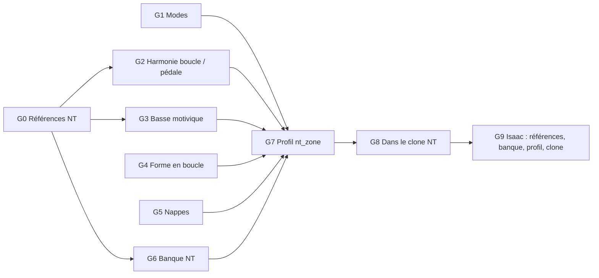

# Phase 014 — Styles de jeu : Nuclear Throne et The Binding of Isaac

**Statut** : ouverte le 2026-10-27, sous la constitution 4.0.0 (moteur tous styles, fusion en
données, sources analysables). La phase 013 reste ouverte pour J5-min (dépôt 1837).

## Problème

Le propriétaire fait deux clones, l'un de Nuclear Throne (NT), l'autre de The Binding of Isaac.
Il veut tester Harmonium dans ces jeux, avec un genre et un son adaptés à chacun. Leur musique
repose sur des boucles et des ostinatos : basse et batterie en avant, harmonie modale ou sur
pédale. *Ce constat vient d'une connaissance générale des bandes originales ; il sera mesuré en
G0.* La grammaire du moteur sort des airs de danse trad. Constats dans le code (moteur `092b1a1`) :

- **Modes** : `trad::Mode` ne connaît que `Ionian`, `Mixolydian`, `Dorian`, `Aeolian`
  (`harmonium_core/src/trad/mode.rs`). Pas de phrygien, pas de mineur harmonique.
- **Harmonie** : la validation n'accepte que `trad_functional`, `jazz_functional` ou `none`
  (`StyleProfile::validate`, `style_profile.rs`). Aucun modèle de boucle d'accords fixe ni de
  pédale.
- **Basse** : `BassDegree` vaut `Root`, `Fifth` ou `FifthIfHeld` (`trad/accomp_profile.rs`). Les
  coups de basse suivent l'accord, donc un riff motivique est impossible.
- **Mélodie** : `has_track(Melody)` est toujours vrai, et les cellules `Run`, `Arp` et `Turn` sont
  exigées de tout profil (validation des rôles de cellule, `style_profile.rs`). Le moteur suppose
  donc qu'une mélodie mène.
- **Forme** : générique (« ni huit mesures, ni deux parties », `profiles/README.md`), mais les
  rôles sont `Open`, `CadHalf`, `CadFull`… Une boucle de 2 ou 4 mesures sans cadence n'a jamais
  été validée.
- **Percussion** : `FeetTable` porte des `voices` nommées, de l'euclidien et des motifs par
  densité, ce qui suffit pour une batterie. Les pistes gardent leurs noms `Heel`/`Toe` : les
  renommer romprait le contrat `MeasureSnapshot` (principe I).
- **Nappes** : aucune piste dédiée. `Chords` avec `stroke = "block"` en est le candidat ; la tenue
  au-delà de la barre de mesure reste à vérifier.
- **Son** : la banque par défaut est GeneralUser GS, en General MIDI. Le jeu passe déjà sa banque
  à `create_offline_engine(sf2_bytes, feet_sf2_bytes)`. Aucune banque propre à un jeu n'existe.
- **Labo** : l'analyse symbolique lit ABC, MIDI et MusicXML. `audio.py` (librosa) mesure tempo,
  spectre, tonalité et dynamique sur de l'audio, donc directement sur les bandes originales.
  `profile_draft.py` ne lit que l'ABC.

## Décisions du propriétaire (2026-10-27)

- **A. Constitution 4.0.0.** Tous les styles doivent pouvoir être générés et fusionnés (principe
  VIII). Les styles se nomment par jeu et zone : `nt_<zone>`, `isaac_<étage>`.
- **B. Les bandes originales servent de référence d'analyse** (principe VII). Le manifeste note
  l'œuvre, l'auteur et la source. Audio et transcriptions restent hors dépôt ; seuls les dérivés
  (mesures, cellules, profils) y entrent.
- **C. La liste des ajouts au moteur est validée** : modes, harmonie boucle ou pédale, basse
  motivique, forme en boucle, nappes, banque propre à chaque jeu.
- **D. NT d'abord, puis Isaac.** NT demande le moins de code ; Isaac ajoute le mineur harmonique,
  les nappes, l'orgue et le chœur.
- **E. À terme, un profil par zone ;** pour commencer, un seul profil par jeu.
- **F. Chaque algorithme ajouté se prouve aussi dans un autre style** (principe VIII), au moyen
  d'une fixture d'un profil trad qui l'utilise. Aucun nom de style dans le code.

## Tâches

| Tâche | Contenu | Dépôt |
|---|---|---|
| G0 | Choisir la zone NT et ses pistes de référence ; écrire le manifeste. Mesures audio librosa : tempo, tonalité et chroma, brillance spectrale, dynamique. Transcrire en MIDI les boucles qui portent le style (riff de basse, groove de batterie, motif mélodique), soit 8 à 15 boucles. Audio et MIDI hors dépôt ; mesures dérivées versionnées. | labo |
| G1 | Modes phrygien et mineur harmonique dans `Mode` et partout où le mode est lu : accords candidats, gammes, bascule de mode par la valence. | moteur |
| G2 | Modèle d'harmonie générique de boucle d'accords fixe par partie, ou de pédale de tonique ; rythme harmonique lu dans le profil. | moteur |
| G3 | Basse motivique : une ligne de basse tirée d'une banque, avec degrés libres et octaves, répétée par la forme. La conception reste ouverte (étendre `BassVoice` ou ouvrir les cellules à plusieurs pistes) ; un seul chemin au bout (principe IV). | moteur |
| G4 | Forme en boucle : parties de 2 ou 4 mesures sans cadence ; mélodie optionnelle ou entrée tardive (arrangement, densité) ; cellules `Run`/`Arp`/`Turn` exigées seulement si la forme les emploie. | moteur |
| G5 | Nappes sur `Chords` : accords plaqués tenus. D'abord vérifier si les données suffisent, sinon ajouter la tenue au-delà de la barre de mesure. | moteur |
| G6 | Banque NT : basse synthé saturée, lead, boîte à rythmes. Source et licence au manifeste ; construction au labo, comme `make trad-sf2`. | labo |
| G7 | Profil `nt_<zone>` en données. Distance au corpus mesurée au labo (audio et symbolique), puis écoute. | moteur |
| G8 | Dans le clone NT : `create_offline_engine` avec sa banque et une émotion fixe (comme J5-min), puis une table de pilotage (signaux du jeu → 4 émotions) côté jeu. | clone NT |
| G9 | Isaac : G0, G6, G7 et G8 pour une première zone (`isaac_<étage>`), en réutilisant G1 à G5. | labo, moteur, clone Isaac |

G0 et G1 peuvent démarrer en parallèle, de même que G4 et G5. La conception de G2 et G3 attend
les transcriptions de G0.

### État (2026-10-27)

| Tâche | État | Compte rendu |
|---|---|---|
| G0 | fusionnée (labo `5e50ddf`) : désert = 12/8 à 140 BPM, pédales phrygiennes G#/D/A, 10 boucles transcrites (hors dépôt) | labo `references/nt-desert/README.md` |
| G1 | fusionnée (`90acfb0`) | `g1-modes.md` |
| G4 | fusionnée (`dab7665`) | `g4-forme-boucle.md` |
| G5 | fusionnée (`69c1449`) | `g5-nappes.md` |
| G3 | fusionnée (`98d0e10`) : motifs pondérés dans `BassVoice`, pédale G#1 tenue en scie (GM 81, décision d'écoute) | `g3-basse-motivique.md` |
| G6 | fusionnée (labo `3fa7eaa`) : `nt_desert.sf2` procédurale CC0, scies 38/81 tenues (excursion < 0,1 dB), kit rock sec | labo `references/nt-desert/banque.md` |
| G2 | fusionnée (`12e0530`) : `harmony.model = "loop"`, pédales et boucles d'accords par partie, composée avec G3 | `g2-harmonie-boucle.md` |
| G7 | fusionnée (`40dcc0f`) : `profiles/nt_desert` en données (arche de Fläshyn, tempo et centre tonal reproduits au labo ; brillance −1,3 kHz) | `g7-nt-desert.md` |
| G7b | fusionnée (`c26c2c3`) : `tracks_off` par partie ; pont de `nt_desert` sans batterie ni basse | `g7b-pistes-par-partie.md` |
| G7c | fusionnée (`229dc34`) : réécriture de `nt_desert` après écoute (sans sifflement, une voix grave, nappe, groove de batterie) | — |
| G6b | terminée dans le worktree `g6b-odin`, à fusionner : synthé Odin par piste derrière l'option `odin`, morphing par les 4 émotions, routage de percussion par profil | `g6b-odin.md` |
| G8 | reportée hors phase (décision du propriétaire, 2026-10-27 : on se concentre sur harmonium) | — |

Après fusion de G1 à G5, G7 et G7b : 544 tests passent, 0 échec ; fmt propre ; clippy sur les bibliothèques
et binaires sans nouvel avertissement (157, mêmes emplacements qu'avant la phase). Labo après G0
et G6 : 279 tests passent, 27 ignorés.

Écoute du propriétaire (2026-10-27) : la pédale de *Fläshyn* rendue en GM 38 décroît (−19 dB sur la
tenue) et laisse la batterie seule ; GM 30 (guitare saturée) « trop étrange » ; **GM 81 scie
retenue**.

Écoute de `nt_desert` G7 (2026-10-27) : « horrible » — buzz (deux scies 81 empilées dans le grave),
batterie en avant et rigide (charleston à tous les pas pairs, swing 0,50, aucun micro-timing),
solos sifflés sans rapport (mélodie de cellules génériques, programme 78). Constat : la structure est
juste, le son et l'écriture non ; la banque procédurale G6 est le maillon faible. Corrections
d'écriture : G7c.

**Décision (2026-10-27) : synthé Odin.** Le propriétaire veut un vrai synthé pour les jeux de type NT :
le port Rust `odin-rs` (GPLv3, dérivé d'Odin 2), déjà branché avant `77a26d4`. Constitution v4.2.0 :
Odin en option de compilation `odin`, instrument par piste en données, désactivée par défaut ;
Harmonium et alacod passent sous `MIT OR Apache-2.0` ; seuls les jeux publics GPL (clones dans
`alacod/games/`) activent `odin`, 1837 compile sans (SoundFont, aucun code GPL).

## Acceptation de la phase

1. `nt_desert` rendu par harmonium (CLI, banque ou presets Odin) : écoute du propriétaire « ça sonne
   comme du NT ».
2. Même critère pour `isaac_<étage>`.
3. Pour chaque profil, le labo publie la distance au corpus de référence, en audio et en
   symbolique.
4. Chaque algorithme ajouté est employé par au moins une fixture d'un autre style ; aucun nom de
   style dans `harmonium_*/src`.
5. Les notes des 10 profils distribués restent identiques à `main` (même graine, mêmes émotions).
   Sinon, bump de `TUNING_VERSION` et goldens régénérés dans le même commit (principe I).
6. `cargo test --workspace`, clippy sans nouvel avertissement, fmt.

## Hors phase

- **Mécanisme de fusion** (un profil qui reprend les couches d'un autre, principe VIII) : il vient
  après deux styles non trad, pour qu'il se conçoive sur des cas réels.
- Test à l'aveugle réel/généré BT2 (annoncé en 013) ; J1b, J2 et J3 de la phase 013.
- Brancher la musique dans les clones (`alacod/games/throne`, `games/isaac`), ex-G8 et partie jeu de
  G9 : plus tard, la phase reste dans harmonium.

## G0 — Corpus NT (2026-10-27)

Source : *Nuclear Throne OST (Full) — Jukio Kallio — Official*, publiée par la chaîne du
compositeur (YouTube `Jk5jogaEsz8`, 2015-12-13, 69 min 28 s, opus 251). Tracklist du propriétaire.

- Dépôt labo, `corpus/nuclear_throne/` : seuls `manifest.jsonl` (35 pistes : zone, type, partie
  A/B, début/fin en secondes, auteur, URL horodatée, licence) et `VERSION` sont versionnés ;
  `raw/` (webm + info.json) et `tracks/NN_<titre>.flac` (44,1 kHz, 836 Mo) sont gitignorés
  (`corpus/*/*`).
- Types : 20 pistes `zone` (A et B, dont les zones secrètes), 11 `boss`, plus `theme`, `ambient`,
  `credits` et `secret` (1 chacun).
- Recréer : `yt-dlp -f bestaudio --write-info-json -o 'corpus/nuclear_throne/raw/%(id)s.%(ext)s'
  <url>`, puis, pour chaque ligne du manifeste, `ffmpeg -ss <start_s> -to <end_s> -i raw/…webm
  -ar 44100 -c:a flac <file>`.
- Contrôle des coupes : `silencedetect` (−50 dB) trouve les silences entre pistes à 2:05,7–2:07,8
  et 35:47,3–35:48+, ce qui encadre les horodatages 2:07 et 35:50.
- Suite de G0 : choisir la zone de départ, mesurer l'audio (`audio.py`) sur ses pistes A et B,
  transcrire les boucles en MIDI.
