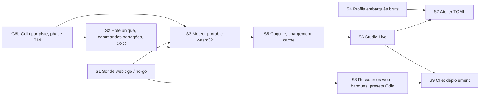

# Phase 015 — Harmonium Studio : vitrine publique et atelier

**Statut** : ouverte le 2026-10-27. Le frontend entre dans la constitution en 4.1.0 ; plan à jour de la
4.2.0 (synthé Odin en option GPL par piste, licence `MIT OR Apache-2.0`). Parallèle à la phase 014
(styles de jeu, dont G6b : Odin par piste) et à la 013 (J5-min, dépôt 1837).

## Problème

Le moteur n'a ni vitrine ni outil interactif autre que le REPL. Le propriétaire veut une application qui
montre au public ce que fait le moteur, et qui serve à essayer les nouvelles fonctions pendant le
développement. L'ancien frontend (`web/`, `web2/`, supprimés en `77a26d4`) est écarté et n'a pas été
consulté. Constats dans le code (moteur `69c1449`, revus à `129a37e`) :

- **Contrôle** : API Rust (`MusicComposer`, `NativeHandle`) ; REPL (`harmonium_cli`) ; binaire
  `harmonium`, dont l'OSC n'accepte qu'un message, `/harmonium/params`, sans retour
  (`harmonium_host/src/main.rs:336-365`). `NativeHandle` n'a aucun consommateur dans le dépôt et ignore
  la banque de pieds (`create_timeline_stream(sf2_bytes, None)`, `native_handle.rs:96`).
- **Commandes** : seul le REPL exécute `EngineCommand` (`harmonium_core/src/command.rs:14`), dans
  `dispatch_command` (`harmonium_cli/src/repl.rs:507`). Swing, tempo, `beat`, style, pieds et intensité
  passent par un second type, `CliCommand` (`repl.rs:321-323`, `repl.rs:349`).
- **Contrat lisible** : `MeasureSnapshot`, `NoteSnapshot`, `EngineReport` (`harmonium_core/src/report.rs`)
  et `TunePosition` (`trad/arrangement.rs:71`) sont sérialisables ; `BeatInfo` porte un
  `std::time::Instant` (`harmonium_host/src/clock.rs:96`). Ils suffisent pour dessiner pistes, accords,
  forme et pulsation sans lire d'état privé (principe VI).
- **Web** : avec `getrandom` + feature `js`, et sans les dépendances du binaire (`ctrlc` ne compile pas en
  wasm ; `rosc`), `harmonium_core`, `harmonium_audio` et `harmonium` (cpal 0.15.3, feature
  `wasm-bindgen`) compilent pour `wasm32-unknown-unknown` (sonde hors dépôt, `cargo check`, 2026-10-27,
  synthèse SoundFont). Bloquants à l'exécution, que `check` ne voit pas :
  - `Instant::now()` panique en wasm (`clock.rs:68`, `audio.rs:134`, `audio.rs:264`) ;
  - le thread d'enregistrement ne démarre pas (`harmonium_audio/src/backend/recorder/worker.rs:53`).
    L'échec est géré : le moteur tourne, sans enregistrement (`recorder.rs:140-143`) ;
  - l'hôte WebAudio de cpal 0.15.3 enchaîne des `AudioBufferSourceNode` (`onended`, `start_with_when`)
    sur le thread principal (`src/host/webaudio/mod.rs:359-378` du crate) : pas de thread audio dédié.
- **Profils** : onze distribués depuis G7 (`profiles/nt_desert` compris). `build.rs` aplatit chaque
  dossier en un TOML unique (`harmonium_core/build.rs:41-82`) ; `toml::to_string` perd commentaires et
  découpe en fichiers, et cette fusion des banques double celle de `StyleProfile::decode`
  (`style_profile.rs:632-667`). Un atelier web ne montrerait qu'un TOML aplati, sans commentaires.
- **Synthèse** : SoundFont par défaut (oxisynth, feature `sf3` déjà active, `harmonium_audio/Cargo.toml:11`).
  Banques : GeneralUser GS (32,3 Mo ; sa licence permet l'usage dans un logiciel et demande de servir sa
  propre copie), pieds `harmonium_trad.sf2` (154 Ko, échantillons CC0), `nt_desert.sf2` (3,35 Mo) ; toutes
  ignorées par git, sauf `assets/test.sf2`. Synthé Odin : option de compilation `odin` (constitution
  4.2.0), instrument choisi par piste en données, morphing du preset par les 4 émotions ; intégration en
  cours (G6b). `odin2-core` (`estran-studio/odin-rs`) : Rust pur (`libm`, `wide`), feature `std`
  réservée aux binaires de démo ; recherche de code GitHub : ni `thread::spawn`, ni `Instant::now`, ni
  `SystemTime`. GPLv3 (dérivé d'Odin 2) : un binaire compilé avec `odin` est GPL.
- **Dépôt public** (`estran-studio/harmonium`, `MIT OR Apache-2.0`) : GitHub Pages est disponible, mais
  envoie `Cache-Control: max-age=600`, sans réglage possible : au-delà de 10 min le cache HTTP revalide,
  et rien ne garantit qu'il garde un fichier de 32 Mo.
- **Stockage du navigateur** : l'API Cache Storage garde des réponses entières sur l'appareil (contexte
  HTTPS). Safari efface ce stockage après 7 jours d'usage de Safari sans interaction avec le site, sous
  pression de stockage ou au-delà du quota global ; `navigator.storage.persist()` ouvre une boîte de
  dialogue dans Firefox, n'est accordé par Chrome que selon ses critères d'engagement et par Safari que
  selon ses heuristiques (<https://webkit.org/blog/14403/updates-to-storage-policy/>). L'initialiseur de
  Trunk (`data-initializer`) rapporte la progression du téléchargement du wasm. Le service worker du
  gabarit eframe (`assets/sw.js`) met l'application en cache sans mise à jour ni nettoyage
  (<https://github.com/emilk/eframe_template/issues/206>, ouvert).

## Décisions du propriétaire (2026-10-27)

- **A. Public visé : vitrine publique**, distribuée sur le web : application egui compilée en WASM
  (eframe), à une URL publique.
- **B. V1 : lecteur en direct avec visualisation, et atelier de profils** en éditeur TOML. Interface en
  anglais.
- **C. Dans ce dépôt.** Constitution amendée (4.1.0) : un seul frontend, `harmonium_studio`.
- **D. Parité avec le REPL** : le studio offre tout ce que fait le REPL ; le REPL reste et suit.
- **E. Remplacements** : le binaire OSC `harmonium` en V1 ; les comparateurs de
  `specs/012-vie-realisme/kits_ecoute.py` et la plomberie commune des `measure_*.py` après V1.
- **F. Chargement** : un écran de chargement montre la progression des ressources (banque SoundFont…) ;
  elles restent en cache sur l'appareil, et seul le premier chargement est long.
- **G. Pas de banque par profil** : `nt_desert` passe au synthé Odin interne (G6b) et ne demande aucune
  SoundFont propre. La banque commune (GeneralUser GS et pieds) sert les pistes SoundFont de tous les
  profils.

## Décisions de conception (validées par le propriétaire, 2026-10-27)

- **Natif et web, même code.** eframe compile la même application en natif pour le développement
  (dossiers de profils sur disque, worktrees, OSC, enregistrement en fichiers) et en WASM pour la
  vitrine. Les différences tiennent dans un module `platform` : sortie audio, fichiers, OSC.
- **Contrat seulement.** Le studio lit `MeasureSnapshot`, `BeatInfo`, `EngineReport` et l'API publique du
  host, et pilote par `EngineCommand`. Il n'accède à aucun interne du générateur ; ce que l'interface
  doit montrer entre d'abord dans la sortie publiée.
- **Un seul hôte vivant, un seul exécuteur.** `NativeHandle`, renommé `LiveHost` en S2, est l'hôte du
  REPL et du studio et exécute `EngineCommand` (`LiveHost::apply`) ; la génération avance par
  `LiveHost::pump`. `EngineCommand` a absorbé `CliCommand`. Le REPL garde son analyseur de texte et son
  affichage ; `dispatch_command` et `handle_clock_command` ont disparu.
- **Génération pilotée par l'appelant.** En natif, un thread de génération appelle `LiveHost::pump`,
  comme le REPL. En web, un minuteur indépendant de `requestAnimationFrame` (Worker) l'appelle : S1 a
  observé que, pilotée par la boucle de l'interface, la génération s'arrête quand l'onglet ne rend plus
  (lecture et écriture figées à la mesure 8, audio toujours actif). Anticipation à dimensionner en S5 pour
  l'étranglement des minuteurs en arrière-plan.
- **OSC dans le host** (module natif, `rosc`) : le REPL (`--osc`) et le studio natif l'ouvrent ; même
  adresse, mêmes arguments. `--simulate` disparaît avec le binaire.
- **Profils embarqués tels quels.** `build.rs` embarque les fichiers bruts ; un seul décodeur multi-fichiers
  en mémoire sert `load(dir)`, les profils embarqués et l'atelier web. Goldens inchangés exigés.
- **La vitrine ne montre que `StyleProfile::distributed()`** : les onze profils de `profiles/`,
  `nt_desert` compris ; Isaac y entrera à G9. Le natif ouvre n'importe quel dossier (fixtures, worktrees).
- **Studio compilé avec `odin`**, en natif comme en web : `nt_desert`, profil distribué, en dépend. Le
  bundle publié est donc GPL (constitution 4.2.0) ; ses sources sont publiques, et le panneau « About »
  le dit.
- **Chargement en deux temps, cache explicite** (décision F) : page HTML avec la progression du wasm, puis
  écran egui avec la progression de chaque ressource, la préparation et le bouton Start. La banque vit dans
  Cache Storage, jamais dans le seul cache HTTP. Détail sous « Chargement et cache ».
- **Ressources web** : copie de GeneralUser GS et de la banque de pieds servie avec le site, plus les
  presets Odin (`.odin`) des profils distribués : depuis G6b, l'hôte les fournit (`OdinPresetSource`) et
  aucun n'est dans le dépôt (`specs/014-styles-de-jeu/g6b-odin.md`). Format de banque décidé en S1 : SF2
  brut si son analyse est rapide (un seul long téléchargement, rien à décoder ensuite), sinon SF3, plus
  léger mais décodé (Vorbis) à chaque visite, même depuis le cache. Banques et presets étant hors git, ils
  sont publiés en assets d'une release GitHub du dépôt ; la CI les télécharge, vérifie leur `sha256` et
  les copie dans le site.

## Écran Live

| Zone | Contenu | Source |
|---|---|---|
| Barre du haut | style, graine (fixe ou nouvelle), lecture/pause, tempo audible et signature, enregistrement, onglets Live / Workbench | `EngineReport`, `MeasureSnapshot` |
| Gauche | pavé valence × arousal, curseurs densité et tension, mode direct et intensité, pieds, tempo et rampe, swing | `EngineCommand` |
| Centre | carte de forme (intro, parties A/B, passe, air dans le set, tonalité et mode), couloir d'accords, piano-roll par piste (notes tenues incluses), tête de lecture, mesures composées en avance | `TunePosition`, `chord_changes`, `NoteSnapshot` (`articulation`), position de transport |
| Droite | horloge de pulsation (pulse, phase, temps fort), état (équivalent de `state`), mixeur (gain, mute, solo par piste ; volume général) | `BeatInfo`, `EngineReport` |

## Chargement et cache (décision F)

| Étape | À l'écran | Mécanisme |
|---|---|---|
| 1. Application | page HTML : nom, barre de progression du wasm, erreur éventuelle | initialiseur Trunk : `onProgress({current, total})`, barre indéterminée si `total` vaut 0 (pas de `Content-Length`), `onFailure` |
| 2. Ressources | écran egui : pour chaque ressource, « on this device » ou « downloading x / y MB » ; au premier passage, « next visits load from this device » | manifeste `assets.json`, Cache Storage |
| 3. Préparation | « Preparing instruments… » | analyse de la banque (oxisynth) et initialisation d'Odin, sur le thread principal ; message dessiné une image avant de bloquer |
| 4. Départ | bouton Start | geste exigé par le navigateur pour démarrer l'AudioContext |

- **Manifeste** `assets.json`, généré au build : pour chaque ressource, `id`, `file` (nom portant
  l'empreinte du contenu), `bytes`, `sha256`. Lu à chaque visite ; la taille connue donne la progression
  même sans `Content-Length`.
- **Clé de cache = fichier à empreinte** : un nouveau contenu change le nom, donc la clé ; aucune date à
  comparer. Une ressource n'entre au cache qu'après contrôle de sa taille, jamais tronquée. Après un
  chargement réussi, les entrées absentes du manifeste sont supprimées.
- **Pas de `persist()`** : stockage « best effort », pour ne pas ouvrir la boîte de dialogue de Firefox.
- **Échec du cache** (API absente, quota, navigation privée) : la ressource reste en mémoire, la musique
  joue, et un avis prévient qu'elle sera retéléchargée à la prochaine visite.
- **Application (wasm, JS)** : cache HTTP et noms à empreinte de Trunk ; les tables d'ondes d'Odin sont
  compilées dans le bundle. Pas de service worker en V1 ; il ne vient, avec mise à jour et nettoyage, que
  si S1 montre que le rechargement du bundle après les 10 min de GitHub Pages se remarque.
- **Natif** : même chargeur, lecture sur disque dans un thread, même écran (bref) ; pas de cache.

## Parité REPL ↔ studio

Les deux surfaces envoient la même commande au même exécuteur (S2).

| REPL | Studio | Commande |
|---|---|---|
| `style <id>` / `style <dossier>` | sélecteur de style ; atelier : ouvrir un dossier (natif) ou téléverser (web) | `SetStyleProfile` |
| `reset` | bouton Reset | `Reset` |
| `feet 0\|1\|2` | sélecteur de pieds | à ajouter (depuis `CliCommand`) |
| `intensity <x>`, `direct` | mode direct et intensité | `UseDirectMode`, intensité à ajouter |
| `emotion …` (absolu, relatif, seul) | pavé et curseurs, valeurs affichées | `SetEmotionParams`, `UseEmotionMode` |
| `seed <n>` | graine, bouton nouvelle graine | `SetSeed`, `NewMelody` |
| `set bpm`, `reset bpm` | tempo nominal | `SetBpm`, `ResetBpm` |
| `swing <x>` | curseur 0,5–0,75 | à ajouter (depuis `CliCommand`) |
| `tempo <bpm> [N]`, `tempo off` | tempo audible et rampe | à ajouter (depuis `CliCommand`) |
| `set time n/d` | signature | `SetTimeSignature` |
| `beat` | horloge de pulsation, toujours visible | `BeatInfo` |
| `seek <n>`, `loop <a> <b>`, `loop off` | clic sur la mesure, boucle (≤ 16 mesures) | `Seek`, `SetLoop`, `ClearLoop` |
| `set volume`, `set gain`, `set mute/unmute` | mixeur ; solo = couper les autres | `SetMasterVolume`, `SetChannelGain`, `SetChannelMute` |
| `record wav\|midi\|musicxml`, `stop` | boutons d'enregistrement : fichiers (natif), téléchargements (web) | `StartRecording`, `StopRecording` |
| `state` | panneau d'état | `EngineReport`, `MeasureSnapshot` |
| `--osc` (nouveau) | OSC en natif | module OSC du host |

Variantes d'`EngineCommand` sans commande REPL (`EnableRhythm`, `EnableHarmony`, `EnableMelody`,
`SetChannelRoute`, `SetVelocityBase`, `ExportTimeline`, `SeekPlayhead`, `SetOutputMute`,
`SetWriteheadLookahead`) : chacune reçoit une commande des deux côtés ou est supprimée en S2.

## Tâches

| Tâche | Contenu | Acceptation |
|---|---|---|
| S1 | Sonde jetable, non fusionnée : app eframe minimale (natif et web), `reel_quebecois` sur GeneralUser GS (SF2 puis SF3) et pieds, plus des voix `odin2-core` (dépôt `estran-studio/odin-rs`, utilisable sans attendre G6b) ; mesure et pulsation affichées. Mesures en release sur Chrome, Firefox et Safari récents (macOS) : sous-alimentations audio sur 5 min avec l'interface à 60 images/s, CPU par tampon (SoundFont, puis Odin selon le nombre de voix), onglet en arrière-plan. **Chargement**, à froid puis depuis Cache Storage : poids du wasm (tables d'ondes comprises) et son rechargement après les 10 min de GitHub Pages, lecture de la banque depuis le cache, analyse SF2, décodage SF3, temps jusqu'au bouton Start. **Snapshots natif contre wasm** pour les onze profils distribués, graines 1–3, 64 mesures : les fonctions f32 transcendantes peuvent différer entre la libm native et celle du wasm. | Tableau de mesures dans ce plan. Décisions : WebAudio sur le thread principal, ou AudioWorklet avec threads wasm (en-têtes COOP/COEP, donc pas GitHub Pages sans contournement) ; format de banque (SF2 ou SF3) ; service worker ou non ; seuils du premier chargement et du chargement depuis le cache. |
| S2 | Après la fusion de G6b. `NativeHandle` devient l'hôte unique (banque de pieds, exécuteur d'`EngineCommand`, renommé) ; le REPL migre dessus ; `EngineCommand` absorbe `CliCommand` ; module OSC dans le host, `--osc` dans le REPL ; binaire `harmonium`, `ctrlc`, cible `make play` et leurs sections de README supprimés ; ligne `harmonium_host` de la constitution mise à jour. | Tests du REPL verts, commandes inchangées à l'usage ; OSC piloté depuis un client UDP ; goldens inchangés. |
| S3 | Après S2. `getrandom` feature `js` sur la cible wasm ; `web_time::Instant` à la place de `std::time::Instant` dans le host ; travailleur d'enregistrement pilotable sans thread (même encodeur ; thread en natif, appelé par la boucle de l'interface en wasm). **Tirages à largeur fixe** : aucun tirage aléatoire sur `usize` (rand 0.8 l'échantillonne selon la largeur de pointeur, 32 bits en wasm) ; correctif de la sonde S1 repris proprement. CI : `cargo check --target wasm32-unknown-unknown` des crates du moteur, avec et sans `odin`, et comparaison des snapshots natif / wasm (profils distribués, graines 1–3, 64 mesures). Si la CI tient, la constitution gagne la contrainte « le moteur compile pour `wasm32-unknown-unknown` et y produit les mêmes snapshots ». | Check wasm et comparaison verts en CI, avec et sans `odin` ; goldens inchangés ; `BeatInfo` inchangé en natif. |
| S4 | `build.rs` embarque les fichiers bruts de chaque profil ; un décodeur multi-fichiers en mémoire sert `load(dir)`, les profils embarqués et l'atelier ; la fusion de `build.rs` disparaît. Erreurs : chemin du champ et position dans le fichier source. | Goldens des profils distribués inchangés ; une erreur de validation pointe le bon fichier et la bonne ligne. |
| S5 | Crate `harmonium_studio` (eframe ; natif et web via Trunk ; compilé avec `odin`) : page HTML et initialiseur Trunk, chargeur de ressources (web : manifeste, téléchargement en flux, Cache Storage ; natif : disque, thread), générateur du manifeste au build, écran de chargement, bouton Start (voir « Chargement et cache »). | Premier chargement : progression visible jusqu'au Start. Visite suivante : aucune requête réseau pour la banque (onglet Réseau des outils de développement). Nouvelle empreinte : un téléchargement, l'ancienne entrée supprimée. Cache refusé (navigation privée) : la musique joue, avec l'avis. |
| S6 | Écran Live et parité REPL complète (tableau ci-dessus). Enregistrement : fichiers en natif, téléchargements en web. Panneau « About » : licences et crédits de ce qui est distribué (Harmonium `MIT OR Apache-2.0` ; `odin-rs` GPLv3, d'où un bundle GPL, avec le lien vers les sources ; GeneralUser GS, S. Christian Collins ; échantillons de pieds CC0 ; presets Odin). | Chaque ligne du tableau de parité marche des deux côtés ; piano-roll et horloge suivent l'audio ; une émotion changée s'entend à la mesure suivante ; `nt_desert` joue ses pistes Odin (exige de vrais presets, voir S8). |
| S7 | Atelier TOML : onglets par fichier du profil, coloration, Apply = décoder, valider, installer à la mesure suivante ; erreurs placées sur la ligne ; « Fork » d'un profil distribué. Natif : ouvrir et enregistrer un dossier. Web : téléverser, télécharger le dossier, modifications gardées dans le navigateur. | Un profil modifié s'entend à la mesure suivante ; le dossier enregistré se charge par `harmonium-cli --profile`. |
| S8 | Ressources web : format de banque décidé en S1 (SF2 brut, ou conversion en SF3) ; GeneralUser GS, banque de pieds et presets Odin des profils distribués publiés en assets de release, `sha256` versionnées dans le dépôt ; entrées du manifeste. Prérequis : des presets Odin réels pour `nt_desert` (G6b n'a que des presets de smoke synthétiques, hors dépôt), avec source et licence. | Premier chargement et chargement depuis le cache sous les seuils fixés en S1 ; une ressource dont l'empreinte ne correspond pas fait échouer la CI. |
| S9 | CI : `harmonium_studio` construit en natif et en wasm, avec `odin`, à chaque PR (dépendances système d'eframe sous Linux) ; déploiement GitHub Pages sur `main`, banques téléchargées depuis la release et vérifiées. | Une PR qui casse le studio échoue en CI ; l'URL publique sert la dernière version de `main`. |

S1, S2 et S4 en parallèle ; S3 après S2 ; S8 après S1 et des presets Odin réels.

### État (2026-10-27)

| Tâche | État | Compte rendu |
|---|---|---|
| G6b (phase 014) | fusionnée (`113fe81`) : Odin par piste, presets fournis par l'hôte, pieds routés par le profil | `specs/014-styles-de-jeu/g6b-odin.md` |
| S1 | terminée (branche jetable `wquintal/s1-sonde-web`, `2daa7d4`, non fusionnée ; rapport copié dans main). (a) fil principal sans AudioWorklet : 0 tampon en retard sur 5 min, et avec 8/16/24 voix Odin, à 1024 et 4096 images (Chromium 150) ; tampon 2048 proposé. (b) SF3 proposé : 7,62 Mo contre 32,3 Mo, analyse ×20 (≈ 0,8 s par visite en wasm, calculé) ; écart de rendu −29 dB RMS **à écouter**. (c) service worker : non mesuré, pas au départ. (d) seuils proposés : Start ≤ 10 s au premier chargement à 10 Mbit/s, ≤ 2 s depuis le cache ; wasm de 16 Mo (7,1 Mo gzip) à réduire. (e) déterminisme : 0/66 → 66/66, quatre sites (`algo`, `score`, `generator`, `composer`). Bloqués : onglet masqué mesuré, revalidation, Cache Storage ; Firefox et Safari à mesurer par le propriétaire (§ 6 du rapport) | `s1-sonde-web.md` |
| S2 | fusionnée (`48fa066`) : `LiveHost` (banque principale, banque de pieds, presets Odin ; `apply`, `pump`, `detached` pour les tests), `EngineCommand` étendu (swing, tempo audible, pieds, intensité) et élagué, REPL migré, OSC dans le host (`--osc`), binaire `harmonium`, `ctrlc`, MIDI live et `LoadFont` supprimés, volume d'écoute réel (rampe 10 ms, hors enregistrements) ; 74 suites vertes, goldens inchangés | `s2-hote-unique.md` |
| S3 | en cours | — |
| S4 | fusionnée (`f01dddd`) : fichiers d'origine embarqués, un seul décodeur multi-fichiers (`load`, `from_files`, `distributed_files`), erreurs `fichier:ligne: champ: message` ; `toml` 0.8.23, une seule version de `toml_edit` ; 73 suites de tests vertes, goldens inchangés | `s4-profils-bruts.md` |

## Risques

- **Audio sur le thread principal** (cpal 0.15.3) : craquements quand l'interface, la génération ou la
  synthèse Odin, plus coûteuse que la lecture d'échantillons, chargent le thread. Atténuation : tampons
  larges, puisque le moteur change à la mesure suivante et que la latence d'un tampon ne s'entend pas comme
  un retard musical [INFERENCE, mesuré en S1] ; budget de génération par image. Repli : AudioWorklet avec
  threads wasm.
- **Onglet en arrière-plan** : `requestAnimationFrame` s'arrête, la génération aussi, et l'anticipation
  (4 mesures au moins, anneau de 16) s'épuise.
- **Divergence natif / wasm** : confirmée par S1, cause trouvée (tirages `usize`) ; le correctif ne change
  pas la sortie native, donc ni bump de `TUNING_VERSION` ni goldens régénérés. Reste à la garder en CI (S3).
- **Poids** : 32,3 Mo de banque en SF2 au premier chargement ; en SF3, moins à télécharger mais un
  décodage Vorbis en wasm à chaque visite. Les tables d'ondes d'Odin grossissent le wasm.
- **Éviction** : Safari efface le cache après 7 jours sans visite, et tout navigateur peut l'effacer sous
  pression de stockage : un long chargement de plus dans ces cas.
- **Écran figé pendant la préparation** : l'analyse de la banque bloque le thread principal, donc
  l'animation ; S1 mesure sa durée, et le SF2 brut la raccourcit (rien à décoder).
- **Travail parallèle** : G6b modifie le backend audio et fait traverser l'option `odin` jusqu'au host ;
  S2 et S3 réécrivent ce code, d'où l'attente de sa fusion.
- **`BeatInfo`** change de type d'`Instant` : `web_time` réexporte `std` en natif, à vérifier en S3.
- **CI Linux** : eframe demande des bibliothèques système en plus de `libasound2`.

## Acceptation de la phase

1. L'URL publique lance `reel_quebecois` d'un clic sur Start, et `nt_desert` avec ses pistes Odin ; 5 min
   sans sous-alimentation audible sur Chrome, Firefox et Safari récents (macOS).
2. Premier chargement : progression visible (application, puis banque) jusqu'au bouton Start. Visites
   suivantes, même version de banque : aucune requête réseau pour la banque, Start sous le seuil fixé en
   S1. Nouvelle version : téléchargée une fois, l'ancienne supprimée du cache. Cache indisponible : la
   musique joue quand même, avec un avis.
3. Même graine, mêmes émotions : snapshots identiques en natif et en wasm (profils distribués, graines
   1–3, 64 mesures).
4. Chaque commande du REPL a son contrôle dans le studio, et inversement ; les deux passent par le même
   exécuteur.
5. L'atelier modifie un profil distribué et le change à la mesure suivante ; une erreur pointe le champ et
   la ligne ; un dossier enregistré se charge par `harmonium-cli --profile`.
6. OSC `/harmonium/params` dans le REPL (`--osc`) et dans le studio natif ; binaire `harmonium` supprimé.
7. La CI construit le studio en natif et en wasm à chaque PR et déploie sur `main`.
8. Notes des profils distribués identiques à `main` (goldens) ; `cargo test --workspace`, clippy sans
   nouvel avertissement, fmt.

## Après V1

- **Comparateur** dans le studio : N variantes alignées, bascule instantanée ou à la mesure, mode aveugle ;
  puis suppression de `kits_ecoute.py` et des pages par kit (principe IV).
- **Plomberie de mesure** : rendu, retrait de sections et statistiques WAV communs, en Rust, exposés par
  `harmonium-cli` ; chaque `measure_*.py` ne garde que sa mesure.
- Non retenus pour V1 : diff entre builds, bac à sable de signaux de jeu, vue partition (l'export MusicXML
  existe).

## Fichiers touchés (prévus)

- `.specify/memory/constitution.md` (S2 : ligne `harmonium_host` ; S3 : contrainte wasm).
- `Cargo.toml` (membre `harmonium_studio`), `harmonium_studio/` (nouveau : `index.html` et initialiseur
  Trunk, `Trunk.toml`, générateur du manifeste, empreintes des banques, `src/`).
- `harmonium_host/` : `native_handle.rs`, `audio.rs`, `clock.rs`, `playback.rs`, `lib.rs`, module OSC
  (nouveau), `main.rs` (supprimé), `Cargo.toml`, `README.md`.
- `harmonium_cli/src/` : `repl.rs`, `parser.rs`, `main.rs` ; `harmonium_cli/README.md`.
- `harmonium_core/` : `src/command.rs`, `src/style_profile.rs`, `build.rs`.
- `harmonium_audio/src/backend/recorder/`.
- `Makefile` (`play` retiré, cibles du studio), `.github/workflows/` (studio natif et wasm, Pages, banques
  de la release), `README.md`.
