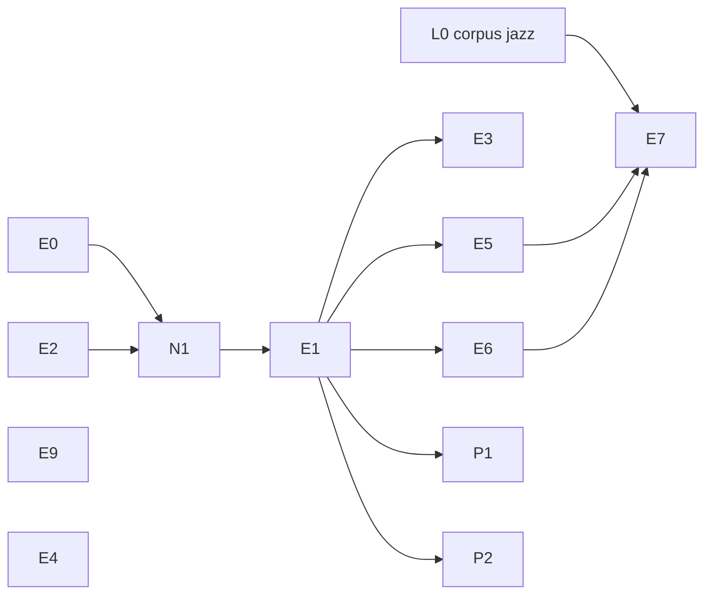

# Phase 018 — Grille d'accords, moteur neutre et variété procédurale

**Statut** : planifiée le 2026-10-30, sous la constitution 4.5.0. Vague 1 lancée le 2026-10-30. Phases
précédentes closes ou en suivi : 016 (variété par graine, timbre par zone, glissando, zones Z1 ;
`specs/016-variete-et-timbres/plan.md`), 017 (plugin Bevy, `specs/017-plugin-bevy/plan.md`).

## Problème

Trois besoins, validés par le propriétaire le 2026-10-30 (« oui, oui, oui ») :

1. **Training** (`harmonium_training`, autre session, hors dépôt) devient un client externe de
   `harmonium_host`, piloté par une grille d'accords et du MIDI joué, pas par les émotions. Ses
   demandes, copiées telles quelles : [`demandes-training.md`](demandes-training.md) (E0 à E9).
2. **Moteur neutre.** Les styles sont des données (principe V) et aucun nom de profil n'est dans
   le code, mais le générateur vit dans `harmonium_core/src/trad/` (~10 200 lignes, contre ~860
   dans `models/`) et son vocabulaire a fui dans le schéma public :
   - pistes `TrackId::Heel` / `Toe` (podorythmie) : dans Isaac, Heel = grosse caisse, Toe =
     caisse claire ;
   - champs `fiddle_duration`, `guitar_velocity`, `chop_intensity`, `feet_*` (dynamics), types
     `ReelFiddleParams`, `ReelArrangement`, notion de `strain` ;
   - six pistes fixes ; ordre de génération figé en code (mélodie → harmonie → basse → accords →
     batterie) ; trois modèles d'harmonie choisis par chaîne (`trad_functional`, `loop`,
     `jazz_functional`).
   Le propriétaire trouve le moteur « trop rigide » et veut le rendre neutre **avant** que
   training écrive du code contre le schéma actuel.
3. **Plus de variété d'une graine à l'autre** pour les profils de jeu (Isaac, NT), où harmonie,
   basse et batterie sont écrites à la main et seulement choisies parmi 2–3 alternatives (V1).
   Garder l'écriture actuelle (validée à l'écoute) et ajouter, en option dans les données, des
   mécanismes plus procéduraux, à prouver avant intégration.

## Décisions (orchestrateur, 2026-10-30)

- **F1 — Écriture d'un accord (E1)** : structure **relative à la tonique**, qualité en texte de
  suffixe partagé avec `theory::Chord` :
  ```toml
  { semitones = 2, quality = "m7" }
  { semitones = 7, quality = "7b9", bass = 11 }   # V7b9, basse sur la sensible
  ```
  Transposable comme tous les profils ; un seul analyseur de qualités ; pas de symbole absolu
  dans les profils. Training convertit iReal (absolu) en relatif grâce à la tonalité verrouillée
  (E2). Durées en pas (ou fraction de mesure) : forme exacte décidée dans E1.
- **F2 — Notes jouées en direct (E4)** : **une voie dédiée** : une poignée `Send` (comme
  `ClockReader`) qui pousse dans une file SPSC lue par le callback ; `EngineCommand::NoteOn/Off`
  passe par cette même file (studio, jeux). Un seul mécanisme, deux points d'entrée. Raison :
  la file seule tient la latence (≤ 1 buffer) dans les deux cas ; le risque est le **verrou** :
  `LiveHost::apply` demande `&mut self`, un thread MIDI attendrait pendant que `pump` compose
  (mesuré dans E4 : `pump()` jusqu'à 0,26 ms en release, 8,5 ms en debug).
- **F3 — Corpus jazz/blues (E7)** : le propriétaire a autorisé la recherche ; **aucune licence
  n'est affirmée sans vérification**. Tâche L0 ci-dessous ; le propriétaire choisit.
  **Choix du propriétaire (2026-10-31)** sur [`corpus/sources-jazz.md`](../../../harmonium_lab/corpus/sources-jazz.md)
  (labo) : combinaison 1 pour le profil distribué (WJazzD, statistiques par temps, ODbL ;
  Groove MIDI Dataset, batterie, CC BY 4.0 ; Jazz Trio Database, timing, MIT ; grilles du
  domaine public), mentions ODbL §4.3, CC BY et MIT portées par le profil ; sources NC/SA
  (iRb, PiJAMA, JHT, JAAH, ancien corpus McKenzie) admises **au labo seulement**, jamais dans
  un profil (champ licence obligatoire au manifeste) ; nom du profil E7 : **`wjazzd_swing`** ;
  grilles du domaine public vérifiées aux **États-Unis et au Canada**. Pas de source
  distribuable de voicings : E5 repose sur des règles codées, validées au labo et à l'écoute.
- **Oxisynth (E4, propriétaire, 2026-10-31)** : NoteOn sans allocation par un fork
  [`estran-studio/OxiSynth`](https://github.com/estran-studio/OxiSynth/tree/harmonium/rt-noteon)
  (branche `harmonium/rt-noteon`, révision épinglée dans `harmonium_audio/Cargo.toml`), pas de
  copie dans `vendor/`. Rendus identiques octet pour octet à l'ancienne dépendance.
- **Moteur neutre** : approuvé. Mêmes notes, octet pour octet ; renommage sans alias (principe IV).
- **Procédural** : approuvé à l'essai, **en option dans les données** ; les profils actuels ne
  changent pas tant qu'une variante n'est pas prouvée meilleure (mesure + écoute).

## Tâches

| Tâche | Contenu | Dépend de |
|---|---|---|
| **L0** | Corpus jazz/blues : chercher des sources de grilles et de transcriptions dont la licence est publiée et vérifiable ; tableau source / licence / contenu / usage permis (analyse seule ou dérivés versionnables) ; proposition de nom de profil selon le principe VII. Livrable au labo ; **choix du propriétaire**. | — |
| **E0** | Constitution 4.5.0 : clients externes (training) qui utilisent l'API publique de `harmonium_host` hors du dépôt, pilotés par une grille ; aucun code de training dans le dépôt. Profiter de l'amendement pour nommer le générateur neutre (N1). | — |
| **E2** | Tonalité verrouillée : tonique et mode fixes en données, que la valence ne modifie pas. | — |
| **E9** | Doc : plage BPM de `command.rs:15-18` (40 à 300). | — |
| **E4** | Notes jouées en direct selon F2 : voie séparée des pistes générées, programme propre, hors snapshot. | — |
| **N1** | Moteur neutre (voir ci-dessous). | E0, E2 fusionnées (évite les conflits sur `trad/`) |
| **E1** | Grille riche dans `loop` selon F1 : qualités `theory::ChordType` + extensions + basse, plusieurs accords par mesure, voicer 4–5 hauteurs sans allocation, parseur de symboles complet (G7b9, alt, slash). | N1 |
| **E3** | Identité d'accord complète dans le snapshot (qualité typée, extensions, basse, fondamentale absolue ; `ScaleGuidance` avec loop). **Bump de `TUNING_VERSION`**, goldens régénérés dans le même commit. | E1 |
| **E5** | Accompagnement jazz en données (notes guides, sans fondamentale, drop 2, comping) enchaîné par `theory/voice_leading.rs`. | E1 |
| **E6** | Walking bass au pas près avec approche ; basse de `jazz_functional` (devenu `rewrite_functional`, N1) unifiée sur les motifs (principe IV). | E1 |
| **E7** | Profil jazz/blues distribué, corpus choisi en L0, validé au labo puis à l'écoute. | L0, E5, E6 |
| **P1** | Procédural par règles, en option : boucles d'accords générées par contraintes de style (ex. « 4 accords mineurs, mouvement chromatique, sur pédale ») et basse par gabarits (relance vers la fondamentale, montée d'une note par mesure). | E1 |
| **P2** | Alternatives extraites du labo, en option : boucles, motifs de basse et patterns tirés automatiquement des transcriptions (`harmonium_lab/corpus/*/transcriptions/`, hors dépôt), comme les cellules trad. | E1 |

Hors phase : **E8** (composition déclarative `extends`, principe VIII) ; pistes extensibles
au-delà de six (à décider après N1, sur un besoin réel).

### N1 — Moteur neutre (détail)

- Renommer le module `harmonium_core/src/trad/` en `compose` (nom fixé par la constitution
  4.5.0 ; **pas `gen`**, réservé en Rust 2024) et les types `Trad*` / `Reel*` (`ReelFiddleParams`,
  `ReelArrangement`, `TradGenerator`, `TradChord`…) selon leur rôle musical.
- Renommer le schéma public selon le **rôle**, pas l'instrument ni la tradition :
  `fiddle_duration`, `guitar_velocity`, `chop_intensity`, `feet_*`, `strain`… et les pistes
  `TrackId::Heel` / `Toe` (canaux MIDI 3 et 4 inchangés). Noms exacts décidés dans la tâche,
  table ancien → nouveau dans le compte rendu.
- Migrer **tous** les profils (`profiles/*`, `tests/fixtures/profiles/*`), le studio, Bevy, le
  CLI, le labo, les docs (`profiles/README.md`, READMEs) ; aucun alias de schéma (principe IV).
- Acceptation : dumps `harmonium_determinism` identiques avant / après (profils distribués,
  graines 1–3, émotions `mid` et `hi`, 64 mesures), goldens et `TUNING_VERSION` inchangés,
  rendus `--features odin` identiques octet pour octet ; suites vertes avec et sans `odin`,
  `harmonium_bevy`, `harmonium_studio`, wasm.
- Risque : diff très large ; aucun autre agent sur `harmonium_core` pendant N1.

### P1 / P2 — Preuve demandée

- Métrique de variété par graine (nouvelle, au labo) : part des parties dont accords, basse et
  batterie changent entre graines 1–16, comparée à V1.
- Distance au corpus (`make style-distance`) pas pire que les profils écrits.
- Écoute du propriétaire dans le studio (« New seed »).
- Intégration seulement sur preuve ; sinon compte rendu et abandon.

## Ordre



Vague 1 : **E0 + E2 + E9** (un agent), **E4** (un agent), **L0** (recherche, sans code).
Vague 2 : **N1** seul sur `harmonium_core`. Vague 3 : **E1** puis **E3**. Vague 4 : **E5 + E6**,
puis **E7** ; **P1 / P2** en parallèle de la vague 4. Au plus deux agents à la fois.

## Exécution (rappel pour la reprise)

- Agents : omp personnel, **jamais l'abonnement Claude perso**. Depuis le 2026-10-30 (décision du
  propriétaire) : **Codex** `openai-codex/gpt-6.1-sol` et la clé **`anthropic-api`** (crédits
  API, `claude-opus-5-5`, `claude-sonnet-5-5`). Overlays : `/tmp/harmonium-018/codex-anthropic.yml`
  (code : Codex, relais anthropic-api sur limite d'usage) et `anthropic-codex.yml` (recherche :
  anthropic-api, relais Codex). OpenRouter à sec, Muse épuisé jusqu'au 2026-11-02. Limite
  d'usage Codex atteinte à 5 agents simultanés.
- Lancement : `orca terminal create --worktree path:<wt> --title … --command 'env -u OMP_PROFILE
  -u PI_PROFILE -u ALL_PROXY -u http_proxy -u https_proxy ~/.local/bin/omp --profile default
  --model openai-codex/gpt-6.1-sol --config <overlay> @<brief>'`. Briefs : l'agent commite sur
  sa branche seulement ; l'orchestrateur relit, fusionne `--no-ff`, teste, supprime le worktree.
- Ne pas toucher le worktree `s6-studio-live` (autre session, travail non commité).
- Écoute : page LAN `http://192.168.8.171:8080/` (servie depuis
  `~/Project/bascanada/harmonium_lab/corpus`) ; studio `make studio
  STUDIO_ODIN=~/Project/bascanada/odin-presets` ; démo Bevy `make bevy/demo`. Presets Odin plats :
  `~/Project/bascanada/odin-presets`. Donner les moments à écouter en minutes:secondes.

## État

| Tâche | État | Compte rendu |
|---|---|---|
| E0, E2, E9 | fusionnées (`d5e5db8`), suite workspace verte | [Compte rendu](e0-e2-e9.md) |
| E4 | fusionnée (`14eb55a`), oxisynth du fork estran-studio | [Compte rendu](e4-notes-jouees.md) |
| L0 | fusionnée au labo (`16defb8`) ; choix du propriétaire consignés (F3) | `harmonium_lab/corpus/sources-jazz.md` |
| N1 | faite sur la branche `wquintal/n1-moteur-neutre` (à relire et fusionner) : dumps, WAV et MIDI identiques, goldens et `TUNING_VERSION` inchangés | [Compte rendu](n1-moteur-neutre.md) |
| E1, E3, E5, E6, E7, P1, P2 | en attente | — |
