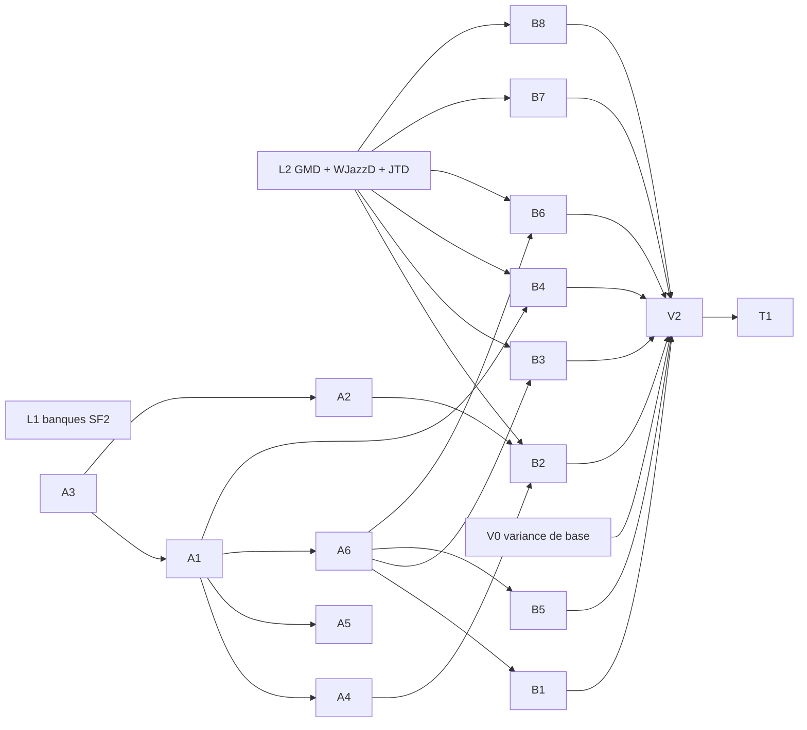

# Phase 019 — Bibliothèque d'accompagnements pour training, variance procédurale

**Statut** : planifiée le 2026-11-02, sous la constitution 4.5.0. Rien n'est lancé. Démarrage dans
une nouvelle session d'orchestration. Phase précédente : 018 (`specs/018-grille-et-moteur-neutre/plan.md`),
toutes tâches fusionnées et poussées ; restes reportés ici (section « Reprise de 018 »).

## Problème

Le moteur couvre les besoins du jeu. `harmonium_training` (client externe, constitution 4.5.0)
a besoin d'un **grand fond musical prêt à l'emploi** sous une grille d'accords fournie par
l'utilisateur, dans tous les styles d'iReal, avec **beaucoup de variance d'un tirage et d'un
chorus à l'autre** : un accompagnement qui sonne procédural, pas une boucle.

Aujourd'hui : un seul style sous grille (`wjazzd_swing`, E7), et la variance est bornée par le
moteur. Les comptes rendus de 018 listent les manques :

- comping et batterie tirés **mesure par mesure** : pas de phrase sur plusieurs mesures
  (`e5-e6-accompagnement.md`, Limites) ;
- **un seul instrument** par piste et par profil ;
- **forme et intensité identiques d'un chorus à l'autre** (P2, manque 4 : forme fixe par graine) ;
- basse sans deux temps, sans note répétée, sans croche de passage, sans chromatisme de passage
  (29 % des notes de passage de WJazzD), arrivée toujours sur la basse publiée
  (`profiles/wjazzd_swing/README.md`, Limites) ;
- une seule famille de voicings par profil, une seule tension de couleur choisie par priorité codée ;
- un seul rapport de swing par profil (0,71), trop swingué au-delà de 200 BPM ; pas de 3/4, 6/8
  ou feel ternaire testés sous grille.

## Décisions (propriétaire, 2026-11-02)

- **D1 — SoundFont seulement pour training.** Training n'inclut pas Odin (GPL) : tout ce qui
  sert training doit sonner sans `odin`. Odin reste permis pour les jeux. La palette dépend donc
  de la banque SoundFont : une banque plus riche que GeneralUser GS a été cherchée (L1), licence
  vérifiée. **Choix du propriétaire (2026-11-02) : GeneralUser GS reste la banque (option C de
  L1)** : aucune différence audible entre A, B et C, et ses sons sont préférés. La palette
  d'A2 et des profils B se construit donc sur les programmes GM de GeneralUser GS.
- **D2 — Tous les styles** d'iReal sont visés, sans priorité imposée ; l'ordre ci-dessous suit les
  dépendances et la qualité des sources.
- **D3 — Variance d'abord générique** (principes V et VIII) : chaque mécanisme est un algorithme
  générique activé en données, utile à tous les profils (jeux compris), jamais un `match` sur un
  style.
- **D4 — Pas de réharmonisation par défaut** : training note l'impro contre la grille de
  l'utilisateur ; l'accompagnement ne la contredit pas (accords de passage, substitutions : option
  désactivée par défaut si un style en a besoin).
- **D7 — Revues et tests dans le studio** (propriétaire, 2026-11-03) : plus de pages d'écoute MP3.
  L'orchestrateur ouvre pour le propriétaire un lien qui charge dans le studio un profil (distribué,
  fixture ou dossier d'un worktree) avec graine et position, en pause par défaut ; le studio
  recharge à chaud les fichiers du profil. Tâche **ST1**. Les agents de tâche ne lancent jamais le
  studio.
- **D5 — Pas de validation à l'oreille tâche par tâche** (propriétaire, 2026-11-03 : « ça sonne
  tout assez similaire et redondant », il ne se sent pas en mesure de juger). Les tâches livrent
  des **preuves chiffrées** ; l'orchestrateur revérifie et fusionne sans attendre d'écoute. Les
  pages d'écoute ne sont plus exigées des agents. Le reste du plan continue tel quel.
- **D6 — Priorité : plus de styles et une variété entre graines qui s'entend** (propriétaire,
  2026-11-03 : « New seed » sur `wjazzd_swing` et sur `isaac_cellar` donne « quasiment la même
  chose »). Constat de l'orchestrateur : une graine ne change que des détails dans la mesure
  (rythme de comping, notes de passage) ; tempo, tonalité, instruments, famille de voicings,
  kit, forme et intensité sont fixes par profil, et l'arc (A3) et les phrases (A1) ne sont
  activés dans aucun profil distribué. D'où **A2 élargie** (habillage tiré par graine) et **R2**
  (l'appliquer, avec l'arc et les phrases, à tous les profils distribués), et un critère
  « variété qui s'entend » dans V2.
- Rappels : notes des profils existants inchangées sauf décision explicite (principe I : rupture
  = `TUNING_VERSION` + goldens dans le même commit) ; corpus et licences selon le principe VII
  et `harmonium_lab/corpus/sources-jazz.md` (décisions F3 de 018 : NC/SA au labo seulement,
  mentions dans `[meta] corpus`, domaine public vérifié US et Canada).

## Tâches

### Recherche et labo

| Tâche | Contenu | Dépend de |
|---|---|---|
| **L1** | Banques SoundFont distribuables plus riches que GeneralUser GS pour training (piano acoustique, Rhodes, orgue, guitares jazz et nylon, contrebasse, basse électrique, kits baguettes **et balais**, percussions latines, cuivres) : tableau banque / URL / licence vérifiée (lien + date) / taille / qualité des programmes utiles / usage permis dans un produit fermé. Écoute comparative rendue sur `wjazzd_swing` et deux styles. **Choix du propriétaire.** | — |
| **L2** | Ingestion **complète** du Groove MIDI Dataset (tous les styles, pas seulement le jazz : compter funk, latin, afro-cubain, rock, reggae, soul, gospel, etc.), sous-ensembles WJazzD `BALLAD`, `TWOBEAT`, `LATIN`, `FUNK` (mesures de basse comme E7), JTD swing et micro-timing **par tempo**. Manifestes avec licence, mesures dans `references/`. Volume par style et fiabilité (peu de solos : 10 à 32). | — |
| **V0** | Ligne de base de variance : étendre `harmonium-lab seed-variety` (P2) avec la variance **par chorus** (16 graines × 16 chorus) et par couche (accords, basse, comping, batterie, orchestration) ; mesurer `wjazzd_swing` et les profils de jeu. Les seuils de V2 partent de ces chiffres. | — |

### Moteur — variance générique (en données, optionnelle)

| Tâche | Contenu | Dépend de |
|---|---|---|
| **A3** | **Arc sur plusieurs chorus** : numéro de chorus exposé au générateur ; par chorus, en données : intensité, densité, feel de basse (deux temps → marche), comping (clairsemé → dense), batterie (charleston → ride), breaks et stop-time, retombée finale ; pondéré et tiré par graine. Fonctionne sous grille utilisateur (une partie de N mesures répétée). | — |
| **A1** | **Phrases sur plusieurs mesures** : banques de motifs de 2, 4 ou 8 mesures pour comping et batterie (et basse si utile), choix selon la position dans la forme (mise en place avant un changement de section, relance de fin de phrase) ; remplace le tirage mesure par mesure quand il est activé. | A3 |
| **A2** | **Habillage par graine et orchestration par chorus** (élargie le 2026-11-03, D6) : variantes de session pondérées, tirées **une fois par graine**, qui surchargent des paramètres globaux nommés en liste blanche : tempo dans la plage du profil, tonalité et mode permis (sauf `[fixed_tonality]`), programmes SoundFont par piste (piano, guitare ou orgue au comping ; contrebasse ou basse électrique ; kit baguettes ou balais), famille de voicings, dosage du swing, registre, tags de banques (comping, batterie, phrases), arc ; changement d'instrument possible au chorus ; programmes visibles dans les snapshots et le MIDI exporté ; sans Odin (D1), presets Odin des jeux tirables aussi. | A3 |
| **A4** | **Basse** : deux temps, notes répétées, croches de passage et notes fantômes, chromatisme de passage, arrivée sur une note d'accord autre que la basse, côté d'approche réglable ; calibrés sur WJazzD (E7). | A1 |
| **A5** | **Voicings** : drop 3, quartes, structures supérieures, tension de couleur tirée par graine dans celles de la qualité, dérive de registre bornée ; même conduite de voix (`theory::voice_leading`). | A1 |
| **A6** | **Swing et micro-timing selon le tempo** (courbe en données, mesurée dans JTD) ; subdivisions ternaires (shuffle 12/8), 3/4 et 6/8 vérifiés sous grille ; manques moteur éventuels des feels latins (clave, bossa, montuno) traités ici, génériques. | A1 |

### Styles (données) — un profil par source précise (principe VII)

| Tâche | Style iReal visé | Sources probables | Dépend de |
|---|---|---|---|
| **B1** | Swing rapide (variante de `wjazzd_swing`, swing selon le tempo) | WJazzD, JTD | A6 |
| **B2** | Ballade (balais, deux temps) | WJazzD `BALLAD` / `TWOBEAT`, GMD | A2, A4, L2 |
| **B3** | Bossa nova, samba, latin, afro-cubain | WJazzD `LATIN`, GMD latin | A6, L2 |
| **B4** | Even 8ths, funk | WJazzD `FUNK`, GMD funk | A1, L2 |
| **B5** | Jazz waltz (3/4) | dérivé du swing, WJazzD | A6 |
| **B6** | Blues shuffle (12/8) | GMD `blues/shuffle` (4 fichiers : trop peu, compléter) | A6, L2 |
| **B7** | New Orleans, second line | GMD `neworleans` (53 fichiers) | L2 |
| **B8** | Rock, pop, gospel, reggae et autres styles présents dans le GMD | GMD | L2 |

Chaque profil : grille par défaut (forme commune ou domaine public US et Canada), tous les
mécanismes A activés et calibrés (dont l'habillage par graine d'A2 dès qu'il existe), mentions de
licence, tests de contrat, dumps dans `harmonium_determinism`, preuve chiffrée de variété entre
graines (D5, D6). Les noms exacts se décident avec les sources (L2) ; aucun nom générique
(« jazz », « latin »).

| Tâche | Contenu | Dépend de |
|---|---|---|
| **R2** | **Variété qui s'entend dans les profils existants** (D6) : habillage par graine (A2), arc (A3) et phrases (A1) activés dans les 16 profils distribués — jeux (`isaac_*` dont `isaac_cellar`, `nt_desert`), trads, `wjazzd_swing` — avec des valeurs dans les bornes de chaque tradition ou de chaque jeu ; rupture assumée (`TUNING_VERSION`) | A2 |

### Preuve et livraison à training

| Tâche | Contenu | Dépend de |
|---|---|---|
| **V2** | Variance prouvée par style et par profil existant : `seed-variety` par chorus contre V0 (seuils écrits dans le compte rendu), **variété qui s'entend** : sur 16 graines, nombre d'habillages distincts (tempo à ± 8 BPM près, tonalité, programmes par piste, famille de voicings, kit) et part des mesures dont comping et batterie diffèrent d'une graine à l'autre ; distance au corpus quand il existe. Écoute du propriétaire facultative (D5). | B*, R2 |
| **T1** | Table **style iReal → profil** (le champ `style` de `harmonium_practice/src/ireal.rs`) et doc d'usage pour training : grille utilisateur dans un profil `loop`, `[fixed_tonality]`, choix du profil, graine, nombre de chorus. Rien de training dans ce dépôt (constitution 4.5.0). | B* |

## Reprise de 018 (à traiter en début de phase)

- **Écoutes en attente** : E5/E6, E7 (`wjazzd_swing`, mixage corrigé le 2026-11-02 : batterie
  −9 dB), propositions P1 et P2. Intégrer aux profils de jeu ce que l'écoute valide (recommandations
  dans `p1-procedural-regles.md` et `harmonium_lab/references/p2-variete.md`). Page :
  `http://192.168.8.171:8080/#phase-018`.
- **`seek_to_bar_64_under_50ms`** : à la limite sur la CI après 018 (55 et 57 ms, puis passé) ;
  local 24 → 26 ms. **Décision du propriétaire (2026-11-02) : rien à changer** (ni le chemin de
  seek ni le seuil). Les tâches A ajoutent du travail par mesure : mesurer la durée du seek à
  chaque fusion et revenir au propriétaire si elle monte.

## Demandes de training (spec 010, reçues le 2026-11-02)

Source : `harmonium_training/specs/010-lecture-impro/demandes-moteur.md` (symptômes, diagnostic,
acceptation proposée). Hors du périmètre d'origine de 019, ajoutées sur demande du propriétaire ;
aucune n'est bloquante pour la v1 de training (chacune débloque une étape repoussée).

| Tâche | Contenu | Priorité | Vague |
|---|---|---|---|
| **E13** | **Défaut** : après un changement de séance (pièce, graine, `NewMelody`, tempo ou swing à l'arrêt), des mesures de l'ancien epoch restent dans la file composer → playback et sont jouées (notes parasites au départ d'une piste). Diagnostic de training : `harmonium_host/src/composer.rs` (`bump_epoch`, `clear_staged`, `stage_bar`), `playback.rs` (`drain_staged`, `try_load`, `DropFrom`). Correction : rejet des boîtes d'epoch antérieur (ou purge), sans allocation ni verrou dans le callback ; test de contrat du scénario de training ; liste de ce que training peut retirer de `prepare_playback` | haute | 2, en parallèle d'A1 (`harmonium_host`) |
| **E10** | Difficulté de la mélodie en données : filtre générique sur le tirage et l'enchaînement des cellules (plus grand saut en demi-tons y compris entre cellules et aux frontières de phrase, densité rythmique, plus petite durée, altérations hors gamme, ambitus). Mesuré par training : au niveau 1 la mélodie saute encore de 7 à 11 demi-tons, seuls 6 styles sur 15 deviennent plus difficiles du niveau 1 au 4 | moyenne | 3 (mélodie, en parallèle d'A2) |
| **E11** | Question-réponse : alternance déclarée dans `[arrangement]` (période et phase par piste, même chemin que `entries`) ; mesures muettes sans notes `Melody` dans le snapshot, autres pistes inchangées | basse | 3 |
| **E12** | Vraie mélodie jazz pour `wjazzd_swing` : banque de cellules tirée de WJazzD (ODbL ; statistiques agrégées, aucune phrase de solo copiée, principe VII), rôles swing (croches swing, anticipations, notes cibles sur les temps forts), coupable par `EnableMelody(false)` | basse | 4, avec B1 (même profil) |

Limites signalées sans demande : `SetLoop` borné à 16 mesures (un chorus AABA de 32 ne se boucle
pas) ; démarrage de `LiveHost::start_paused` ≈ 4,5 s avec MuseScore General `.sf3` (38 Mo) — avec
GeneralUser GS, banque retenue par le propriétaire (L1, option C : 7,6 Mo en SF3 q. 4, chargement
SF2 0,4 s mesuré par L1), le délai devrait baisser : à signaler à training.

## Ordre

Vague 1 : **A3** (moteur, seul sur `harmonium_core`), **L1** (recherche), **L2 + V0** (labo).
Vague 2 : **S0** (graine du comping, constat V0), puis **A1** (moteur, `harmonium_core`) en
parallèle d'**E13** (défaut de training, `harmonium_host`). Vague 3 (lancée le 2026-11-03) :
**A2** élargie (habillage par graine) ; **E10 + E11** (un agent, mélodie et arrangement) ;
**A4 + A5** (un agent) ; **A6** ; styles qui ne dépendent que de L2 et A1 : **B4 + B7** (un agent)
et **B8** (un agent). Vague 4 : **R2** (dès A2 fusionnée), **B1** (+ **E12**), **B2**, **B3**,
**B5**, **B6**, et habillage d'A2 ajouté aux profils B4, B7, B8. Vague 5 : **V2**, **T1**.

## Acceptation commune (toute tâche moteur)

- Mécanisme optionnel en données ; profils existants : dumps `harmonium_determinism` identiques à
  `main`, rendus `harmonium-cli --export --record-wav` identiques (CLI lancé depuis le checkout
  principal, pour `assets/`), sinon rupture assumée (bump `TUNING_VERSION`, goldens, référence D2
  du CLI `harmonium_cli/tests/fixtures/profile_d2_main.json`, liste des profils touchés).
- Tests de contrat sur le flux de snapshots (principe VI) ; temps réel inchangé (génération côté
  compositeur, `ArrayVec` sur la pile) ; déterminisme (ChaCha8, entiers `u64`).
- `cargo test --workspace`, `-p harmonium --features odin`, `-p harmonium_bevy`, `cargo check -p
  harmonium_studio`, wasm des crates moteur, `harmonium_determinism/scripts/run.sh` (natif = wasm),
  clippy sans avertissement nouveau, fmt ; durée du seek mesurée.
- Le profil ou la fixture qui exerce le mécanisme sonne **sans `odin`** (D1).

## Exécution (rappel pour la reprise)

- Agents : omp personnel. **Codex** `openai-codex/gpt-6.1-sol` (limite hebdomadaire atteinte le
  2026-11-01, retour vers le 2026-11-04 ; au lancement, refuser la proposition de « reset »
  par Échap) ; **abonnement Claude** permis pour **Sonnet ou Haiku seulement**
  (`anthropic/claude-sonnet-5-5`, `anthropic/claude-haiku-5-5`), jamais Opus ; `anthropic-api` sans
  crédit ; OpenRouter à sec.
- Overlays à recréer dans `/tmp/harmonium-019/` (le `/tmp` ne survit pas) :
  - `codex-sub.yml` : `modelRoles` default/slow/plan = `openai-codex/gpt-6.1-sol`, smol =
    `anthropic/claude-haiku-5-5` ; `retry` : `modelFallback: true`, `fallbackOn: usage-limit`,
    `fallbackRevertPolicy: cooldown-expiry`, chaînes vers `anthropic/claude-sonnet-5-5` ;
  - `anthropic-sub.yml` : default/slow/plan = `anthropic/claude-sonnet-5-5`, smol =
    `anthropic/claude-haiku-5-5`, relais vers `openai-codex/gpt-6.1-sol`.
- Lancement : `orca worktree create --repo id:<repo> --name <tâche> --no-parent --base-branch main
  --setup skip --json`, puis `orca terminal create --worktree path:<wt> --title "019 <tâche>"
  --command 'env -u OMP_PROFILE -u PI_PROFILE -u ALL_PROXY -u http_proxy -u https_proxy
  ~/.local/bin/omp --profile default --model <modèle> --config <overlay> @<brief>'`. Vérifier
  l'écran après une minute (oh-my-zsh peut avaler la commande ; une coupure réseau arrête l'agent :
  le relancer par `orca terminal send`). Repos Orca : harmonium `2e17ab66-…`, harmonium_lab
  `7fd311cb-…` (`orca repo list --json`).
- Briefs : l'agent commite sur sa branche seulement, ne fusionne ni ne pousse ; l'orchestrateur
  revérifie lui-même (dumps contre `main`, rendus WAV, suites), fusionne `--no-ff`, met à jour ce
  plan, supprime le worktree, pousse quand le propriétaire le demande et surveille la CI
  (`gh run list -R estran-studio/harmonium`).
- Les profils distribués sont compilés dans le binaire : reconstruire le CLI après un changement
  de profil avant de rendre avec `--style`.
- Ressources du studio web : un nouveau preset ou une nouvelle banque nommés par un profil doivent
  entrer dans une release (`harmonium_studio/scripts/web_resources.py stage`, puis `gh release
  create`, puis commit de `web-resources.json`), sinon le déploiement du site échoue
  (`check-profiles`). Dernière release : `studio-resources-2`.
- Ne pas toucher le worktree `s6-studio-live` (autre session).
- Écoute : page LAN `http://192.168.8.171:8080/` (servie depuis `harmonium_lab/corpus`,
  `index.html` non suivi ; une section par lot, clips en MP3 320 k sous `corpus/ecoute_0xx/`,
  gitignorés) ; studio `make studio`. Donner les moments à écouter en minutes:secondes ; mesurer
  le mixage (LUFS par piste en solo) avant de publier un rendu.

## État

| Tâche | État | Compte rendu |
|---|---|---|
| Reprise 018 (écoutes, seek) | **close** (2026-11-02). Seek : rien à changer. Écoute E5/E6, E7 : **validée** (« un jazz très très basique et statique » : base acceptée, la variance de 019 est le manque). P1/P2 : **intégration demandée** selon les recommandations → tâche **R1** | — |
| **R1** | **fusionnée** (2026-11-02, `TUNING_VERSION` 25 puis 26 avec S0) : intégration P1/P2 aux profils de jeu (`nt_desert`, `isaac_basement`, `isaac_burning`, `isaac_downpour` ; rien pour `isaac_cellar`). Revérifié par l'orchestrateur contre sa base : dumps (24 sur 98) et WAV changés pour ces quatre profils seulement, douze autres identiques. Variété en hausse sur chaque couche intégrée ; distance dans la tolérance partout **sauf l'audio d'`isaac_downpour` (−2,1, imputé à son groove de batterie de densité 1)** : gardé par défaut, **à trancher à l'écoute par le propriétaire** (studio ou `#phase-019-r1` ; retrait = supprimer le `[[patterns]]` « R1 » de `isaac_downpour/percussion.toml`) | [`r1-integration-p1-p2.md`](r1-integration-p1-p2.md) |
| L1 | terminée ; **choix du propriétaire : C, GeneralUser GS conservée** (aucune différence entendue entre A, B, C ; sons de GeneralUser GS préférés) | [`l1-banques-soundfont.md`](l1-banques-soundfont.md) (écoute : `#phase-019-l1`) |
| L2 | fusionnée au labo (`0ad313e`) : GMD complet par style, WJazzD `BALLAD`/`TWOBEAT`/`LATIN`/`FUNK`, JTD swing par tempo (0,720 → 0,591 de < 120 à > 240 BPM) ; manques moteur listés (§ 6) pour A1/A6 | `harmonium_lab/references/l2-ingestion.md` |
| V0 | fusionnée au labo (`d01d684`) : `seed-variety --chorus`, ligne de base sur 8 profils, seuils V2 proposés | `harmonium_lab/references/v0-variance/README.md` |
| A3 | **fusionnée** (2026-11-02). `[arc]` optionnel : étapes de chorus pondérées par graine, retombée, breaks et stop-time, feel deux temps, `tag` de comping et de batterie ; numéro de chorus = `TunePosition::chorus()` / `choruses()` (aucun champ sérialisé ajouté). Revérifié par l'orchestrateur : dumps 98/98 et 32 WAV (16 profils × 2 graines) identiques à `main`, natif = wasm 98/98, 806 workspace, 118 odin, 11 Bevy, studio, clippy identique à `main`, fmt ; seek 26,0–26,7 ms (main 25,9–26,2). **À écouter par le propriétaire** : `#phase-019-a3` (fixtures `grille_arc_chorus`, `grille_arc_chorus_aaba`) | [Compte rendu](a3-arc-chorus.md) |
| **S0** | **fusionnée** (2026-11-02, `f7cf57c`). Cause vérifiée : comping, marche, notes de passage et plan de motifs de basse tiraient leur graine de `material_seed` (dérivée de la mélodie écrite), qui ne prend que 2 valeurs sur 16 graines sous grille fixe ; correction : `accompaniment_seed` tirée une fois par air dans le RNG de session, après la mélodie (ornements et hétérophonie gardent `material_seed`). Variété inter-graines sur 16 graines : comping 2 → 16, basse 2 → 16. **Rupture : `TUNING_VERSION` 26** ; 15 profils distribués sur 16 changent d'accompagnement (revérifié : dumps et WAV), `marche_britannique_coloniale` (sans accompagnement) identique. Après fusion R1 + S0 : 810 workspace, 118 odin, 11 Bevy, studio, natif = wasm 98/98, clippy identique, fmt. **À écouter par le propriétaire** : `#phase-019-s0`, et les trads dans le studio (accompagnement retiré autrement) | [Compte rendu](s0-graine-accompagnement.md) |
| **A1** | **fusionnée** (2026-11-03). Phrases de 1 à 8 mesures pour le comping (`accompaniment.chords.phrases`) et la batterie (`[[phrases]]`), relances de 1 à 4 mesures à position de départ (`[[fills]]`, remplacent `cadence_patterns` à la densité déclarée), place dans la forme (`any`, `part_start`, `part_end` = mise en place, `chorus_end`), tags de l'arc ; tirage sans état. Optionnel en données : revérifié par l'orchestrateur, dumps 98/98 et 32 WAV identiques à `main`, `TUNING_VERSION` 26 inchangé. Variance (fixture de l'arc, 16 graines) : séquences de batterie distinctes 7 → 16 (blues) et 5 → 16 (AABA) ; distance inter-graines du comping en baisse de 6 à 11 points (structure au lieu du hasard mesure par mesure). Seek : inchangé sans phrases, + 0,9 à 2,5 ms avec. écoute facultative (D5) : `#phase-019-a1` | [Compte rendu](a1-phrases.md) |
| **E13** | **fusionnée** (2026-11-03). Quatre défauts vérifiés (epoch non annoncé au playback, file pleine qui bloque le re-staging, mesure non chargée gardée sous la tête, tête du compositeur en retard après un seek) ; `DropFrom { bar, epoch }`, rejet des boîtes périmées à l'adoption, bit « non chargé » dans l'atomique de transport, réserve de file, re-staging immédiat après seek. Test de contrat 13/27 en échec sur `main`, 0/28 après ; revérifié par l'orchestrateur : dumps 98/98 et 32 WAV identiques ; seek inchangé (26–28 ms), un pas de latence de moins après un seek. **À transmettre à training** : contournement à retirer (`drain_playback_window`, cycle `resume`/`pause` de `prepare_playback`, `rebuild_current_bar` au départ de piste), liste dans le compte rendu | [Compte rendu](e13-mesures-perimees.md) |
| A6, B4 + B7, B8 | lancées le 2026-11-03 (vague 3 ; briefs et overlays dans `~/orca/harmonium-019/`) | — |
| **ST1** | **fusionnée** (2026-11-03). Le studio comme outil de revue : lien `harmonium://open?profile=<id ou dossier>&seed=&bar=&loop=&bpm=&swing=&solo=&mute=&play=` (pause par défaut), commande `harmonium_studio open` / `make studio/open`, canal TCP local `127.0.0.1:47820`, gestionnaire du schéma (`make studio/install-handler` ; macOS vérifié, Linux écrit non exécuté), rechargement à chaud du dossier du profil (graine, mesure, boucle, solos, mutes, tempo et swing gardés ; erreur avec fichier et ligne, ancien profil gardé), « Copy link », requête d'URL côté web. Moteur inchangé. Revérifié par l'orchestrateur : 85 tests du studio, natif et wasm, clippy identique à `main`, fmt. Limite : le studio décode avec son propre moteur ; un profil de worktree qui emploie un mécanisme non fusionné s'ouvre avec un studio compilé dans ce worktree | [Compte rendu](st1-studio-revue.md) |
| **E10 + E11** | **fusionnées** (2026-11-03 ; revérifié par l'orchestrateur : dumps 98/98 et 32 WAV identiques à `main`). E10 : `[melody.difficulty]` optionnel (saut en demi-tons, attaques par mesure, plus petite durée, ambitus d'une mesure, gamme, ornements, ajustement aux accords) ; tirage préférant les cellules conformes, puis ligne de l'air réécrite par programmation dynamique, bornes garanties dans un air (tours, parties, mesures muettes, intro `tail`), levée d'intro retirée ; en données seulement (le profil du niveau est installé avant `SetSeed`). E11 : `[arrangement.alternation]` (`period`, `play`, `phase` par piste), piste composée puis retirée du snapshot des mesures muettes, autres pistes inchangées ; à la volée par `SetStyleProfile`. Preuves : 15 profils × 3 graines × 64 mesures aux niveaux 1 à 3, bornes tenues sur chaque graine (saut 4 / 5 / 7) ; `Melody` aux mesures 1–2, 5–6…, absente aux 3–4, 7–8… ; dumps 98/98 et 32 WAV identiques à `main`, `TUNING_VERSION` 26 inchangé. Limite : jonction entre deux airs non bornée | [`e10-e11-melodie-qr.md`](e10-e11-melodie-qr.md) |
| **A2** | **fusionnée** (2026-11-03 ; revérifiée par l'orchestrateur : profils existants identiques à `main`). `[session]` optionnelle : variantes de session pondérées en groupes (tirage indépendant par groupe, une fois par graine) qui surchargent tempo, tonalité, programmes et kit, zones Odin, famille de voicings, swing, registre, tags, arc nommé, intensité et densité ; orchestration par chorus (`instruments` dans une variante d'arc) ; programmes et variantes dans les snapshots, le MIDI enregistré (`program_change` à la barre, `AudioEvent::SetInstruments`) et `timeline_to_midi` ; l'hôte gagne (`SetBpm`, `[fixed_tonality]`, `SetSwing`). Sans `[session]` : dumps 98/98 et 16 WAV identiques à `main`, `TUNING_VERSION` 26 inchangé. Fixture `grille_habillage` : 16 graines → 16 habillages distincts (3 tempos à ±8 BPM, 4 tonalités, 9 triplets de programmes, 3 familles de voicings) ; `seed-variety` : orchestration 1 → 11 séquences distinctes sur 16, voicings inter-graines 15 → 85 % | [`a2-habillage.md`](a2-habillage.md) |
| **A4 + A5** | **fusionnée** (2026-11-03 ; revérifiée par l'orchestrateur : profils existants identiques à `main`), `TUNING_VERSION` 26 inchangé. Basse : `walking.{arrival, eighths, two_feel, approach.side, passing.chromatic_weight, passing.repeat_weight}` optionnels (arrivée sur tierce, quinte ou septième sans contredire la grille, croches de passage et notes fantômes, deux temps fondamentale-quinte, côté d'approche tiré, chromatisme, notes répétées) ; gabarits non swing déjà exprimés par `bass_template.rs`. Voicings : `drop3`, `fourths`, `upper_structure`, `shell`, `open` (spread), `chords.color` (tension 9/11/13 tirée par graine, règle des notes à éviter), `chords.register_drift` (dérive bornée). Preuves : distance de la basse à WJazzD swing (`make backing-validate`, graines 11–26 jamais vues) 0,224 → 0,133 ; notes répétées 5 → 20 % (WJazzD 20), chromatisme de passage 14 → 28 % (27) ; voicings distincts par accord sur 16 graines 1 → 2 à 7 ; dumps 98/98 et 32 WAV identiques à `main`, natif = wasm 98/98 | [Compte rendu](a4-a5-basse-voicings.md) |
| R2, B1–B3, B5, B6, E12 | en attente (vague 4) | — |
| V2, T1 | en attente | — |
