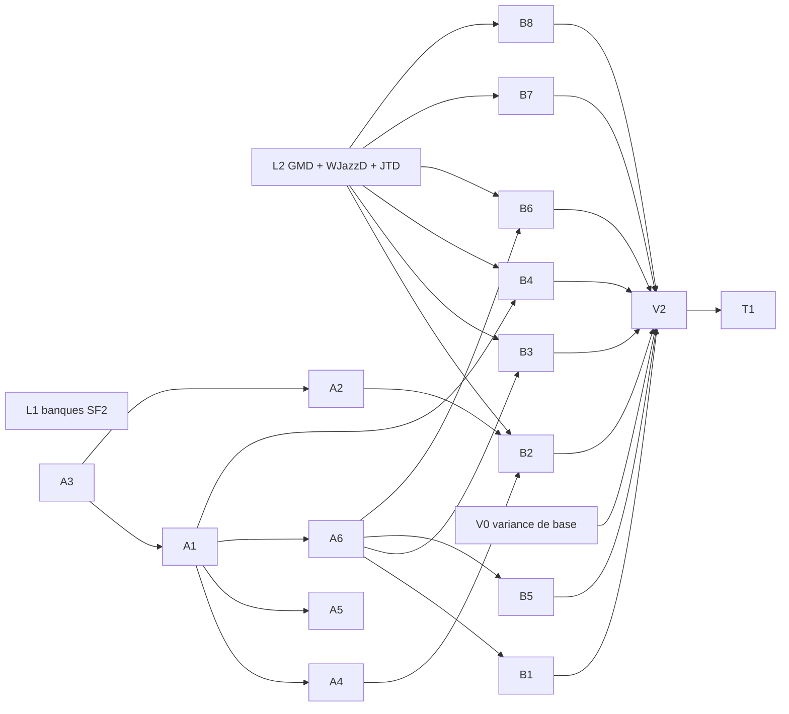

# Phase 019 — Bibliothèque d'accompagnements pour training, variance procédurale

**Statut** : planifiée le 2026-11-02, sous la constitution 4.5.0. Rien n'est lancé. Démarrage dans
une nouvelle session d'orchestration. Phase précédente : 018 (`specs/018-grille-et-moteur-neutre/plan.md`),
toutes tâches fusionnées et poussées ; restes reportés ici (section « Reprise de 018 »).

## Problème

Le moteur couvre les besoins du jeu. `harmonium_training` (client externe, constitution 4.5.0)
a besoin d'un **grand fond musical prêt à l'emploi** sous une grille d'accords fournie par
l'utilisateur, dans tous les styles d'iReal, avec **beaucoup de variance d'un tirage et d'un
chorus à l'autre** : un accompagnement qui sonne procédural, pas une boucle.

Aujourd'hui : un seul style sous grille (`wjazzd_swing`, E7), et la variance est bornée par le
moteur. Les comptes rendus de 018 listent les manques :

- comping et batterie tirés **mesure par mesure** : pas de phrase sur plusieurs mesures
  (`e5-e6-accompagnement.md`, Limites) ;
- **un seul instrument** par piste et par profil ;
- **forme et intensité identiques d'un chorus à l'autre** (P2, manque 4 : forme fixe par graine) ;
- basse sans deux temps, sans note répétée, sans croche de passage, sans chromatisme de passage
  (29 % des notes de passage de WJazzD), arrivée toujours sur la basse publiée
  (`profiles/wjazzd_swing/README.md`, Limites) ;
- une seule famille de voicings par profil, une seule tension de couleur choisie par priorité codée ;
- un seul rapport de swing par profil (0,71), trop swingué au-delà de 200 BPM ; pas de 3/4, 6/8
  ou feel ternaire testés sous grille.

## Décisions (propriétaire, 2026-11-02)

- **D1 — SoundFont seulement pour training.** Training n'inclut pas Odin (GPL) : tout ce qui
  sert training doit sonner sans `odin`. Odin reste permis pour les jeux. La palette dépend donc
  de la banque SoundFont : une banque plus riche que GeneralUser GS a été cherchée (L1), licence
  vérifiée. **Choix du propriétaire (2026-11-02) : GeneralUser GS reste la banque (option C de
  L1)** : aucune différence audible entre A, B et C, et ses sons sont préférés. La palette
  d'A2 et des profils B se construit donc sur les programmes GM de GeneralUser GS.
- **D2 — Tous les styles** d'iReal sont visés, sans priorité imposée ; l'ordre ci-dessous suit les
  dépendances et la qualité des sources.
- **D3 — Variance d'abord générique** (principes V et VIII) : chaque mécanisme est un algorithme
  générique activé en données, utile à tous les profils (jeux compris), jamais un `match` sur un
  style.
- **D4 — Pas de réharmonisation par défaut** : training note l'impro contre la grille de
  l'utilisateur ; l'accompagnement ne la contredit pas (accords de passage, substitutions : option
  désactivée par défaut si un style en a besoin).
- Rappels : notes des profils existants inchangées sauf décision explicite (principe I : rupture
  = `TUNING_VERSION` + goldens dans le même commit) ; corpus et licences selon le principe VII
  et `harmonium_lab/corpus/sources-jazz.md` (décisions F3 de 018 : NC/SA au labo seulement,
  mentions dans `[meta] corpus`, domaine public vérifié US et Canada).

## Tâches

### Recherche et labo

| Tâche | Contenu | Dépend de |
|---|---|---|
| **L1** | Banques SoundFont distribuables plus riches que GeneralUser GS pour training (piano acoustique, Rhodes, orgue, guitares jazz et nylon, contrebasse, basse électrique, kits baguettes **et balais**, percussions latines, cuivres) : tableau banque / URL / licence vérifiée (lien + date) / taille / qualité des programmes utiles / usage permis dans un produit fermé. Écoute comparative rendue sur `wjazzd_swing` et deux styles. **Choix du propriétaire.** | — |
| **L2** | Ingestion **complète** du Groove MIDI Dataset (tous les styles, pas seulement le jazz : compter funk, latin, afro-cubain, rock, reggae, soul, gospel, etc.), sous-ensembles WJazzD `BALLAD`, `TWOBEAT`, `LATIN`, `FUNK` (mesures de basse comme E7), JTD swing et micro-timing **par tempo**. Manifestes avec licence, mesures dans `references/`. Volume par style et fiabilité (peu de solos : 10 à 32). | — |
| **V0** | Ligne de base de variance : étendre `harmonium-lab seed-variety` (P2) avec la variance **par chorus** (16 graines × 16 chorus) et par couche (accords, basse, comping, batterie, orchestration) ; mesurer `wjazzd_swing` et les profils de jeu. Les seuils de V2 partent de ces chiffres. | — |

### Moteur — variance générique (en données, optionnelle)

| Tâche | Contenu | Dépend de |
|---|---|---|
| **A3** | **Arc sur plusieurs chorus** : numéro de chorus exposé au générateur ; par chorus, en données : intensité, densité, feel de basse (deux temps → marche), comping (clairsemé → dense), batterie (charleston → ride), breaks et stop-time, retombée finale ; pondéré et tiré par graine. Fonctionne sous grille utilisateur (une partie de N mesures répétée). | — |
| **A1** | **Phrases sur plusieurs mesures** : banques de motifs de 2, 4 ou 8 mesures pour comping et batterie (et basse si utile), choix selon la position dans la forme (mise en place avant un changement de section, relance de fin de phrase) ; remplace le tirage mesure par mesure quand il est activé. | A3 |
| **A2** | **Orchestration par graine et par chorus** : programmes SoundFont pondérés par piste (piano, guitare ou orgue au comping ; contrebasse ou basse électrique ; kit baguettes ou balais), changement possible au chorus ; sans Odin (D1). | A3 |
| **A4** | **Basse** : deux temps, notes répétées, croches de passage et notes fantômes, chromatisme de passage, arrivée sur une note d'accord autre que la basse, côté d'approche réglable ; calibrés sur WJazzD (E7). | A1 |
| **A5** | **Voicings** : drop 3, quartes, structures supérieures, tension de couleur tirée par graine dans celles de la qualité, dérive de registre bornée ; même conduite de voix (`theory::voice_leading`). | A1 |
| **A6** | **Swing et micro-timing selon le tempo** (courbe en données, mesurée dans JTD) ; subdivisions ternaires (shuffle 12/8), 3/4 et 6/8 vérifiés sous grille ; manques moteur éventuels des feels latins (clave, bossa, montuno) traités ici, génériques. | A1 |

### Styles (données) — un profil par source précise (principe VII)

| Tâche | Style iReal visé | Sources probables | Dépend de |
|---|---|---|---|
| **B1** | Swing rapide (variante de `wjazzd_swing`, swing selon le tempo) | WJazzD, JTD | A6 |
| **B2** | Ballade (balais, deux temps) | WJazzD `BALLAD` / `TWOBEAT`, GMD | A2, A4, L2 |
| **B3** | Bossa nova, samba, latin, afro-cubain | WJazzD `LATIN`, GMD latin | A6, L2 |
| **B4** | Even 8ths, funk | WJazzD `FUNK`, GMD funk | A1, L2 |
| **B5** | Jazz waltz (3/4) | dérivé du swing, WJazzD | A6 |
| **B6** | Blues shuffle (12/8) | GMD `blues/shuffle` (4 fichiers : trop peu, compléter) | A6, L2 |
| **B7** | New Orleans, second line | GMD `neworleans` (53 fichiers) | L2 |
| **B8** | Rock, pop, gospel, reggae et autres styles présents dans le GMD | GMD | L2 |

Chaque profil : grille par défaut (forme commune ou domaine public US et Canada), tous les
mécanismes A activés et calibrés, mentions de licence, tests de contrat, dumps dans
`harmonium_determinism`, page d'écoute. Les noms exacts se décident avec les sources (L2) ; aucun
nom générique (« jazz », « latin »).

### Preuve et livraison à training

| Tâche | Contenu | Dépend de |
|---|---|---|
| **V2** | Variance prouvée par style : `seed-variety` par chorus contre V0 (seuils écrits dans le compte rendu), distance au corpus quand il existe, écoute du propriétaire (page web, section par style, moments en minutes:secondes). | B* |
| **T1** | Table **style iReal → profil** (le champ `style` de `harmonium_practice/src/ireal.rs`) et doc d'usage pour training : grille utilisateur dans un profil `loop`, `[fixed_tonality]`, choix du profil, graine, nombre de chorus. Rien de training dans ce dépôt (constitution 4.5.0). | B* |

## Reprise de 018 (à traiter en début de phase)

- **Écoutes en attente** : E5/E6, E7 (`wjazzd_swing`, mixage corrigé le 2026-11-02 : batterie
  −9 dB), propositions P1 et P2. Intégrer aux profils de jeu ce que l'écoute valide (recommandations
  dans `p1-procedural-regles.md` et `harmonium_lab/references/p2-variete.md`). Page :
  `http://192.168.8.171:8080/#phase-018`.
- **`seek_to_bar_64_under_50ms`** : à la limite sur la CI après 018 (55 et 57 ms, puis passé) ;
  local 24 → 26 ms. **Décision du propriétaire (2026-11-02) : rien à changer** (ni le chemin de
  seek ni le seuil). Les tâches A ajoutent du travail par mesure : mesurer la durée du seek à
  chaque fusion et revenir au propriétaire si elle monte.

## Ordre

Vague 1 : **A3** (moteur, seul sur `harmonium_core`), **L1** (recherche), **L2 + V0** (labo).
Vague 2 : **S0** (graine du comping, constat V0), puis **A1**, puis **A2** (moteur, à la suite).
Vague 3 : **A4 + A5** (un agent) et **A6**
(fichiers distincts ; l'orchestrateur gère les conflits). Vague 4 : profils **B1–B8** en
parallèle (données, un dossier de profil par agent ; un manque moteur découvert est signalé et
traité par un seul agent moteur). Vague 5 : **V2**, **T1**.

## Acceptation commune (toute tâche moteur)

- Mécanisme optionnel en données ; profils existants : dumps `harmonium_determinism` identiques à
  `main`, rendus `harmonium-cli --export --record-wav` identiques (CLI lancé depuis le checkout
  principal, pour `assets/`), sinon rupture assumée (bump `TUNING_VERSION`, goldens, référence D2
  du CLI `harmonium_cli/tests/fixtures/profile_d2_main.json`, liste des profils touchés).
- Tests de contrat sur le flux de snapshots (principe VI) ; temps réel inchangé (génération côté
  compositeur, `ArrayVec` sur la pile) ; déterminisme (ChaCha8, entiers `u64`).
- `cargo test --workspace`, `-p harmonium --features odin`, `-p harmonium_bevy`, `cargo check -p
  harmonium_studio`, wasm des crates moteur, `harmonium_determinism/scripts/run.sh` (natif = wasm),
  clippy sans avertissement nouveau, fmt ; durée du seek mesurée.
- Le profil ou la fixture qui exerce le mécanisme sonne **sans `odin`** (D1).

## Exécution (rappel pour la reprise)

- Agents : omp personnel. **Codex** `openai-codex/gpt-6.1-sol` (limite hebdomadaire atteinte le
  2026-11-01, retour vers le 2026-11-04 ; au lancement, refuser la proposition de « reset »
  par Échap) ; **abonnement Claude** permis pour **Sonnet ou Haiku seulement**
  (`anthropic/claude-sonnet-5-5`, `anthropic/claude-haiku-5-5`), jamais Opus ; `anthropic-api` sans
  crédit ; OpenRouter à sec.
- Overlays à recréer dans `/tmp/harmonium-019/` (le `/tmp` ne survit pas) :
  - `codex-sub.yml` : `modelRoles` default/slow/plan = `openai-codex/gpt-6.1-sol`, smol =
    `anthropic/claude-haiku-5-5` ; `retry` : `modelFallback: true`, `fallbackOn: usage-limit`,
    `fallbackRevertPolicy: cooldown-expiry`, chaînes vers `anthropic/claude-sonnet-5-5` ;
  - `anthropic-sub.yml` : default/slow/plan = `anthropic/claude-sonnet-5-5`, smol =
    `anthropic/claude-haiku-5-5`, relais vers `openai-codex/gpt-6.1-sol`.
- Lancement : `orca worktree create --repo id:<repo> --name <tâche> --no-parent --base-branch main
  --setup skip --json`, puis `orca terminal create --worktree path:<wt> --title "019 <tâche>"
  --command 'env -u OMP_PROFILE -u PI_PROFILE -u ALL_PROXY -u http_proxy -u https_proxy
  ~/.local/bin/omp --profile default --model <modèle> --config <overlay> @<brief>'`. Vérifier
  l'écran après une minute (oh-my-zsh peut avaler la commande ; une coupure réseau arrête l'agent :
  le relancer par `orca terminal send`). Repos Orca : harmonium `2e17ab66-…`, harmonium_lab
  `7fd311cb-…` (`orca repo list --json`).
- Briefs : l'agent commite sur sa branche seulement, ne fusionne ni ne pousse ; l'orchestrateur
  revérifie lui-même (dumps contre `main`, rendus WAV, suites), fusionne `--no-ff`, met à jour ce
  plan, supprime le worktree, pousse quand le propriétaire le demande et surveille la CI
  (`gh run list -R estran-studio/harmonium`).
- Les profils distribués sont compilés dans le binaire : reconstruire le CLI après un changement
  de profil avant de rendre avec `--style`.
- Ressources du studio web : un nouveau preset ou une nouvelle banque nommés par un profil doivent
  entrer dans une release (`harmonium_studio/scripts/web_resources.py stage`, puis `gh release
  create`, puis commit de `web-resources.json`), sinon le déploiement du site échoue
  (`check-profiles`). Dernière release : `studio-resources-2`.
- Ne pas toucher le worktree `s6-studio-live` (autre session).
- Écoute : page LAN `http://192.168.8.171:8080/` (servie depuis `harmonium_lab/corpus`,
  `index.html` non suivi ; une section par lot, clips en MP3 320 k sous `corpus/ecoute_0xx/`,
  gitignorés) ; studio `make studio`. Donner les moments à écouter en minutes:secondes ; mesurer
  le mixage (LUFS par piste en solo) avant de publier un rendu.

## État

| Tâche | État | Compte rendu |
|---|---|---|
| Reprise 018 (écoutes, seek) | **close** (2026-11-02). Seek : rien à changer. Écoute E5/E6, E7 : **validée** (« un jazz très très basique et statique » : base acceptée, la variance de 019 est le manque). P1/P2 : **intégration demandée** selon les recommandations → tâche **R1** | — |
| **R1** | intégration P1/P2 aux profils de jeu (`nt_desert`, `isaac_basement`, `isaac_burning`, `isaac_downpour` ; rien pour `isaac_cellar`) : **fusionnable, rupture `TUNING_VERSION` 25** (quatre profils changent : 24 dumps sur 98 ; les douze autres profils identiques à `main` ; natif = wasm 98 / 98 ; seek 25,2 → 25,1 ms). Variété en hausse sur chaque couche intégrée (basse d'`isaac_downpour` : par mesure seulement) ; distance dans la tolérance partout **sauf l'audio d'`isaac_downpour` (−2,1, imputé à son groove de batterie de densité 1, gardé sur décision du propriétaire)**. Écoute : `#phase-019-r1` | [`r1-integration-p1-p2.md`](r1-integration-p1-p2.md) |
| L1 | terminée ; **choix du propriétaire : C, GeneralUser GS conservée** (aucune différence entendue entre A, B, C ; sons de GeneralUser GS préférés) | [`l1-banques-soundfont.md`](l1-banques-soundfont.md) (écoute : `#phase-019-l1`) |
| L2 | fusionnée au labo (`0ad313e`) : GMD complet par style, WJazzD `BALLAD`/`TWOBEAT`/`LATIN`/`FUNK`, JTD swing par tempo (0,720 → 0,591 de < 120 à > 240 BPM) ; manques moteur listés (§ 6) pour A1/A6 | `harmonium_lab/references/l2-ingestion.md` |
| V0 | fusionnée au labo (`d01d684`) : `seed-variety --chorus`, ligne de base sur 8 profils, seuils V2 proposés | `harmonium_lab/references/v0-variance/README.md` |
| A3 | en cours (session reprise après le crash du 2026-11-02 ; travail non commité intact) | — |
| **S0** (nouveau) | **graine du comping** : sur `wjazzd_swing` à `main`, 8 graines × 24 mesures → piano 2 séquences distinctes (une par grille par défaut), basse 4, batterie 5 (constat V0, reproduit par l'orchestrateur). Le comping ne dépend pas de la graine de session à grille égale. À corriger avant A1 (moteur, après fusion d'A3) | — |
| A1, A2, A4, A5, A6 | en attente | — |
| B1–B8 | en attente | — |
| V2, T1 | en attente | — |
