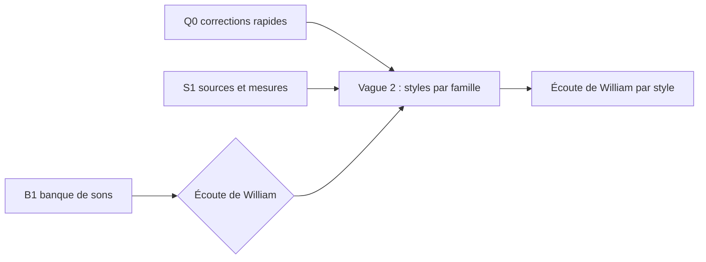

# Phase 020 — Qualité des styles d'accompagnement

**Statut** : ouverte le 2026-11-07. Vague 1 lancée (Q0, S1, B1). Phase précédente : 019
(`specs/019-bibliotheque-accompagnements/plan.md`).

## Problème

Écoute de William après 019 (2026-11-07) : **les nouveaux styles sont « reconnaissables mais pas vraiment
bons comparés au traditionnel »**. Ils comptent pourtant pour `harmonium_training`, qui doit offrir des sons
différents. Ce qui sonne mal, selon William : **les sons, le rythme des accords, la basse, la batterie et la
mise en place** (le mixage n'est pas cité).

Constats mesurés par l'orchestrateur (MIDI de 48 mesures, graine 3, `gmd_rock`, `gmd_funk`,
`gmd_latin_brazilian_bossa`, `gmd_pop`, `wjazzd_swing`, `reel_quebecois`) :

- **Basse et comping des `gmd_*` sont des règles de métier**, jamais mesurées ni écoutées (D5 de 019) ; les
  trads reposent sur 574 airs mesurés par tradition et quatre phases d'écoute.
- Nuances plates : écart-type des vélocités de basse et d'accords de 6 à 9 (sur 127), contre 21 à 28 pour la
  batterie mesurée.
- `gmd_rock` en variante `swing_leger` (graines 3 et 5 sur 5) : croches en contretemps ~50 ms en retard
  pendant que les doubles croches restent droites. Seuls `gmd_rock` et `gmd_hiphop` ont cette variante.
- Batterie de `gmd_rock` plus décousue que les batteurs du GMD : mesure la plus fréquente 9 % des mesures
  (GMD rock : médiane 23 %).

## Décisions de William (2026-11-07)

- **E1 — Styles prioritaires** : swing, ballade jazz, valse jazz, bossa, samba / baião, afro-cubain, funk,
  soul / R&B, reggae, rock, pop, blues shuffle (12). Hors liste, après : hip-hop, disco, afrobeat,
  second line.
- **E2 — Tout est à reprendre** : sons, rythme des accords, basse, batterie, mise en place.
- **E3 — Sources : « le plus de sources possible, toutes »** : tout corpus utile est permis, y compris ceux
  de provenance incertaine (Lakh MIDI, Slakh), **à condition de n'en garder que des statistiques** (comme le
  GMD) : aucune note de corpus copiée dans un profil, provenance et licence notées au manifeste (principe VII).
- **E4 — Banque de sons : chercher une banque libre plus riche** (D1 de 019 rouvert ; le choix final suit
  l'écoute de William, comme L1). Training reste **sans Odin**.
- **E5 — Corrections rapides lancées tout de suite** (Q0).
- Reconduits de 019 : D3 (variance générique, en données), D4 (pas de réharmonisation), D7 (revues dans le
  studio, liens `harmonium://`, seuls l'orchestrateur et William ouvrent le studio), D8 (agents sur
  `ovh-inner`, 3 à la fois, omp en Sonnet, jamais Opus). **Changement par rapport à D5 de 019 : chaque style
  repris est écouté par William avant d'être déclaré fini.**

## Tâches

| Tâche | Contenu | Vague |
|---|---|---|
| **Q0** | Corrections sans dépendance, sur les 12 styles d'E1 : retrait de `swing_leger` des styles droits ; accents et notes fantômes du comping ; groove de batterie tenu par phrase, au plus près des statistiques du GMD ; mise en place (asynchronies basse / grosse caisse et comping / caisse claire). `TUNING_VERSION` 34. | 1 |
| **S1** | Sources (labo) : inventaire exhaustif des corpus de basse, de comping (guitare, piano) et de batterie par style, licences vérifiées à la source ; ingestion des corpus utiles en cache vérifié (manifeste, SHA256) ; mesures par style des statistiques qui manquent aux profils. | 1 |
| **B1** | Banque de sons : candidats libres de redistribution (jeu fermé, web), centrés sur les programmes faibles (guitares électriques, clavinet, piano électrique, orgue, basses électriques, cuivres, kits) ; chargement par le synthé du moteur, taille SF3 ; banques prêtes à écouter dans le studio. Décision de William après écoute. | 1 |
| **Jazz** | `wjazzd_swing`, `wjazzd_ballad`, `gmd_jazz_waltz` sur les mesures de S1. | 2 |
| **Latin** | bossa, samba / baião, afro-cubain. | 2 |
| **Groove** | funk, soul, reggae. | 2 |
| **Rock / pop** | rock, pop, blues shuffle. | 2 |

La vague 2 se planifie quand Q0 et S1 sont livrées et que William a choisi la banque (B1).

## Acceptation commune (toute tâche moteur)

`cargo test --workspace -q --no-fail-fast` ; `cargo test -p harmonium --features odin` ;
`cargo test -p harmonium_bevy` ; `cargo check -p harmonium_studio` ; `harmonium_determinism/scripts/run.sh`
(natif = wasm) ; `cargo +nightly fmt --all --check` ; clippy sans avertissement nouveau. Profils touchés :
`TUNING_VERSION` réservé, dumps et goldens régénérés, autres profils identiques à `main`. Compte rendu dans
ce dossier, liens d'écoute `harmonium://open?profile=<id>&seed=<n>`.

## État

| Tâche | État |
|---|---|
| Q0 | **livrée** (2026-11-07, reprise sur le Mac), branche `wquintal/q0-corrections-rapides`, `TUNING_VERSION` 34 : [compte rendu](q0-corrections-rapides.md) ; en attente de l'écoute de William |
| S1 | lancée (2026-11-07), `ovh-inner`, labo, branche `wquintal/s1-sources` |
| B1 | lancée (2026-11-07), `ovh-inner`, branche `wquintal/b1-banque-sons` |
